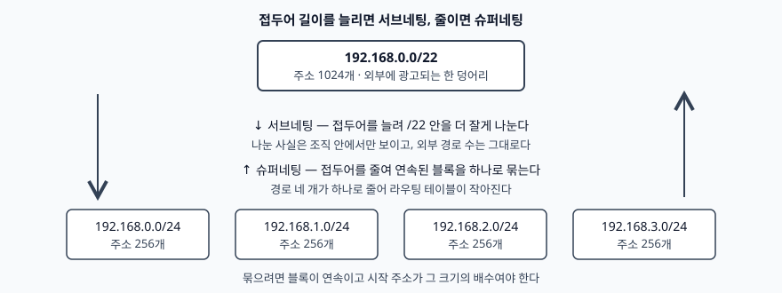
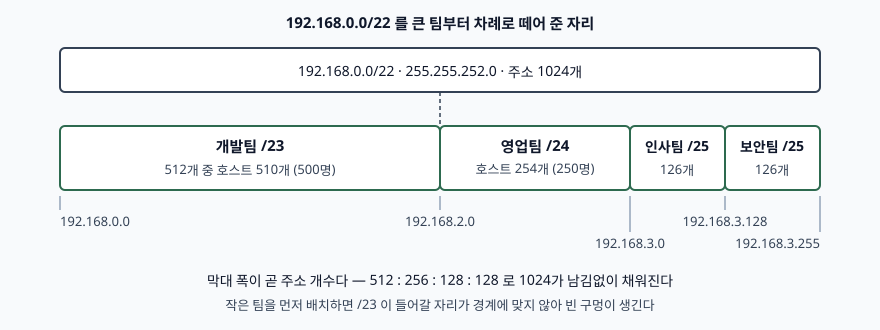

기출문제. 네트워크 서브네팅과 관련해 두 가지를 물었다. 하나는 슈퍼네팅과
서브네팅의 개념이고, 다른 하나는 `192.168.0.0/22` 대역을 인사팀 125명·영업팀
250명·보안팀 125명·개발팀 500명이 쓸 수 있도록 VLSM 네 개로 나누어 각각의
서브넷 마스크와 할당 가능한 호스트 IP 대역을 구하는 것이다.

계산 문항이므로 아래 답안의 분할 결과는 파이썬 `ipaddress` 모듈로 직접 계산해
빈틈·겹침·범위 이탈을 검산했다. 검산 코드와 출력은 [`code/`](code/)에 있다.

---

# Ⅰ. 개요

IPv4 주소 체계는 두 방향의 압력을 동시에 받았다. 하나는 주소가 모자란다는 것이고,
다른 하나는 경로가 너무 많아졌다는 것이다. 서브네팅과 슈퍼네팅은 이 두 압력에
각각 대응해 나온 **같은 기계의 반대 방향 연산**이다. 두 연산 모두 "주소를 접두어
길이와 함께 다룬다"는 동일한 규약 위에 서 있고, 접두어를 늘리면 서브네팅,
줄이면 슈퍼네팅이 된다.

서브네팅은 1985년 RFC 950이 표준화했다. 주소를 네트워크·서브넷·호스트의 3단으로
해석해, 받아 둔 네트워크 번호 하나를 조직 안에서 여러 물리 네트워크로 나눠 쓴다.
슈퍼네팅은 1992년 RFC 1338이 제안하고 CIDR로 이어져 현행 RFC 4632가 된 쪽이다.
연속된 여러 블록을 접두어를 줄여 한 경로로 묶어 광고한다.

이 문제가 묻는 VLSM은 서브네팅 쪽의 확장이다. 한 블록 안에서 **세그먼트마다 다른
접두어 길이**를 쓰는 것으로, 인원 편차가 큰 조직에 고정 길이 서브넷을 적용했을 때
생기는 낭비를 없앤다. 이 문항의 네 팀은 500명에서 125명까지 네 배 차이가 나므로,
고정 길이로 나누면 가장 큰 팀에 맞춘 /23 네 개가 필요해 /21이 있어야 한다.
주어진 것은 /22뿐이므로 VLSM 외에는 답이 없다.

# Ⅱ. 슈퍼네팅과 서브네팅 개념

## 가. 서브네팅 — 접두어를 늘려 안에서 나눈다

**서브네팅은 하나의 네트워크 번호를 접두어 길이를 늘려 여러 개의 논리적 하위
네트워크로 분할하는 기법이다.** RFC 950은 이를 인터넷 주소 지정에 세 번째 단계를
더하는 것으로 설명하고, 나뉜 각 구역을 그 네트워크의 논리적으로 보이는 하위
구역이라고 정의한다(§1).

도입 동기는 네 가지다(§1).

1. LAN 기술이 섞여 있어 한 매체로 묶을 수 없는 경우
2. 케이블 길이와 전기적 제약으로 한 세그먼트에 다 담을 수 없는 경우
3. 많이 통신하는 호스트들을 갈라 혼잡을 줄이려는 경우
4. 물리적으로 떨어진 사이트를 잇는 경우

핵심은 **네 번째가 아니라 그 뒤에 있는 이유**다. 케이블마다 새 네트워크 번호를
받아 오면 인터넷 전체의 라우팅 테이블이 그만큼 커진다. 서브네팅은 번호를 더
받지 않고 내부에서 해결함으로써, 조직의 분할이 외부 라우팅에 전혀 보이지 않게
한다.

판정 기계는 **주소 마스크**다. RFC 950이 정한 호스트 판정 절차(§2.2)는, 목적지
주소와 자기 주소를 각각 마스크와 AND 해서 결과가 같으면 같은 서브넷으로 보아
직접 보내고, 다르면 게이트웨이로 넘긴다. 마스크의 상위 비트는 연속이어야 하며,
RFC 4632도 마스크가 연속이어야 한다는 요건(§5.1)을 그대로 유지한다.

서브네팅의 비용은 **블록마다 주소 두 개를 잃는다**는 점이다. 각 서브넷의 첫
주소는 네트워크 식별에, 마지막 주소는 브로드캐스트에 예약되므로 호스트에 줄 수
있는 것은 `블록 크기 − 2`다. 잘게 쪼갤수록 이 손실의 비율이 커진다.

## 나. 슈퍼네팅 — 접두어를 줄여 밖으로 묶는다

**슈퍼네팅은 연속된 복수의 네트워크 블록을 접두어 길이를 줄여 하나의 경로로
집약해 광고하는 기법이다.** RFC 1338은 이를 주소 할당을 서비스 제공자에게
계층적으로 위임하고, 그 위에서 라우팅 정보를 집약하는 두 부분의 계획으로 제시한다(§2).

배경이 된 문제는 두 가지다(§1).

1. **클래스 체계의 크기 불일치** — 클래스 C는 너무 작고 클래스 B는 널리
   할당하기엔 너무 크다. 그 결과 200명 조직이 클래스 B를 받아 6만여 주소를
   놀리는 일이 벌어졌다
2. **라우팅 테이블 증가** — 클래스 C를 여러 개 주면 경로 수가 그만큼 늘어난다

슈퍼네팅은 두 번째를 푼다. 제공자가 큰 블록을 받아 고객에게 잘라 주고, 외부에는
그 큰 블록 하나만 광고하면 고객 수와 무관하게 경로는 한 줄이다. RFC 4632는
집약을 패킷 교환망에서 라우팅 상태를 줄이는, 널리 이해된 유일한 방법이라고 적는다(§4.1).

성립 조건이 까다롭다.

- **블록이 연속**이어야 한다. 중간이 비면 한 접두어로 덮을 수 없다
- **시작 주소가 묶을 크기의 배수**여야 한다. `192.168.1.0`에서 시작하는 네 개의
  /24는 /22로 묶이지 않는다
- **라우팅 프로토콜이 접두어 길이를 함께 실어 날라야** 한다. RFC 4632는 주소의
  선행 비트로 마스크를 추론할 수 없게 되었으므로 마스크나 접두어 길이를
  명시적으로 전달해야 한다고 적는다(§5). 클래스풀 프로토콜에서는 성립하지 않는다
- **다중 귀속(multihomed) 목적지는 집약할 수 없다.** RFC 4632의 집약 규칙 1(§5.1)은
  이런 목적지를 반드시 명시적으로 광고하도록 요구한다. 규칙 2는 집약 경로에는
  맞지만 더 구체적인 경로가 없는 패킷을 버리도록 해 전달 루프를 막는다

RFC 1338은 스스로의 한계도 밝힌다. 32비트 주소 공간 자체의 고갈은 풀지 않으며,
장기 해법이 나올 때까지의 단기 조치라는 것이다(§1).

## 다. 두 방향의 대비



> **출처**: [RFC 4632 §3.1 Prefix Notation / §4.1 Aggregation](https://www.rfc-editor.org/rfc/rfc4632.html#section-3.1)

| 구분 | 서브네팅 | 슈퍼네팅 |
|---|---|---|
| 접두어 길이 | 늘린다 (/22 → /23·/24·/25) | 줄인다 (/24 넷 → /22) |
| 블록 수 | 하나를 여럿으로 | 여럿을 하나로 |
| 보이는 범위 | 조직 내부 | 조직 외부, 인터넷 라우팅 |
| 노리는 효과 | 브로드캐스트 도메인 축소, 보안 경계 분리 | 라우팅 테이블 항목 수 감소 |
| 치르는 비용 | 블록마다 주소 2개 손실 | 주소를 연속으로 받아야 함, 사업자 변경 시 재번호 |
| 전제 조건 | 호스트·라우터가 마스크를 인지 | 라우팅 프로토콜이 접두어 길이를 전달 |
| 근거 문서 | RFC 950 (1985) | RFC 1338 (1992) → RFC 4632 (2006) |

같은 주소에 대해 두 연산은 **서로의 역(逆)이 아니다.** 서브네팅한 결과를 다시
묶으면 원래 블록이 되지만, 집약은 "묶을 수 있는 배치로 미리 할당해 두었을 때만"
가능하다. 그래서 설계 순서가 중요하다. 아래 Ⅲ의 분할이 큰 팀부터 차례로 붙여
나가는 이유도 여기에 있다.

# Ⅲ. 192.168.0.0/22 의 VLSM 4분할

## 가. 소요 주소 산정과 배치 순서

기준 대역은 `192.168.0.0/22`다. 마스크는 `255.255.252.0`, 주소는 2^(32−22) = 1024개로
`192.168.0.0`부터 `192.168.3.255`까지다.

각 팀에 필요한 주소는 **인원 + 2**다. 네트워크 주소와 브로드캐스트 주소가 한
자리씩 빠지기 때문이다. 이 값을 넘는 가장 작은 2의 거듭제곱을 찾으면 접두어
길이가 정해진다.

| 팀 | 인원 | 필요 주소 | 수용 블록 | 접두어 | 호스트 수 |
|---|---:|---:|---:|---|---:|
| 개발팀 | 500 | 502 | 512 | /23 | 510 |
| 영업팀 | 250 | 252 | 256 | /24 | 254 |
| 인사팀 | 125 | 127 | 128 | /25 | 126 |
| 보안팀 | 125 | 127 | 128 | /25 | 126 |

합이 512 + 256 + 128 + 128 = **1024**로 /22를 정확히 채운다. 여유가 한 주소도
남지 않는 분할이고, 이는 뒤의 고려사항에서 다시 짚는다.

배치는 **큰 블록부터** 한다. 이 순서가 VLSM의 핵심이다. 모든 블록은 자기 크기의
배수가 되는 주소에서만 시작할 수 있는데(정렬 제약), 작은 것을 먼저 놓으면 큰
블록이 들어갈 경계가 깨진다. 인사팀 /25를 `192.168.0.0`에 먼저 놓았다고 하자.
그러면 개발팀 /23이 시작할 수 있는 다음 자리는 512의 배수인 `192.168.2.0`이고,
그 앞의 `192.168.0.128`부터 `192.168.1.255`까지 384개가 /23의 뒤편으로 밀려
조각으로 남는다. 남은 공간은 충분해 보여도 경계가 맞지 않아 쓸 수 없다.

## 나. 분할 결과



> **출처**: [RFC 4632 §3.1 Prefix Notation](https://www.rfc-editor.org/rfc/rfc4632.html#section-3.1), [RFC 1878 Variable Length Subnet Table For IPv4](https://www.rfc-editor.org/rfc/rfc1878.html)

| 팀 | 네트워크 주소 | 서브넷 마스크 | 할당 가능한 호스트 IP 대역 | 브로드캐스트 |
|---|---|---|---|---|
| 개발팀 | 192.168.0.0/23 | 255.255.254.0 | 192.168.0.1 ~ 192.168.1.254 | 192.168.1.255 |
| 영업팀 | 192.168.2.0/24 | 255.255.255.0 | 192.168.2.1 ~ 192.168.2.254 | 192.168.2.255 |
| 인사팀 | 192.168.3.0/25 | 255.255.255.128 | 192.168.3.1 ~ 192.168.3.126 | 192.168.3.127 |
| 보안팀 | 192.168.3.128/25 | 255.255.255.128 | 192.168.3.129 ~ 192.168.3.254 | 192.168.3.255 |

마스크 값은 접두어 길이를 그대로 옮긴 것이다. /23은 상위 23비트가 1이므로 셋째
옥텟이 `11111110`, 곧 254가 된다. /25는 넷째 옥텟 상위 1비트만 1이므로 128이다.

## 다. 검산

분할이 맞는지는 세 가지로 본다. **기준 대역을 벗어나지 않는가, 블록 사이에
빈틈이나 겹침이 없는가, 각 블록의 수용량이 인원 이상인가.** 손으로 비트를 센
결과를 믿지 않고 `ipaddress` 모듈로 다시 계산했다.

```python
def required_prefix(hosts):
    """호스트 n 대를 수용하는 가장 작은 접두어 길이."""
    size, bits = 1, 0
    while size < hosts + 2:        # 네트워크·브로드캐스트 주소 두 자리를 더한다
        size *= 2
        bits += 1
    return 32 - bits


def allocate(base, demands):
    """큰 블록부터 차례로 떼어 준다. cursor 는 다음에 쓸 첫 주소."""
    cursor = int(base.network_address)
    result = []
    for name, hosts in sorted(demands, key=lambda d: -d[1]):
        block = ipaddress.IPv4Network((cursor, required_prefix(hosts)))
        result.append((name, hosts, block))
        cursor += block.num_addresses
    return result
```

전체 코드는 [`code/vlsm.py`](code/vlsm.py)에 있다. 실행 기록은
[`code/output.txt`](code/output.txt)다.

```text
[검산]
할당 합계    1024 / 1024 주소
남는 주소    0
마지막 주소  192.168.3.255 (기준 대역 끝 192.168.3.255)

[마스크 AND 판정]
/23 192.168.0.5   -> 192.168.0.0   | 192.168.1.200 -> 192.168.0.0   | 같은 서브넷
/24 192.168.0.5   -> 192.168.0.0   | 192.168.1.200 -> 192.168.1.0   | 다른 서브넷 -> 게이트웨이로

[슈퍼네팅 — 묶는 방향]
묶기 전  192.168.0.0/24, 192.168.1.0/24, 192.168.2.0/24, 192.168.3.0/24
묶은 뒤  192.168.0.0/22
경계가 어긋나면 192.168.0.0/23, 192.168.2.0/24, 192.168.5.0/24
```

세 번째 블록이 (가)에서 설명한 두 연산을 한 화면에서 보여 준다. `192.168.0.0`부터
연속된 /24 네 개는 /22 하나로 줄지만, 마지막을 `192.168.5.0`으로 바꾸면 경계가
어긋나 세 개로 남는다. 집약은 **배치를 미리 그렇게 해 두었을 때만** 성립한다.

마스크 AND 판정은 개발팀 /23의 효과를 보인다. `192.168.0.5`와 `192.168.1.200`은
셋째 옥텟이 달라 /24에서는 서로 게이트웨이를 거쳐야 하지만, /23에서는 같은
브로드캐스트 도메인에 들어 직접 통신한다. 개발팀 500명이 한 세그먼트에 묶이는
근거가 이 한 줄이다.

# Ⅳ. 적용 시 고려사항

**첫째, 서브넷 0번과 전부 1 서브넷의 사용 가능 여부를 확인한다.** 이 분할의
인사팀 `192.168.3.0/25`는 셋째 단계에서 서브넷 비트가 모두 0인 블록이고, 보안팀
`192.168.3.128/25`는 모두 1인 블록이다. RFC 950은 이 두 값을 실제 물리 서브넷에
할당하지 말라고 권고했다(§2.1). 그러나 RFC 1878은 그 관행을 폐기된 것으로 명시하고,
현대 소프트웨어는 정의 가능한 모든 네트워크를 쓸 수 있다고 적는다. 지금의 장비는
문제가 없지만, 구형 장비나 `ip subnet-zero`를 끈 설정이 섞여 있으면 이 분할은
그 자리에서 깨진다. **설계 전에 장비 설정을 확인해야 한다.**

**둘째, 여유를 0으로 둔 분할은 증설을 감당하지 못한다.** 1024개를 남김없이 쓰는
이 답은 문항이 요구한 조건을 정확히 만족하지만, 실무 설계로는 위험하다. 어느 팀에
한 명만 늘어도 블록 하나를 키워야 하고, 그러면 그 뒤의 모든 블록이 밀려 전면
재설계가 된다. 실제로는 각 팀 블록을 한 단계 크게 잡거나, 상위 블록을 /21로 받아
절반을 비워 둔다.

**셋째, 라우터 간 연결 구간의 주소가 이 1024개 안에 없다.** 네 팀을 잇는
라우터끼리의 점대점 링크에도 주소가 필요한데, 그 몫이 한 자리도 남지 않았다.
점대점 구간은 호스트 두 개면 되므로 /30이면 충분하지만, 그 /30을 떼려면 어느 팀
블록을 줄여야 한다. **문항의 답과 실제 구축 설계는 이 지점에서 갈린다.**

**넷째, 각 서브넷의 첫 사용 가능 주소를 게이트웨이에 주는 관행을 반영한다.**
그러면 단말이 쓸 수 있는 수는 표의 값에서 다시 하나씩 줄어든다. 영업팀 /24는
254 − 1 = 253으로 250명을 받고도 세 자리가 남지만, 인원이 253을 넘는 순간 /24로는
불가능해진다. 표의 "호스트 수"를 곧 "수용 인원"으로 읽으면 안 된다.

**다섯째, 집약 가능성을 염두에 두고 순서를 정한다.** 지금의 분할은 네 블록이
연속이고 시작이 `192.168.0.0`이므로 `192.168.0.0/22` 한 줄로 되묶인다. 팀을
임의의 빈자리에 흩뿌리면 내부적으로는 문제가 없어도 외부 광고를 한 줄로 줄일 수
없다. 서브네팅 설계가 슈퍼네팅 가능성을 결정한다.

# Ⅴ. 결론

서브네팅과 슈퍼네팅은 접두어 길이를 늘리고 줄이는 같은 연산의 두 방향이다.
서브네팅은 받아 둔 블록을 조직 안에서 나눠 번호를 더 받지 않게 하고, 슈퍼네팅은
연속 블록을 한 경로로 묶어 라우팅 테이블을 줄인다. 전자는 내부에만 보이고 후자는
외부에만 뜻이 있으므로, 설계자는 두 층을 함께 보아야 한다.

`192.168.0.0/22`의 네 팀 분할은 인원 + 2를 2의 거듭제곱으로 올림해 /23·/24·/25·/25를
얻고, 큰 것부터 붙여 1024개를 정확히 채운다. 개발팀 `192.168.0.0/23`, 영업팀
`192.168.2.0/24`, 인사팀 `192.168.3.0/25`, 보안팀 `192.168.3.128/25`이며 마스크는
각각 `255.255.254.0`, `255.255.255.0`, `255.255.255.128`, `255.255.255.128`이다.

다만 이 답은 여유가 없고 라우터 간 링크 주소가 빠져 있다. 시험에서 묻는 것은
비트 계산의 정확성이지만, 실무 설계에서 같은 표를 그대로 쓰면 첫 증설에서 무너진다.
**정렬 제약과 배치 순서를 이해했는지가 이 문제의 실제 평가점이다.**

> 개념 정리: [VLSM — 가변 길이 서브넷 마스크](../../network/2026-10-28-vlsm-variable-length-subnet-mask/index.md)
>
> 개념 정리: [CIDR와 라우팅 집약](../../network/2026-10-28-cidr-and-route-aggregation/index.md)

끝

---

## 답안 작성 메모

**무엇부터 쓸 것인가.** (나)의 계산표를 먼저 완성한다. (가)의 개념은 아는 만큼
늘릴 수 있지만 계산은 맞거나 틀리거나 둘 중 하나이고, 틀리면 그 항목의 배점을
전부 잃는다. 개요를 짧게 적고 바로 계산으로 들어가 표를 채운 뒤, 남는 시간으로
(가)를 살찌우는 순서가 안전하다.

**계산에서 틀리는 자리는 셋이다.**

1. **인원 + 2를 빼먹는 것.** 250명에 /24가 필요한 이유는 252개를 담아야 하기
   때문이다. 250만 보고 256을 떠올리면 맞지만, 500명에서 510을 담으려다 /23 대신
   /24를 고르면 그대로 틀린다
2. **큰 것부터 배치하지 않는 것.** 문항이 인사·영업·보안·개발 순으로 열거했다고
   그 순서로 주소를 떼면 경계가 어긋난다. 열거 순서와 배치 순서는 다르다
3. **마스크 변환.** /23 → 255.255.254.0, /25 → 255.255.255.128을 바로 쓸 수
   있어야 한다. 셋째·넷째 옥텟에서 멈칫하면 시간을 많이 잃는다

**시간이 모자라면 버릴 것.** (가)의 RFC 조문 인용과 슈퍼네팅 성립 조건의 세부
항목을 줄인다. 비교표 한 장은 반드시 남긴다 — 개념 대비는 표로 쓰는 것이 가장
빠르고 채점자가 항목을 세기도 쉽다. 반대로 (나)의 네 행짜리 결과표는 어떤
경우에도 완성한다.

**점수가 갈리는 지점.** 계산을 맞힌 답안은 많다. 갈리는 곳은 **왜 큰 것부터
배치해야 하는지**를 정렬 제약으로 설명했는가, 그리고 **분할 설계가 집약
가능성을 결정한다**는 두 방향의 연결을 짚었는가다. 이 두 줄이 있으면 (가)와
(나)가 따로 노는 답안과 구분된다. 고려사항에서는 서브넷 0번 문제와 여유 0 설계의
위험을 들면 실무 감각이 드러난다.

**모식도.** 시간이 빠듯하면 Ⅱ의 방향 도식을 버리고 Ⅲ의 분할 막대만 그린다.
막대 하나에 경계 주소 네 개만 적어도 채점자가 분할을 한눈에 확인한다. 폭을
512 : 256 : 128 : 128 비율로 그리는 것만 지키면 된다.

## 참고 자료

- [RFC 950 — Internet Standard Subnetting Procedure (1985)](https://www.rfc-editor.org/rfc/rfc950.html)
- [RFC 1338 — Supernetting: an Address Assignment and Aggregation Strategy (1992)](https://www.rfc-editor.org/rfc/rfc1338.html)
- [RFC 1878 — Variable Length Subnet Table For IPv4 (1995)](https://www.rfc-editor.org/rfc/rfc1878.html)
- [RFC 4632 — Classless Inter-domain Routing (CIDR): The Internet Address Assignment and Aggregation Plan, BCP 122 (2006)](https://www.rfc-editor.org/rfc/rfc4632.html)
- [Python 표준 라이브러리 — ipaddress](https://docs.python.org/3/library/ipaddress.html)
