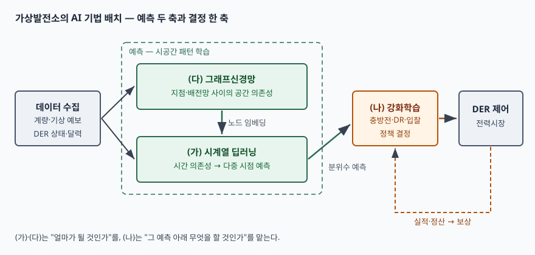

기출문제가 가상발전소(VPP)가 전력수요 예측에 AI를 쓴다는 전제를 깔고, 시계열 딥러닝·
강화학습·그래프신경망 세 가지를 설명하라고 묻는다. 세 기법을 교과서식으로 하나씩
정의하면 분량은 채워지지만, 그러면 "가상발전소"라는 앞머리가 답안에서 사라진다.
채점자가 보는 것은 **세 기법이 가상발전소의 어느 자리에 들어가는가**다.

이 문항에는 함정이 하나 있다. 강화학습은 그 자체로는 **예측 기법이 아니다.** 예측은
"다음 시간대 수요가 얼마인가"를 내고, 강화학습은 "그 상황에서 무엇을 할 것인가"를
고른다. 문항이 셋을 "수요 예측을 위해"로 묶어 놓았으므로, 강화학습 절에서 이 구분을
먼저 밝히고 **예측과 맞물리는 두 경로**(예측을 받아 결정하는 경로, 예측 모델 자체를
고르는 경로)로 쓰는 것이 정확하다.

> 실행 검증 없음. 원 논문·교재·법령 근거만으로 정리했다.

---

## Ⅰ. 개요

### 가. 가상발전소의 정의

가상발전소는 **지붕형 태양광, 배터리, 전기차와 충전기, 스마트 기기, 유연한 상업·산업
부하 같은 분산에너지자원(DER)을 정보통신으로 묶어, 하나의 발전소처럼 계통에 서비스를
제공하는 운영 체계**다. IEEE 전력·에너지학회는 VPP를 DER 시스템의 집합으로서 기존
발전소처럼 계통 서비스를 제공한다고 설명하고, 미국 에너지부(DOE)의 Liftoff 보고서도
같은 자원 목록을 들어 수요·공급 균형을 맞추는 집합체로 정의한다.

국내에서는 「전기사업법」이 통합발전소사업을 두고, 「분산에너지 활성화 특별법」이
그중 **분산에너지자원을 활용한 사업**을 분산에너지 통합발전소사업(제2조제2호라목)으로
정한다.

### 나. 가상발전소에서 예측이 왜 어려운가 — 3가지

| 어려움 | 내용 | 대응하는 기법 |
|---|---|---|
| 시간 변동 | 수요·태양광 출력이 일·주·계절 주기와 기상에 따라 바뀐다 | 시계열 딥러닝 |
| 공간 상관 | 가까운 지점은 같은 구름·기온의 영향을 받고, 같은 배전선로에 묶여 있다 | 그래프신경망 |
| 불확실성 아래 결정 | 예측이 틀릴 수 있는 상태에서 충방전·수요반응·입찰을 정해야 한다 | 강화학습 |

자원 하나하나는 작고 많으며 소유자가 다르다. 그래서 대형 발전소 한 대를 예측할 때와
달리, **수천 개 지점의 시계열**을 **서로의 관계까지 포함해** 예측하고 그 결과로 **묶음 전체의
행동**을 정해야 한다. 세 기법이 이 세 겹의 요구에 하나씩 대응한다.

> **출처**: [Lim et al., Temporal Fusion Transformers (arXiv:1912.09363)](https://arxiv.org/abs/1912.09363), [Sutton & Barto, Reinforcement Learning: An Introduction 2nd ed. §1.3·§3.1](http://incompleteideas.net/book/the-book-2nd.html), [Liao et al., A Review of Graph Neural Networks and Their Applications in Power Systems (JMPSCE 2022)](https://arxiv.org/abs/2101.10025)

---

## Ⅱ. (가) 시계열 딥러닝

### 가. 정의

시계열 딥러닝은 **시간 순서로 관측된 값의 의존 관계를 신경망이 학습해, 과거 구간과
외생 변수로부터 미래 한 시점 또는 여러 시점의 값을 추정하는 기법**이다. 가상발전소에서는
지점별 수요, 태양광·풍력 출력, 전기차 충전량을 15분·1시간 단위로 예측하는 데 쓴다.

### 나. 대표 구조 4가지

| 구조 | 시간 의존성을 잡는 방식 | 원 논문 |
|---|---|---|
| RNN/LSTM | 은닉 상태를 한 단계씩 넘긴다. LSTM은 게이트로 기억을 보존·갱신해 긴 의존성을 학습한다 | Hochreiter & Schmidhuber 1997 |
| GRU | LSTM의 게이트를 갱신·리셋 둘로 줄인다 | Cho et al. 2014 |
| TCN | 인과적·팽창 합성곱으로 과거 창을 한 번에 본다 | Bai et al. 2018 |
| Transformer 계열 | 셀프 어텐션으로 먼 시점끼리 직접 연결한다 | Vaswani et al. 2017, Lim et al. 2019 |

LSTM이 나온 이유는 기본 RNN이 오차를 시간 축으로 거슬러 전파할 때 기울기가 사라지거나
폭주해 **긴 시차의 의존성을 배우지 못했기 때문**이다. 원 논문은 기억 셀의 오차 흐름을
일정하게 유지하는 구조로 이 문제를 풀었고, 수요 예측처럼 하루·일주일 전 값이 오늘에 영향을
주는 문제에 바로 맞는다.

### 다. 가상발전소 수요 예측에 쓰는 방식

1. **입력 3종 분리**: TFT 논문은 다중 시점 예측의 입력을 **변하지 않는 정적 변수**(지점 유형,
   계약 용량), **미래 값을 미리 아는 변수**(달력, 기상 예보), **과거에만 관측되는 변수**(실측
   부하)로 나눈다. 가상발전소 예측에서 기상 예보와 공휴일 정보가 정확히 두 번째 범주다.
2. **다중 시점 출력**: 전력시장 입찰은 하루 전에 24시간분을 낸다. 한 시점씩 반복 예측하면
   오차가 누적되므로 여러 시점을 한 번에 출력한다.
3. **확률 예측**: 한 점의 값 대신 분위수(예: 10%·50%·90%)를 낸다. 뒤 단계의 결정이
   "얼마나 틀릴 수 있는가"를 알아야 예비력을 잡을 수 있기 때문이다.
4. **해석 가능성**: TFT는 변수 선택 구조와 어텐션 가중치로 어느 입력·어느 시점이 예측에
   기여했는지 보여 준다. 운영자가 예측을 믿고 쓰려면 근거가 보여야 한다.

---

## Ⅲ. (나) 강화학습

### 가. 정의

강화학습은 **에이전트가 환경과 상호작용하며, 상황을 행동에 대응시키는 정책을 누적 보상이
최대가 되도록 시행착오로 학습하는 방법**이다(Sutton & Barto 2018 1장). 문제는 보통
마르코프 결정 과정(MDP)으로 정식화한다.

### 나. 구성요소 4가지 + MDP 요소

교재는 에이전트·환경 외의 구성요소로 **정책, 보상 신호, 가치 함수, (선택적) 환경 모델**
4가지를 든다(§1.3). 가상발전소에 대응시키면 다음과 같다.

| 요소 | 일반 정의 | 가상발전소에서 |
|---|---|---|
| 상태 | 에이전트가 관측하는 환경 | 예측 수요·출력 분포, 배터리 충전 상태, 시장 가격 |
| 행동 | 에이전트가 고르는 것 | 충방전량, 수요반응 호출, 입찰량 |
| 보상 | 행동 직후 받는 수치 | 정산 수익 − 불균형 벌금 − 설비 열화 비용 |
| 정책 | 상태 → 행동 대응 | 시간대별 운영 규칙 |
| 가치 함수 | 상태의 장기 기대 보상 | 지금 충전해 두는 것의 미래 가치 |

### 다. 수요 예측과 맞물리는 두 경로

1. **예측을 받아 결정한다 (주 경로)**: 시계열 딥러닝이 낸 분위수 예측을 상태에 넣고,
   에이전트가 충방전·수요반응을 정한다. 수요반응에 강화학습을 적용한 연구를 정리한
   리뷰(Vázquez-Canteli & Nagy 2019)는 대부분의 연구가 **단일 에이전트·정상 환경**을
   가정하며, 수요에 따라 가격이 바뀌는 조건에서 **다수 에이전트를 조정하는 연구가 더
   필요하다**고 지적한다. 수많은 자원을 묶는 가상발전소가 바로 그 다수 에이전트 상황이다.
2. **예측 모델을 고른다 (보조 경로)**: 예측 모델 여러 개를 두고, 시점마다 어느 모델을
   쓸지를 강화학습이 고르게 한다. Feng & Zhang(2019)은 기계학습 예측 모델 10개를 후보로 두고
   Q-러닝 에이전트가 다음 시점에 쓸 모델을 고르는 단기 부하 예측 방법을 제안했다.
   계절·이벤트에 따라 잘 맞는 모델이 바뀌는 문제를 결정 문제로 바꾼 것이다.

### 라. 적용 시 주의점

- **실계통에서 시행착오를 할 수 없다.** 학습은 시뮬레이터에서 하고, 실운영에는 안전 제약
  (출력 한계, 전압 범위)을 넘는 행동을 걸러내는 층을 따로 둔다
- **보상 설계가 곧 운영 목표다.** 수익만 보상으로 두면 배터리를 과도하게 써 열화를 부른다
- **예측 오차가 상태로 들어온다.** 점 예측만 주면 에이전트가 예측을 사실로 믿고 행동한다.
  분위수를 함께 줘야 불확실성을 반영한 정책이 나온다

---

## Ⅳ. (다) 그래프신경망

### 가. 정의

그래프신경망은 **노드와 간선으로 표현된 데이터에서, 각 노드가 이웃 노드의 정보를 모아
자기 표현을 갱신하는 연산을 층마다 반복해 그래프 구조를 반영한 표현을 학습하는
신경망**이다. 가상발전소에서는 DER 설치 지점·변전소를 노드로, 배전선로 연결이나 지리적
근접·상관을 간선으로 둔다.

### 나. 왜 필요한가

일반 신경망은 입력이 격자(이미지)나 순서열(문장)이라는 전제를 둔다. 전력망 데이터는
노드마다 이웃 수가 다르고 순서가 정해지지 않은 **비유클리드 구조**다. 전력계통 GNN 리뷰
(Liao et al. 2022)는 바로 이 점, 즉 **노드 간 상호 의존이 있는 그래프 구조 데이터를 기존
심층망이 잘 다루지 못한다는 점**을 GNN 도입 이유로 든다.

### 다. 대표 구조 4가지

| 구조 | 이웃 정보를 모으는 방식 | 원 논문 |
|---|---|---|
| GCN | 정규화한 인접 행렬로 이웃 특징을 평균에 가깝게 합친다 | Kipf & Welling 2017 |
| GAT | 이웃마다 어텐션 가중치를 학습해 중요도를 달리한다 | Veličković et al. 2018 |
| 시공간 GCN | 그래프 합성곱(공간)과 시간 합성곱을 쌓아 둘을 함께 학습한다 | Yu et al. 2018 (STGCN) |
| 그래프 순환망 | 순환망의 갱신식 안에 그래프 합성곱을 넣는다 | Liao et al. 2022 리뷰 분류 |

시공간 GCN은 원래 교통 흐름 예측에서 나왔지만, "도로망 위 지점마다 시계열이 있다"는
구조가 "배전망 위 지점마다 수요 시계열이 있다"와 같아서 전력 예측으로 그대로 옮겨졌다.
Liao 등의 리뷰도 전력계통 GNN 응용 분류에 **시계열 예측**을 따로 둔다.

### 라. 가상발전소에서 얻는 것

1. **관측이 짧은 지점의 예측 보강**: 새로 들어온 태양광 지점은 이력이 없다. 이웃 지점의
   표현을 받아 오므로 이력이 짧아도 예측이 가능하다
2. **공간 상관을 이용한 동시 예측**: 구름 이동처럼 지점 사이를 따라 퍼지는 변동을 간선으로
   전달해 지점별 예측을 따로 돌릴 때보다 일관된 결과를 낸다
3. **계통 제약과의 연결**: 배전망 토폴로지를 그래프 그대로 쓰므로, 예측 결과를 선로·변전소
   단위의 혼잡 판단으로 바로 묶을 수 있다

---

## Ⅴ. 결론

### 가. 세 기법 비교

| 구분 | 시계열 딥러닝 | 강화학습 | 그래프신경망 |
|---|---|---|---|
| 학습 대상 | 시간 축 의존성 | 상태 → 행동 정책 | 노드 간 공간 의존성 |
| 학습 신호 | 실측값과의 오차 (지도학습) | 누적 보상 | 실측값과의 오차 (지도학습) |
| 출력 | 미래 수요·출력 (다중 시점, 분위수) | 충방전·수요반응·입찰 행동 | 노드별 표현 → 노드별 예측 |
| VPP에서의 자리 | 예측의 시간 축 | 예측을 쓰는 결정 축 | 예측의 공간 축 |
| 필요한 데이터 | 지점별 이력·기상 예보·달력 | 시뮬레이터, 보상 정의 | 지점 이력 + 연결 관계(인접 행렬) |
| 주된 위험 | 이상 기상·이벤트 시 오차 급증 | 실계통 탐색 불가, 보상 설계 오류 | 토폴로지 변경 시 그래프 재구성 |

### 나. 정보시스템 관점의 결언

세 기법은 대체 관계가 아니라 **한 흐름의 서로 다른 단계**다. 그래프신경망이 지점 사이의
관계를, 시계열 딥러닝이 시간의 흐름을 학습해 분위수 예측을 내고, 강화학습이 그 예측을
상태로 받아 자원 묶음의 행동을 정한다. 실제 행동의 결과는 정산을 거쳐 다시 보상으로
돌아온다.

따라서 가상발전소의 AI는 모델 하나의 정확도보다 **데이터 연계 체계**에서 성패가 갈린다.
수천 지점의 계량 데이터를 같은 시간 해상도로 모으는 수집 체계, 배전망 연결을 최신으로
유지하는 토폴로지 관리, 예측과 실적을 맞대어 보는 정산 데이터 흐름이 갖춰져야 세 기법이
제 자리에서 작동한다.

끝

---

## 답안 작성 메모

**무엇부터 쓰는가.** Ⅰ-나의 "어려움 3가지 ↔ 기법 3가지" 표를 첫 장에 놓는다. 이 표가
있으면 채점자는 세 기법이 따로 나열된 것이 아니라 가상발전소 문제에서 하나씩 뽑혀 나왔다고
읽는다. 모식도는 그 표 바로 아래에 둔다.

**점수가 갈리는 지점.** 세 군데다.

1. **강화학습이 예측 기법이 아니라는 점을 짚는가.** 문항은 셋을 "수요 예측을 위해"로 묶었다.
   강화학습을 "예측 정확도를 높인다"로만 쓰면 개념 오류가 된다. "예측을 받아 결정한다"를
   주 경로로, "예측 모델을 고른다"를 보조 경로로 나눠 쓰면 문항의 전제를 살리면서도 틀리지
   않는다
2. **입력 3종 분리를 아는가.** 시계열 딥러닝 절에서 "과거 값만 넣는다"로 쓰면 기상 예보가
   빠진다. 정적·미래 기지·과거 관측 셋으로 나누는 한 줄이 실무 답안과 교과서 답안을 가른다
3. **그래프의 노드와 간선이 무엇인지 적는가.** "GNN은 그래프를 다룬다"에서 멈추지 말고
   노드=설치 지점·변전소, 간선=선로 연결·근접이라고 박아 둬야 가상발전소 답안이 된다

**시간이 모자라면 무엇을 버리는가.** 각 절의 대표 구조 표를 두 줄로 줄인다(LSTM·Transformer,
GCN·시공간 GCN). Ⅲ-라 주의점은 첫 항목만 남긴다. 반대로 **Ⅴ-가의 비교표와 모식도는
끝까지 남긴다** — 논술형 필수 요소이고 세 기법의 자리를 한눈에 보여 준다.

**모식도 그리는 순서.** 가운데 점선 사각형(예측 묶음)을 먼저 그리고 그 안에 GNN을 위,
시계열을 아래로 놓는다. 왼쪽에 데이터, 오른쪽에 강화학습과 DER 제어를 놓고, 마지막에
제어에서 강화학습으로 돌아오는 점선(보상)을 긋는다. 박스 6개라 2분이면 된다.

**쓰지 말아야 할 것.** "LSTM 대비 오차 몇 % 감소", "국내 VPP 시장 몇 GW" 같은 수치는 쓰지
않는다. 개별 논문의 실험 수치는 데이터셋에 묶여 있어 일반화할 수 없고, 시장 규모는 출처마다
다르다. 숫자 대신 **구조와 역할**로 점수를 받는다.

---

## 참고 자료

- [IEEE PES — Trending Technologies: Virtual Power Plants](https://ieee-pes.org/trending-tech/virtual-power-plants/) — VPP 정의와 구성 자원, IEEE P2030.14 작업반
- [U.S. DOE, Pathways to Commercial Liftoff: Virtual Power Plants (2023-09, 2025-01 갱신)](https://liftoff.energy.gov/vpp/) — VPP를 DER의 집합으로 정의
- [분산에너지 활성화 특별법 — 국가법령정보센터](https://www.law.go.kr/법령/분산에너지활성화특별법) — 제2조제2호라목 분산에너지 통합발전소사업
- [Hochreiter & Schmidhuber, Long Short-Term Memory, Neural Computation 9(8), 1997](https://doi.org/10.1162/neco.1997.9.8.1735)
- [Lim, Arık, Loeff & Pfister, Temporal Fusion Transformers for Interpretable Multi-horizon Time Series Forecasting (arXiv:1912.09363, 2019-12, v3 2020-09)](https://arxiv.org/abs/1912.09363) — 입력 3종 분리, 변수 선택·게이팅·어텐션
- [Cho et al., Learning Phrase Representations using RNN Encoder–Decoder for Statistical Machine Translation (EMNLP 2014)](https://arxiv.org/abs/1406.1078) — GRU
- [Bai, Kolter & Koltun, An Empirical Evaluation of Generic Convolutional and Recurrent Networks for Sequence Modeling (arXiv:1803.01271, 2018)](https://arxiv.org/abs/1803.01271) — TCN
- [Vaswani et al., Attention Is All You Need (NeurIPS 2017)](https://arxiv.org/abs/1706.03762)
- [Sutton & Barto, Reinforcement Learning: An Introduction, 2nd ed. (MIT Press, 2018)](http://incompleteideas.net/book/the-book-2nd.html) — §1.3 강화학습의 구성요소, §3.1 에이전트-환경 인터페이스
- [Vázquez-Canteli & Nagy, Reinforcement learning for demand response: A review of algorithms and modeling techniques, Applied Energy 235 (2019)](https://doi.org/10.1016/j.apenergy.2018.11.002)
- [Feng & Zhang, Reinforcement Learning based Dynamic Model Selection for Short-Term Load Forecasting (arXiv:1811.01846, 2018-11)](https://arxiv.org/abs/1811.01846)
- [Kipf & Welling, Semi-Supervised Classification with Graph Convolutional Networks (ICLR 2017)](https://arxiv.org/abs/1609.02907)
- [Veličković et al., Graph Attention Networks (ICLR 2018)](https://arxiv.org/abs/1710.10903)
- [Yu, Yin & Zhu, Spatio-Temporal Graph Convolutional Networks (IJCAI 2018)](https://arxiv.org/abs/1709.04875)
- [Liao, Bak-Jensen, Pillai, Wang & Wang, A Review of Graph Neural Networks and Their Applications in Power Systems, JMPSCE 10(2), 2022](https://arxiv.org/abs/2101.10025)
