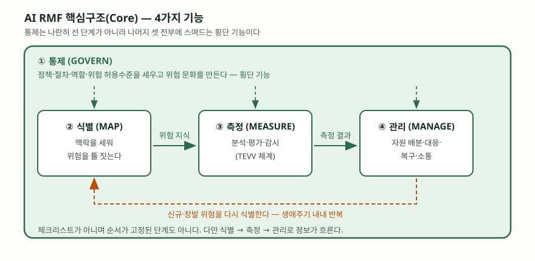
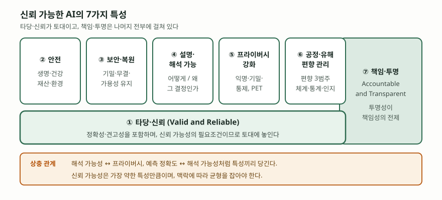

기출문제에서 미국 국립표준기술연구소가 발행한 AI 위험관리 프레임워크의 개념과
핵심구조 4가지, 신뢰 가능한 특성 7가지를 묻는다. 개수를 맞춰 이름만 나열하면
10점짜리 단답형에서 중간 점수에 머문다. 점수가 갈리는 곳은 **4가지 기능이 서로
어떤 순서로 맞물리는지**와 **7가지 특성이 서로 상충한다는 사실**이다. 프레임워크가
이 두 가지를 본문에서 명시적으로 말하고 있어서, 그대로 쓰면 원문을 읽은 답안으로
읽힌다.

> 실행 검증 없음. NIST AI 100-1(AI RMF 1.0, 2023-01) 원문을 근거로 정리했다.
> 특성별 용어 정의는 프레임워크가 인용한 ISO 9000:2015·ISO/IEC TS 5723:2022를 따랐다.

---

## Ⅰ. 정의

**AI 위험관리 프레임워크(AI RMF)** 는 미국 국립표준기술연구소(NIST)가 2023년 1월
발행한 문서로, AI 시스템을 설계·개발·배포·사용하는 조직이 AI의 위험을 관리하고
신뢰 가능한 AI를 만들도록 돕는 **자원(resource)** 이다. 「2020년 국가 인공지능
이니셔티브법」(P.L. 116-283)의 지시로 만들어졌다.

성격을 규정하는 네 단어를 프레임워크가 직접 적는다 — **자발적(voluntary),
권리보전적(rights-preserving), 특정 분야에 매이지 않으며(non-sector-specific),
사용 사례를 가리지 않는다(use-case agnostic)**. 즉 인증·심사를 전제한 요구사항
규격이 아니라, 조직이 자기 규모와 역량에 맞춰 골라 쓰는 지침이다. 답안 첫 줄에서
이 성격을 밝히지 않으면 ISO/IEC 42001 같은 인증형 경영시스템 규격과 섞여 읽힌다.

문서는 **두 부분**으로 나뉜다. **제1부(기초 정보)** 는 위험을 어떻게 틀 지을지,
대상 독자는 누구인지, 신뢰 가능한 AI의 특성은 무엇인지를 다루고, **제2부(핵심구조와
프로파일)** 가 실제 활동 체계인 Core와 Profile을 담는다.

## Ⅱ. 핵심구조(Core) — 4가지 기능

> **출처**: [NIST AI 100-1, AI RMF 1.0 §5 AI RMF Core, Fig. 5 (2023-01)](https://doi.org/10.6028/NIST.AI.100-1)

Core는 AI 위험을 관리하기 위한 **결과(outcome)와 행동(action)** 의 집합이며,
**4가지 기능(Function)** 으로 구성된다. 각 기능은 다시 범주(Category)와
하위 범주(Subcategory)로 쪼개진다.

| # | 기능 | 하는 일 | 끝났을 때 갖춰지는 것 |
|---|---|---|---|
| ① | **통제 (GOVERN)** | 정책·절차·역할·위험 허용수준을 세우고 위험 문화를 만든다 | 위험을 이해하고 관리하는 조직 구조와 문화 |
| ② | **식별 (MAP)** | AI 시스템의 **맥락을 세워** 위험을 틀 짓는다 | 생애주기 전반의 상호의존성과 영향 범위 파악 |
| ③ | **측정 (MEASURE)** | 정량·정성·혼합 기법으로 위험과 영향을 분석·평가·벤치마킹·감시한다 | 반복·확장 가능한 시험·평가·검증·확인(TEVV) 체계 |
| ④ | **관리 (MANAGE)** | 식별·측정된 위험에 자원을 배분하고 대응·복구·소통 계획을 실행한다 | 우선순위에 따른 위험 처리와 상시 감시 체계 |

구조에서 두 가지를 짚어야 한다.

- **통제는 횡단 기능이다.** 나머지 셋과 나란히 놓인 단계가 아니라, 셋 전부에
  스며들어 정보를 주고받는다. 프레임워크는 통제 가운데 특히 준법·평가와 관련된
  부분을 다른 세 기능 각각에 통합하라고 적는다.
- **체크리스트도, 순서가 정해진 단계도 아니다.** 프레임워크가 행동 항목에 대해
  이를 명시한다. 다만 정보의 흐름은 있다 — 식별에서 얻은 지식을 측정이 쓰고,
  측정 결과가 관리의 위험 감시·대응에 쓰인다.

**프로파일(Profile)** 은 Core를 특정 상황에 구현한 것이다. 채용·주거 같은
**사용 사례 프로파일**과, 현재 상태를 적은 **현행 프로파일**·목표 상태를 적은
**목표 프로파일**로 나뉘며, 둘을 비교해 나온 격차가 곧 개선 과제가 된다.

## Ⅲ. 신뢰 가능한 AI의 특성 — 7가지

> **출처**: [NIST AI 100-1, AI RMF 1.0 §3 AI Risks and Trustworthiness, Fig. 4 (2023-01)](https://doi.org/10.6028/NIST.AI.100-1)

| # | 특성 | 핵심 | 근거 정의 |
|---|---|---|---|
| ① | **타당·신뢰 (Valid and Reliable)** | 의도한 용도의 요구사항이 객관적 증거로 확인되고, 주어진 조건에서 고장 없이 동작한다. 정확성·견고성이 여기에 딸린다 | 타당성은 ISO 9000:2015, 신뢰성·정확성·견고성은 ISO/IEC TS 5723:2022 |
| ② | **안전 (Safe)** | 정해진 조건에서 인간의 생명·건강·재산·환경을 위험에 빠뜨리는 상태로 이어지지 않는다 | ISO/IEC TS 5723:2022 |
| ③ | **보안·복원 (Secure and Resilient)** | 기밀성·무결성·가용성을 지키고, 예상 밖 사건에서도 기능을 유지하거나 안전하게 저하된다 | ISO/IEC TS 5723:2022 적용, NIST CSF·RMF 연계 |
| ④ | **책임·투명 (Accountable and Transparent)** | 시스템과 산출물에 관한 정보가 상호작용하는 사람에게 제공된다. 투명성이 책임성의 전제다 | 프레임워크 본문 |
| ⑤ | **설명·해석 가능 (Explainable and Interpretable)** | 설명 가능성은 동작 기제의 표현, 해석 가능성은 설계된 목적 맥락에서 산출물이 갖는 의미 | 프레임워크 본문 |
| ⑥ | **프라이버시 강화 (Privacy-Enhanced)** | 익명성·기밀성·통제라는 가치가 설계·개발·배포 선택을 이끈다. PET, 비식별·집계가 수단 | NIST Privacy Framework 연계 |
| ⑦ | **공정·유해 편향 관리 (Fair – with Harmful Bias Managed)** | 평등·형평을 다루며, 편향을 **체계적·계산통계적·인간인지적** 3가지 범주로 나눠 관리한다 | NIST SP 1270 |

세 가지가 답안의 깊이를 만든다.

- **①이 토대, ④가 수직축이다.** 프레임워크의 그림은 타당·신뢰를 **신뢰성의 필요조건**
  으로 보아 맨 아래에 깔고, 책임·투명은 나머지 전부와 관련되므로 세로 상자로 그린다.
  7개를 평면에 나열한 답안과 여기서 갈린다.
- **특성끼리 상충한다.** 해석 가능성과 프라이버시, 예측 정확도와 해석 가능성이
  서로 당긴다. 데이터가 희소할 때 프라이버시 강화 기법을 쓰면 정확도가 떨어진다.
  프레임워크는 "보안은 뛰어나지만 불공정한 시스템", "정확하지만 불투명한 시스템"을
  모두 바람직하지 않다고 적는다.
- **신뢰성은 가장 약한 특성만큼이다.** 개별 특성을 각각 충족한다고 신뢰 가능한
  시스템이 되지 않으며, 맥락에 따라 균형을 잡아야 한다는 것이 프레임워크의 결론이다.

## Ⅳ. 활용 시 고려사항 — 3가지

- **측정이 안 되는 위험을 측정된 위험으로 대체하지 않는다.** 프레임워크는 제3자
  소프트웨어·데이터처럼 조직이 통제하지 못하는 영역과, 아직 드러나지 않은 위험의
  측정이 어렵다는 점을 위험관리의 난제로 든다. 측정 가능한 지표만 관리하면
  위험 지도 자체가 왜곡된다.
- **위험 허용수준을 먼저 정한다.** 통제 기능의 하위 범주가 조직의 위험 허용수준에
  따라 필요한 활동 수준을 정하라고 요구한다. 허용수준이 없으면 모든 위험을 같은
  무게로 다루게 되고, 자원은 우선순위 없이 흩어진다.
- **생애주기 전체에 걸고, 외부 행위자를 끌어들인다.** 위험관리는 계획·설계 단계에서
  시작해 생애주기 내내 이어져야 하며, Core의 수행에는 조직 밖 AI 행위자의 관점까지
  포함한 다학제적 시각이 필요하다는 것이 프레임워크의 요구다.

> 관련 답안: [AI 리스크 — 개념, 보안·프라이버시·사회적 리스크](../2026-10-12-ai-risk-security-privacy-social/index.md)
>
> 개념 정리: [AI 편향의 3가지 범주 — 체계적·계산통계적·인간인지적](../../ai/2026-10-29-nist-ai-bias-three-categories/index.md)

끝

## 답안 작성 메모

- **먼저 쓸 것**: 발행 주체·연도와 성격 네 단어(자발적·권리보전적·분야 불문·사용
  사례 불문). 그 다음 4가지 기능 표, 그 다음 7가지 특성 표. 표 두 개가 답안의 몸통이다.
- **점수가 갈리는 지점**: ① 통제가 **횡단 기능**이라는 점, ② 타당·신뢰가 **토대**이고
  책임·투명이 **수직축**이라는 점, ③ 특성끼리 **상충한다**는 점. 셋 중 둘만 써도
  나열형 답안과 구분된다.
- **빠지기 쉬운 함정**: 4가지를 식별→측정→관리→통제의 순환 단계로 그리는 것.
  통제는 단계가 아니다. 그리고 영문 머리글자를 억지로 바꾸지 않는다 —
  GOVERN·MAP·MEASURE·MANAGE를 괄호로 병기하면 채점자가 바로 확인한다.
- **시간이 모자라면**: 특성 7가지 표의 '근거 정의' 열과 프로파일 설명을 버린다.
  기능 4가지와 특성 7개 이름, 상충 한 줄은 지킨다. 모식도는 통제가 바깥을 두르고
  안에 셋이 도는 그림 하나면 된다.
- 개수를 붙인다 — 핵심구조 4가지, 특성 7가지, 편향 범주 3가지, 고려사항 3가지.

## 참고 자료

- [NIST AI 100-1, Artificial Intelligence Risk Management Framework (AI RMF 1.0), January 2023](https://doi.org/10.6028/NIST.AI.100-1) — §3 신뢰 가능한 AI 특성 7가지와 Fig. 4, §5 Core 4가지 기능과 Fig. 5, §6 프로파일, §1.2 위험관리의 난제
- [ISO/IEC TS 5723:2022, Trustworthiness — Vocabulary](https://www.iso.org/standard/81608.html) — 신뢰성·정확성·견고성·안전의 용어 정의. AI RMF가 인용한 출처
- [ISO 9000:2015, Quality management systems — Fundamentals and vocabulary](https://www.iso.org/standard/45481.html) — 타당성 확인(validation)의 정의
- [NIST SP 1270, Towards a Standard for Identifying and Managing Bias in Artificial Intelligence (2022-03)](https://doi.org/10.6028/NIST.SP.1270) — 편향 3가지 범주(체계적·계산통계적·인간인지적)
- [NIST, AI Risk Management Framework 사업 페이지](https://www.nist.gov/itl/ai-risk-management-framework) — Playbook·Profile 등 부속 자료의 위치
