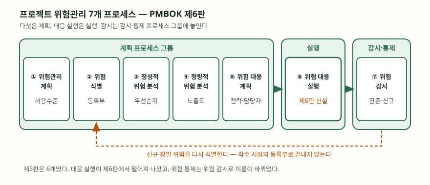

기출문제에서 프로젝트 위험관리를 묻는다. 범위가 넓은 문항이라 "식별하고 분석하고
대응한다"로 뭉뚱그리면 누구나 쓰는 답안이 된다. 점수가 나는 곳은 **위험을 개별
위험과 전체 프로젝트 위험으로 갈라 정의하는 것**, **프로세스를 프로세스 그룹에
얹어 어디서 계획하고 어디서 실행하는지 밝히는 것**, 그리고 **PMBOK과 ISO 표준의
절차를 대응시키는 것** 세 가지다.

> 실행 검증 없음. PMBOK Guide는 유료 간행물이라 원문을 직접 열지 못했고,
> 프로세스 구성은 PMI 발행 이력을 정리한 2차 자료 2건으로 교차 확인했다.
> ISO 31000:2018의 절 구조는 ISO 카탈로그와 노스캐롤라이나 주립대 ERM 자료로,
> ISO 21502:2020은 호주표준협회가 공개한 동일 채택본 목차로 확인했다. (§10)

---

## Ⅰ. 정의

**위험(Risk)** 은 ISO 31000:2018의 용어 정의(§3.1)에서 *목표에 대한 불확실성의
영향*이다. 영향은 긍정·부정 어느 쪽으로도 벗어날 수 있으므로, 위험은 손실만을
뜻하지 않는다.

**프로젝트 위험관리(Project Risk Management)** 는 이 불확실성을 프로젝트 목표
— 범위·일정·원가·품질 — 에 대해 체계적으로 다루는 활동이다. 목적은 **긍정적
위험(기회)의 확률과 영향은 키우고, 부정적 위험(위협)의 확률과 영향은 줄이는 것**이다.

답안에서 먼저 갈라야 할 것은 위험의 **두 층위**다.

| 층위 | 무엇 | 관리 방법 |
|---|---|---|
| **개별 위험** (Individual Risk) | 발생하면 하나 이상의 프로젝트 목표에 영향을 주는 **불확실한 사건이나 조건** | 위험 등록부에 한 건씩 올려 확률·영향을 매기고 대응 전략을 붙인다 |
| **전체 프로젝트 위험** (Overall Project Risk) | 개별 위험을 포함한 **모든 불확실성의 원천이 프로젝트 전체에 주는 영향**. 결과가 양쪽으로 벌어지는 정도 | 몬테카를로 시뮬레이션 같은 정량 분석으로 일정·원가 분포를 보고, 프로젝트 단위로 보고한다 |

이 구분이 중요한 이유는 **개별 위험을 다 처리해도 전체 위험이 남기 때문**이다.
각각은 영향이 작아 수용한 위험 열 건이 같은 시기에 몰리면 일정은 무너진다.
위험 등록부만 관리하는 조직이 놓치는 지점이고, 답안에서 쓰면 바로 눈에 띈다.

## Ⅱ. 프로세스 — PMBOK 제6판 기준 7가지

> **출처**: [Visual Paradigm — PMBOK 6: 10 Knowledge Areas & 49 Processes](https://www.visual-paradigm.com/guide/pmbok/pmbok-6-10-knowledge-areas-and-49-processes/) · [iZenBridge — What's New in PMBOK Guide Sixth Edition (2017-09-21 작성, 2023-06-22 갱신)](https://www.izenbridge.com/blog/pmbok6-changes/) (2차 자료 기반)

| # | 프로세스 | 프로세스 그룹 | 무엇을 산출하는가 |
|---|---|---|---|
| ① | 위험관리 계획 (Plan Risk Management) | 계획 | 위험관리 계획서 — 방법론, 역할, 확률·영향 정의, 위험 허용수준 |
| ② | 위험 식별 (Identify Risks) | 계획 | 위험 등록부(Risk Register), 위험 보고서 |
| ③ | 정성적 위험 분석 (Perform Qualitative Risk Analysis) | 계획 | 확률·영향 매트릭스로 매긴 **우선순위** |
| ④ | 정량적 위험 분석 (Perform Quantitative Risk Analysis) | 계획 | 전체 위험 노출도의 **수치** — 기대화폐가치(EMV), 몬테카를로 분포, 민감도 분석 |
| ⑤ | 위험 대응 계획 (Plan Risk Responses) | 계획 | 위험별 대응 전략과 담당자, 예비비 |
| ⑥ | **위험 대응 실행** (Implement Risk Responses) | **실행** | 합의된 대응의 실제 수행, 변경요청 |
| ⑦ | 위험 감시 (Monitor Risks) | 감시·통제 | 잔존 위험 추적, 신규 위험 식별, 대응 효과성 평가 |

판을 밝히는 것이 중요하다.

- **⑥ 위험 대응 실행은 제6판(2017)에서 새로 생겼다.** 그전에는 감시·통제에 섞여
  있었는데, 대응을 **계획만 하고 실행하지 않는** 현장 문제를 드러내려고 실행
  프로세스 그룹에 독립 프로세스로 뺐다.
- **⑦ 위험 감시는 제5판의 '위험 통제(Control Risks)'가 이름을 바꾼 것이다.**
  제6판이 여러 프로세스에서 '통제'를 '감시'로 바꾼 흐름의 일부다.
- **제7판(2021)은 프로세스를 본문에서 뺐고, 제8판(2025-11)이 40개로 되살렸다.**
  제8판에서 위험은 성과 영역으로 재배치되고 프로세스는 6개다. 답안 첫 줄에
  "제6판 기준"을 적어 두면 판이 다른 채점 기준과 어긋나지 않는다.

### 표준마다 절차 이름이 다르다

| PMBOK 제6판 | ISO 31000:2018 §6 프로세스 | ISO 21502:2020 §7.8 위험관리 |
|---|---|---|
| — (전 과정에 걸침) | §6.2 의사소통과 협의 | — |
| ① 위험관리 계획 | §6.3 범위·맥락·기준 | 7.8.1 개요 |
| ② 위험 식별 | §6.4.2 위험 식별 | 7.8.2 위험 식별 |
| ③ 정성적 분석 · ④ 정량적 분석 | §6.4.3 위험 분석 · §6.4.4 위험 평가 | 7.8.3 위험 평가 |
| ⑤ 대응 계획 · ⑥ 대응 실행 | §6.5 위험 처리 | 7.8.4 위험 처리 |
| ⑦ 위험 감시 | §6.6 모니터링·검토 · §6.7 기록·보고 | 7.8.5 위험 통제 |

세 표준의 뼈대는 같지만 **무게중심이 다르다.** ISO 31000은 조직 전체의 위험관리를
다루므로 **의사소통·협의**를 프로세스 안에 상시 항목으로 두고, 원칙 8가지와
프레임워크(리더십·통합·설계·실행·평가·개선)를 프로세스 위에 얹는다. PMBOK은
프로젝트라는 한시 조직을 전제하므로 **대응 계획과 실행**이 두 개 프로세스로
갈라져 있다. ISO 21502는 프로젝트 실무를 통합 기술하면서 위험관리를 그중 한
절로 둔다.

## Ⅲ. 활용 시 고려사항 — 3가지

- **정성 분석과 정량 분석을 구분해 쓴다.** 정성 분석은 확률·영향 매트릭스로
  **순서를 매기는** 활동이고, 정량 분석은 전체 위험 노출도를 **수치로 내는**
  활동이다. 정량 분석은 모든 프로젝트에 필요하지 않다 — 데이터와 모델링 비용이
  들고, 입력 추정이 부실하면 그럴듯한 분포가 잘못된 확신을 준다. 소규모
  정보화 사업에서 몬테카를로를 형식으로 돌리면 문서만 늘고 판단은 나아지지 않는다.
- **대응을 계획에서 끝내지 않는다.** 제6판이 대응 실행을 따로 뺀 이유가 그대로
  고려사항이다. 위험별 **담당자(Risk Owner)** 와 **발동 조건(Trigger)** 이 없으면
  등록부는 목록으로 남는다. 대응 실행에서 나오는 변경요청이 통합 변경통제로
  이어지는지도 함께 본다.
- **위험 식별은 한 번으로 끝나지 않는다.** 위험 감시는 잔존 위험을 추적하는 동시에
  **신규·창발 위험을 다시 식별**하는 활동이다. 요구사항이 확정되고 아키텍처가
  정해질수록 알 수 있는 위험이 달라지므로, 착수 시점의 등록부를 그대로 들고 가면
  후반부 위험은 비어 있게 된다. 정기 검토 주기를 위험관리 계획서에 못 박아 둔다.

> 관련 답안: [IT 프로젝트의 부정적 위험과 대응 전략 5가지](../2026-10-09-negative-risk-response-strategies/index.md)
>
> 개념 정리: [PMBOK 지식 영역과 프로세스 그룹](../../it-management/2026-10-01-pmbok-knowledge-areas-process-groups/index.md)
>
> 개념 정리: [ISO 31000 위험관리 — 원칙 8가지, 프레임워크, 프로세스](../../it-management/2026-10-29-iso-31000-risk-management-principles-framework-process/index.md)

끝

## 답안 작성 메모

- **먼저 쓸 것**: 위험의 정의(목표에 대한 불확실성의 영향)와 개별 위험 / 전체
  프로젝트 위험의 구분. 그 다음 7개 프로세스 표. 표가 답안의 몸통이다.
- **점수가 갈리는 지점**: ⑥ 위험 대응 실행이 **실행 프로세스 그룹**이라는 것.
  프로세스 그룹 열을 채운 답안과 이름만 나열한 답안이 여기서 갈린다. 전체 프로젝트
  위험 개념을 쓰면 한 단계 더 올라간다.
- **빠지기 쉬운 함정**: 제5판 기준 6개로 쓰는 것. 제6판부터 대응 실행이 들어가
  7개다. 그리고 판을 밝히지 않는 것 — 제8판 기준이면 위험은 성과 영역이고
  프로세스는 6개라서 숫자가 어긋난다.
- **시간이 모자라면**: 표준 대응표를 버린다. 정의 → 7개 프로세스 표 → 고려사항
  순서는 지킨다. 모식도는 계획 5 · 실행 1 · 감시 1의 배치만 그려도 된다.
- 개수를 붙인다 — 프로세스 7가지, 위험 층위 2가지, 고려사항 3가지.

## 참고 자료

- [PMI, A Guide to the Project Management Body of Knowledge (PMBOK Guide) 6th Edition (2017)](https://www.pmi.org/standards/pmbok) — §11 Project Risk Management. 유료 간행물이라 직접 열람하지 못했고 아래 2차 자료로 교차 확인했다
- [ISO 31000:2018, Risk management — Guidelines](https://www.iso.org/standard/65694.html) — §3.1 위험의 정의, §4 원칙 8가지, §5 프레임워크, §6 프로세스
- [ISO 21502:2020, Project, programme and portfolio management — Guidance on project management (2020-12)](https://www.iso.org/standard/74947.html) — §7.8 위험관리. 본문은 유료이고 절 구조는 [호주표준협회 AS ISO 21502:2022 목차](https://store.standards.org.au/product/as-iso-21502-2022)로 확인했다
- [NC State ERM Initiative — ISO's Risk Management Framework (2020-06-17)](https://erm.ncsu.edu/resource-center/isos-risk-management-framework) — 2차 자료, ISO 31000:2018 원칙 8가지와 프로세스 6단계 교차 확인
- [Visual Paradigm — PMBOK 6: 10 Knowledge Areas & 49 Processes](https://www.visual-paradigm.com/guide/pmbok/pmbok-6-10-knowledge-areas-and-49-processes/) — 2차 자료, 위험관리 7개 프로세스 번호와 이름
- [iZenBridge — What's New in PMBOK Guide Sixth Edition (2017-09-21, 2023-06-22 갱신)](https://www.izenbridge.com/blog/pmbok6-changes/) — 2차 자료, 대응 실행 신설과 통제 → 감시 개명 경위
- [David Hillson, Managing Overall Project Risk (PMI Global Congress, 2014)](https://www.pmi.org/learning/library/overall-project-risk-assessment-models-1386) — 개별 위험과 전체 프로젝트 위험의 구분이 필요한 이유
