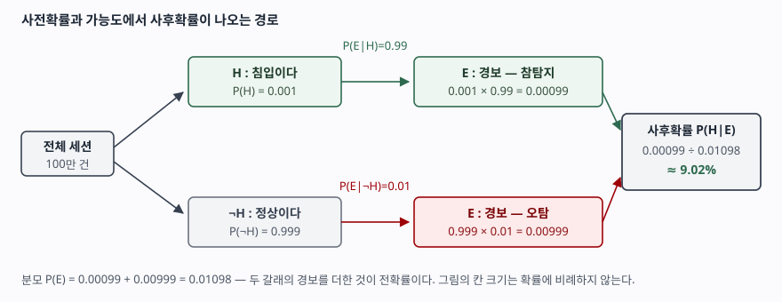

기출문제에서 베이즈 정리를 묻는다. 수식 한 줄만 적으면 10점짜리 단답형에서 중간
점수에 머문다. 점수가 갈리는 곳은 **분모가 왜 전확률 공식인지**, 그리고 **사전확률이
작으면 아무리 정확한 탐지기도 사후확률이 낮게 나온다**는 사실이다. 정보관리기술사
답안이므로 동전·주사위가 아니라 **분류기와 탐지 경보**로 끌고 간다. 스팸 필터, 보안관제
경보, 장애 원인 추정이 전부 이 한 줄 위에 서 있다.

> 계산 문제이므로 직접 계산해 검산했다. 공식으로 구한 값과 모집단 100만 건을
> 직접 세어 구한 값이 일치하는 것까지 확인했고, 실행 기록은 `code/output.txt`에 있다.

---

## Ⅰ. 정의

**베이즈 정리(Bayes' theorem)** 는 어떤 가설 H에 대한 확률을, **증거 E를 관측한
뒤의 확률로 갱신하는 식**이다.

> P(H|E) = P(E|H) · P(H) / P(E)

유도는 한 줄이다. 조건부확률의 정의에서 두 결합확률을 같다고 놓으면 된다.

- P(H|E) = P(H ∩ E) / P(E)
- P(E|H) = P(H ∩ E) / P(H)  →  P(H ∩ E) = P(E|H) · P(H)
- 둘을 합치면 P(H|E) = P(E|H) · P(H) / P(E)

**새로운 공리가 아니라 조건부확률 정의의 다른 표현**이라는 점을 답안 첫 줄 근처에서
밝히면 좋다. 정리의 값은 식 자체가 아니라 **방향을 뒤집는 데** 있다. 실무에서 측정할
수 있는 것은 "침입일 때 경보가 울릴 확률" P(E|H)이고, 알고 싶은 것은 "경보가 울렸을
때 침입일 확률" P(H|E)다. 이 둘을 잇는 다리가 베이즈 정리다.

가설이 **상호배타적이고 전체를 덮는** H₁…Hₙ으로 나뉘면 일반형이 된다.

> P(Hᵢ|E) = P(E|Hᵢ) · P(Hᵢ) / Σₖ P(E|Hₖ) · P(Hₖ)

분모가 **전확률 공식(law of total probability)** 이다. 증거가 관측될 확률을 모든
가설 경로로 쪼개어 더한 것이며, 사후확률의 합을 1로 만드는 **정규화 상수** 역할을 한다.

## Ⅱ. 구성요소 — 4가지

| # | 이름 | 기호 | 뜻 |
|---|---|---|---|
| ① | **사전확률** (prior) | P(H) | 증거를 보기 전의 확률. 기저율(base rate)이라고도 한다 |
| ② | **가능도** (likelihood) | P(E\|H) | 가설이 참일 때 그 증거가 나타날 확률. 탐지기의 민감도가 여기 해당한다 |
| ③ | **증거** (evidence) | P(E) | 증거가 관측될 확률. 전확률 공식으로 계산하는 정규화 상수 |
| ④ | **사후확률** (posterior) | P(H\|E) | 증거를 반영한 뒤의 확률. 우리가 구하려는 값 |

미국 국립표준기술연구소의 통계 핸드북도 같은 네 이름을 쓴다. 연속형에서는 사전
분포 g(λ), 가능도 f(x|λ), 사후 분포 g(λ|x)로 적고 분모는 적분이 된다.

**갱신이 이어진다는 점이 다섯 번째로 중요하다.** 한 번 구한 사후확률은 다음 관측에서
그대로 사전확률이 된다. 이것이 베이즈 추론을 **순차적**으로 만드는 성질이다.



> **출처**: [NIST/SEMATECH e-Handbook of Statistical Methods §8.1.10, Bayes Formula, Prior and Posterior Distribution Models](https://www.itl.nist.gov/div898/handbook/apr/section1/apr1a.htm) — 사전·가능도·사후의 정의. 수치는 아래 계산 결과

### 계산 — 보안관제 경보를 판정한다

침입 탐지 장비가 전체 세션의 **0.1%** 가 침입인 망에 걸려 있다. 침입을 **99%** 잡고,
정상 세션을 **1%** 오탐한다. 경보가 하나 울렸을 때 실제 침입일 확률은 얼마인가.

```python
def posterior(prior, sensitivity, false_positive_rate):
    """경보가 울렸을 때 실제 침입일 확률 P(H|E).

    분모는 전확률 공식 P(E) = P(E|H)P(H) + P(E|~H)P(~H) 이다.
    """
    evidence = prior * sensitivity + (1 - prior) * false_positive_rate
    return prior * sensitivity / evidence
```

전체 소스는 [`code/bayes_alert.py`](code/bayes_alert.py)에 있다. 실행 결과다.

```text
[1차 경보]
  P(E)   전확률(경보가 울릴 확률) = 549/50000 = 1.0980%
  P(H|E) 사후확률                 = 11/122 = 9.0164%

[검산] 100만 세션을 직접 세어 같은 값이 나오는지 본다
  침입 1000건 중 탐지 990건
  정상 999000건 중 오탐 9990건
  세어서 구한 값 = 11/122 = 9.0164%
  공식과 일치하는가: True
```

**99%를 잡는 탐지기인데 경보의 9%만 진짜다.** 침입이 1,000건일 때 탐지가 990건인데,
정상 999,000건에서 나온 오탐이 9,990건이라 참탐지를 열 배로 덮는다. 사전확률이
작으면 분모의 두 번째 항이 첫 항을 압도한다는 뜻이고, 이것이 **기저율 오류(base rate
fallacy)** 가 생기는 자리다.

독립된 경보가 한 번 더 울리면 사후확률이 사전확률 자리로 올라간다.

```text
[2차 경보] 1차 사후확률을 사전확률로 삼아 한 번 더 갱신한다
  P(H)   = 9.0164%  ->  P(H|E) = 90.7500%
  P(H)   = 90.7500%  ->  P(H|E) = 99.8971%
```

**단일 경보로 조치하지 말고 증거를 모으라**는 보안관제의 상식이 여기서 숫자로 나온다.

## Ⅲ. 활용과 고려사항

### 가. 정보시스템에서의 활용 — 4가지

| # | 적용 | 가설 H와 증거 E |
|---|---|---|
| ① | **나이브 베이즈 분류** (스팸 필터, 문서 분류) | H = 스팸이다, E = 본문에 나타난 단어들 |
| ② | **침입탐지·이상탐지 경보 판정** | H = 실제 공격이다, E = 탐지 규칙이 울렸다 |
| ③ | **장애 원인 추정** | H = 특정 구성요소의 고장이다, E = 관측된 증상·로그 패턴 |
| ④ | **A/B 테스트와 베이지안 최적화** | H = 변경안이 더 낫다, E = 누적된 관측 표본 |

①은 특히 중요하다. 단어가 n개면 P(E|H)는 2ⁿ 가지 조합의 확률이 되어 계산도 학습도
불가능하다. **나이브 베이즈는 "가설이 주어지면 단어들이 서로 독립"이라고 가정해**
곱으로 쪼갠다. 현실에서 틀린 가정이지만, 분류는 순위만 맞으면 되므로 잘 동작한다.
가정을 명시하지 않고 쓰면 답안에서 감점된다.

### 나. 적용 시 고려사항 — 4가지

- **사전확률을 빼고 가능도만 보지 않는다.** 위 계산이 그 사례다. 탐지율만 보고
  "99% 정확하니 경보는 믿을 만하다"고 쓰면 틀린다. 기저율이 낮은 영역 — 침입탐지,
  희귀 질환, 부정거래 — 에서 특히 그렇다.
- **사전확률을 무엇으로 둘지가 논쟁거리다.** 과거 데이터가 있으면 그 빈도를 쓰지만,
  없으면 주관적으로 정해야 한다. 이 주관성이 빈도주의 통계학과 갈리는 지점이다.
  답안에서는 "사전확률의 선정 근거를 남긴다"까지 적으면 충분하다.
- **조건부 독립 가정이 어디서 깨지는지 본다.** 2차 경보의 90.75%는 두 경보가
  **서로 독립**일 때의 값이다. 같은 규칙이 같은 트래픽에 두 번 걸린 것이라면
  독립이 아니고, 그대로 곱하면 확신이 부풀려진다.
- **수치 계산에서 언더플로와 0 확률을 막는다.** 단어 확률을 수백 번 곱하면
  부동소수점이 0으로 가라앉으므로 **로그 확률의 합**으로 바꿔 계산한다. 학습
  데이터에 없던 단어가 가능도를 0으로 만들어 곱 전체를 0으로 만드는 문제는
  **라플라스 스무딩**으로 분자·분모에 상수를 더해 막는다.

끝

## 답안 작성 메모

- **먼저 쓸 것**: 수식 한 줄과 **조건부확률 정의에서 나온다**는 유도 두 줄. 그 다음
  네 구성요소 표. 유도는 세 줄이면 끝나므로 반드시 넣는다 — 외운 식을 적은 답안과
  여기서 갈린다.
- **점수가 갈리는 지점**: ① 분모가 **전확률 공식이자 정규화 상수**라는 설명,
  ② 사후확률이 다음 사전확률이 되는 **순차 갱신**, ③ 기저율이 낮으면 사후확률이
  낮게 나온다는 **수치 예시**. ③은 숫자를 직접 써야 힘이 붙는다.
- **빠지기 쉬운 함정**: P(E|H)와 P(H|E)를 섞어 쓰는 것. 기호를 정의하고 시작한다.
  그리고 정보관리기술사 답안이므로 **동전·주사위 예시를 쓰지 않는다** — 분류기나
  탐지 경보로 들면 같은 설명이 IT 답안이 된다.
- **시간이 모자라면**: 활용 표와 고려사항 넷째 항목(언더플로·스무딩)을 버린다.
  수식·유도·네 구성요소·기저율 예시는 지킨다. 모식도는 두 갈래 나무 하나면 된다.
- **숫자를 외워 두면 빠르다.** 0.1% / 99% / 1% → 약 9%. 한 번 더 갱신하면 약 91%.
  계산기 없이 쓸 수 있는 분수는 990 / (990 + 9,990)이다.
- 개수를 붙인다 — 구성요소 **4가지**, 활용 **4가지**, 고려사항 **4가지**.

## 참고 자료

- [NIST/SEMATECH e-Handbook of Statistical Methods §8.1.10, How can Bayesian methodology be used for reliability evaluation?](https://www.itl.nist.gov/div898/handbook/apr/section1/apr1a.htm) — 사전 분포·가능도·사후 분포의 정의와 연속형 베이즈 공식
- [Bayes, T. (1763). An Essay towards solving a Problem in the Doctrine of Chances. *Philosophical Transactions of the Royal Society of London*, 53, 370–418](https://doi.org/10.1098/rstl.1763.0053) — 원 논문. 사후 Price가 정리해 발표했다
- [`code/bayes_alert.py`](code/bayes_alert.py) · [`code/output.txt`](code/output.txt) — 이 글의 모든 수치를 만든 계산과 실행 기록
