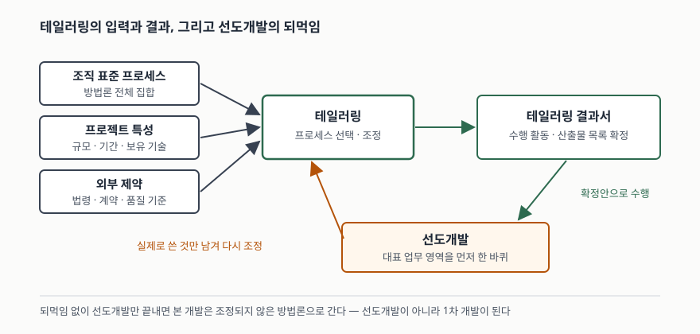

기출문제에서 개발방법론 테일러링을 묻는다. "프로젝트에 맞게 방법론을 고치는 것"이라고
한 줄 쓰고 기준 몇 개를 나열하면 평범한 답안이 된다. 점수가 갈리는 곳은 두 군데다.
**테일러링이 선택사항이 아니라 표준이 규범으로 요구하는 프로세스**라는 점, 그리고
**선도개발이라는 조건이 왜 테일러링을 특별하게 만드는가**다. 뒤쪽을 쓰지 않으면
문항이 붙여 놓은 조건을 버리고 일반론만 답한 꼴이 된다.

> 실행 검증 없음. 공개 표준과 공공 고시 근거만으로 정리했다.
>
> 테일러링은 1차 자료(ISO/IEC/IEEE 12207:2017)로 썼다. 다만 **'선도개발'은 국제표준에
> 정의된 용어가 아니다.** 국내 대형·공공 사업에서 "본 개발에 앞서 대표 영역을 먼저
> 개발한다"는 뜻으로 쓰는 현장 용어이므로, 아래에서는 그 뜻을 밝히고 쓴다.

---

## Ⅰ. 정의

**개발방법론 테일러링**은 조직의 표준 프로세스 집합에서 그 프로젝트에 적용할
프로세스·활동·태스크와 산출물을 **선택하고 조정해 확정하는 활동**이다.

근거는 소프트웨어 생명주기 프로세스 표준(ISO/IEC/IEEE 12207:2017)에 있다. 이 표준의
목적 절(§1.2)은 본문 프로세스가 방법·절차·기법·도구·훈련된 인력 같은 업무 환경을
세우는 바탕이 된다고 한 뒤, **부록 A가 이 생명주기 프로세스의 테일러링에 관해
규범적 방향을 제공한다**고 적는다. 여기서 중요한 것은 부록 A의 성격이다.

> **부록 A는 informative(참고)가 아니라 normative(규범)다.**

부록이라서 선택사항처럼 보이지만 아니다. 표준이 본문 프로세스를 그대로 다 쓰라고
요구하지 않는 대신, **줄이는 방법 자체를 규범으로 묶어** 둔 구조다. 답안 첫머리에
이 한 줄을 넣으면 "방법론을 적당히 줄이는 실무 관행"과 "표준이 정한 프로세스"를
구분해 쓴 답안이 된다.

부록 A의 구성은 다른 프로세스와 같은 꼴이다.

| 절 | 내용 |
|---|---|
| A.1 | Introduction — 테일러링이 필요한 상황 |
| A.2.1 | Purpose — 테일러링 프로세스의 목적 |
| A.2.2 | Outcomes — 수행 결과로 무엇이 생기는가 |
| A.2.3 | Activities and tasks — 무엇을 하는가 |

**선도개발**은 본 개발 전체에 들어가기 전에 **대표 업무 영역 하나를 끝까지 한 바퀴
돌려 보는 방식**을 가리킨다. 표준 용어는 아니지만, 같은 표준의 적용 방식 절(§1.3)이
생명주기 프로세스를 동시적·반복적·재귀적으로 적용할 수 있고 시스템 요소에는
점증적으로 적용할 수 있다고 한 것의 한 형태로 읽으면 된다. 선도개발의 목적은
**제품을 만드는 것이 아니라 방법론을 확정하는 것**이다.

## Ⅱ. 구성요소

> **출처**: [ISO/IEC/IEEE 12207:2017 §1.2, §1.3, Annex A (normative) Tailoring process](https://www.iso.org/standard/63712.html) — 테일러링의 규범적 지위와 생명주기 프로세스의 반복·점증 적용. 선도개발 되먹임 부분은 국내 공공 사업 방법론 문서들의 쓰임 (2차 자료 기반)

### 가. 테일러링 입력 — 3갈래

| # | 갈래 | 보는 것 |
|---|---|---|
| ① | **조직 표준 프로세스** | 방법론이 가진 단계·활동·산출물의 전체 집합 |
| ② | **프로젝트 특성** | 사업 규모, 기간, 목표 환경, 요구사항, 보유 기술 |
| ③ | **외부 제약** | 법령·고시, 계약 조건, 분야별 품질·보안 기준 |

②와 ③을 갈라 쓰는 것이 중요하다. ②는 줄일 수 있는 쪽이고 **③은 줄일 수 없는
쪽**이다. 공공 사업이라면 정보시스템 구축·운영 지침(행정안전부고시)과 감리·보안
요구가 ③에 들어가며, 이 때문에 품질보증·형상관리·보안 점검은 사업이 작아도
남는다. "작은 사업이니 다 뺀다"는 답안이 틀리는 지점이다.

### 나. 테일러링 수행 절차 — 4단계

| # | 단계 | 하는 일 |
|---|---|---|
| ① | **프로젝트 특성 정의** | 규모·기간·난이도·제약을 기준표로 정리 |
| ② | **표준 프로세스 선정** | 적용할 생명주기 모형과 기준 방법론을 고른다 |
| ③ | **상위·세부 조정** | 단계·활동 단위로 먼저 자르고, 산출물 단위로 다시 자른다 |
| ④ | **결과 문서화·합의** | 테일러링 결과서를 만들고 발주자와 합의한다 |

④를 빼먹은 답안이 많다. **합의되지 않은 테일러링은 산출물 미제출 분쟁이 된다.**
무엇을 왜 뺐는지가 문서로 남아야 검수와 감리에서 근거가 된다.

### 다. 선도개발이 추가로 요구하는 것 — 2회의 테일러링

선도개발이 들어간 사업은 테일러링을 **한 번이 아니라 두 번** 한다.

| 시점 | 무엇을 조정하나 | 목적 |
|---|---|---|
| **선도개발 착수 전** | 최소한의 프로세스만 남긴다 | 방법론을 빨리 한 바퀴 돌려 보는 것 자체가 목적 |
| **본 개발 착수 전** | 선도개발에서 실제로 쓴 것만 남겨 다시 조정 | 쓰지 않은 산출물·검토 회의를 걷어낸다 |

여기서 선도개발의 값이 나온다. 일반적인 테일러링은 **착수 시점에 추정으로** 무엇을
뺄지 정한다. 선도개발이 있으면 추정 대신 **실제로 한 바퀴 돌려 본 기록**으로 정할
수 있다. 어떤 산출물이 아무도 보지 않았는지, 어떤 검토 단계가 결함을 실제로 잡았는지가
증거로 남기 때문이다.

반대로 **되먹임이 없으면 선도개발은 그냥 1차 개발이 된다.** 답안에서 이 문장을
한 줄 쓰면 문항이 붙인 조건에 답한 것이 된다.

## Ⅲ. 활용과 고려사항

### 가. 적용 시 고려사항 — 5가지

- **삭제한 프로세스의 목적이 어디서 충족되는지 적는다.** 표준은 프로세스마다
  목적(purpose)과 결과(outcomes)를 정해 두었다. 활동을 지우는 것은 괜찮지만
  **목적까지 지우면 프로세스를 뺀 것이 아니라 품질을 뺀 것이다.** 설계 검토 회의를
  없앴다면 그 결함 검출을 코드 리뷰나 정적 분석이 맡는다고 적어야 한다.
- **선도개발의 범위를 쉬운 영역으로 잡지 않는다.** 가장 만만한 화면 몇 개를 골라
  선도개발을 하면 본 개발에서 터질 문제가 하나도 안 나온다. **인터페이스가 많고
  업무 규칙이 복잡한 영역**을 골라야 방법론의 약한 곳이 드러난다.
- **법령·계약이 요구하는 산출물은 테일러링 대상이 아니다.** 공공 사업의 감리 대상
  산출물, 보안약점 진단, 개인정보 영향평가 같은 것은 사업 규모와 무관하게 남는다.
  이것을 뺀 테일러링 결과서는 검수에서 되돌아온다.
- **테일러링 결과를 착수 시점에 고정하고 변경 이력을 남긴다.** 진행 중에 슬그머니
  산출물을 빼면 그것은 테일러링이 아니라 미이행이다. 변경이 필요하면 같은 절차로
  다시 합의하고 이력을 남긴다.
- **인력 역량을 조정 기준에 넣는다.** 방법론을 줄이는 가장 흔한 이유는 일정이지만,
  **팀이 그 기법을 쓸 줄 아는가**도 같은 무게의 기준이다. 쓸 줄 모르는 기법을
  남겨 두면 산출물은 나오되 내용이 비는, 가장 나쁜 결과가 된다.

### 나. 활용 — 3가지

| # | 상황 | 테일러링의 방향 |
|---|---|---|
| ① | **소규모·단기 사업** | 단계를 합치고 산출물을 통합한다. 승인 지점은 남긴다 |
| ② | **대규모 공공 사업의 선도개발** | 선도개발은 최소 집합으로, 본 개발은 실적 기반으로 재조정 |
| ③ | **유지보수·고도화 사업** | 요구사항 정의와 아키텍처 정의를 줄이고 형상관리·회귀 검증을 키운다 |

> 개념 정리: [ISO/IEC/IEEE 12207 소프트웨어 생명주기 프로세스 — 프로세스군 4개와 15288이 갈리는 한 지점](../../software-engineering/2026-10-30-iso-iec-ieee-12207-software-life-cycle-processes/index.md)

끝

## 답안 작성 메모

- **먼저 쓸 것**: 정의 한 문장과 **부록 A가 규범(normative)** 이라는 사실. 이 한 줄이
  답안의 격을 정한다. 그 다음 입력 3갈래와 절차 4단계를 표로 친다.
- **점수가 갈리는 지점**: ① 문항이 붙인 **선도개발**이라는 조건에 답했는가 —
  테일러링을 **두 번** 한다는 구조와 **되먹임**을 썼는가, ② 삭제한 프로세스의
  **목적이 어디서 충족되는지**를 적었는가, ③ **법령·계약 제약은 줄일 수 없다**는
  구분을 했는가. ①을 빼면 일반론 답안이 되어 중간 점수에 머문다.
- **빠지기 쉬운 함정**: 테일러링 기준을 외운 대로 길게 나열하는 것. 기준을 여섯 개
  적는 것보다 **내부 기준과 외부 제약을 갈라** 세 갈래로 묶는 쪽이 점수가 높다.
  그리고 **방법론 이름을 나열하지 않는다** — 묻는 것은 조정 행위이지 방법론 목록이
  아니다.
- **시간이 모자라면**: 활용 표를 버린다. 정의·부록 A의 규범성·입력 3갈래·절차
  4단계·선도개발의 2회 테일러링은 지킨다. 모식도는 입력 세 개에서 가운데 상자로
  모이고 오른쪽으로 빠진 뒤 아래에서 되돌아오는 그림 하나면 된다.
- 개수를 붙인다 — 입력 **3갈래**, 절차 **4단계**, 테일러링 시점 **2회**,
  고려사항 **5가지**.

## 참고 자료

- [ISO/IEC/IEEE 12207:2017, Systems and software engineering — Software life cycle processes](https://www.iso.org/standard/63712.html) — 목적 절(§1.2)의 "Annex A provides normative direction regarding the tailoring", 적용 방식 절(§1.3)의 반복·재귀·점증 적용, 부록 A(규범) 테일러링 프로세스
- [ISO/IEC/IEEE 12207:2017 미리보기 (목차·§1 범위)](https://assets.vde-verlag.de/iec-normen/preview-pdf/info_isoiecieee12207%7Bed1.0%7Den.pdf) — 부록 A의 쪽수와 하위 절 구성(A.1, A.2.1 Purpose, A.2.2 Outcomes, A.2.3 Activities and tasks) 확인
- [행정안전부고시 제2022-31호, 행정기관 및 공공기관 정보시스템 구축·운영 지침](https://www.mois.go.kr/frt/bbs/type001/commonSelectBoardArticle.do?bbsId=BBSMSTR_000000000016&nttId=91659) — 전자정부법 제45조 제3항에 따른 구축·운영 기준. 기술용역개발사업에 개발방법론을 사용하도록 하고 산출물 계획을 요구한다
- [한국전력거래소, 소프트웨어(SW) 개발 방법론 (2023.8)](https://www.kpx.or.kr/boardDownload.es?bid=0045&list_no=70219&seq=1) — 공공기관 방법론에서 '방법론 테일러링'이 개발 준비 단계의 작업으로 놓이고 결과를 문서로 남기는 사례 (2차 자료)
