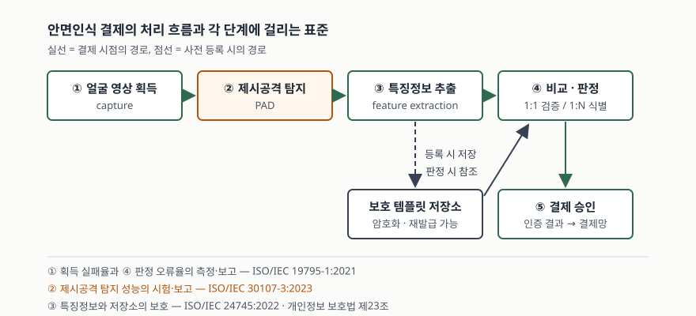

기출문제에서 안면인식 결제 서비스를 묻는다. "얼굴을 찍어 본인을 확인하고 결제한다"로
끝내면 10점짜리 단답형에서 절반도 못 받는다. 채점자가 보는 것은 **생체인식 처리를
단계로 끊을 수 있는가**, 그리고 **각 단계에 어떤 표준과 법적 요구가 걸리는가**다.
정보관리기술사 답안이므로 결제 편의성이 아니라 인증 파이프라인과 정보 보호 설계를
축으로 쓴다.

> 실행 검증 없음. 공개된 국제표준과 국내 법령·가이드라인 근거만으로 정리했다.

---

## Ⅰ. 정의

**안면인식 결제 서비스**는 결제 시점에 촬영한 얼굴 영상에서 생성한 **생체인식
특징정보**를 사전에 등록해 둔 보호 템플릿과 비교해 본인임을 확인하고, 그 확인
결과를 결제 승인의 인증 수단으로 사용하는 서비스다.

용어는 생체인식 어휘 표준(ISO/IEC 2382-37:2022)의 구분을 따른다. 이 표준은 사람을
알아보는 일과 관련된 개념을 체계적으로 기술하고, 옛 표준들이 제각기 쓰던 말을 하나의
권장 용어로 정리한다. 답안에서 반드시 갈라 써야 하는 두 가지가 여기서 나온다.

| 구분 | 비교 방식 | 묻는 것 | 결제에서의 쓰임 |
|---|---|---|---|
| **검증** (verification) | 1:1 | "이 사람이 본인이 맞는가" | 카드·앱·전화번호로 먼저 신원을 좁힌 뒤 얼굴로 확인 |
| **식별** (identification) | 1:N | "이 사람이 등록자 중 누구인가" | 아무것도 제시하지 않고 얼굴만으로 결제 |

국내법에서는 분류가 하나 더 붙는다. 얼굴에서 기술적 수단으로 생성한 특징정보는
**민감정보**(개인정보 보호법 시행령 제18조 제3호)이므로, 같은 법 제23조에 따라
**다른 개인정보와 별도로 명시적 동의**를 받거나 법령이 처리를 요구·허용할 때만
처리할 수 있다. 개인정보보호위원회의 생체정보 보호 가이드라인은 이때 **원본정보**
(얼굴 사진·영상 그 자체)와 **특징정보**(그로부터 생성한 정보)를 나누어 다룬다.
특징정보만을 생체인식정보로 보는 EU 일반개인정보보호규정과 범위가 다르다는 점도
적어 두면 좋다.

## Ⅱ. 구성요소 — 처리 5단계

> **출처**: [ISO/IEC 30107-3:2023 Biometric presentation attack detection — Part 3: Testing and reporting](https://webstore.iec.ch/publication/81714) · [ISO/IEC 19795-1:2021 Biometric performance testing and reporting — Part 1: Principles and framework](https://webstore.iec.ch/en/publication/69063) · [ISO/IEC 24745:2022 Biometric information protection](https://webstore.iec.ch/publication/74235) — 각 단계에 대응하는 표준의 적용 범위

| # | 단계 | 하는 일 | 걸리는 표준·규정 |
|---|---|---|---|
| ① | **획득** | 카메라로 얼굴 영상을 받는다 | 획득 실패율(FTA)·등록 실패율(FTE)을 ISO/IEC 19795-1:2021로 측정·보고 |
| ② | **제시공격 탐지(PAD)** | 사진·영상·마스크·합성 얼굴을 걸러낸다 | ISO/IEC 30107-3:2023 |
| ③ | **특징정보 추출** | 영상을 비교 가능한 특징정보로 바꾼다 | 원본정보/특징정보 구분, 민감정보 처리 |
| ④ | **비교·판정** | 임계값과 견주어 일치 여부를 정한다 | 오류율(FMR·FNMR) 측정·보고는 ISO/IEC 19795-1:2021 |
| ⑤ | **결제 승인** | 인증 결과를 결제망으로 넘겨 승인을 받는다 | 결제 수단 식별자는 토큰으로 대체 |

**②가 이 서비스의 급소다.** 얼굴은 비밀이 아니다. 지문이나 홍채와 달리 길에서도
찍히고 사회관계망에도 올라가 있다. 그래서 "일치하는가"보다 "지금 카메라 앞에 있는
것이 살아 있는 본인인가"가 더 어려운 문제가 되고, 이것을 다루는 것이 제시공격
탐지다. 제시공격 탐지의 시험·보고 방법을 정한 표준이 ISO/IEC 30107-3:2023이며,
2017년판은 2023년 1월 10일자로 폐지되었다.

### 템플릿 보호 요구 — 4가지

저장소에 들어가는 것은 얼굴 사진이 아니라 **보호된 생체 참조**여야 한다.
생체정보 보호 표준(ISO/IEC 24745:2022)이 저장·전송 구간에 요구하는 성질은 넷이다.

| # | 요구 | 뜻 | 깨지면 |
|---|---|---|---|
| ① | **기밀성** | 권한 없는 자가 내용을 읽지 못한다 | 템플릿 유출 |
| ② | **무결성** | 임의로 바뀌지 않는다 | 타인 템플릿으로 교체되는 공격 |
| ③ | **갱신·폐기 가능성** | 유출된 템플릿을 폐기하고 같은 얼굴에서 새 템플릿을 다시 만든다 | 한 번 새면 영구 피해 |
| ④ | **비가역성·비연결성** | 보호 템플릿에서 원래 특징정보를 되돌릴 수 없고, 서비스가 달라도 같은 사람임을 맞춰 볼 수 없다 | 재구성 공격, 서비스 간 추적 |

**③이 생체인증의 고유 문제를 푸는 자리다.** 비밀번호는 유출되면 바꾸면 되지만
얼굴은 바꿀 수 없다. 그래서 얼굴 자체가 아니라 **얼굴에서 파생한, 다시 만들 수 있는
값**을 저장해야 한다는 요구가 나온다. 2022년 개정판은 비가역성과 비연결성 요구를
이전판보다 명시적으로 했다.

## Ⅲ. 활용과 고려사항

### 가. 활용 — 4가지

| # | 적용 | 왜 얼굴인가 |
|---|---|---|
| ① | **무인 매장·키오스크 결제** | 손이 닿지 않아도 되고 소지품이 필요 없다 |
| ② | **대중교통 개찰** | 통과 시간이 짧아야 해서 제시 동작이 없는 쪽이 유리하다 |
| ③ | **비대면 계좌 개설의 실명확인** | 신분증 사진과 실시간 얼굴을 맞춰 본다 |
| ④ | **고액 거래의 추가 인증 수단** | 소지(단말)와 생체를 묶어 다요소로 만든다 |

### 나. 적용 시 고려사항 — 5가지

- **1:N 식별은 등록자가 늘수록 오매칭이 늘어난다.** 1:1 검증은 비교를 한 번 하지만,
  1:N 식별은 등록자 수만큼 비교한다. 한 번의 오매칭 확률(FMR)이 같아도 비교 횟수가
  늘면 누군가와 잘못 맞을 확률이 함께 오른다. **얼굴만으로 결제**하는 설계가
  **카드를 대고 얼굴로 확인**하는 설계보다 훨씬 비싼 오류율을 요구하는 이유다.
  답안에 "모집단 규모에 따라 운영 임계값을 다시 정한다"까지 쓴다.
- **제시공격 탐지 시험을 통과했다고 시스템이 안전한 것이 아니다.** ISO/IEC
  30107-3:2023은 **생체 획득 장치에 제시되는 공격**만 다루며, 구체적인 탐지 기법,
  대응책의 세부, 시스템 전체의 보안·취약점 평가는 적용 범위에서 **명시적으로
  제외**한다. 카메라 뒤에서 영상을 주입하거나 통신 구간을 가로채는 공격은
  이 시험이 보증하지 않는다. 벤더의 "국제표준 인증" 문구를 그대로 받으면 안 된다.
- **오류율 측정 표준과 공격 저항성은 서로 다른 표준이다.** ISO/IEC 19795-1:2021은
  성능 시험의 원칙과 틀을 정하되 **의도적 공격에 대한 오류율 측정은 범위에서
  뺀다.** 즉 FMR·FNMR이 아무리 좋아도 그 수치는 "정상 사용자들 사이의 혼동"을
  말할 뿐 "공격자가 뚫을 확률"이 아니다. 둘을 섞어 쓰면 감점이다.
- **원본정보는 특징정보를 만든 뒤 지체 없이 파기한다.** 생체정보 보호 가이드라인은
  특징정보가 생성되면 원본정보는 수집 목적이 달성된 것으로 보아 파기를 원칙으로
  하고, 법적 근거나 동의로 보관할 때는 **다른 개인정보와 분리해 저장**하도록
  안내한다. 결제 로그에 얼굴 이미지를 함께 남기는 설계는 이 지점에서 걸린다.
- **실패하는 이용자를 위한 대체 수단이 반드시 있어야 한다.** 조명·마스크·노화·
  의료적 사유로 등록이 안 되거나(FTE) 획득이 안 되는(FTA) 이용자가 항상 남는다.
  얼굴을 유일한 결제 수단으로 두면 그 이용자는 결제를 못 한다. **생체인증은
  편의 수단이고 대체 경로가 본선**이라는 원칙을 적는다.

끝

## 답안 작성 메모

- **먼저 쓸 것**: 정의 한 문장과 **1:1 검증 / 1:N 식별** 구분. 이 구분이 없으면
  뒤의 오류율 이야기가 전부 뜬다. 그 다음 5단계 흐름도를 그린다.
- **점수가 갈리는 지점**: ① **제시공격 탐지(PAD)** 를 단계로 떼어 썼는가,
  ② **특징정보가 민감정보**라 별도 동의가 필요하다는 법적 요건을 적었는가,
  ③ **얼굴은 바꿀 수 없으므로 갱신 가능한 보호 템플릿을 저장한다**는 설계 원칙을
  적었는가. 셋 중 둘은 꼭 들어간다.
- **빠지기 쉬운 함정**: 인식 정확도 수치를 적는 것. 제품·데이터셋마다 달라
  근거를 댈 수 없고, 근거 없는 수치는 그 자체가 감점이다. **수치 대신 FMR·FNMR·
  FTA·FTE라는 지표 이름과 임계값 운용**을 쓴다.
- **시간이 모자라면**: 활용 표를 버린다. 5단계 흐름도와 템플릿 보호 4요구는 지킨다.
  모식도는 가로 다섯 칸짜리 흐름 하나면 충분하고 1분이면 그린다.
- 개수를 붙인다 — 처리 **5단계**, 템플릿 보호 요구 **4가지**, 활용 **4가지**,
  고려사항 **5가지**.

## 참고 자료

- [ISO/IEC 2382-37:2022, Information technology — Vocabulary — Part 37: Biometrics](https://www.iso.org/standard/73514.html) — 생체인식 용어. 검증(1:1)과 식별(1:N)의 구분
- [ISO/IEC 19795-1:2021, Biometric performance testing and reporting — Part 1: Principles and framework](https://webstore.iec.ch/en/publication/69063) — 오류율·처리율 측정과 보고. 의도적 공격에 대한 측정은 범위 밖
- [ISO/IEC 30107-3:2023, Biometric presentation attack detection — Part 3: Testing and reporting](https://webstore.iec.ch/publication/81714) — 제시공격 탐지의 시험·보고. 2017년판은 2023-01-10 폐지
- [ISO/IEC 24745:2022, Biometric information protection](https://webstore.iec.ch/publication/74235) — 저장·전송 구간의 기밀성·무결성·갱신성 요구
- [개인정보보호위원회, 생체정보 보호 가이드라인 (2021.9 개정)](https://www.pipc.go.kr/) — 원본정보와 특징정보의 구분, 처리 단계별 보호조치
