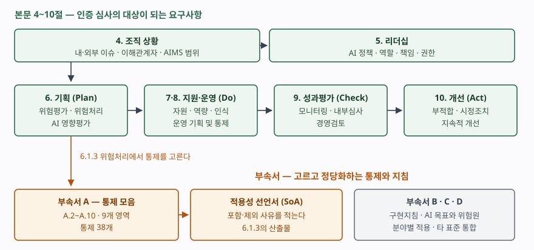

기출문제에서 인공지능 경영시스템 국제표준을 묻는다. 10점짜리 단답형에서
"AI를 잘 관리하자는 표준" 수준으로 쓰면 점수가 붙지 않는다. 점수가 갈리는 곳은
**이것이 가이드가 아니라 인증 심사를 받는 요구사항 규격**이라는 성격, 본문
4~10절이 다른 경영시스템 표준과 **같은 공통 구조**를 쓴다는 점, 그리고
**AI 영향평가**라는 이 규격에만 있는 요구사항이다. 세 가지를 짚으면 NIST AI RMF
같은 자발적 프레임워크와 섞이지 않는다.

> 실행 검증 없음. 표준 원문은 유료 발행물이라 열람하지 못했다. 발행 정보·적용
> 범위·제정 조직은 발행처인 ISO의 공식 목록(1차 자료)을 근거로 했고, **부속서 A의
> 영역 구분과 통제 개수는 2차 자료 3건 이상을 교차 확인해 적었다.** (§10)
> 수험 목적이면 원문 또는 국가표준 채택본을 확인하는 편이 안전하다.

---

## Ⅰ. 정의

**ISO/IEC 42001:2023**(Information technology — Artificial intelligence —
Management system)은 조직이 **인공지능 경영시스템(AIMS, AI Management System)** 을
수립·이행·유지·지속적으로 개선하기 위한 **요구사항을 정하고 지침을 제공하는
국제표준**이다. ISO/IEC JTC 1/SC 42(인공지능)가 만들어 **2023년 12월 18일**
제1판으로 발행했으며, AI 기반 제품·서비스를 **제공하거나 사용하는** 모든 조직에
규모·유형·성격을 가리지 않고 적용된다.

성격을 세 가지로 끊어 둔다.

- **요구사항 규격이다.** 본문 4~10절이 "shall"로 적힌 요구사항이고, 인증기관이
  이를 심사한다. 심사·인증기관이 지켜야 할 추가 요구사항은 별도 표준
  **ISO/IEC 42006:2025**(2025년 7월 발행)가 정하며, 이는 경영시스템 심사·인증기관
  일반 요구사항인 ISO/IEC 17021-1을 대체하지 않고 **보완한다.**
- **AI 시스템이 아니라 조직을 본다.** 개별 모델의 성능이나 알고리즘을 규정하지
  않는다. AI를 다루는 조직의 정책·역할·절차·기록이 대상이다.
- **공통 구조(Harmonized Structure)를 따른다.** ISO/IEC 27001, ISO 9001과 절
  번호와 뼈대가 같다. 이미 정보보호 경영시스템을 운영하는 조직이 문서·심사·경영검토를
  포개어 쓸 수 있도록 설계된 결과다.

## Ⅱ. 구성 — 본문 7개 절과 부속서 4개

> **출처**: [ISO/IEC 42001:2023 Information technology — Artificial intelligence — Management system](https://www.iso.org/standard/81230.html) — 발행 정보·적용 범위. 절 구성과 부속서 A의 영역 구분은 2차 자료 교차 확인 기반

### 가. 본문 요구사항 — 4~10절

| 절 | 이름 | 이 규격에서 특히 볼 것 |
|---|---|---|
| 4 | 조직 상황 | 내·외부 이슈, 이해관계자 요구, **AIMS 범위**, 조직이 AI에 대해 맡은 역할(제공자·사용자) |
| 5 | 리더십 | **AI 정책** 수립, 역할·책임·권한 배정 |
| 6 | 기획 | **AI 위험평가(6.1.2) → AI 위험처리(6.1.3) → AI 시스템 영향평가(6.1.4)**, AI 목표 수립 |
| 7 | 지원 | 자원, 역량, 인식, 의사소통, 문서화된 정보 |
| 8 | 운영 | 운영 기획 및 통제, 그리고 6절의 위험평가·위험처리·영향평가를 **실제로 수행** (8.2~8.4) |
| 9 | 성과평가 | 모니터링·측정·분석, 내부심사, 경영검토 |
| 10 | 개선 | 지속적 개선, 부적합 및 시정조치 |

구조에서 두 가지를 짚어야 한다.

- **6절이 계획이고 8절이 수행이다.** 6절은 "위험평가 절차를 **수립**하라"는 요구이고,
  8절은 "계획한 주기에, 그리고 중대한 변경이 있을 때 **수행하고 기록하라**"는 요구다.
  두 절에 같은 이름이 두 번 나오는 이유이며, 한 번만 쓰면 절반만 답한 것이 된다.
- **AI 시스템 영향평가(6.1.4 / 8.4)가 이 규격의 고유 요구사항이다.** 정보보호
  경영시스템에는 없다. 조직 자신이 입는 위험만 보는 것이 아니라 **개인과 사회가
  입는 영향**까지 평가하라는 요구이고, 그 수행 방법을 ISO/IEC 42005가 따로 다룬다.

### 나. 부속서 — 4개

| 부속서 | 내용 | 성격 |
|---|---|---|
| **A** | 참조 통제 목록. **A.2~A.10의 9개 영역에 통제 38개** | 위험처리에서 골라 쓰는 참조 집합 |
| **B** | 부속서 A 통제별 **구현 지침** | A와 같은 영역 구분을 따른다 |
| **C** | AI 관련 **조직 목표와 위험원(risk source)** 예시 | 참고용, 전부를 다룬 목록이 아니다 |
| **D** | **분야별 적용**과 타 경영시스템 표준(27001·27701·9001 등)과의 **통합** | 참고용 |

부속서 A의 9개 영역은 다음과 같다. **① AI 정책 ② 내부 조직 ③ AI 시스템을 위한
자원 ④ AI 시스템의 영향 평가 ⑤ AI 시스템 생애주기 ⑥ AI 시스템을 위한 데이터
⑦ 이해관계자에 대한 정보 제공 ⑧ AI 시스템의 사용 ⑨ 제3자 및 고객 관계.**

- **통제는 전부 적용하는 것이 아니다.** 6.1.3 위험처리에서 조직의 위험에 비추어
  필요한 것을 **고르고**, 고르지 않은 것은 **제외 사유**를 적는다. 그 결과물이
  **적용성 선언서(SoA, Statement of Applicability)** 다. 부속서 A에 없는 통제를
  조직이 새로 설계해 쓰는 것도 허용된다.
- 정보보호 경영시스템을 아는 사람에게는 익숙한 구조다. **ISO/IEC 27001의 부속서
  A와 SoA가 하는 일을, AI 쪽에서 그대로 한다**고 보면 된다.

## Ⅲ. 활용 시 고려사항 — 4가지

- **규제 대응의 뼈대로 쓰되, 규제 준수와 같다고 보지 않는다.** 국내 인공지능
  기본법과 EU AI Act는 고영향·고위험 AI에 문서화·위험관리·사후 모니터링을
  요구한다. 42001의 문서·기록 체계가 그 증빙을 모으는 그릇이 되지만, **인증을
  받았다고 법적 요구를 충족한 것은 아니다.** 규제가 요구하는 항목과 SoA를
  대조해 빈칸을 찾아야 한다.
- **인접 표준과 역할을 나눠 쓴다.** 위험관리 **방법**은 ISO/IEC 23894, 영향평가
  **수행 절차**는 ISO/IEC 42005, 용어는 ISO/IEC 22989가 다룬다. 42001은 이들을
  묶어 돌리는 **경영시스템**이다. 한 표준으로 전부 덮으려 하면 답안도 실무도 얕아진다.
- **범위 설정이 전체를 좌우한다.** AI를 직접 개발하는 조직과 외부 모델을 사다 쓰는
  조직은 적용되는 통제가 다르다. 특히 **제3자·고객 관계 영역**은 사용자 조직에서
  무게가 커진다. 범위를 넓게 잡고 증빙을 못 채우면 부적합으로 돌아온다.
- **기존 경영시스템에 얹는다.** 공통 구조를 쓰므로 27001 운영 조직은 내부심사·경영검토·
  문서관리·부적합 처리를 공유할 수 있다. 별도 체계를 새로 세우면 기록만 두 벌이 된다.

> 관련 답안: [기출문제 — 인공지능 기본법의 고영향 인공지능: 정의, 활용 영역, 사업자의 안전성·신뢰성 확보 활동](../2026-10-05-high-impact-ai-basic-act/index.md)
>
> 개념 정리: [AI 시스템 영향평가 — ISO/IEC 42005와 기본권 영향평가](../../it-management/2026-10-05-ai-system-impact-assessment-iso-42005/index.md)

끝

## 답안 작성 메모

- **먼저 쓸 것**: 정식 명칭·발행 연도·제정 조직(JTC 1/SC 42), 그리고 **"인증 가능한
  요구사항 규격"** 이라는 한 줄. 이 한 줄이 NIST AI RMF·OECD 원칙 같은 자발적
  프레임워크와 답안을 갈라놓는다.
- **점수가 갈리는 지점**: ① 본문 4~10절이 **공통 구조**라 27001과 통합된다는 점,
  ② **AI 시스템 영향평가**가 이 규격의 고유 요구사항이라는 점, ③ 부속서 A 통제가
  **선택·정당화 대상**이고 그 산출물이 **적용성 선언서**라는 점. 셋 중 둘만 써도
  나열형 답안과 구분된다.
- **빠지기 쉬운 함정**: 부속서 A 통제 38개를 전부 적용해야 한다고 쓰는 것, 그리고
  6절과 8절에 같은 이름이 두 번 나오는 이유를 설명하지 못하는 것.
- **시간이 모자라면**: 부속서 B·C·D 설명과 인접 표준 비교를 버린다. 절 구성 표와
  부속서 A → SoA 흐름, AI 영향평가 한 줄은 지킨다. 모식도는 4~10절 한 줄에
  부속서 A와 SoA를 아래로 매단 그림이면 된다.
- 개수를 붙인다 — 본문 요구사항 **7개 절(4~10)**, 부속서 **4개(A~D)**,
  부속서 A **9개 영역·통제 38개**, 고려사항 **4가지**.

## 참고 자료

- [ISO/IEC 42001:2023, Information technology — Artificial intelligence — Management system](https://www.iso.org/standard/81230.html) — 발행처 공식 목록. 제1판 2023-12, 51쪽, ISO/IEC JTC 1/SC 42, 적용 범위 원문
- [ISO/IEC 42006:2025, Requirements for bodies providing audit and certification of AI management systems](https://www.iso.org/standard/42006) — 심사·인증기관 추가 요구사항. ISO/IEC 17021-1을 보완
- [ISO/IEC 42005:2025, AI system impact assessment](https://www.iso.org/standard/42005) — 42001의 6.1.4·8.4가 요구하는 영향평가의 수행 절차
- [ISO/IEC 23894:2023, Guidance on risk management](https://www.iso.org/standard/77304.html) — AI 위험관리 방법 지침
- [ISMS.online, ISO 42001 Annex A Controls (2025-08-21 갱신)](https://www.isms.online/iso-42001/annex-a-controls/) — 부속서 A의 9개 영역 구분. 2차 자료
- [Modulos, ISO/IEC 42001 Annexes A–D](https://docs.modulos.ai/frameworks/iso-42001/annexes-a-d) — 영역별 통제 수와 합계 38개, 부속서 B·C·D의 내용. 2차 자료
- [RiskProfs, ISO 42001 Annex A Controls List (2026-07-23)](https://riskprofs.com/iso-42001-annex-a-controls-list/) — 영역별 통제 수와 합계 38개. 2차 자료
- [Modulos, ISO/IEC 42001 Clauses 4–10](https://docs.modulos.ai/frameworks/iso-42001/clauses-4-10.html) — 절별 하위 조항 번호와 적용성 선언서 요구(6.1.3). 2차 자료
