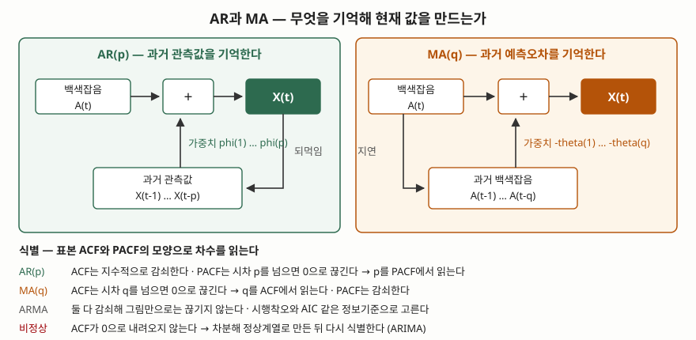

기출문제에서 자기회귀모형과 이동평균모형을 묶어 묻는다. 두 식을 나란히 적는 것만으로는
10점짜리 단답형에서 중간에 머문다. 채점자가 보는 것은 **두 모형이 각각 무엇을 기억해
현재 값을 만드는가**, 그리고 **표본에서 어떻게 차수를 골라내는가**다. 정보관리기술사
답안이므로 경제 지표가 아니라 **시스템 용량 예측, 트래픽 기준선, 이상 탐지**로 끌고 간다.
APM 지표 예측과 오토스케일링 임계값 산정이 전부 이 두 식 위에 서 있다.

> 식별 규칙이 정말 그대로 나오는지 확인하려고 AR(1)·MA(1) 표본경로를 직접 생성해
> 표본 ACF·PACF를 계산했다. 실행 기록은 [`code/output.txt`](code/output.txt)에 있다.

---

## Ⅰ. 정의

둘 다 **정상 시계열(stationary time series)을 백색잡음으로부터 설명하는 선형 모형**이다.
무엇을 기억하는지가 갈린다.

**자기회귀모형 AR(p)** 은 현재 값을 **자기 자신의 과거 관측값 p개**의 선형결합으로 둔다.

> X(t) = delta + phi(1)·X(t-1) + phi(2)·X(t-2) + … + phi(p)·X(t-p) + A(t)
> 단, delta = (1 − Σ phi(i))·mu

**이동평균모형 MA(q)** 은 현재 값을 **과거 백색잡음 q개**의 선형결합으로 둔다.

> X(t) = mu + A(t) − theta(1)·A(t-1) − … − theta(q)·A(t-q)

여기서 A(t)는 평균 0, 분산이 일정한 **백색잡음**, mu는 계열의 평균, p·q는 **차수(order)** 다.
MA 항에 음부호가 붙은 것은 미국 국립표준기술연구소 통계 핸드북의 표기를 따른 것으로,
부호 규약은 문헌마다 갈린다. 답안에 쓸 때는 **어느 규약인지 한 줄 밝히면 된다.**

이름이 오해를 부른다. **이동평균모형은 흔히 말하는 이동평균(moving average) 평활과
다른 것이다.** 평활은 관측값을 구간별로 평균 내는 전처리이고, MA 모형은 **관측되지
않는 오차항을 설명변수로 쓰는 생성 모형**이다. 답안에서 이 구분을 한 줄 적으면
용어를 외운 답안과 갈린다.

## Ⅱ. 구성요소와 대비 — 5가지 축



> **출처**: [NIST/SEMATECH e-Handbook of Statistical Methods §6.4.4.4 Common Approaches to Univariate Time Series](https://www.itl.nist.gov/div898/handbook/pmc/section4/pmc444.htm) — AR·MA 모형식, [§6.4.4.6 Box-Jenkins Model Identification](https://www.itl.nist.gov/div898/handbook/pmc/section4/pmc446.htm) — ACF·PACF 식별 규칙

| # | 축 | AR(p) | MA(q) |
|---|---|---|---|
| ① | **기억 대상** | 과거 **관측값** X(t-1)…X(t-p) | 과거 **백색잡음** A(t-1)…A(t-q) |
| ② | **모수** | phi(1)…phi(p), 평균 mu | theta(1)…theta(q), 평균 mu |
| ③ | **충격의 수명** | 되먹임으로 **무한히** 감쇠하며 남는다 | **q기 지나면 완전히 사라진다** |
| ④ | **제약 조건** | **정상성 조건** — AR(1)은 \|phi\| < 1 | 언제나 정상. 대신 **가역성 조건** |
| ⑤ | **추정 방법** | 설명변수가 관측되므로 **선형 최소제곱** | 오차항이 관측되지 않아 **반복 비선형 추정** |

③과 ⑤가 답안에서 점수가 붙는 자리다.

**③ 충격의 수명**이 두 모형의 실질적 차이다. AR은 현재 값이 다음 값의 입력으로 되먹여지므로
한 번의 충격이 phi의 거듭제곱으로 줄며 영원히 남는다. MA는 과거 잡음을 q개만 들고 있으므로
**q기가 지나면 그 충격의 흔적이 계열에서 완전히 사라진다.** 장애로 한 번 치솟은 지표가
오래 끌면 AR 쪽, 금방 제자리로 돌아오면 MA 쪽 성격이다.

**⑤ 추정 방법**이 갈리는 이유는 설명변수의 관측 가능 여부다. AR의 X(t-1)은 데이터에 있지만
MA의 A(t-1)은 **모형을 세워야 비로소 계산되는 값**이라서, 모수를 가정하고 잔차를 구하고
다시 모수를 고치는 반복이 필요하다. 같은 차수라도 MA 추정이 더 비싸고 초기값에 민감하다.

### 차수 식별 — 직접 만들어 확인한 값

핸드북의 식별 절(§6.4.4.6)은 표본 ACF와 PACF의 **끊기는 자리**로 차수를 읽으라고 적는다.
정말 그렇게 끊기는지 길이 2,000의 표본경로를 만들어 계산했다.

```python
def pacf_from_acf(acf):
    """Durbin-Levinson 재귀로 편자기상관을 뽑는다.

    PACF 의 k 차 값은 'k-1 차까지의 영향을 걷어낸 뒤 남는 상관'이라서,
    AR(p) 에서 p 를 넘는 순간 0 이 된다. 이 성질이 식별 규칙의 근거다.
    """
```

전체 소스는 [`code/arma_identify.py`](code/arma_identify.py)에 있다. 실행 결과다.

```text
유의대역 ±2/√N = ±0.0447  (핸드북 §6.4.4.6 의 95% 기준)

[AR(1)] X_t = delta + 0.7 X_(t-1) + A_t
  lag |  이론 ACF |  표본 ACF | 표본 PACF | 유의대역 밖?
    1 |    0.7000 |    0.7158 |    0.7158 | ACF PACF
    2 |    0.4900 |    0.5190 |    0.0135 | ACF
    3 |    0.3430 |    0.3781 |    0.0040 | ACF
    4 |    0.2401 |    0.2746 |   -0.0016 | ACF

[MA(1)] X_t = mu + A_t - 0.7 A_(t-1)
  lag |  이론 ACF |  표본 ACF | 표본 PACF | 유의대역 밖?
    1 |   -0.4698 |   -0.4881 |   -0.4881 | ACF PACF
    2 |    0.0000 |   -0.0005 |   -0.3134 |     PACF
    3 |    0.0000 |    0.0303 |   -0.1790 |     PACF
    4 |    0.0000 |   -0.0320 |   -0.1481 |     PACF
```

**두 표가 정확히 거울상이다.** AR(1)은 ACF가 0.7의 거듭제곱으로 끌리는데 PACF는 시차 2부터
0.0135로 주저앉아 유의대역 안으로 들어간다. MA(1)은 반대로 ACF가 시차 2부터 −0.0005로
끊기고 PACF가 −0.31, −0.18, −0.15로 끌린다. 그래서 **AR의 차수는 PACF에서, MA의 차수는
ACF에서 읽는다.**

정상성 조건도 같은 코드로 확인했다. phi가 0.3·0.7·0.95일 때 표본 분산은 이론값
sigma²/(1−phi²)를 따라가지만, phi = 1.00에서는 160까지 치솟아 수렴하지 않는다.
**임의보행은 정상계열이 아니므로 차분해서 ARIMA로 다뤄야 한다.**

## Ⅲ. 활용과 고려사항

### 가. 정보시스템에서의 활용 — 4가지

| # | 적용 | 모형이 하는 일 |
|---|---|---|
| ① | **용량 예측과 오토스케일링** | CPU·세션 수의 다음 구간 값을 예측해 증설 시점을 정한다 |
| ② | **이상 탐지 기준선** | 예측값과 예측구간을 기준선으로 두고 벗어난 관측을 경보로 올린다 |
| ③ | **잔차 기반 공정 관리** | 자기상관이 남은 계열을 모형으로 걷어내고 **잔차에 관리도**를 적용한다 |
| ④ | **결측·이상치 보정** | 모형으로 추정한 조건부 기댓값으로 빈 구간을 채운다 |

③은 답안에 쓰면 눈에 띈다. 관리도는 관측값이 서로 독립이라고 가정하는데, 시스템 지표는
거의 항상 자기상관이 있다. 그대로 관리도를 씌우면 **경보가 쏟아진다.** AR·MA로 구조를
걷어낸 뒤 남은 잔차를 보는 것이 순서다.

### 나. 적용 시 고려사항 — 4가지

- **정상성부터 확인한다.** 두 모형 모두 정상성을 전제한다. 추세가 있으면 차분하고,
  분산이 커지면 로그 변환을 먼저 한다. ACF가 0으로 내려오지 않는 것이 비정상의 신호다.
  차분 횟수 d를 붙인 것이 ARIMA(p,d,q)다.
- **차수를 키워 적합도를 올리지 않는다.** 모수를 늘리면 과거는 잘 맞고 미래는 틀린다.
  AIC 같은 **정보기준으로 적합도와 모수 개수를 함께 평가**하고, 적합 뒤에는 잔차가
  백색잡음인지(잔차 ACF가 유의대역 안인지) 반드시 검사한다.
- **표본이 짧으면 식별 자체가 안 된다.** 유의대역이 ±2/√N이므로 N이 작으면 대역이 넓어
  진짜 상관도 0으로 보인다. 위 계산도 N = 2,000이라 시차 2의 0.0135가 또렷하게
  대역 안으로 들어간 것이다. 핸드북은 50점 이상을 권한다.
- **계절성과 외생변수를 모형 밖에 두지 않는다.** 주간·일중 주기가 있는 트래픽은
  계절 항을 넣은 SARIMA로, 배포·프로모션 같은 외부 사건은 설명변수를 더한
  모형으로 간다. 설명해야 할 것을 잔차에 남기면 예측구간이 쓸모없어진다.

> 개념 정리: [ARIMA와 Box-Jenkins 모형화 절차 — 식별·추정·진단 3단계](../../data-analysis/2026-10-30-arima-box-jenkins-modeling-procedure/index.md)

끝

## 답안 작성 메모

- **먼저 쓸 것**: 두 식과 **"AR은 과거 관측값, MA는 과거 백색잡음을 기억한다"** 한 줄.
  이 한 줄이 답안 전체의 축이다. 그 다음 대비표.
- **점수가 갈리는 지점**: ① ACF·PACF **식별 규칙의 방향**(AR은 PACF에서, MA는 ACF에서),
  ② MA는 오차항이 관측되지 않아 **비선형 반복 추정**이 필요하다는 점,
  ③ AR만 정상성 조건이 붙고 MA는 언제나 정상이라는 **비대칭**. 셋 중 하나만 적어도
  외운 답안과 갈린다.
- **빠지기 쉬운 함정**: MA 모형을 **이동평균 평활과 섞어 쓰는 것**. 정의 절에서
  한 줄로 끊어 둔다. 그리고 MA 항의 부호 규약을 밝히지 않고 ACF 값을 쓰면
  부호가 어긋난다.
- **시간이 모자라면**: 활용 표와 고려사항 넷째 항목(계절성·외생변수)을 버린다.
  두 식, 대비표, 식별 규칙은 지킨다. 모식도는 두 패널에 되먹임 화살표 하나씩이면 된다.
- **외워 둘 숫자**: AR(1)의 이론 ACF는 phi의 거듭제곱(0.7 → 0.49 → 0.343),
  MA(1)의 이론 ACF는 시차 1에서 −theta/(1+theta²) = −0.47, 시차 2부터 0.
  유의대역은 ±2/√N.
- 개수를 붙인다 — 대비 축 **5가지**, 활용 **4가지**, 고려사항 **4가지**.

## 참고 자료

- [NIST/SEMATECH e-Handbook of Statistical Methods §6.4.4.4, Common Approaches to Univariate Time Series](https://www.itl.nist.gov/div898/handbook/pmc/section4/pmc444.htm) — AR·MA 모형식과 추정 방법의 차이
- [NIST/SEMATECH e-Handbook of Statistical Methods §6.4.4.5, Box-Jenkins Models](https://www.itl.nist.gov/div898/handbook/pmc/section4/pmc445.htm) — AR과 MA를 합친 ARMA, 차분을 통한 ARIMA 확장
- [NIST/SEMATECH e-Handbook of Statistical Methods §6.4.4.6, Box-Jenkins Model Identification](https://www.itl.nist.gov/div898/handbook/pmc/section4/pmc446.htm) — ACF·PACF 모양별 식별 규칙과 ±2/√N 유의대역
- Box, G.E.P., Jenkins, G.M., Reinsel, G.C. (1994). *Time Series Analysis: Forecasting and Control*, 3rd ed. Prentice Hall — 핸드북이 수학적 근거로 지목하는 원 문헌
- [`code/arma_identify.py`](code/arma_identify.py) · [`code/output.txt`](code/output.txt) — 이 글의 모든 수치를 만든 계산과 실행 기록
