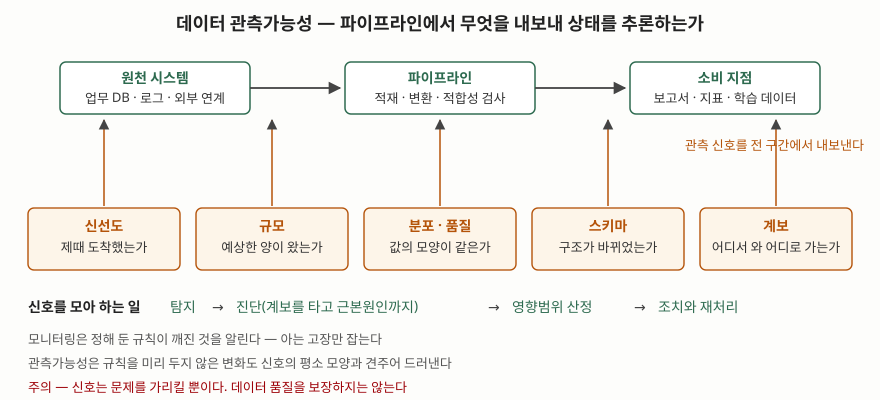

기출문제에서 데이터 관측가능성을 묻는다. 데이터 파이프라인의 고장은 멈추지 않는다는
점에서 애플리케이션 장애와 다르다. 스키마가 한 칼럼 바뀌어도 적재는 성공으로 끝나고,
원천이 하루치를 빠뜨려도 보고서는 그대로 그려진다. **틀린 수치가 경보 없이 소비
지점까지 내려가 의사결정에 쓰인 뒤에야 드러나는 것**이 이 영역의 문제이고, 거기에
붙은 이름이 데이터 관측가능성이다.

> **실행 검증 없음.** 매뉴얼·표준 문서 근거만으로 정리했다.
>
> **데이터 관측가능성 자체를 정의한 1차 자료는 없다.** 표준화 기구 문서도, 학술적
> 정의도 찾지 못했다. 어원이 되는 관측가능성은 1차 자료가 있어 그쪽을 근거로 쓰고,
> 데이터 영역의 정의와 구성요소는 **독립된 2차 자료 3건을 교차 확인**했다 (§10).
> 세 자료가 구성요소를 다르게 센다는 사실까지 그대로 적는다.

---

## Ⅰ. 정의

**데이터 관측가능성(Data Observability)** 은 **데이터와 데이터 파이프라인이 내보내는
신호를 지속적으로 수집해, 데이터의 상태와 건강도를 외부에서 추론할 수 있게 하는
체계**다. 미리 정해 둔 규칙이 깨졌는지만 보는 것이 아니라, **규칙을 두지 않은 변화까지
평소 모양과 견주어 드러내는 것**이 목적이다.

### 가. 말의 뿌리 — 여기는 1차 자료가 있다

- **제어이론**: 시스템의 외부 출력만으로 내부 상태를 결정할 수 있으면 그 시스템을
  관측가능하다고 한다. 선형 동적 시스템에 대해 칼만이 1960년에 도입한 개념이다.
- **소프트웨어**: 클라우드 네이티브 컴퓨팅 재단의 OpenTelemetry 문서는 관측가능성을
  **시스템 바깥에서 질문을 던져 시스템을 이해하게 해 주는 성질**로 적고, 그 재료를
  추적(trace)·지표(metric)·로그(log) 세 가지 **원격 측정 신호**로 든다.

데이터 관측가능성은 이 틀을 **데이터와 파이프라인**으로 옮긴 것이다. 신호의 종류가
추적·지표·로그에서 아래의 다섯 가지로 바뀐다.

### 나. 정의가 아직 하나로 모이지 않았다

교차 확인한 세 자료의 표현이 다르다. **답안에서는 이 사실 자체를 쓸 수 있다.**

| 출처 | 정의의 초점 | 확인일 |
|---|---|---|
| Monte Carlo (2019 최초, 2026-10-08 갱신) | 데이터와 시스템의 **건강도에 대한 완전한 가시성** | 2026-10-26 |
| IBM | **품질·가용성·신뢰성을 보장하도록** 데이터를 감시·관리·유지하는 실무 | 2026-10-26 |
| Soda (2026-05-05 발행) | 문제가 하류 소비자에게 닿기 전에 **잡아내고 설명하도록** 지속 감시하는 것 |

셋이 공통으로 말하는 것은 **① 지속적 수집, ② 하류 영향 이전의 탐지, ③ 원인 설명까지**
세 가지다. 정의를 하나로 통일하려 들지 말고 **공통분모 세 가지를 적고 "정의가 정립되는
중"임을 밝히는 편**이 안전하다.

## Ⅱ. 구성요소 — 5가지 관측 신호

세 자료가 모두 **다섯 가지**로 센다. 출처들은 이를 기둥(pillar)이라 부른다.

> **출처**: [Monte Carlo, What is Data Observability?](https://montecarlo.ai/blog-what-is-data-observability) (2026-10-08 갱신) · [IBM, What is data observability?](https://www.ibm.com/think/topics/data-observability) · [Soda, What Is Data Observability? 5 Pillars](https://soda.io/blog/data-observability-five-pillars) (2026-05-05) — 세 자료를 교차 확인해 그렸다 (2차 자료 기반)

| # | 신호 | 무엇을 보는가 | 틀어졌을 때의 모습 |
|---|---|---|---|
| ① | **신선도** (freshness) | 데이터가 **제때 도착했는가**, 갱신 주기가 지켜지는가 | 어제 적재분으로 오늘 보고서가 그려진다 |
| ② | **규모** (volume) | 예상한 **양**이 들어왔는가, 표가 완전한가 | 원천 한 곳이 빠져 행 수가 급감한다 |
| ③ | **분포 / 품질** (distribution) | 값이 **허용 범위 안의 모양**을 유지하는가 | 널 비율이 튀거나 단위가 바뀐다 |
| ④ | **스키마** (schema) | **구조**가 바뀌었는가, 누가 언제 바꿨는가 | 칼럼 이름이 바뀌어 하류 변환이 조용히 빈 값을 만든다 |
| ⑤ | **계보** (lineage) | 어느 원천에서 와 **어디까지 쓰이는가** | 한 표의 고장이 어느 보고서까지 번졌는지 모른다 |

③의 이름이 자료마다 갈린다. **IBM과 Soda는 분포(distribution)로, Monte Carlo는
품질(quality)로 적는다.** 보는 대상은 같다 — 값 자체의 통계적 모양이다.
답안에서는 둘 중 하나를 쓰고 괄호로 다른 이름을 덧붙이면 된다.

**⑤ 계보가 나머지 넷과 성격이 다르다.** ①~④는 한 표를 두고 "이상한가"를 판정하는
신호이고, 계보는 **이상이 어디서 왔고 어디까지 번지는지를 잇는 연결 정보**다. 계보가
없으면 경보가 떠도 원인 추적과 영향범위 산정을 손으로 하게 되므로, 신호 다섯 중
하나가 아니라 **나머지를 쓸모 있게 만드는 전제**로 적는 편이 정확하다.

## Ⅲ. 활용과 고려사항

### 가. 인접 개념과의 경계 — 3가지

| 구분 | 데이터 관측가능성 | 인접 개념 |
|---|---|---|
| **vs 모니터링** | 평소 모양에서 벗어난 변화를 드러낸다. **규칙을 미리 두지 않은 고장**도 잡는다 | 모니터링은 정해 둔 임계값·규칙이 깨진 것을 알린다 |
| **vs 데이터 검사(test)** | 운영 중 데이터의 거동을 **시간에 걸쳐** 본다 | 검사는 배포 전 정해진 규칙으로 한 시점을 판정한다 |
| **vs 데이터 품질관리** | 문제를 **가리킨다**. 품질을 보장하지는 않는다 | 품질관리는 ISO/IEC 25012의 품질 특성으로 적합성을 **정의하고 개선**한다 |

세 번째 경계가 답안에서 가장 잘 묻힌다. IBM은 관측가능성이 품질 문제를 가리킬 수는
있어도 **그 자체로 품질을 보장하지는 못한다**고 선을 긋는다. 신호가 알려 주는 것은
"평소와 다르다"이지 "요구사항에 맞지 않는다"가 아니다. **무엇이 맞는 값인지는 데이터
품질 모델 표준(ISO/IEC 25012:2008)의 정확성·완전성·최신성 같은 품질 특성과 업무
요구사항이 정한다.** 관측가능성은 그 기준이 깨지는 순간을 빨리 알려 주는 쪽이다.

### 나. 적용 시 고려사항 — 4가지

- **계보 수집을 먼저 세운다.** 신호 네 가지는 수집 자체가 어렵지 않지만, 계보는
  적재·변환 도구가 메타데이터를 내보내 주어야 모인다. 계보 없이 경보만 켜면
  경보 처리 비용만 늘고 원인은 그대로 손으로 찾게 된다.
- **기준선이 설 만큼의 이력이 쌓여야 한다.** 분포와 규모는 과거 관측과의 비교로
  판정하므로 운영 초기에는 오탐이 많다. 주간·월말 같은 **주기성을 기준선에 반영**하지
  않으면 정상 변동이 전부 경보가 된다.
- **경보의 심각도를 소비 지점으로 정한다.** 모든 표에 같은 임계값을 걸면 경보가
  쏟아진다. 계보를 타고 **그 표가 어느 보고서·모델에 쓰이는지**로 등급을 나눈다.
- **개인정보와 수집 범위를 분리한다.** 분포 신호는 값의 통계를 읽는 작업이라
  원본 값을 그대로 저장할 유인이 생긴다. 집계치만 남기고 **원본은 관측 저장소에
  두지 않도록** 수집 설계 단계에서 끊는다.

> 개념 정리: [ISO/IEC 25024 데이터 품질 측정 — 품질 측정원소와 측정함수](../../data-analysis/2026-10-25-iso-25024-data-quality-measurement-qme/index.md)
>
> 개념 정리: [데이터 계보(Data Lineage)와 메타데이터 카탈로그](../../database/2026-10-14-data-lineage-metadata-catalog/index.md)

끝

## 답안 작성 메모

- **먼저 쓸 것**: 정의 한 줄과 **"관측가능성은 제어이론·소프트웨어에서 온 말이고,
  데이터와 파이프라인이 내보내는 신호로 상태를 추론한다"** 는 뿌리 한 줄.
  그 다음 다섯 신호 표. 표가 이 문제의 뼈대다.
- **점수가 갈리는 지점**: ① **모니터링과의 차이**(정해 둔 규칙 대 평소 모양),
  ② **데이터 품질관리와의 경계**(가리킬 뿐 보장하지 않는다),
  ③ 계보가 나머지 넷을 쓸모 있게 만드는 **전제**라는 점. 셋 다 한 줄씩이면 된다.
- **최신 주제를 다루는 법**: 표준 정의가 없는 용어다. **"정의가 정립되는 중이며
  출처마다 구성요소 명칭이 다르다"고 밝히고 공통분모를 적는 것**이 감점 요인이
  아니라 가점 요인이다. 없는 표준을 지어내는 것이 감점이다.
- **시간이 모자라면**: 고려사항 넷째 항목(개인정보)과 경계표의 검사 행을 버린다.
  정의·다섯 신호·모니터링과의 차이는 지킨다. 모식도는 파이프라인 한 줄 위에
  신호 다섯 개를 세운 그림이면 된다.
- **쓰지 말 것**: 특정 상용 도구 이름을 답안의 뼈대로 쓰지 않는다. 다섯 신호 구분
  자체가 벤더에서 나온 틀이므로, **구성요소로는 쓰되 제품명은 적지 않는다.**
- 개수를 붙인다 — 구성요소 **5가지**, 인접 개념 경계 **3가지**, 고려사항 **4가지**.

## 참고 자료

- [OpenTelemetry, Observability Primer](https://opentelemetry.io/docs/concepts/observability-primer/) — 관측가능성의 정의와 추적·지표·로그 세 가지 원격 측정 신호 (1차)
- [Kalman, R.E. (1960). On the general theory of control systems. *IFAC Proceedings Volumes*, 1(1), 491–502](https://doi.org/10.1016/S1474-6670%2817%2970094-8) — 선형 동적 시스템의 관측가능성 개념 도입 (1차)
- [ISO/IEC 25012:2008, Software engineering — SQuaRE — Data quality model](https://www.iso.org/standard/35736.html) — 데이터 품질 특성. 관측가능성과 품질관리의 경계를 가르는 기준 (1차)
- [Monte Carlo, What is Data Observability?](https://montecarlo.ai/blog-what-is-data-observability) — 다섯 기둥 구분의 출처. 2019년 최초 게시, 2026-10-08 갱신 (2차)
- [IBM, What is data observability?](https://www.ibm.com/think/topics/data-observability) — 정의와 다섯 기둥, 품질관리와의 구분 (2차)
- [Soda, What Is Data Observability? 5 Pillars + How to Implement It](https://soda.io/blog/data-observability-five-pillars) — 검사와 관측가능성의 차이 (2026-05-05 발행, 2차)
