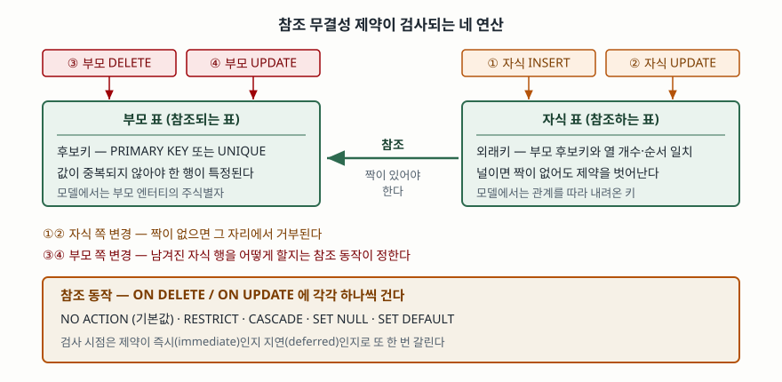

기출문제에서 정보모델링의 참조 무결성을 묻는다. 모델링 단계에서 그은 관계선은 그 자체로는
아무것도 막지 못한다. 부모 행이 지워지고 자식 행만 남아도, 존재한 적 없는 부서 번호가 사원
행에 들어가도 데이터베이스는 받아들인다. **모델에 그린 관계를 데이터가 지키도록 강제하는
제약**이 참조 무결성이고, 이 문제에서 물어야 할 것은 그 제약이 **언제 검사되고 깨졌을 때
무엇을 하는가**다.

> **실행 검증 없음.** 표준과 제품 공식 매뉴얼 근거로만 정리했다.

---

## Ⅰ. 정의

**참조 무결성(Referential Integrity)** 은 **자식 표의 외래키 값이 널이거나, 부모 표에 그 값을
가진 행이 존재해야 한다는 제약**이다. SQL 표준에서는 이를 참조 제약(referential constraint)
이라 부르고, 부모 쪽 열은 기본키이거나 유일 제약이 걸려 있어야 한다.

### 가. 모델에서 내려온다 — 외래키는 이주한 주식별자다

정보모델링 표기 표준인 IDEF1X는 외래키를 독립된 장치로 두지 않는다. 관계가 있으면
**부모 엔터티의 주식별자 속성이 자식 엔터티로 이주(migration)한다**고 적고, 속성 이주를
다루는 항목(§3.4.1)에서 **주식별자 속성만 이주할 수 있다**고 못박는다. 외래키 규칙
항목(§3.9.3)은 한 걸음 더 나간다.

- 자식·범주 엔터티는 자신이 참여한 **관계마다 외래키 속성 집합을 반드시 가져야 하고**,
  그 속성 수는 **부모 주식별자의 속성 수와 같아야 한다** (항목 a)
- 자식의 모든 이주 속성은 부모 주식별자의 속성이어야 하고, **역으로 부모 주식별자의 모든
  속성은 자식에 이주해 있어야 한다** (항목 d)

즉 참조 무결성은 뒤늦게 붙이는 검사가 아니라 **논리 모델의 관계를 그대로 옮긴 결과**다.
관계 하나가 외래키 제약 하나가 된다.

### 나. 표기 표준은 "깨졌을 때"를 정하지 않는다

주의할 점이 하나 있다. **IDEF1X 표준 전문에는 referential integrity라는 말이 나오지 않는다.**
표기 표준은 관계와 외래키의 **구성**까지만 정하고, 위반이 생겼을 때 무엇을 할지는
**SQL 표준과 각 DBMS 구현**이 정한다. 답안에서 모델링 쪽 근거와 구현 쪽 근거를 섞어
한 표준에서 나온 것처럼 쓰지 않는 편이 안전하다.

## Ⅱ. 구성요소 — 5가지

> **출처**: [FIPS PUB 184 IDEF1X §3.9.3 Foreign Key Rules](https://www.idef.com/wp-content/uploads/2016/02/Idef1x.pdf) · [PostgreSQL 18 Documentation §5.5.5 Foreign Keys](https://www.postgresql.org/docs/18/ddl-constraints.html) · [SQLite Foreign Key Support §4 ON DELETE and ON UPDATE Actions](https://www.sqlite.org/foreignkeys.html)

| # | 구성요소 | 무엇을 정하는가 |
|---|---|---|
| ① | **부모 후보키** | 참조 대상. **기본키이거나 유일 제약·유일 인덱스**가 있어야 한 행이 특정된다 |
| ② | **자식 외래키** | 참조하는 열. 부모 후보키와 **열 개수와 순서가 같아야** 한다 |
| ③ | **일치 규칙** (MATCH) | 복합 외래키에 널이 섞였을 때 제약을 벗어나는지. SIMPLE · FULL · PARTIAL |
| ④ | **참조 동작** | 부모 쪽이 바뀔 때 남겨진 자식 행을 어떻게 할지. 5가지 |
| ⑤ | **검사 시점** | 문장 끝에 보는 **즉시(immediate)** 인지 커밋 때 보는 **지연(deferred)** 인지 |

### 가. 참조 동작 5가지

`ON DELETE`와 `ON UPDATE`에 각각 하나씩 건다. 기본값은 `NO ACTION`이다.

| 동작 | 부모 행이 지워지거나 키가 바뀔 때 |
|---|---|
| **NO ACTION** | 아무것도 하지 않고 **제약만 검사**한다. 지연 제약이면 커밋 전까지 고칠 여지가 있다 |
| **RESTRICT** | 자식이 있으면 **그 자리에서 거부**한다. 지연 제약이어도 즉시 실패한다 |
| **CASCADE** | 자식 행을 **같이 지우거나** 바뀐 키 값을 **자식에 옮겨 쓴다** |
| **SET NULL** | 자식 외래키 열을 **널로 바꾼다.** 그 열이 `NOT NULL`이면 쓸 수 없다 |
| **SET DEFAULT** | 자식 외래키 열을 **기본값으로 바꾼다.** 그 기본값도 부모에 있어야 성공한다 |

**NO ACTION과 RESTRICT의 차이는 시점이다.** 둘 다 결국 거부하지만, RESTRICT는 값이 바뀌는
즉시 실패하고 NO ACTION은 검사 시점까지 위반 상태를 허용한다. 답안에서 이 한 줄을 적으면
다섯 동작을 외워서 나열한 것과 구분된다.

### 나. 널이 제약을 벗어나게 한다

외래키 열이 널이면 부모에 짝이 없어도 제약을 만족한 것으로 본다. 복합 외래키에서는
이 판정이 갈린다. **MATCH SIMPLE**(기본값)은 열 **하나라도** 널이면 통과시키고,
**MATCH FULL**은 **전부** 널일 때만 통과시킨다. 널과 값이 섞인 행을 막으려면 MATCH FULL을
걸거나 애초에 외래키 열에 `NOT NULL`을 건다.

## Ⅲ. 활용과 고려사항

### 가. 식별 관계와 비식별 관계가 선택을 좌우한다 — 2가지

IDEF1X는 관계를 둘로 나눈다. 자식이 **부모와의 연결로 식별되면 식별 관계**이고,
이때 자식은 **부모 없이 존재할 수 없다**(§3.5.1.1). 부모를 몰라도 자식이 유일하게
식별되면 **비식별 관계**다(§3.5.1.2).

- **식별 관계** — 외래키가 자식 기본키에 들어가므로 널일 수 없다. `ON DELETE CASCADE`가
  자연스럽다. 주문과 주문항목처럼 부모가 사라지면 자식도 뜻을 잃는 경우다
- **비식별 관계** — 외래키가 널일 수 있다. 부모와 자식이 각자 존재하므로 `RESTRICT`나
  `SET NULL`을 고른다. 관계가 선택적이면 `SET NULL`이 맞는다

### 나. 고려사항 4가지

- **자식 외래키 열에 인덱스를 건다.** 부모 행을 지우거나 키를 고칠 때마다 자식 표에서
  그 값을 찾아야 한다. 인덱스가 없으면 그때마다 자식 표 전체를 훑는다. 부모 쪽은
  유일 제약이 있어 이미 인덱스가 있지만 **자식 쪽은 자동으로 생기지 않는 제품이 있다**
- **제품마다 지원 범위가 다르다.** MySQL 8.4의 InnoDB는 `SET DEFAULT`가 들어간 테이블
  정의를 **거부하고** `NO ACTION`을 `RESTRICT`와 같게 처리하며, 지연 검사는 NDB에서만
  된다. SQLite는 외래키 검사가 **연결마다 기본으로 꺼져 있고** MATCH 절을 구문만 받고
  동작시키지 않는다. "표준에 있으니 된다"고 쓰면 틀린다
- **대량 적재와 순환 참조에는 지연 제약을 쓴다.** 서로를 참조하는 두 표는 어느 쪽을 먼저
  넣어도 중간에 위반이 생긴다. 제약을 `DEFERRABLE INITIALLY DEFERRED`로 두면 트랜잭션
  안에서만 위반을 허용하고 커밋 때 한 번에 검사한다
- **데이터베이스를 나누면 제약이 따라가지 못한다.** 서비스마다 데이터베이스를 분리하면
  외래키 제약을 걸 수 없으므로, 참조 무결성을 **응용 계층의 보상 처리로 옮겨야 한다.**
  이때 "지켜진다"가 아니라 "언제까지 어긋날 수 있는가"를 설계값으로 정해 둔다

> 개념 정리: [데이터 모델링 3단계 — 개념·논리·물리](../../database/2026-09-23-data-modeling-three-stages/index.md)
>
> 개념 정리: [외래 키 — 참조 무결성과 ON DELETE](../../../Database/sql-basics/2026-10-01-sqlite-foreign-key-on-delete/index.md)

끝

## 답안 작성 메모

- **먼저 쓸 것**: 정의 한 줄과 **"모델의 관계가 외래키 제약으로 내려온 것"** 이라는 문장.
  문제가 정보모델링을 묻고 있으므로 SQL 문법부터 꺼내면 각도가 어긋난다. 모델에서
  시작해 구현으로 내려가는 순서를 지킨다.
- **점수가 갈리는 지점**: ① **제약이 검사되는 연산이 넷**(자식 INSERT·UPDATE, 부모
  DELETE·UPDATE)이라는 정리, ② **NO ACTION과 RESTRICT의 차이가 시점**이라는 한 줄,
  ③ **식별·비식별 관계가 참조 동작 선택을 좌우한다**는 연결. 셋 다 한 줄씩이면 된다.
- **개수를 붙인다**: 구성요소 **5가지**, 참조 동작 **5가지**, 검사되는 연산 **4가지**,
  고려사항 **4가지**.
- **시간이 모자라면**: MATCH 규칙 설명과 고려사항 넷째 항목을 버린다. 구성요소 표와
  참조 동작 표는 지킨다. 모식도는 부모 상자·자식 상자·화살표 하나에 연산 넷을
  붙인 그림이면 되고 1분이면 그린다.
- **쓰지 말 것**: 특정 제품의 문법을 답안의 뼈대로 쓰지 않는다. 제품 차이는
  고려사항에서 **"구현마다 다르다"는 근거**로만 든다.
- **엔터티 무결성과 묶어 물으면**: 기본키는 널일 수 없다는 **엔터티 무결성**과,
  외래키는 널이거나 부모에 있어야 한다는 **참조 무결성**을 나란히 적고 **널의 취급이
  반대**라는 점을 대비시킨다.

## 참고 자료

- [NIST, FIPS PUB 184 — Integration Definition for Information Modeling (IDEF1X), 1993](https://www.idef.com/wp-content/uploads/2016/02/Idef1x.pdf) — §3.4.1 속성 이주, §3.5.1.1 식별 관계, §3.5.1.2 비식별 관계, §3.9.3 Foreign Key Rules (IDEF 사이트 게재본, 1차)
- [ISO/IEC 9075-2:2023, Information technology — Database languages SQL — Part 2: Foundation](https://www.iso.org/standard/76584.html) — 참조 제약과 참조 동작의 규격. 원문은 유료라 확인하지 못했고, 아래 제품 매뉴얼로 동작을 확인했다 (1차)
- [PostgreSQL 18 Documentation, §5.5.5 Foreign Keys](https://www.postgresql.org/docs/18/ddl-constraints.html) — 참조 동작 5가지, MATCH FULL과 기본 동작의 차이, 자식 열 인덱스 권고 (1차)
- [SQLite, Foreign Key Support](https://www.sqlite.org/foreignkeys.html) — NO ACTION과 RESTRICT의 시점 차이, 지연 제약, MATCH 미구현, 검사 기본 비활성 (1차)
- [MySQL 8.4 Reference Manual, FOREIGN KEY Constraints](https://dev.mysql.com/doc/refman/8.4/en/create-table-foreign-keys.html) — InnoDB의 SET DEFAULT 거부, NO ACTION과 RESTRICT 동일 처리, 외래키 인덱스 자동 생성 (1차)
