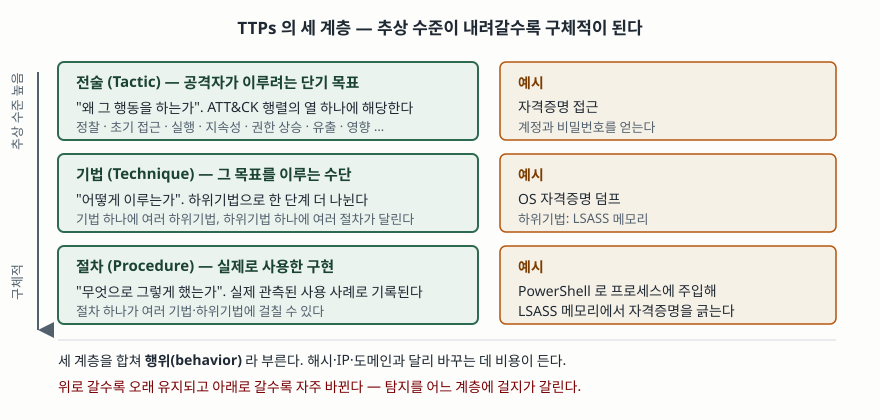

기출문제에서 TTPs를 묻는다. 악성코드 해시와 공격지 IP를 아무리 모아 차단해도 같은 공격자가
다음 날 다른 해시와 다른 IP로 들어온다. 바꾸는 데 비용이 거의 들지 않기 때문이다. 반면
**자격증명을 어떤 방식으로 꺼내 쓰는가는 쉽게 바꾸지 못한다.** 그 바꾸기 어려운 쪽,
곧 공격자의 행위를 기술하는 틀이 TTPs이고, 오늘날 보안 운영의 탐지 설계가 이 위에 선다.

> **실행 검증 없음.** 표준·공식 문서 근거로만 정리했다.

---

## Ⅰ. 정의

**TTPs(Tactics, Techniques and Procedures)** 는 **공격 행위자의 행위를 세 계층의 추상
수준으로 나눠 기술한 것**이다. 미국 국립표준기술연구소의 용어집은 TTPs를 행위자의
행위로 정의하고, **전술을 그 행위를 가장 높은 수준에서 기술한 것**, **기법을 전술의 맥락
안에서 더 상세히 기술한 것**, **절차를 기법의 맥락 안에서 훨씬 낮은 수준으로 매우 상세히
기술한 것**으로 구분한다. 이 정의의 출처 문서는 사이버 위협 정보 공유 지침(NIST SP 800-150)이다.

위협정보 교환 표준인 STIX 2.1의 용어집도 같은 뜻으로 적는다. TTP를 전술·기법·절차 중
하나를 가리키는 말로 두고, 그 내용을 공격자가 공격을 수행하는 데 쓰는
"behaviors and resources that attackers use to carry out their attacks"라고 설명한다.

**핵심은 TTPs가 도구나 흔적이 아니라 행위를 가리킨다는 점**이다. 같은 도구를 써도 행위가
다르면 다른 기법이고, 도구를 바꿔도 행위가 같으면 같은 기법이다.

## Ⅱ. 구성요소 — 3계층

> **출처**: [MITRE ATT&CK Design and Philosophy §3.3~3.4.1 (March 2020)](https://attack.mitre.org/docs/ATTACK_Design_and_Philosophy_March_2020.pdf) — 전술·기법·하위기법·절차의 정의와 자격증명 덤프 예시

| 계층 | 답하는 질문 | ATT&CK 에서의 자리 | 예시 |
|---|---|---|---|
| **전술** (Tactic) | **왜** 그 행동을 하는가 — 단기 목표 | 행렬의 **열** 하나 | 자격증명 접근 |
| **기법** (Technique) | **어떻게** 그 목표를 이루는가 | 열 안의 **항목**. 하위기법으로 더 나뉜다 | OS 자격증명 덤프 → LSASS 메모리 |
| **절차** (Procedure) | **무엇으로 실제로 그렇게 했는가** | 기법 문서의 **관측된 사용 사례** | PowerShell로 프로세스에 주입해 LSASS 메모리에서 자격증명을 긁는다 |

### 가. ATT&CK 엔터프라이즈 전술 — 확인 시점 기준 15가지

정찰 · 자원 개발 · 초기 접근 · 실행 · 지속성 · 권한 상승 · 은폐 · 방어 무력화 ·
자격증명 접근 · 탐색 · 내부 확산 · 수집 · 명령제어 · 유출 · 영향.

**답안에 전술 개수를 쓸 때는 버전을 함께 적는다.** 목록이 고정돼 있지 않기 때문이다.
확인 시점의 v20 기준으로 열다섯이고, 과거 Defense Evasion이던 전술은 지금 Stealth라는
이름을 쓰며 Defense Impairment가 별도 전술로 들어와 있다. **개수만 외워 두면 틀린다.**

### 나. 절차가 세 계층 중 가장 다루기 까다롭다

ATT&CK 설계 문서는 절차에 대해 두 가지를 짚는다. 첫째, 절차는 **기법을 실제로 어떻게
썼는지**이고, 둘째 **하나의 절차가 여러 기법·하위기법에 걸칠 수 있다.** 위 예시의 절차
하나에 PowerShell 사용, 프로세스 주입, LSASS 메모리 접근이라는 서로 다른 행위가 함께 들어 있다.

같은 문서는 **기법 하나에 절차가 아주 많을 수 있고 공격자가 계속 바뀌므로 그 절차를 미리 다
알 수 없다**고 적는다. 네트워크 설정을 알아내는 기법을 두고 `ipconfig.exe` 실행만
수집하면, 같은 정보를 PowerShell 명령으로 얻는 절차는 그대로 지나간다.

## Ⅲ. 활용과 고려사항

### 가. 침해지표와의 차이 — 왜 TTPs를 보는가

침해지표(IoC)와 TTPs의 차이는 **공격자가 바꾸는 비용**이다. 고통의 피라미드는 탐지 대상을
해시 · IP · 도메인 · 네트워크/호스트 산출물 · 도구 · TTPs 여섯 단계로 두고, 위로 갈수록
공격자가 치러야 할 비용이 커진다고 정리한다. 맨 위 TTPs에 대응하면 공격자는 **행위 자체를
새로 익혀야 한다.**

| 구분 | 침해지표 | TTPs |
|---|---|---|
| 가리키는 것 | 특정 사건의 **흔적**(값) | 공격자의 **행위**(방식) |
| 수명 | 짧다. 값 하나 바꾸면 무효 | 길다. 바꾸려면 작전 방식을 바꿔야 한다 |
| 탐지 방식 | 일치 비교 | 행위 분석. 적절한 원격 측정 데이터가 전제된다 |
| 오탐 | 적다 | 정상 활동과 겹칠 수 있어 상대적으로 많다 |

### 나. 활용 3가지

- **위협 인텔리전스의 구조화와 공유** — STIX 2.1의 공격 패턴·침입 집합 같은 객체로
  표현해 기계가 읽을 수 있는 형태로 주고받는다. 보고서의 서술을 공통 분류로 옮기는 일이다
- **탐지 공학과 커버리지 평가** — 어떤 기법을 탐지하고 있는지로 보안관제의 빈칸을 센다.
  데이터 소스별로 "이 센서가 있으면 어떤 기법을 볼 수 있는가"를 역으로 묻는 데 쓴다
- **공격자 모의와 퍼플팀** — 특정 위협 그룹이 쓴 기법 묶음을 그대로 재현해 방어가
  실제로 동작하는지 시험한다. ATT&CK 자체가 이 용도의 연구에서 나왔다

### 다. 고려사항 4가지

- **전체 커버리지를 목표로 삼지 않는다.** ATT&CK 설계 문서는 기법 100% 커버리지를
  기대하는 것이 비현실적이며, 지식 기반을 체크리스트로 채우는 일이 목표가 아니라고
  명시한다. **무엇을 못 보고 있는지를 아는 것**이 목적이다
- **절차 단위로 우회된다.** 기법 하나를 탐지한다고 선언하려면 **어떤 절차를 덮고 있는지
  설명할 수 있어야 한다.** 설명하지 못하면 그 선언은 근거가 없다
- **공개 보고 편향이 있다.** 발견된 사건의 대다수는 공개되지 않는다. 지식 기반에 없는
  기법이 쓰이지 않는 기법이라는 뜻이 아니다. 자체 관측과 미보고 사례를 함께 봐야 한다
- **추상 수준을 섞지 않는다.** 킬체인 같은 고수준 생애주기 모델은 개별 행동을 설명하지
  못하고, 취약점·악성코드 데이터베이스는 그 행동이 **어떤 맥락에서 쓰이는지**를 담지 않는다.
  TTPs는 둘 사이의 중간 수준 모델이며 둘을 대체하지 않는다

> 개념 정리: [침해사고 대응 절차 6단계](../../security/2026-09-29-incident-response-six-phases/index.md)

끝

## 답안 작성 메모

- **먼저 쓸 것**: 정의 한 줄(**행위자의 행위를 세 계층으로 기술한 것**)과 계층 표.
  표를 먼저 그리고 설명을 채우면 시간이 모자라도 뼈대가 남는다.
- **점수가 갈리는 지점**: ① **전술·기법·절차가 "왜·어떻게·무엇으로"에 대응**한다는 정리,
  ② **침해지표와의 수명·비용 대비**, ③ **절차 하나가 여러 기법에 걸친다**는 점.
  셋째 항목까지 쓰면 외워서 쓴 답안과 갈린다.
- **개수를 붙인다**: 계층 **3가지**, 활용 **3가지**, 고려사항 **4가지**, 고통의 피라미드
  **6단계**. 전술 개수는 **버전을 함께** 적는다.
- **시간이 모자라면**: 전술 열다섯 개 나열과 활용 셋째 항목을 버린다. 계층 표와
  침해지표 대비표는 지킨다. 모식도는 세 계층을 위아래로 쌓고 오른쪽에 예시를
  하나씩 붙인 그림이면 된다.
- **쓰지 말 것**: 특정 상용 보안 제품 이름. 그리고 **"TTP 탐지가 침해지표 탐지를
  대체한다"** 는 식으로 쓰지 않는다. 오탐과 데이터 수집 비용이 다르므로 **계층을
  나눠 함께 쓰는 것**이 맞는 답이다.
- **"APT 대응 방안"으로 확장되면**: 이 세 계층을 그대로 뼈대로 쓰고 각 계층에
  대응하는 수집 데이터와 탐지 수단을 매핑해 적는다. 답안 구조를 새로 만들 필요가 없다.

## 참고 자료

- [NIST CSRC Glossary, Tactics, Techniques, and Procedures (TTP)](https://csrc.nist.gov/glossary/term/tactics_techniques_and_procedures) — 전술·기법·절차 3계층 정의. 출처 문서는 NIST SP 800-150(2016-10), SP 800-172r3, SP 800-61r3 (1차)
- [NIST SP 800-150, Guide to Cyber Threat Information Sharing (2016-10)](https://csrc.nist.gov/pubs/sp/800/150/final) — TTP 정의의 원 출처 (1차)
- [MITRE, ATT&CK Design and Philosophy (March 2020)](https://attack.mitre.org/docs/ATTACK_Design_and_Philosophy_March_2020.pdf) — §3.4 기법과 하위기법, §3.4.1 절차, §2.1 커버리지, §4.1.3 추상 수준 (1차)
- [MITRE ATT&CK, Enterprise Tactics](https://attack.mitre.org/tactics/enterprise/) — 전술 목록. v20 기준 15개 (2026-10-26 확인, 1차)
- [OASIS, STIX Version 2.1 OASIS Standard](https://docs.oasis-open.org/cti/stix/v2.1/os/stix-v2.1-os.html) — 용어집의 TTP 정의, 공격 패턴·침입 집합 객체 (1차)
- [David J. Bianco, The Pyramid of Pain (2013)](https://detect-respond.blogspot.com/2013/03/the-pyramid-of-pain.html) — 탐지 대상 6단계와 공격자 비용. 저자 본인의 원 게시물 (1차)
