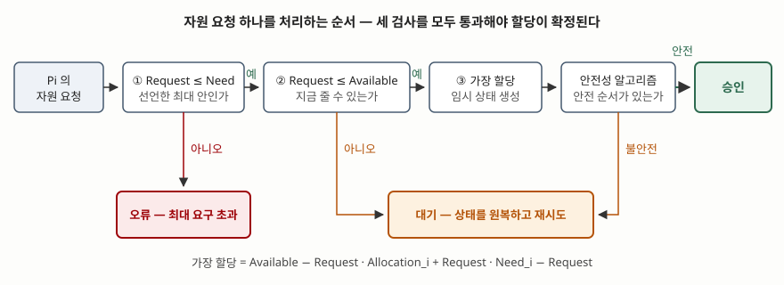

기출문제에서 은행가 알고리즘을 묻는다. 교착상태를 다루는 네 가지 방법 가운데 **회피**에
해당하고, 회피 기법 중 자원 유형마다 인스턴스가 여럿일 때 쓰는 쪽이다. 이름이 은행에서
온 이유는, 은행이 고객 신용 한도의 합보다 적은 현금을 들고도 파산하지 않는 조건과 같은
것을 보기 때문이다 — **한도 전액을 한꺼번에 요구받아도 모두 갚게 할 수 있는 순서가
남아 있는가.**

---

## Ⅰ. 정의

**은행가 알고리즘(Banker's Algorithm)** 은 **각 프로세스가 앞으로 요구할 자원의 최대량을
미리 선언받아, 어떤 요청을 들어주었을 때 시스템이 안전 상태로 남는 경우에만 그 요청을
승인하는 교착상태 회피 기법**이다.

**안전 상태(safe state)** 는 교재가 정의하는 대로 **모든 프로세스를 어떤 순서
&lt;P₁, …, Pₙ&gt;으로 늘어놓았을 때, 각 Pᵢ가 앞으로 더 요구할 수 있는 자원이 현재 가용 자원과
자기보다 앞선 Pⱼ(j &lt; i)들이 들고 있는 자원의 합으로 충족되는 순서가 하나라도 존재하는
상태**다. 그런 순서를 **안전 순서(safe sequence)** 라 한다.

여기서 **비대칭** 하나가 따라 나온다. **안전 상태이면 교착상태가 아니지만, 불안전
상태라고 교착상태인 것은 아니다** — 교착의 **가능성**이 있을 뿐이다. 그래서 회피
알고리즘의 목표는 교착을 깨는 것이 아니라 **불안전 상태에 결코 들어가지 않는 것**이고,
그 대가로 교착이 안 날 요청까지 거절한다.

## Ⅱ. 자료구조 4가지와 알고리즘 2가지

프로세스 n개, 자원 유형 m개일 때 네 가지를 유지한다.

| 자료구조 | 모양 | 뜻 |
|---|---|---|
| **Available** | 길이 m 벡터 | 지금 남아 있는 자원 수 |
| **Max** | n×m 행렬 | 각 프로세스가 **미리 선언한** 최대 요구량 |
| **Allocation** | n×m 행렬 | 각 프로세스에 **지금 할당된** 양 |
| **Need** | n×m 행렬 | **Max − Allocation**. 앞으로 더 요구할 수 있는 양 |

### 가. 안전성 알고리즘 — 4단계

`Work`(가용 자원 사본)와 `Finish`(완료 표시) 두 벡터로 돈다.

① `Work = Available`, 모든 `Finish[i] = false`로 둔다 →
② `Finish[i] = false` 이면서 `Need[i] ≤ Work` 인 i를 찾는다. 없으면 ④로 →
③ `Work = Work + Allocation[i]`, `Finish[i] = true` 로 두고 ②로 →
④ 모든 `Finish[i]`가 `true`면 **안전 상태**다.

### 나. 자원 요청 알고리즘 — 3단계 + 복귀

> **출처**: [Silberschatz·Galvin·Gagne, *Operating System Concepts* 10th ed. Ch.8 슬라이드 8.31~8.32 (Hunter College S. Weiss 2020 개정판)](https://www.cs.hunter.cuny.edu/~sweiss/course_materials/csci340/slides/chapter08.pdf) — 안전성 알고리즘 4단계와 자원 요청 알고리즘 3단계

**가장(假裝) 할당이 이 알고리즘의 핵심 장치**다. 요청을 실제로 들어준 셈 치고 상태를
바꿔 본 뒤 안전성 알고리즘을 돌리고, 불안전하면 **바꾼 상태를 전부 되돌린다.** 판단
근거가 "지금 자원이 남는가"가 아니라 **"내주고 나서도 모두 끝낼 수 있는가"** 라는 점이
자원 유무만 보는 단순 할당과 갈리는 지점이다.

### 다. 예제 — 네 갈래 판정

자원 A 10개·B 5개를 세 프로세스가 쓰는 상태다. Need는 Max − Allocation이다.

| | Max | Allocation | Need |
|---|---|---|---|
| P0 | (5, 4) | (0, 1) | (5, 3) |
| P1 | (5, 2) | (3, 0) | (2, 2) |
| P2 | (9, 2) | (2, 1) | (7, 1) |

`Available = (5, 3)`. 안전성 알고리즘을 돌리면 P0 → P1 → P2 순으로 `Finish`가 차고
`Work`가 (5,3) → (5,4) → (8,4) → (10,5)로 회복된다. **안전 상태**다.
전수로 세면 6가지 순서 중 **3가지**가 안전 순서다 — `<P0,P1,P2>`, `<P1,P0,P2>`,
`<P1,P2,P0>`. **안전 순서는 하나로 정해지지 않는다.**

이 상태에서 요청 네 개를 넣으면 알고리즘의 네 갈래가 모두 나온다.

| 요청 | 판정 | 이유 |
|---|---|---|
| P1이 (2,2) | **승인** | 가장 할당 후 `Available=(3,1)`, 안전 순서 `<P1,P0,P2>` 존재 |
| P2가 (5,0) | **거절** | 자원은 남는데 가장 할당 후 `Available=(0,3)` 에서 **아무도 Need를 못 채운다** |
| P2가 (6,1) | **대기** | `Request > Available`. 안전성은 따져 보지도 않는다 |
| P0이 (6,0) | **오류** | `Request > Need`. 선언한 최대를 넘었다 |

**P2의 (5,0)이 이 문제의 핵심**이다. A가 5개 남아 있어 요청을 그대로 줄 수 있는데도
거절된다. 주고 나면 남는 것이 (0,3)인데 세 프로세스의 Need가 모두 A를 1개 이상 요구하므로
아무도 전진하지 못한다. **지금 줄 수 있느냐와 주어도 되느냐는 다른 질문이다.**

## Ⅲ. 활용과 고려사항 — 5가지

- **최대 요구량을 미리 알아야 한다.** 이것이 가장 큰 제약이다. 범용 운영체제에서 프로세스가
  자기 수명 동안 쓸 자원 최대치를 선언하는 일은 현실적이지 않다. 그래서 실제 범용 OS는
  회피 대신 **무시(타조 알고리즘)** 를 택하고, 회피는 자원 집합이 고정된 임베디드·실시간
  시스템이나 트랜잭션 관리자처럼 **요구량을 미리 아는 영역**에서 쓴다
- **비용이 요청마다 든다.** 안전성 알고리즘은 요청 하나당 **O(m·n²)** 로 돌아간다.
  요청이 잦으면 판정 비용 자체가 처리량을 깎는다
- **프로세스 수가 고정이라고 가정한다.** 중간에 프로세스가 생기거나 자원이 고장으로
  빠지면 Max·Available이 바뀌므로 그 시점에 안전성을 다시 따져야 한다
- **보수적이라 이용률이 낮다.** 거절한 요청 중에는 들어줬어도 교착이 안 났을 것이 섞여 있다
- **교착 처리 네 방법 중 어디에 쓸지 먼저 고른다.** 예방은 필요조건 하나를 구조적으로 깨서
  요청을 제약하고, **회피는 요청을 그때그때 심사하며**, 탐지와 복구는 일어난 뒤에 희생자를
  고른다. 회피는 **선언 비용을 치르고 예방보다 나은 이용률을 얻는** 중간 선택지다

> 개념 정리: [교착상태 4조건과 해결 기법](../../system/2026-10-12-deadlock-conditions-bankers-algorithm/index.md)

끝

## 답안 작성 메모

- **먼저 쓸 것**: 안전 상태 정의 한 줄과 자료구조 4가지 표. 이 둘이 없으면 뒤가 전부
  말로만 흐른다. 표를 먼저 그려 두고 설명을 채운다.
- **점수가 갈리는 지점**: ① **안전 ≠ 비교착, 불안전 ≠ 교착**이라는 비대칭을 정확히 쓰는가,
  ② **가장 할당 후 원복**이라는 장치를 적는가, ③ **자원이 남는데도 거절되는 사례**를 숫자로
  드는가. 셋째까지 쓰면 외워서 쓴 답안과 갈린다.
- **숫자 예제는 작게 만든다**: 3프로세스·2자원이면 추적이 다섯 줄 안에 끝난다.
  교재의 5프로세스·3자원 예제를 외워 가면 답안지에서 시간을 다 쓴다.
- **개수를 붙인다**: 자료구조 **4가지**, 안전성 알고리즘 **4단계**, 자원 요청 알고리즘
  **3단계**, 판정 **4갈래**(승인·거절·대기·오류), 고려사항 **5가지**.
- **시간이 모자라면**: 안전 순서 전수 탐색과 고려사항 뒤쪽 두 항목을 버린다. 모식도와
  거절 사례는 지킨다. 모식도는 박스 여덟 개짜리 흐름도라 1~2분이면 옮겨 그린다.
- **쓰지 말 것**: "은행가 알고리즘이 교착을 해결한다"는 표현. **회피이지 해결이 아니다.**
  그리고 복잡도를 근거 없이 쓰지 않는다 — 안전성 검사는 요청 1건당 **O(m·n²)** 이다.
- **"교착상태 해결 방안"으로 확장되면**: 예방·회피·탐지와 복구·무시 네 축을 먼저 세우고
  이 답안을 회피 칸에 그대로 넣는다. 답안 구조를 새로 만들 필요가 없다.

## 참고 자료

- [Silberschatz, Galvin, Gagne, *Operating System Concepts* 10th ed. Ch.8 Deadlocks 슬라이드 (Hunter College S. Weiss 2020 개정판)](https://www.cs.hunter.cuny.edu/~sweiss/course_materials/csci340/slides/chapter08.pdf) — 8.19 회피의 전제, 8.21~8.22 안전 상태와 비대칭, 8.31 안전성 알고리즘, 8.32 자원 요청 알고리즘, 8.34 Need 정의
- [Silberschatz, Galvin, Gagne, *Operating System Concepts* 10th ed. (2018) 공식 사이트](https://www.os-book.com/OS10/) — 교재 서지
- A. N. Habermann, "Prevention of System Deadlocks", *Communications of the ACM* 12(7), 1969 — 단일 자원 유형이던 Dijkstra의 방법을 **다중 자원 유형으로 확장한 원 논문**. 교재 참고문헌으로 확인, 원문 미열람
- [E. W. Dijkstra, EWD108 "Een algorithme ter voorkoming van de dodelijke omarming" (1964)](https://www.cs.utexas.edu/users/EWD/ewd01xx/EWD108.PDF) — 은행가 알고리즘 원문(네덜란드어). THE 운영체제 설계에서 나왔다. 교재 참고문헌으로 확인, 원문 미열람
- 전체 소스: [`code/bankers.py`](code/bankers.py) · 실행 기록: [`code/output.txt`](code/output.txt)
