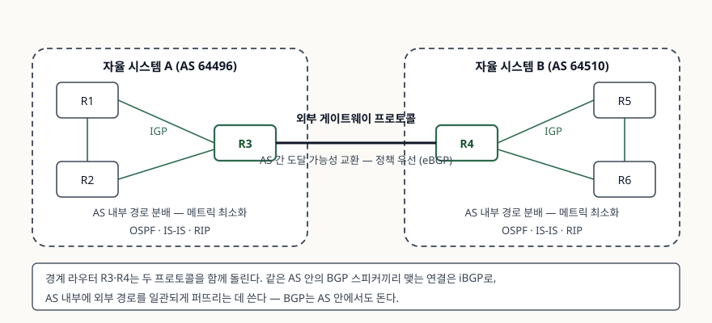

기출문제에서 동적 라우팅 프로토콜을 IGP와 EGP로 나눠 설명하라고 묻는다. "내부냐
외부냐"로 한 줄 쓰고 대표 프로토콜을 나열하면 절반만 쓴 답안이 된다. **경계를 긋는
기준은 물리적 안팎이 아니라 자율 시스템이고, 경로를 고르는 기준 자체가 다르다.**
그리고 EGP를 대표하는 BGP는 **AS 내부에서도 돈다.** 이 셋을 짚어야 답안이 선다.

> **실행 검증 없음.** 표준 문서 근거로만 정리했다.

---

## Ⅰ. 정의

### 가. 먼저 자율 시스템

두 프로토콜의 경계를 긋는 단위이므로 정의를 먼저 세운다. 출처마다 결이 다르니 둘을
같이 적는다.

- BGP-4 표준은 **단일 기술 관리 아래 있는 라우터 집합**으로 규정한다. 내부에서는 IGP와
  공통 메트릭으로 경로를 정하고, 외부에는 AS 간 라우팅 프로토콜을 쓴다
- AS 번호 운용 지침(BCP 6)은 **하나 이상의 IP 접두사가 연결된 묶음이며 하나의 명확히
  정의된 라우팅 정책을 갖는 것**으로 적는다. **라우팅 정책이 정의의 중심**이라는 점이
  이쪽의 강조점이다

AS 번호는 원래 2옥텟(0~65535)이었고, 4옥텟 확장으로 **0~4294967295** 까지 늘었다.
확장을 모르는 구형 스피커와 섞여 돌기 위해 **AS_TRANS(23456)** 한 값을 예약해 두고
2옥텟 경로 정보에서 대역 밖 번호를 대신하게 한다.

### 나. IGP와 EGP

| | **내부 게이트웨이 프로토콜(IGP)** | **외부 게이트웨이 프로토콜(EGP)** |
|---|---|---|
| 정의 | **단일 AS 안의 라우터들 사이에 라우팅 정보를 분배**하는 프로토콜 | **AS 사이에서 도달 가능성 정보를 교환**하는 프로토콜 |
| 라우터 표준의 표현 | AS 내부 라우팅(intra-AS routing) | AS 간 라우팅(inter-AS routing) |

**용어에 함정이 하나 있다.** EGP는 ① **프로토콜 부류의 이름**이면서 ② 1984년에 규격이
나온 **구체적인 프로토콜 한 개의 이름**이기도 하다. 후자는 현재 Historic 상태다. 라우터
요구사항 표준이 "EGP를 구현한다면 BGP도 반드시 구현해야 한다"고 쓴 것은 이 **구체
프로토콜 쪽**을 가리킨다. 답안에서 둘을 섞지 않는다.

## Ⅱ. 비교 — 5가지 축

> **출처**: [RFC 1812, Requirements for IP Version 4 Routers §7.1 Introduction, §7.2 Interior Gateway Protocols, §7.3 Exterior Gateway Protocols (1995-06)](https://www.rfc-editor.org/rfc/rfc1812.txt) · [RFC 4271, A Border Gateway Protocol 4 (BGP-4) §1.1 Definition of Commonly Used Terms, §3 Summary of Operation (2006-01)](https://www.rfc-editor.org/rfc/rfc4271.txt) — AS 내부·외부 구분과 iBGP·eBGP의 정의. 도식의 AS 번호는 문서 예시용으로 예약된 대역(RFC 5398)을 썼다

| 축 | IGP | EGP |
|---|---|---|
| **적용 범위** | 단일 AS 내부 | AS와 AS 사이 |
| **목표** | AS 안의 모든 라우터가 내부 경로에 **같은 뷰**를 갖게 한다 | 다른 AS의 **도달 가능성**을 알리고 받는다 |
| **경로 선택 기준** | **메트릭 최소화** — 홉 수, 링크 비용 | **라우팅 정책** — 계약·비용·신뢰 관계가 메트릭보다 앞선다 |
| **관리 주체** | 단일 기술 관리 | 서로 다른 관리 주체 사이의 합의 |
| **대표 프로토콜** | RIP(거리벡터), OSPF·IS-IS(링크 상태) | BGP-4 |

**경로 선택 기준의 차이가 핵심이다.** IGP는 "어디로 가야 가장 싼가"를 푼다. EGP는
"어디로 **보내도 되는가**"를 먼저 푼다. 더 짧은 경로가 있어도 계약상 쓰지 않기로 한
이웃이면 쓰지 않는다. 그래서 EGP에는 메트릭 대신 경로 속성과 정책 표현이 들어간다.

### 표준이 정한 구현 요구사항

답안에 넣으면 근거가 생기는 부분이다. 라우터 요구사항 표준은 이렇게 적는다.

- 정적 경로 외에 **라우팅 프로토콜을 하나라도 구현하는 라우터는 OSPF를 반드시 구현**해야
  한다. 추가 IGP는 **구현해도 된다**
- **AS 간 라우팅 프로토콜은 구현이 필수가 아니다.** 다만 **EGP를 구현한다면 BGP도 반드시
  구현**해야 한다

## Ⅲ. 활용 시 고려사항 — 4가지

### 가. BGP는 AS 내부에서도 돈다 — iBGP와 eBGP

"BGP = AS 간 프로토콜"이라는 도식이 깨지는 지점이다. BGP 연결은 상대가 어느 AS에
있느냐로 두 가지로 갈린다.

| 구분 | 피어의 위치 | 역할 |
|---|---|---|
| **eBGP** | **다른** AS | AS 간 도달 가능성 교환 |
| **iBGP** | **같은** AS | AS 안에서 **외부 경로**를 일관되게 공유 |

표준은 둘의 관계를 이렇게 정리한다. **IGP가 AS 내부 경로에 대한 일관된 뷰를 만들고,
AS 안의 BGP 스피커들은 iBGP로 외부 경로에 대한 일관된 뷰를 만든다.** 즉 한 AS 안에서
IGP와 iBGP가 **서로 다른 종류의 경로를 맡아** 함께 돈다. 경계 라우터가 받아 온 외부
경로를 IGP에 그대로 밀어 넣지 않는 이유도 여기에 있다.

### 나. 프로토콜 간 경로 재배포는 신중히 한다

라우터 요구사항 표준은 **라우팅 프로토콜 사이의 정보 교환**을 별도 절로 다룬다. IGP가
여럿이거나 BGP와 IGP를 섞는 환경에서 한쪽 경로를 다른 쪽에 넘기는 작업인데, 경로가
돌아 나왔다가 다시 들어가면 **루프와 불안정**이 생긴다. 재배포 지점에서 경로 필터링을
거는 것이 전제다. 같은 표준이 **라우팅 정보 필터링**도 별도 절로 둔 것이 그래서다.

### 다. AS 번호가 필요한 경우는 제한적이다

운용 지침은 **상위 피어와 다른 라우팅 정책이 있을 때만** 자체 AS가 필요하다고 적고,
**멀티호밍**(둘 이상의 사업자에 연결)을 사실상 거의 유일한 사유로 든다. 단일 연결
사이트의 접두사는 상위 사업자의 AS 안에 두면 된다. 여기서 말하는 멀티호밍은 한 사업자
안에서 회선을 이중화하는 것이 아니라 **사업자가 둘 이상**인 경우다.

### 라. 설계 판단의 축

- **AS 내부를 어떤 IGP로 가져갈 것인가** — 규모와 수렴 특성이 다른 거리벡터·링크 상태
  계열의 선택 문제다
- **AS 경계를 어디에 그을 것인가** — 정책이 갈리는 지점이 곧 경계다. 조직도가 아니라
  라우팅 정책으로 긋는다
- **경계 라우터가 두 프로토콜을 동시에 돌린다** — IGP 장애와 BGP 세션 장애의 영향
  범위가 다르므로 감시도 따로 건다

> 개념 정리: [라우팅 프로토콜 — 거리벡터와 링크상태](../../network/2026-09-28-routing-distance-vector-vs-link-state/index.md)

끝

## 답안 작성 메모

- **먼저 쓸 것**: 자율 시스템 정의 한 줄 → IGP·EGP 정의 두 줄 → 비교표. 자율 시스템을
  먼저 세우지 않으면 "내부·외부"가 무엇의 안팎인지 흐려진다.
- **점수가 갈리는 지점**: ① 경로 선택 기준을 **메트릭 최소화 대 정책 우선**으로 가르는가,
  ② **iBGP** 를 써서 "BGP는 AS 간 프로토콜"이라는 단순 도식을 넘어서는가, ③ EGP가
  **부류 이름이자 역사적 프로토콜 이름**이라는 용어 함정을 짚는가. 둘째가 가장 크다.
- **개수를 붙인다**: 비교 축 **5가지**, 고려사항 **4가지**, BGP 연결 유형 **2가지**.
- **대표 프로토콜은 계열까지 적는다**: RIP은 거리벡터, OSPF·IS-IS는 링크 상태. 이름만
  나열하면 "알고 있다"가 아니라 "외웠다"로 읽힌다.
- **시간이 모자라면**: AS 번호 4옥텟 확장과 재배포 절을 버린다. 비교표와 iBGP·eBGP
  표는 지킨다. 모식도는 점선 타원 두 개에 라우터 세 개씩, 가운데를 굵은 선으로 잇고
  안쪽에 IGP·바깥쪽에 eBGP만 적으면 2분 안에 그린다.
- **쓰지 말 것**: 근거 없는 수렴 시간·확장 한계 수치. "BGP는 AS 안에서는 쓰지 않는다"는
  단정. 특정 장비 벤더의 기본 관리 거리 값.
- **"라우팅 프로토콜 분류"로 확장되면**: 적용 범위(IGP·EGP) × 알고리즘(거리벡터·링크
  상태·경로벡터) 두 축으로 표를 만든다. BGP는 경로벡터이고, 이 축을 같이 쓰면 분류가
  한 겹 깊어진다.

## 참고 자료

- [RFC 1812, *Requirements for IP Version 4 Routers* (1995-06, Standards Track)](https://www.rfc-editor.org/rfc/rfc1812.txt) — §2.2.4 자율 시스템, §7.1 IGP·EGP의 구분, §7.2 내부 게이트웨이 프로토콜과 OSPF 구현 요구, §7.3 외부 게이트웨이 프로토콜과 BGP 구현 요구, §7.5 라우팅 정보 필터링, §7.6 라우팅 프로토콜 간 정보 교환, Appendix B 용어집 (1차)
- [RFC 4271, *A Border Gateway Protocol 4 (BGP-4)* (2006-01, Standards Track)](https://www.rfc-editor.org/rfc/rfc4271.txt) — §1 BGP의 목적, §1.1 자율 시스템·IGP·iBGP·eBGP·내부 피어·외부 피어 정의, §3 IGP와 iBGP의 역할 분담 (1차)
- [RFC 1930 / BCP 6, *Guidelines for creation, selection, and registration of an Autonomous System (AS)* (1996-03)](https://www.rfc-editor.org/rfc/rfc1930.txt) — §3 AS 정의(단일 라우팅 정책), §5 AS가 필요한 조건, §5.1 멀티호밍 (1차)
- [RFC 6793, *BGP Support for Four-Octet Autonomous System (AS) Number Space* (2012-12, Proposed Standard)](https://www.rfc-editor.org/rfc/rfc6793.txt) — AS 번호 공간 확장과 AS_TRANS(23456) 예약 (1차)
- [RFC 904, *Exterior Gateway Protocol Formal Specification* (1984-04, Historic)](https://www.rfc-editor.org/info/rfc904) — 부류 이름과 혼동되는 역사적 프로토콜 쪽의 규격 (1차)
- [RFC 5398, *Autonomous System (AS) Number Reservation for Documentation Use* (2008-12, Informational)](https://www.rfc-editor.org/info/rfc5398) — 문서 예시용 AS 번호 대역 64496~64511, 65536~65551 (1차)
- [RFC 2328, *OSPF Version 2* (1998-04, STD 54)](https://www.rfc-editor.org/rfc/rfc2328.txt) · [RFC 2453, *RIP Version 2* (1998-11, STD 56)](https://www.rfc-editor.org/rfc/rfc2453.txt) — 대표 IGP 두 계열의 규격 (1차)
