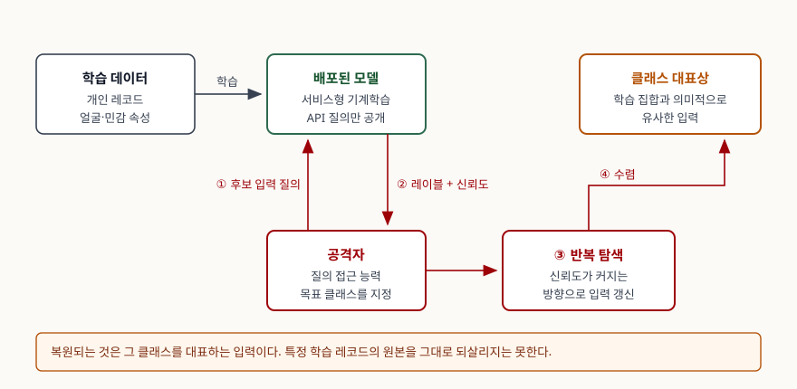

기출문제에서 모델 전도 공격을 묻는다. 이름 때문에 "모델을 거꾸로 돌려 학습 데이터를
꺼낸다"로 외우기 쉬운데, **그렇게 쓰면 틀린다.** 표준 분류 체계는 이 공격이 복원하는
것을 **클래스의 대표상**이라고 명시하고, 학습 데이터를 직접 재구성하지는 못한다고
못 박는다. 이 한 줄을 아는지가 답안의 수준을 가른다.

> **실행 검증 없음.** 표준·공식 문서 근거로만 정리했다.

---

## Ⅰ. 정의

**모델 전도 공격(Model Inversion Attack)** 은 **배포된 기계학습 모델에 질의를 반복하고
돌아오는 예측 신뢰도를 이용해, 목표 클래스의 학습 데이터가 가진 특징을 역방향으로
복원해 내는 프라이버시 공격**이다.

분류 체계상 위치를 함께 적으면 정의가 단단해진다.

- 미국 국립표준기술연구소의 적대적 기계학습 분류 체계는 공격을 **회피 · 오염 ·
  프라이버시 침해 · 오용 허용** 네 축으로 나눈다. 모델 전도는 이 중 **프라이버시
  침해**(NISTAML.03)에 속한다
- 프라이버시 침해는 다시 **데이터 프라이버시 공격**(학습 데이터를 노린다)과 **모델
  프라이버시 공격**(모델 자체를 노린다)으로 갈린다. 모델 전도는 앞쪽이다
- 데이터 프라이버시 공격의 세부 목표 다섯 가지 — **데이터 재구성 · 멤버십 추론 ·
  학습 데이터 추출 · 속성 추론 · 특성 추론** — 중에서 모델 전도는 **데이터
  재구성**(NISTAML.032)의 한 기법으로 분류된다

**복원의 한계도 정의에 포함된다.** 같은 문서는 모델 전도가 **학습 집합과 의미적으로
유사한 상을 만들어 낼 뿐, 모델의 학습 데이터를 직접 재구성하지는 못한다**고 적는다.
학습 데이터 표본 자체를 되살리는 것은 모델 파라미터에 접근하는 별도 연구 계열의
결과이고, 모델 전도와 같은 것이 아니다.

## Ⅱ. 성립 조건과 공격 절차

> **출처**: [NIST AI 100-2e2025, Adversarial Machine Learning §2.1.3 Attacker Capabilities, §2.4 Privacy Attacks and Mitigations, §2.4.1 Data Reconstruction (2025-03)](https://doi.org/10.6028/NIST.AI.100-2e2025) — 질의 접근 능력의 정의와 데이터 재구성·모델 전도의 분류

### 가. 성립 조건 — 4가지

| 조건 | 내용 | 근거 |
|---|---|---|
| **질의 접근** | 모델에 입력을 보내고 예측을 받을 수 있다 | 분류 체계의 공격자 능력 중 하나. 모델의 학습 데이터·구조·파라미터를 몰라도 되는 모든 프라이버시 공격이 이 능력을 쓴다 |
| **신뢰도 노출** | 응답이 레이블만이 아니라 **신뢰도 값**까지 담는다 | 분류 체계는 질의 접근이 반환하는 것을 "레이블 또는 모델 신뢰도"로 적는다. 원 논문의 기여가 바로 이 신뢰도를 이용한 것이다 |
| **목표 클래스 지정** | 복원하려는 클래스를 공격자가 안다 | 얼굴 인식이면 특정 인물의 레이블 |
| **반복 질의 허용** | 탐색이 수렴할 때까지 질의할 수 있다 | 질의 횟수 제한이 없거나 느슨하다 |

**지식 수준은 블랙박스로 충분하다.** 분류 체계는 공격자 지식을 화이트박스 ·
블랙박스 · 그레이박스로 나누는데, 모델 전도는 모델 내부를 모르는 블랙박스
상태에서도 성립한다. 서비스형 기계학습처럼 **API만 열려 있는 구성이 곧 공격 표면**이
된다는 뜻이다.

### 나. 절차 — 4단계

① 목표 클래스를 고르고 임의의 후보 입력을 만든다 → ② 그 입력을 질의해 **해당 클래스의
신뢰도**를 받는다 → ③ 신뢰도가 커지는 방향으로 입력을 갱신한다 → ④ 수렴한 입력이
그 클래스의 대표상이다.

핵심은 **모델이 돌려주는 신뢰도를 목적함수로 삼는 최적화**라는 점이다. 모델을 수학적으로
역함수화하는 것이 아니라, 공격자가 밖에서 산을 오르는 구조다.

### 다. 원 논문이 보인 범위

Fredrikson·Jha·Ristenpart가 2015년에 발표한 논문이 예측과 함께 공개되는 신뢰도를
이용하는 공격 유형을 제시했고, **생활습관 설문을 학습한 의사결정 트리**와 **얼굴 인식
신경망** 두 가지를 대상으로 평가했다. 그 이전 연구는 개인 맞춤 의료 영역의 선형
분류기에서 유전 정보를 추론한 사례였다.

## Ⅲ. 인접 공격과의 구분, 그리고 대응

### 가. 인접 공격 비교 — 5가지

답안에서 가장 자주 묻는 형태다. **무엇을 알아내는가**로 가른다.

| 공격 | 알아내려는 것 | 분류 |
|---|---|---|
| **데이터 재구성 (모델 전도)** | 학습 데이터의 **내용·특징** | 데이터 프라이버시 |
| **멤버십 추론** | 특정 레코드가 학습 집합에 **있었는가** | 데이터 프라이버시 |
| **학습 데이터 추출** | 생성형 모델에서 학습 데이터 **그 자체** | 데이터 프라이버시 |
| **속성 추론** | 다른 특징을 아는 상태에서 **민감 속성 한 칸** | 데이터 프라이버시 |
| **특성 추론** | 학습 데이터 **분포의 전역 성질**(예: 특정 속성의 비율) | 데이터 프라이버시 |
| **모델 추출** | 모델의 **구조·파라미터** | 모델 프라이버시 |

### 나. 대응 — 차분 프라이버시를 중심에 두되 경계를 적는다

분류 체계는 재구성 공격의 발견이 **차분 프라이버시**의 엄밀한 정의를 낳았다고 적고,
차분 프라이버시가 **데이터 재구성과 멤버십 추론에 대한 완화책이 된다**고 분명히 쓴다.
기계학습 학습 알고리즘으로는 DP-SGD가 가장 널리 쓰이고, DP-FTRL과 행렬 분해 기반
개선이 뒤따른다.

**다만 만능이 아니다.** 같은 절이 경계를 두 군데 긋는다.

- **모델 추출에는 보장이 없다.** 차분 프라이버시는 학습 데이터를 보호하도록 설계된
  것이지 모델을 보호하는 것이 아니다
- **특성 추론에는 부정적 결과가 보고됐다.** 학습 집합의 부분 모집단 성질을 빼내는
  공격에 차분 프라이버시를 적용한 연구들이 효과를 보지 못했다

모델 전도만 놓고 보면 추가로 쓸 수 있는 완화책이 더 있다.

| 완화책 | 내용 |
|---|---|
| **출력 최소화** | 신뢰도 값을 반환하지 않거나 거칠게 반올림한다. 성립 조건 중 "신뢰도 노출"을 끊는다 |
| **질의 통제** | 사용자당 질의 수를 제한하고 의심스러운 질의 패턴을 탐지한다. 분류 체계는 이 기법들을 모델 추출 완화책으로 들면서 **동기와 자원이 충분한 공격자는 우회할 수 있으므로 주의해서 쓰라**고 단서를 단다 |
| **프라이버시 감사** | 식별하기 쉬운 합성 표본(canary)을 학습 집합에 심고 출력에서 그 흔적을 재어 **실제 유출량을 경험적으로 측정**한다 |
| **기계 학습 제거** | 학습된 모델에서 특정 사용자의 데이터 영향을 제거한다. 재학습 방식(정확)과 파라미터 갱신 방식(근사)이 있고 계산 비용과 보장 수준이 맞바뀐다 |

### 다. 고려사항 — 3가지

- **암기를 완전히 없앨 수는 없다.** 학습 표본을 복원할 수 있는 배경에는 신경망이
  학습 데이터를 암기하는 성질이 있는데, 레이블 암기가 **거의 최적의 일반화 오차를
  달성하는 데 필요하다**는 연구 결과가 있다. 암기를 죽이면 성능이 죽는다
- **매개변수 설정이 실무의 난제다.** 차분 프라이버시의 프라이버시 예산 ε은 보호
  수준과 효용 사이의 맞바꿈을 정하는데, 이론 분석이 최악의 경우를 기준으로 하므로
  느슨하다. 그래서 실무에서는 큰 값이 쓰인다 — **2020년 미국 센서스 공개는 ε = 19.61**
  이었다. 이론 분석만으로 값을 고르지 말고 경험적 감사로 보완하라는 것이 권고다
- **학습 단계의 기밀성과 별개 문제다.** 암호 기반 보안 연산으로 학습 중 데이터와
  파라미터를 보호해도, **배포된 모델에 질의하는 공격자는 여전히 정보를 빼낼 수 있다.**
  모델 전도는 배포 시점의 공격이므로 학습 단계 대책으로 막히지 않는다

> 개념 정리: [적대적 머신러닝 공격 분류 — 회피·오염·프라이버시·오용 허용](../../security/2026-10-13-adversarial-ml-attack-taxonomy/index.md) · [멤버십 추론 공격과 학습 데이터 암기](../../security/2026-10-13-membership-inference-memorization/index.md) · [차분 프라이버시 — 프라이버시 손실 매개변수 ε과 누적 손실](../../security/2026-10-03-differential-privacy-epsilon-composition/index.md)

끝

## 답안 작성 메모

- **먼저 쓸 것**: 정의 한 줄 + **"복원되는 것은 클래스 대표상이지 학습 레코드 원본이
  아니다"**. 둘째 문장이 이 문제의 변별점이다. 정의만 쓰면 다른 답안과 똑같아진다.
- **점수가 갈리는 지점**: ① 분류 체계상 위치를 **프라이버시 침해 → 데이터 프라이버시
  → 데이터 재구성**으로 3단계로 짚는가, ② **신뢰도 노출**이 성립 조건이라는 점(그래야
  "출력 최소화"가 대책으로 연결된다), ③ 차분 프라이버시가 **모델 추출과 특성 추론에는
  보장이 없다**는 경계. 셋째까지 쓰면 대책 나열형과 갈린다.
- **개수를 붙인다**: 성립 조건 **4가지**, 절차 **4단계**, 인접 공격 **5가지 + 모델 추출**,
  고려사항 **3가지**.
- **멤버십 추론과 반드시 대비한다.** "있었는가"(멤버십)와 "무엇이었는가"(재구성)로
  한 줄에 가른다. 이 대비가 비교표의 첫 두 줄이다.
- **시간이 모자라면**: 원 논문 소개 절과 완화책 표의 뒤 두 줄(프라이버시 감사·기계
  학습 제거)을 버린다. 비교표와 차분 프라이버시의 경계는 지킨다. 모식도는 왼쪽에
  학습 데이터와 모델, 아래에 공격자, 질의와 신뢰도 두 화살표, 오른쪽에 복원 결과면
  3분 안에 그린다.
- **쓰지 말 것**: "모델 전도로 학습 데이터를 그대로 복원한다"는 단정. 근거 없는 복원
  정확도·성공률 수치. 차분 프라이버시를 적용하면 모든 프라이버시 공격이 막힌다는 서술.
- **"AI 프라이버시 위협"으로 확장되면**: 데이터 재구성 · 멤버십 추론 · 학습 데이터
  추출 · 속성 추론 · 특성 추론 · 모델 추출 여섯을 축으로 쓰고, 앞 다섯은 데이터
  프라이버시, 마지막은 모델 프라이버시로 묶는다.

## 참고 자료

- [NIST AI 100-2e2025, *Adversarial Machine Learning: A Taxonomy and Terminology of Attacks and Mitigations* (2025-03)](https://doi.org/10.6028/NIST.AI.100-2e2025) — §2.1.2 공격자 목표(데이터 프라이버시·모델 프라이버시 구분), §2.1.3 질의 접근 능력, §2.1.4 공격자 지식, §2.4 프라이버시 공격, §2.4.1 데이터 재구성(모델 전도의 분류와 한계), §2.4.5 완화(차분 프라이버시·프라이버시 감사·기계 학습 제거), 용어집 (1차)
- Matt Fredrikson, Somesh Jha, Thomas Ristenpart, "Model Inversion Attacks that Exploit Confidence Information and Basic Countermeasures", *Proceedings of the 22nd ACM SIGSAC Conference on Computer and Communications Security (CCS '15)*, pp. 1322–1333, [DOI 10.1145/2810103.2813677](https://doi.org/10.1145/2810103.2813677) — 신뢰도 값을 이용하는 공격 유형의 원 논문. 의사결정 트리·얼굴 인식 신경망 두 대상 평가. 위 보고서 참고문헌 [130]으로 확인, 원문 미열람 (1차)
- [NIST SP 800-226, *Guidelines for Evaluating Differential Privacy Guarantees*](https://csrc.nist.gov/pubs/sp/800/226/final) — 프라이버시 예산 ε의 해석과 평가 지침 (1차)
