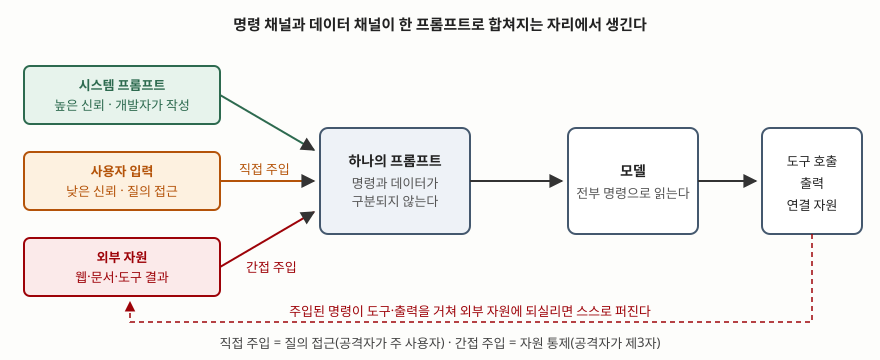

기출문제에서 프롬프트 인젝션을 묻는다. SQL 인젝션과 이름이 닮았지만 대응이 전혀 다르다.
SQL은 **구문을 파싱하는 엔진**이 받으므로 질의 틀과 값을 따로 보내는 바인딩으로 끊을 수
있다. 반면 언어모델에는 **값만 따로 보낼 통로가 없다.** 시스템 프롬프트도, 사용자 입력도,
모델이 읽어 온 웹 문서도 한 덩어리 토큰열로 들어간다. 그래서 이 취약점은 구현 실수가
아니라 **현재 모델 구조에서 나오는 성질**이고, 답안도 그 지점에서 출발해야 한다.

> **실행 검증 없음.** 표준·공식 문서 근거로만 정리했다.

---

## Ⅰ. 정의

**프롬프트 인젝션(Prompt Injection)** 은 **공격자가 모델에 들어가는 프롬프트에 자신의
지시를 끼워 넣어, 개발자가 의도한 동작 대신 공격자가 지정한 동작을 하게 만드는 공격**이다.

- OWASP는 "**사용자 프롬프트가 의도하지 않은 방식으로 LLM의 동작이나 출력을 바꿀 때**"
  이 취약점이 발생한다고 적고, **사람 눈에 보이지 않는 입력이라도 모델이 파싱하면 성립**한다고
  밝힌다. 보이는 글자만의 문제가 아니라는 뜻이다
- 미국 국립표준기술연구소의 적대적 기계학습 분류 체계는 더 구조적으로 적는다. **생성형 AI
  모델은 데이터 채널과 명령 채널을 하나로 합쳐 쓰기 때문에**, 공격자가 데이터 쪽을 건드려
  시스템 동작에 영향을 줄 수 있다는 것이다

**이 "두 채널이 합쳐져 있다"가 답안의 뼈대**다. 여기서 유형도 대응도 전부 따라 나온다.

## Ⅱ. 구조와 유형 — 2가지

> **출처**: [NIST AI 100-2e2025, Adversarial Machine Learning §3.1.3 공격자 능력, §3.3 Direct Prompting Attacks, §3.4 Indirect Prompt Injection Attacks (2025-03)](https://doi.org/10.6028/NIST.AI.100-2e2025) — 질의 접근·자원 통제 구분과 두 공격 유형의 정의

유형을 가르는 기준은 **공격자가 가진 능력**이다.

| 구분 | **직접 프롬프트 인젝션** | **간접 프롬프트 인젝션** |
|---|---|---|
| 공격자 능력 | **질의 접근**(query access) | **자원 통제**(resource control) |
| 공격자 위치 | 시스템의 **주 사용자 본인** | 모델이 읽을 자원을 심어 둔 **제3자** |
| 주입 경로 | 사용자 입력창 | 웹 페이지·문서·검색 결과·도구 반환값 |
| 피해자 | 주로 서비스 제공자 | **주 사용자가 피해자가 되는 경우가 많다** |
| 대표 사례 | 탈옥, 시스템 프롬프트 탈취 | 검색 결과·RAG 지식베이스 오염, 에이전트 탈취 |

### 가. 직접 — 주 사용자가 공격자다

분류 체계는 직접 프롬프트 인젝션을 **주 사용자가 넣은 맥락 내 지시가, 시스템 프롬프트처럼
더 높은 신뢰를 갖는 지시에 덧붙는 형태**로 규정한다. 공격자 목표는 셋으로 든다 —
**오남용 유도**(탈옥으로 거부 동작을 우회), **프라이버시 침해**(시스템 프롬프트나 맥락 내
비공개 정보 추출), **무결성 위반**(에이전트의 도구 호출·API 호출 조작).

### 나. 간접 — 공격자가 자원을 심는다

검색 증강 생성이나 에이전트처럼 **모델이 외부 자원을 읽어 오는 구조**에서, 그 자원에
지시를 미리 넣어 두는 방식이다. 분류 체계는 결과를 **가용성 침해 · 무결성 침해 ·
프라이버시 침해** 세 범주로 나누고, 연구로 입증된 기법을 든다.

- **가용성** — 응답 전에 오래 걸리는 작업을 시키기, 특정 API 사용을 금지시키기,
  출력 형식을 깨뜨려 후속 호출을 못 하게 만들기
- **무결성** — RAG 지식베이스 오염, 주입을 숨기는 기법(자원의 비가시 영역에 숨기기,
  다단계 주입, Base64로 인코딩해 두고 해독을 지시하기), 그리고 **자기 전파형 주입** —
  메일 클라이언트에 붙은 모델이 악성 메일을 읽고 연락처 전원에게 같은 메일을 보내게 만들어
  **웜처럼 번지게** 하는 것
- **프라이버시** — 접근 권한이 있는 자원에서 정보를 꺼내 공격자 주소로 전달시키기,
  마크다운 이미지 렌더링 같은 기능을 이용한 정보 유출

### 다. 에이전트에서 위험이 커진다

같은 문서의 에이전트 보안 절(§3.5)은, 에이전트가 **도구로 실제 행동을 하기 때문에** 같은
공격이 임의 코드 실행이나 환경 내 데이터 유출로 이어진다고 적는다. **모델이 틀린 말을
하는 데서 끝나지 않고 틀린 일을 한다**는 것이 차이다.

## Ⅲ. 대응 — 전제부터 다르다

**완전한 차단 기법은 알려져 있지 않다.** OWASP는 이 점을 명시하고 제시하는 항목을
"예방"이 아니라 **영향을 줄이는 완화책**으로 둔다. 분류 체계도 현세대 모델이 여전히
취약하다고 적으며, 방어를 두 층으로 나눈다.

| 층 | 무엇을 한다 | 예 |
|---|---|---|
| **모델·입력층** | 주입이 먹히기 어렵게 만든다 | 사용자 입력을 태그로 감싸 명령과 분리, 신뢰 계층을 따르도록 학습, 주입 탐지 모델, 외부 데이터의 지시를 무시하도록 지시 |
| **시스템 설계층** | **주입이 성공했다고 가정하고** 피해를 줄인다 | 최소권한, 고위험 행동에 사람 승인, 권한이 다른 모델 여럿으로 분리, 외부 자원은 정의된 인터페이스로만 접촉 |

**둘째 층이 답안의 차별점**이다. 분류 체계는 방어의 방향을 "모델의 견고성을 높이는 것"이
아니라 **"악성 출력을 낼 수 있다는 전제 위에서 시스템을 설계하는 것"** 으로 돌린다.
민감 데이터에 접근하거나 되돌리기 어려운 행동을 할 수 있는 모델은 **그 데이터를 흘리고
그 행동을 할 수 있다고 보고** 권한을 끊는다.

고려사항 네 가지를 덧붙인다.

- **출력 형식을 결정적 코드로 검증한다.** 모델에게 형식을 지켜 달라고 부탁하는 것과,
  어긴 출력을 코드가 거부하는 것은 다르다
- **탐지기도 공격 대상이다.** 탐지 모델 역시 공격받을 수 있고 본 모델과 같은 방식으로
  함께 실패할 수 있다. 심층 방어의 한 겹으로만 센다
- **외부 자원을 표시하고 분리한다.** 어디까지가 신뢰할 수 없는 데이터인지 모델과 코드
  양쪽에서 구분할 수 있어야 한다
- **적대적 시험을 정례화한다.** 모델을 신뢰할 수 없는 사용자로 보고 신뢰 경계를 주기적으로
  두드린다. 평가는 그 시점의 취약성만 재므로 배포 후에도 이어 간다

> 개념 정리: [적대적 머신러닝 공격 분류 — 회피·오염·프라이버시·오용 허용](../../security/2026-10-13-adversarial-ml-attack-taxonomy/index.md)

끝

## 답안 작성 메모

- **먼저 쓸 것**: "**데이터 채널과 명령 채널이 합쳐져 있다**" 한 줄과 직접·간접 비교표.
  이 두 개가 답안의 축이고, 나머지는 여기서 파생된다.
- **점수가 갈리는 지점**: ① 직접·간접을 **공격자의 능력**(질의 접근 / 자원 통제)으로
  가르는가 — 입력 위치로만 나누면 평범해진다, ② **간접 주입은 주 사용자가 피해자**라는 점,
  ③ **완전 차단이 없다는 전제 위에서 시스템을 설계한다**는 대응 방향. 셋째까지 쓰면
  대책 나열형 답안과 갈린다.
- **개수를 붙인다**: 유형 **2가지**, 직접 주입의 공격자 목표 **3가지**, 간접 주입의 침해
  범주 **3가지**(가용성·무결성·프라이버시), 대응 **2층**, 고려사항 **4가지**.
- **SQL 인젝션과 대비하면 한 단락을 번다**: 바인딩으로 끊을 수 있는 쪽과 **값만 따로
  보낼 통로가 없는** 쪽. 다만 "프롬프트 인젝션도 입력 검증으로 막는다"고 쓰면 틀린다.
- **시간이 모자라면**: 간접 주입 기법 목록을 셋으로 줄이고 에이전트 절을 버린다.
  비교표와 대응 2층 표는 지킨다. 모식도는 왼쪽에 신뢰 수준이 다른 입력 셋, 가운데에
  합쳐진 프롬프트, 오른쪽에 모델과 도구를 두면 2분 안에 그린다.
- **쓰지 말 것**: "~를 적용하면 프롬프트 인젝션을 차단할 수 있다"는 단정. 근거 없는
  공격 성공률·탐지율 수치. 그리고 특정 상용 가드레일 제품 이름.
- **"생성형 AI 보안 위협"으로 확장되면**: 공급망 공격(데이터·모델 오염), 직접 프롬프트
  공격, 간접 프롬프트 인젝션, 에이전트 보안 네 축이 분류 체계의 구성이다. 그대로 뼈대로 쓴다.

## 참고 자료

- [NIST AI 100-2e2025, *Adversarial Machine Learning: A Taxonomy and Terminology of Attacks and Mitigations* (2025-03)](https://doi.org/10.6028/NIST.AI.100-2e2025) — §3.1.3 공격자 능력(질의 접근·자원 통제·모델 통제), §3.3 직접 프롬프팅 공격과 완화, §3.4 간접 프롬프트 인젝션(가용성·무결성·프라이버시), §3.5 에이전트 보안, 용어집 (1차)
- [OWASP Top 10 for LLM Applications 2025, LLM01:2025 Prompt Injection](https://genai.owasp.org/llmrisk/llm01-prompt-injection/) — 취약점 정의, 직접·간접 구분, 예시 시나리오 9가지, 완화 7가지 (1차)
- [OWASP Top 10 for LLM Applications 2025 전체 문서](https://genai.owasp.org/llm-top-10/) — 목록 전체와 발행 연도 (1차)
- Kai Greshake 외, "Not What You've Signed Up For: Compromising Real-World LLM-Integrated Applications with Indirect Prompt Injection", arXiv:2302.12173 (2023) — 간접 프롬프트 인젝션 개념과 가용성·무결성·프라이버시 공격 기법의 원 논문. NIST 보고서 참고문헌 [146]으로 확인, 원문 미열람
- 관련 글: [SQL 인젝션은 이스케이프가 아니라 바인딩으로 막는다](../../../Security/2026-10-16-sql-injection-binding-not-escaping/index.md) — 값 통로가 있는 쪽의 대응
