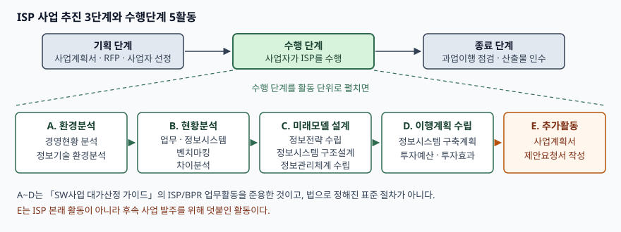

> 실행 검증 없음. 정의·절차·활동 목록은 한국소프트웨어산업협회가 공표한
> 「SW사업 대가산정 가이드 2024년 개정판」과 한국정보화진흥원의
> 「전자정부지원사업 정보화전략계획(ISP) 산출물 점검 가이드 V1.0」에 적힌 것만 옮겼다.
> 사업 건수·비용 절감률 같은 수치는 원 출처를 확인하지 못해 쓰지 않았다.

문항은 세 갈래로 나눠 묻는다. ISP가 무엇이고 왜 하는지, 어떤 체계와 순서로 수행하는지,
ISMP와 무엇이 다른지다. 물은 순서를 그대로 대항목으로 쓴다.

---

## Ⅰ. 개요

공공 정보화사업에서 ISP와 ISMP는 **예산을 요구하기 전에 반드시 통과해야 하는 관문**이다.
한국지능정보사회진흥원은 각 중앙행정기관이 정보시스템 구축·재구축 예산을 요구하기에
앞서 ISP 또는 ISMP를 수립해 기획재정부의 검토를 받아야 한다고 밝히고, 기획재정부와
함께 「ISP·ISMP 수립 공통가이드」를 매년 개정해 배포한다. 2025년 5월에 제9판이 나왔고
같은 해 12월에 일부 개정됐다.

둘을 가르는 축은 "계획이냐 아니냐"가 아니다. **같은 계획 활동을 어느 해상도까지
내려가서 쓰느냐**다. ISP는 조직 전체를 보고 중장기 과제와 목표 구조를 그리고,
ISMP는 사업 하나를 붙들고 요구사항을 기능점수로 셀 수 있는 수준까지 적는다.
해상도가 다르면 산출물이 다르고, 산출물이 다르면 뒤따르는 발주의 품질이 갈린다.

---

## Ⅱ. ISP의 정의 및 목적 (가)

### 가. 정의

공표된 가이드의 용어 정의를 그대로 쓴다.

> **정보전략계획(ISP: Information Strategy Planning)** 은 조직 내의 전략적 정보 요구를
> 파악하여 업무활동과 이에 대한 자료영역을 기술하고, 현행 정보지원 정도를 평가하며,
> 정보시스템 개발을 위한 통합된 프레임워크를 제공하고, 이를 구현하기 위하여 정보기술을
> 활용한 통합정보시스템 계획을 작성하는 체계적인 접근활동이다.

이 정의는 네 개의 동사로 끊어진다. **① 전략적 정보 요구 파악 → ② 업무활동과 자료영역
기술 → ③ 현행 정보지원 수준 평가 → ④ 통합정보시스템 계획 작성**이다. 답안에서는
정의를 한 문장으로 적은 뒤 이 네 단계를 괄호로 덧붙이면 정의와 절차가 한 줄에 들어간다.

공공기관의 ISP는 통상 업무재설계(BPR)를 일부 수반하므로, 산출물 점검 가이드는
ISP를 **BPR을 포함하는 개념**으로 쓴다고 명시한다. 답안에서 ISP와 ISP/BPR을
구분해 쓸지 묶어 쓸지는 이 전제를 한 줄 밝히고 가면 된다.

### 나. 목적 — 네 가지

| 목적 | 무엇을 산출하는가 | 근거 |
|---|---|---|
| ① 경영전략과 정보화전략의 연계 | 정보화 비전·목표·추진단계 전략 | 경영전략과 정보화 전략 연계 및 새로운 정보기술 반영 |
| ② 중장기 과제와 로드맵 도출 | 이행과제, 통합 실행일정, 자원계획 | 통상 3년 또는 5년 중장기 계획 수립 |
| ③ 투자 근거 확보 | 정보화 투자예산(HW·SW), 투자효과 분석 | 예산요구 전 수립, 기획재정부 검토 |
| ④ 통합·공유 가능한 목표 구조 정의 | 응용 구조, 통합정보시스템 기술구조도 | 다양한 조직단위가 정보를 공유하는 통합정보시스템 계획 |

산출물 점검 가이드는 ISP 사업을 "사업의 방향과 정보기술의 방향을 통합하여 조직의 사업
비전을 지원하고, 정보관리를 위한 전반적인 전략을 정의하여 다양한 조직단위에 의해 정보가
공유 가능하도록 하는 통합된 정보시스템을 위한 계획을 수립하는 것"으로 적는다.
**목적의 주어가 "조직의 사업 비전"이지 "시스템"이 아니라는 점**이 ISP의 성격을 드러낸다.

### 다. 정보시스템 관점에서 ISP가 실제로 요구하는 것

제도 설명에서 멈추면 답안이 행정 문서가 된다. ISP가 정보시스템에 요구하는 것은 네 가지다.

- **목표 응용·기술 구조**: 응용 구조 정의와 통합정보시스템 기술구조도를 산출한다.
  여기서 내·외부 시스템과의 **기능 중복**과 연계·통합, 정보 공동활용이 함께 검토된다.
- **정보자원 관리체계**: 운영관리 조직 체계도, 정보자원 관리 체계 정의서, 보안체계
  구조정의, 투자효과 평가지표까지를 ISP 단계에서 정한다.
- **하드웨어 규모 산정**: 「정보시스템 하드웨어 규모산정 지침」(TTAK.KO-10.0292)을
  준수했는지와 산출 근거의 적정성이 수행단계 중점 점검 항목이다.
- **예산 산정의 정량 근거**: 투자예산을 내려면 기능 규모를 세야 하므로, 형식상
  '추가활동'인 기능점수 도출이 실질적으로는 필수 활동이 된다.

감사 지적 사례로 거론되는 것도 이 지점이다. **사업 중복성 검토 미흡, 하드웨어 용량산정
오류(규정 미준수·산정 오류·과다 산정), 최종검사 시 산출물 누락** 세 가지다.

---

## Ⅲ. ISP 수행방법론 체계와 절차 (나)

### 가. 체계 — 두 층으로 본다

ISP 방법론은 **사업을 관리하는 층**과 **컨설팅을 수행하는 층**이 겹쳐 있다.
이 둘을 구분하지 않으면 답안에서 "기획–수행–종료"와 "환경분석–현황분석–…"이
뒤섞여 한 줄에 놓인다.

- **사업 추진 층(발주자 관점)**: 기획 → 수행 → 종료의 3단계
- **수행 층(사업자 관점)**: 수행 단계 안에서 활동(Activity)과 태스크(Task)로 내려간다

용어도 층마다 어긋난다. 산출물 점검 가이드는 대가산정 가이드의 '단계/활동'을 각각
'활동/태스크'로 바꿔 쓴다고 명시한다. 답안에서는 **"단계–활동–태스크"로 층을 먼저
선언**하고 들어가는 편이 안전하다.

### 나. 표준 절차가 없다는 사실 자체가 논점이다

ISP 수행 절차에는 법으로 정해진 표준이 없다. 산출물 점검 가이드는 "ISP 수행을 위한
절차나 산출물에 대한 기준이 명확하게 정의되어 있지 않아" 부득이 **어느 정도 통용되는
기준**을 활용했다고 적고, 그 기준으로 「SW사업 대가산정 가이드」의 ISP/BPR 업무활동을
준용한다고 밝힌다. 그 업무활동표는 원래 **대가 산출을 위해 작업분할도를 만들려고**
제시된 것이지 수행 표준이 아니다.

여기서 따라오는 결론이 둘이다. ① ISP 절차와 산출물은 사업자의 방법론과 제안요청서의
기능 요구사항에 따라 달라진다. ② 따라서 **발주자는 제안요청서의 기능 요구사항에
단계별 활동·범위·산출물을 직접 써 넣어야 한다.** 쓰지 않으면 점검할 기준이 없다.

### 다. 사업 추진 3단계

| 단계 | 핵심 활동 | 핵심 산출물·점검 |
|---|---|---|
| 기획 | 사업계획서 작성 → 제안요청서·제안안내서 작성 → 제안서 평가·사업자 선정 → 기술협상·계약 → 착수계 접수 | ISP 사업계획서, 제안요청서. 필수 산출물이 요구사항에 빠짐없이 들어갔는지 검토 |
| 수행 | 환경분석 → 현황분석 → 미래모델 설계 → 이행계획 수립 | 과업대비표·요구사항추적표로 수행내용과 산출물을 추적. 중복성·HW 용량산정·예산 지침 준수 검토 |
| 종료 | 과업이행 여부 점검 → 최종 산출물 인수 → 잔금 지급 | 과업대비표 기반 검사표. 산출물 누락 여부 점검 |

제안요청서의 요구사항 유형 중 ISP에 적용되는 것은 **기능·보안·제약사항·프로젝트
관리·프로젝트 지원**이고, 성능·시스템 장비구성·인터페이스·데이터·테스트는 적용되지
않는다. ISP는 시스템을 만드는 사업이 아니라 계획을 만드는 사업이기 때문이다.

### 라. 수행단계의 활동과 태스크 — 5활동 11태스크

> **출처**: [전자정부지원사업 정보화전략계획(ISP) 산출물 점검 가이드 V1.0, 제2장 ISP 사업 추진절차 (한국정보화진흥원, 2015.7)](https://m.korea.kr/expertWeb/resources/files/data/document_file/2015/%EC%A0%84%EC%9E%90%EC%A0%95%EB%B6%80%EC%A7%80%EC%9B%90%EC%82%AC%EC%97%85_%EC%A0%95%EB%B3%B4%ED%99%94%EC%A0%84%EB%9E%B5%EA%B3%84%ED%9A%8D%28ISP%29_%EC%82%B0%EC%B6%9C%EB%AC%BC_%EC%A0%90%EA%B2%80_%EA%B0%80%EC%9D%B4%EB%93%9C535.pdf)

| 활동 | 태스크 | 주요 산출물 |
|---|---|---|
| A. 환경분석 | A.1 경영현황 분석 A.2 정보기술 환경분석 | 환경분석서, 핵심성공요소(CSF), 주요 정보화 요구사항(CIR), CSF/CIR 연관도, 주요 정보기술 동향, 정보기술 적용성 |
| B. 현황분석 | B.1 업무분석 B.2 정보시스템 분석 B.3 벤치마킹 B.4 차이분석 | 현행 프로세스 맵 및 기술서, 조직 vs 업무 상관도, 정보화 요구사항, 법제도 분석서, 현행 기술 구조도, 현행 정보시스템 분석서, 선진사례 동향파악서, 벤치마킹 요약서, 차이 분석서 |
| C. 미래모델 설계 | C.1 정보전략 수립 C.2 정보시스템 구조 설계 C.3 정보관리체계 수립 | 정보화 비전, 정보화 목표 및 과제, 정보화 추진단계 전략, 정보시스템 기술 요건, 응용 구조 정의, 통합정보시스템 기술구조도, 운영관리 조직 체계도, 정보자원 관리 체계 정의서, 보안체계 구조정의, 투자효과 평가지표 |
| D. 이행계획 수립 | D.1 정보시스템 구축계획 수립 | 정보시스템 구축일정, 전환전략, 통합실행일정 및 자원계획, 정보화 투자예산(HW·SW), 투자효과 분석 |
| E. 추가활동 | E.1 사업계획서 및 제안요청서 작성 | 사업계획서, 제안요청서 |

활동 **5개**, 태스크 **11개**, 산출물 **32개**다. 숫자를 적어 두면 채점자가 범위를 센다.

세 가지는 짚고 넘어가야 한다. 첫째, 공공기관 특성을 반영해 업무분석에 **법제도 분석서**가,
구축계획에 **정보화 투자예산(HW·SW)** 이 더해졌다. 둘째, BPR 성격의 '미래업무 프로세스
설계'와 '업무프로세스 개선계획 수립'은 ISP에서 다루기 어려워 **제외**됐다. 셋째,
대가산정 가이드에서 '추가활동'으로 분류된 기능점수 도출이 여기서는 **사업계획서·제안요청서
작성**으로 바뀌었다.

### 마. 대가산정 가이드의 ISP 업무활동 — 5단계 16활동

같은 ISP를 대가 산정 관점에서 쪼개면 분절이 달라진다. 답안에서 절차를 묻는다면
이쪽 분류를 써도 된다.

| 단계 | 활동 | 수 |
|---|---|---|
| 환경분석 | 경영환경 분석, 정보기술 환경분석, 제도/규정 분석 | 3 |
| 현황분석 | 경영전략 분석, 업무 분석, 정보시스템 분석, 벤치마킹, 차이 분석 | 5 |
| 목표모델 수립 | 정보화 전략 수립, 정보시스템 구조설계, 정보관리체계 수립, 제도/규정 개선안 수립 | 4 |
| 이행계획 수립 | 정보시스템 구축계획 수립 | 1 |
| 세부계획 작성 | 소요예산 산출, 기대효과 산정, 제안요청서 작성 | 3 |

**5단계 16활동**이다. 앞의 11태스크 분류와 수가 다른 것은 기준 문서가 다르기 때문이고,
답안에서는 어느 쪽을 쓰든 **출처를 한 줄 밝히면 감점되지 않는다.** 두 분류를 섞어
쓰는 것이 위험하다.

### 바. 대가 산정 방식

ISP 수립비는 두 방식 중 하나로 산정한다. **컨설팅업무량 방식**은 업무별 가중치의 합에
난이도(업무규모·업무 특성·기존 시스템·ISP 유형·정보자원 규모의 곱)를 곱해 업무량을
구한 뒤 단가를 곱한다. **투입공수 방식**은 사전준비 → 투입공수 산정 → 직접인건비 계산 →
제경비·기술료 계산 → 직접경비 계산 → 대가 산정의 6단계를 따른다. 제경비는 직접인건비의
144~154%, 기술료는 (직접인건비+제경비)의 20~40%다.

과거 유사 사업이 없어 투입공수를 추정할 수 없거나 업무량 방식의 상한을 넘는 대형
사업이면 업무량 방식을, 유사 사업을 참조해 공수 추정이 가능하면 투입공수 방식을 쓴다.
**ISMP는 투입공수 방식만 적용된다.**

---

## Ⅳ. ISP와 ISMP 비교 (다)

### 가. ISMP의 정의

> **정보시스템 마스터플랜(ISMP: Information System Master Plan)** 은 특정 소프트웨어 개발
> 사업에 대한 상세분석과 제안요청서(RFP)를 마련하기 위해 비즈니스(업무) 및 정보기술에
> 대한 현황과 요구사항을 분석하고, 기능점수 도출이 가능한 수준까지 기능적·기술적·비기능적
> 요건을 상세히 기술하며, 구축 전략 및 이행 계획을 수립하는 활동이다.

정의의 목적어가 "통합정보시스템 계획"이 아니라 **"제안요청서"** 라는 점이 ISP와 갈리는
첫 자리다. 그리고 상세화의 기준선이 **"기능점수 도출이 가능한 수준"** 으로 명시돼 있다.
이 한 구절이 ISMP의 모든 활동을 규정한다.

### 나. ISMP 수행 절차 — 5단계 19활동

| 단계 | 활동 |
|---|---|
| ① 프로젝트 착수 및 참여자 결정 | 경영진 지원조직 형성 · 프로젝트 수행조직 편성 · 프로젝트 계획 수립 (3) |
| ② 정보시스템 방향성 수립 | 정보화 전략 검토 · 벤치마킹 분석(선택) · 추진 범위 및 방향 정의 · 추진 범위 및 방향 검토 (4) |
| ③ 업무 및 정보기술 요건 분석 | 업무 및 정보기술 현황 분석 · 업무 요건 분석 · 정보기술 요건 분석 · 업무 및 정보기술 요건 검토 (4) |
| ④ 정보시스템 구조 및 요건 정의 | 정보시스템 아키텍처 정의 · 요건의 이행 연관성 식별 · 요건 기술서 작성 (3) |
| ⑤ 정보시스템 구축사업 이행방안 수립 | 구축사업 계획 수립 · 분리발주 가능성 평가 · 정보시스템 예산 수립 · 제안요청서(RFP) 작성 · 구축업체 선정·평가 지원 (5) |

업무활동 구성표 기준으로 **5단계 19활동**이다. 같은 가이드의 대가 산정 종합양식에서는
'정보시스템 요건 기술서 검토'를 ④의 별도 활동으로 세어 20활동이 된다. 답안에서는
**"5단계"** 를 먼저 못 박고 활동 수는 단계별로 적는 편이 안전하다.

③단계의 정보기술 요건 분석은 도입대상 장비·데이터·애플리케이션 성능·표준화·테스트·보안·
시스템 운영·교육 및 기술지원·그 외 프로젝트 지원 요건까지 내려간다. **제안요청서에
적힐 비기능 요구사항의 목록이 여기서 만들어진다.**

### 다. 비교

| 축 | ISP | ISMP |
|---|---|---|
| 목적 | 경영전략과 정보화전략 연계, 새로운 정보기술 반영 | 특정 정보시스템의 기능적·기술적·비기능적 요구사항 상세화 |
| 범위 | 전사, 서비스 또는 부서 대상 정보화 전략 | 단위 프로젝트 또는 단위 프로젝트의 묶음 |
| 상세 수준 | 목표시스템의 개념·구조 수준 | 기능점수 도출이 가능한 수준 |
| 주요 활동 | 경영환경·정보기술 동향 분석, 업무·정보시스템 구조 분석, 정보전략·정보관리체계 수립, 미래업무 프로세스 및 구조 설계, TO-BE 로드맵 | 구축 범위·방향 수립, 기능·기술 요건 도출, 구조 및 요건 상세 기술, 구축 사업계획 수립, 예산 산정 및 업체 선정·평가 지원 |
| 주요 산출물 | 경영환경·정보기술 동향 분석 보고서, 업무/정보시스템 분석 보고서, IT 비전 및 전략, 이행과제 및 로드맵, 제안요청서 | 제안요청서, 정보시스템 예산 |
| 기간 범위 | 통상 3~5년 중장기 | 해당 사업의 구축 기간 |
| 대가 산정 | 컨설팅업무량 방식, 투입공수 방식 둘 다 | 투입공수 방식만 |

**흔한 오답 하나를 짚는다.** "ISP는 제안요청서를 만들지 않는다"는 서술은 틀렸다.
대가산정 가이드의 ISP 주요 산출물에도, 산출물 점검 가이드의 ISP 추가활동에도
제안요청서가 들어 있다. 갈리는 것은 **제안요청서의 해상도**다. ISP가 만드는
제안요청서는 요구사항을 개략적으로 적고, ISMP가 만드는 제안요청서는 기능점수를 셀 수
있을 만큼 적는다. 그래서 ISMP 절차에는 **정보시스템 예산 수립 활동 안에 기능점수
산정**이 들어 있고, **분리발주 가능성 평가**가 별도 활동으로 선다.

### 라. 전사적 아키텍처(EA/ITA)와의 자리

세 개를 함께 물을 때를 대비해 한 문단으로 정리한다. **ISP가 정보기술의 방향과 계획을
제시하는 CIO 차원이라면, EA/ITA는 전사 차원의 구성요소를 정의하고 보완해 나가는
측면이고, ISMP는 EA/ITA의 목표 아키텍처 구조 아래에서 정보기술 방향·계획과 일치하도록
특정 사업의 구축 목표와 방향을 세우고 사용자·시스템 요구사항을 기술한다.**
세 개는 경쟁 관계가 아니라 **해상도의 계층**이다.

### 마. 선택 기준

| 상황 | 선택 |
|---|---|
| 조직 전체의 정보화 방향이 아직 정해지지 않음 | ISP |
| 다수 과제의 우선순위와 중장기 로드맵이 필요함 | ISP |
| 대상 사업과 범위가 이미 정해져 있고 발주가 임박함 | ISMP |
| 요구사항 불명확으로 과업 변경 분쟁이 예상되는 사업 | ISMP |
| 패키지 활용·분리발주 여부를 가려야 하는 사업 | ISMP |

판단의 축은 **"지금 정해야 하는 것이 무엇을 할지인가, 어떻게 발주할지인가"** 다.
전자면 ISP, 후자면 ISMP다.

---

## Ⅴ. 결론

ISP는 조직의 전략적 정보 요구를 파악해 통합정보시스템 계획을 작성하는 체계적 접근활동이고,
그 체계는 발주자의 추진 3단계와 사업자의 수행 활동·태스크라는 두 층으로 이루어진다.
수행 절차에 법정 표준이 없다는 점 때문에 **제안요청서의 기능 요구사항이 사실상의 절차
규정** 역할을 하며, 과업대비표와 요구사항추적표가 그 이행을 묶는다.

ISMP는 ISP가 남긴 해상도의 공백을 사업 단위에서 메운다. 상세화의 기준선이 "기능점수
도출이 가능한 수준"으로 명시돼 있어, 산출물이 제안요청서와 예산으로 수렴한다.
따라서 **ISP와 ISMP는 택일 관계가 아니라 적용 시점과 대상이 다른 활동**이며,
예산 요구 단계에서 둘 중 하나를 수립하라는 제도 역시 이 차이를 전제한 것이다.

> 개념 정리: [ISP와 ISMP — 산출물과 발주 시점이 갈리는 지점](../../it-management/2026-10-16-isp-vs-ismp/index.md)

끝

---

## 답안 작성 메모

- **분량 배분**: (가) 0.6장, (나) 1.4장, (다) 1장이 무난하다. (나)가 가장 길어야 한다.
  정의와 목적은 누구나 쓰므로 변별이 안 되고, 절차의 층 구분과 산출물에서 갈린다.
- **먼저 쓸 것**: ① ISP 정의 한 문장, ② 추진 3단계 + 수행 5활동 도식, ③ ISP·ISMP 비교표.
  이 셋만 있으면 뼈대가 선다. 도식과 비교표를 먼저 그려 두면 뒤에 시간이 모자라도
  채점자가 범위를 읽는다.
- **점수가 갈리는 지점 셋**
  1. **층을 구분했는가.** "기획–수행–종료"와 "환경분석–현황분석–…"을 한 줄에 늘어놓은
     답안이 가장 흔하다. 두 층이 다른 관점이라는 것을 먼저 선언하고 들어간다.
  2. **표준 절차가 없다는 사실을 썼는가.** ISP 절차가 대가 산출용 업무활동표를 준용한
     것이라는 서술은 가이드에 적힌 사실이고, 여기서 "그래서 제안요청서에 활동과
     산출물을 직접 써야 한다"는 실무 결론까지 이어지면 변별이 생긴다.
  3. **ISMP 상세화의 기준선을 적었는가.** "더 자세히 쓴다"가 아니라 **"기능점수 도출이
     가능한 수준"** 이라는 명시된 기준선을 쓴다. 이 한 구절이 분리발주 평가와 예산
     산정으로 이어진다는 서술까지 붙인다.
- **시간이 모자라면 버릴 것**: 대가 산정 방식(Ⅲ-바)과 EA/ITA 비교(Ⅳ-라).
  단, 도식과 ISP·ISMP 비교표는 버리지 않는다.
- **쓰지 말 것**: "ISP는 RFP를 만들지 않는다"는 서술, ISMP 도입 효과를 숫자로 적는 것.
  둘 다 근거가 없다. 개수를 적을 때는 **기준 문서를 함께 밝힌다** — 분류마다 활동 수가
  다르므로, 출처 없이 숫자만 적으면 틀린 것처럼 읽힌다.

---

## 참고 자료

- [SW사업 대가산정 가이드 2024년 개정판 (한국소프트웨어산업협회, 2024-05-13)](https://data.cmpi.or.kr/program/board/%5B2024.05.13%5D%20%EC%86%8C%ED%94%84%ED%8A%B8%EC%9B%A8%EC%96%B4%EC%82%AC%EC%97%85%20%EB%8C%80%EA%B0%80%EC%82%B0%EC%A0%95%20%EA%B0%80%EC%9D%B4%EB%93%9C.pdf) — 용어 정의(ISP·ISMP), ISMP/ISP/EA 개념 비교, ISP·ISMP 업무활동과 대가 산정 절차
- [전자정부지원사업 정보화전략계획(ISP) 산출물 점검 가이드 V1.0 (한국정보화진흥원, 2015.7)](https://m.korea.kr/expertWeb/resources/files/data/document_file/2015/%EC%A0%84%EC%9E%90%EC%A0%95%EB%B6%80%EC%A7%80%EC%9B%90%EC%82%AC%EC%97%85_%EC%A0%95%EB%B3%B4%ED%99%94%EC%A0%84%EB%9E%B5%EA%B3%84%ED%9A%8D%28ISP%29_%EC%82%B0%EC%B6%9C%EB%AC%BC_%EC%A0%90%EA%B2%80_%EA%B0%80%EC%9D%B4%EB%93%9C535.pdf) — ISP 사업 추진 3단계, 수행단계 활동·태스크·산출물, 중점 점검사항
- [ISP·ISMP 수립 공통가이드(제9판) 배포 (한국지능정보사회진흥원, 2025-05-19)](https://nia.or.kr/site/nia_kor/ex/bbs/View.do?cbIdx=99835&bcIdx=28088&parentSeq=28088) — 예산요구 전 ISP 또는 ISMP 수립 의무와 기획재정부 검토, 제9판 개정 사항
- 정보시스템 하드웨어 규모산정 지침(TTAK.KO-10.0292, 한국정보통신기술협회) — ISP 수행단계 HW 용량산정의 준거 기준. 표준 번호는 위 산출물 점검 가이드가 인용한 것이다
