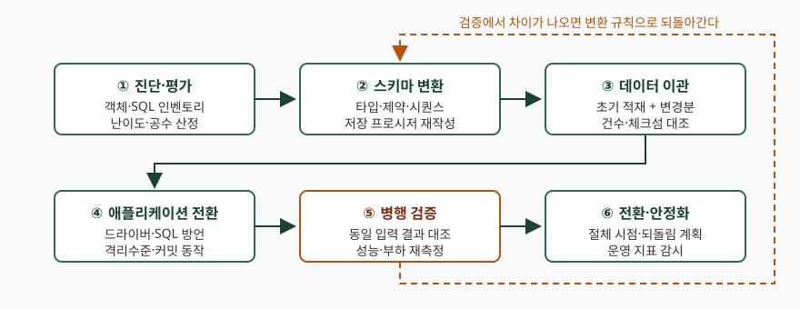
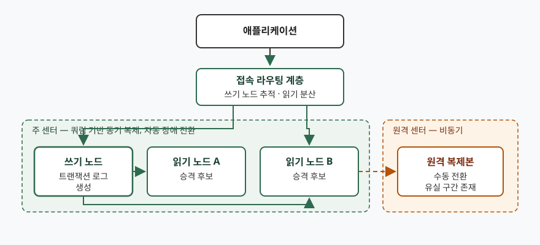

> 실행 검증 없음. 공식 매뉴얼(PostgreSQL 17 문서, MySQL 8.0 Reference Manual, MySQL Shell 8.0 문서)과
> 라이선스 원문에 적힌 동작만 옮겼고, 출력·측정값은 싣지 않았다.

문항은 상용 DBMS를 오픈소스 DBMS로 옮기는 흐름을 네 갈래로 나눠 묻는다.
전환이 왜 늘고 있는지, 옮기기 전에 무엇을 따져야 하는지, 어떤 순서로 옮기는지,
옮긴 뒤 신뢰성을 어떻게 확보하는지다. 물은 순서를 그대로 대항목으로 쓴다.

---

## Ⅰ. 개요

오픈소스 DBMS 전환은 **같은 기능을 더 싸게 사는 일이 아니라 책임의 소재가 옮겨 가는 일**이다.
상용 제품에서 벤더가 계약으로 지던 보증·지원·장애 대응이, 오픈소스에서는 라이선스의
면책 조항으로 바뀐다. PostgreSQL 라이선스는 소프트웨어가 "AS IS" 기준으로 제공되며
유지보수·지원·갱신을 제공할 의무가 없다고 명시한다.

그 공백은 **조직이 직접 갖추는 운영 역량**과 **아키텍처로 확보하는 가용성**으로
메워진다. 그래서 전환 과제는 데이터를 옮기는 작업(마이그레이션)과 신뢰성을 떠받치는
구성(HA)을 한 묶음으로 설계해야 한다. 데이터만 옮기고 가용성 설계를 뒤로 미루면,
전환 직후의 첫 장애에서 전환 자체가 실패로 평가된다.

---

## Ⅱ. 오픈소스 DBMS 전환 배경 (가)

### 가. 비용 구조의 이동

상용 DBMS의 사용권과 연간 유지보수료는 **처리량이 아니라 코어 수·인스턴스 수에
비례**해 누적된다. 시스템이 늘어날수록 비용이 선형으로 따라 늘고, 쓰지 않는 시간에도
줄지 않는다. 오픈소스로 옮기면 사용권 지출이 사라지는 대신 지출이 **기술지원 구독과
내부 인력**으로 옮겨 간다. 비용이 없어지는 것이 아니라 고정비가 변동비·인건비로
바뀌는 것이고, 이 점을 전제하지 않은 전환은 총소유비용 산정에서 어긋난다.

### 나. 클라우드·컨테이너 운영 방식과의 불일치

인스턴스를 수요에 따라 늘리고 줄이는 운영에서는 **코어 단위 과금 모델이 배치 자유도를
제약한다.** 노드를 늘리는 결정이 기술 판단이 아니라 사용권 잔량 판단이 되기 때문이다.

### 다. 공급자 종속 완화

전용 저장 프로시저 언어와 전용 도구에 업무 로직이 쌓이면, 제품을 바꾸는 선택지 자체가
사라진다. 소스와 포맷에 접근할 수 있다는 것은 **지금 옮긴다는 뜻이 아니라 옮길 수
있는 상태를 유지한다는 뜻**이고, 이것이 협상력과 조달 요건의 근거가 된다.

### 라. 오픈소스 엔진의 성숙

판단 근거는 기능 목록이 아니라 **생애주기와 가용성 기능의 기본 탑재 여부**다.
PostgreSQL은 약 1년에 한 번 메이저 버전을 내고 각 메이저 버전을 최초 릴리스 후
**5년간 지원**하며, 버그·보안 수정을 담은 마이너 릴리스를 **최소 3개월에 한 번** 낸다.
MySQL 8.0은 그룹 복제(Group Replication)를 서버 기본 배포에 포함해, 멤버십 관리와
자동 장애 전환을 외부 제품 없이 구성할 수 있게 한다.

### 마. 조달·규제 환경

공공 조달에서 특정 공급자 종속을 완화하라는 요구가 커지면서, **같은 기능을 복수
공급자에게서 받을 수 있는지**가 평가 항목이 된다.

---

## Ⅲ. 전환 시 검토해야 할 제약사항 (나)

제약은 **다섯 갈래**로 나뉜다. 법적 제약, 기능·문법 제약, 운영·지원 제약,
아키텍처 제약, 성능·호환 제약이다.

### 가. 법적 제약 — 라이선스

오픈소스라고 해서 조건이 같지 않다. 크게 **허용형과 카피레프트형**으로 갈린다.

- **허용형**: PostgreSQL 라이선스는 BSD·MIT에 가까운 허용형으로, 사용·복제·수정·배포를
  저작권 고지 유지 조건으로만 허용한다. 독점 제품에 포함해도 소스 공개 의무가 없다.
  대신 **보증을 전면 부인**하고 유지보수·지원·갱신 의무가 없음을 명시한다.
- **카피레프트형**: MySQL은 GPL과 상용 라이선스의 이중 체계다. 엔진을 **제품에 담아
  외부에 배포**하는 형태라면 GPL 의무가 따라붙고, 사내에서 운영만 하는 형태와는
  검토 결론이 달라진다.
- **오픈소스 승인 밖의 라이선스**: 소스가 공개돼 있어도 오픈소스 정의를 충족하지 않는
  라이선스가 있다. 공개 저장소에서 받았다는 사실만으로 오픈소스로 분류하지 않는다.

판단 기준은 **배포 여부와 결합 방식**이다. 이 항목은 기술 검토로 끝낼 수 없으므로
법무 검토를 절차에 넣는다.

### 나. 기능·문법 제약

| 갈래 | 상용 DBMS에서 흔히 쓰는 것 | 전환 시 쟁점 |
|---|---|---|
| 절차 언어 | 전용 저장 프로시저 언어, 패키지 | 대상 엔진의 절차 언어로 재작성. 패키지 단위 묶음은 스키마·함수로 분해 |
| 트랜잭션 | 자율 트랜잭션 | 대체 수단(별도 커넥션 등)을 쓰거나 설계를 바꾼다 |
| 질의 | 옵티마이저 힌트, 계층 질의 | 힌트는 엔진 간 호환되지 않는다. 재귀 질의 등 표준 구문으로 다시 쓴다 |
| 데이터 타입 | 고유 숫자·날짜 타입, 빈 문자열과 NULL 취급 | 정밀도·반올림·NULL 판정이 달라져 결과가 갈릴 수 있다 |
| 시퀀스·식별자 | 캐시·건너뜀 동작 | 기본값과 동작 폭이 엔진마다 다르다 |

자동 변환 도구가 있지만 범위가 한정된다. ora2pg는 스스로를 **마이그레이션 평가
리포트, 스키마 변환, PL/SQL→PL/pgSQL 변환, 오프라인 데이터 이관, 데이터 검증**을
제공하는 도구로 설명하고, 데이터 이관은 **중단 시간을 요구하는 오프라인 방식**이라고
밝힌다. 복잡한 절차 로직은 사람이 다시 쓰는 몫으로 남는다.

### 다. 운영·지원 제약

- **보증과 지원이 라이선스에 없다.** 장애 시 책임질 주체를 상용 기술지원 계약이나
  내부 인력으로 따로 마련해야 한다.
- **생애주기 관리가 운영 항목으로 추가된다.** PostgreSQL 메이저 버전은 5년 뒤
  지원이 끝나고, **메이저 업그레이드는 데이터 디렉터리가 하위 호환되지 않아**
  덤프 후 재적재하거나 `pg_upgrade`를 쓴다. 즉 전환으로 끝이 아니라
  **주기적인 계획 업그레이드가 영구 과제로 생긴다.**

### 라. 아키텍처 제약

가용성 구성을 붙이는 순간 엔진이 요구하는 전제가 따라온다. 설계 전에 확인해야
결과가 뒤집히지 않는다.

- **MySQL 그룹 복제**: 그룹은 **최대 9개 멤버**까지다. 데이터는 **InnoDB**에 있어야
  하고, 복제되는 모든 테이블에 **기본키 또는 NOT NULL 유니크 키**가 있어야 한다.
  `binlog_format=row`, `gtid_mode=ON`, `enforce_gtid_consistency=ON`이 요구된다.
  멀티프라이머리 모드에서는 **SERIALIZABLE 격리수준을 지원하지 않고**, 다단계
  `CASCADE` 외래키를 쓰는 테이블도 지원하지 않는다. 트랜잭션 크기는
  `group_replication_transaction_size_limit`의 기본값(150000000바이트)을 넘으면
  롤백된다.
- **PostgreSQL 논리 복제**: **DDL은 복제되지 않아** 스키마 변경을 수동으로 맞춰야
  하고, **시퀀스 값과 라지 오브젝트도 복제되지 않는다.** 복제 대상은 테이블(파티션
  테이블 포함)뿐이어서 뷰·구체화 뷰·외부 테이블은 오류가 난다.

기본키 없는 레거시 테이블이 남아 있으면 그룹 복제 구성 자체가 성립하지 않는다.
이것은 전환 막바지가 아니라 **진단 단계에서 잡아야 하는 항목**이다.

### 마. 성능·호환 제약

옵티마이저가 다르므로 **같은 SQL이 다른 실행계획으로 수행된다.** 힌트에 의존해
계획을 고정해 둔 질의일수록 격차가 크다. 이 항목은 토론이 아니라 **동일 데이터·동일
부하로 재측정해야만 답이 나오는 영역**이므로, 절차 안에 병행 검증 단계를 반드시 둔다.

---

## Ⅳ. 단계별 마이그레이션 절차 (다)

**6단계**로 구성한다.

> **출처**: [Ora2Pg — Features](https://ora2pg.darold.net/), [PostgreSQL 17 Documentation — Logical Replication Restrictions §29.7](https://www.postgresql.org/docs/17/logical-replication-restrictions.html)

### 가. ① 진단·평가

객체(테이블·인덱스·뷰·프로시저·트리거)와 애플리케이션 SQL의 **인벤토리를 먼저
확보**한다. 그 위에서 자동 변환 가능한 것과 수작업이 필요한 것을 가르고, 난이도와
공수를 산정한다. ora2pg가 제공하는 **마이그레이션 평가 리포트**가 이 단계의 입력이
된다. 여기서 기본키 없는 테이블, 자율 트랜잭션, 힌트 의존 질의처럼 **뒤에서 설계를
뒤집는 항목**을 모두 꺼내 놓아야 한다.

### 나. ② 스키마 변환

데이터 타입, 제약조건, 시퀀스, 인덱스를 대상 엔진 문법으로 옮긴다. 저장 프로시저는
대상 절차 언어로 다시 쓴다. **변환 규칙을 문서로 고정**해 두어야, 뒤의 검증에서
차이가 나왔을 때 어느 규칙을 고칠지가 특정된다.

### 다. ③ 데이터 이관

**초기 적재와 변경분 따라잡기**로 나눈다. 중단 시간을 길게 둘 수 있으면 오프라인
일괄 적재로 끝내고, 그럴 수 없으면 초기 적재 뒤 변경분을 복제로 따라붙여 중단 시간을
절체 순간으로 좁힌다. 다만 논리 복제에는 앞서 적은 제약(시퀀스 값·DDL 미복제)이
그대로 적용되므로, **시퀀스 현재값은 절체 시점에 따로 맞춘다.**
검증은 건수 대조와 체크섬 대조를 쓴다.

### 라. ④ 애플리케이션 전환

드라이버와 접속 문자열, 바인드 변수 표기, 자동 커밋 기본값, 기본 격리수준,
예외 코드 처리를 바꾼다. **격리수준 기본값이 다르면 같은 코드가 다른 일관성에서
돌아간다.** 데이터가 아니라 이 지점에서 조용한 결함이 나온다.

### 마. ⑤ 병행 검증

**기존 시스템과 새 시스템에 같은 입력을 넣고 결과를 대조한다.** 정렬 순서, NULL 정렬
위치, 숫자 반올림, 날짜 경계처럼 눈에 안 띄는 차이가 여기서 드러난다. 성능은 동일
부하로 재측정하고, 차이가 나면 변환 규칙이나 인덱스 설계로 되돌아간다. 도식의
되돌림 화살표가 이 흐름이다.

### 바. ⑥ 전환·안정화

절체 시점, 중단 공지, **되돌림 계획**을 정한다. 전환 후에 쌓인 데이터는 되돌릴 때
역방향 이관이 필요하므로, **되돌림 가능 기한을 숫자로 못박아** 그 이후에는
되돌리지 않고 앞으로 고치는 것으로 합의한다. 전환 직후에는 실행계획 변화와
잠금 대기를 집중 감시한다.

---

## Ⅴ. 신뢰성 확보를 위한 고가용성(HA) 아키텍처 구성 방안 (라)

### 가. 설계 출발점 — 목표부터 정한다

**목표 복구 시간(RTO)과 목표 복구 시점(RPO)을 먼저 정하고 복제 모드를 고른다.**
순서가 뒤집히면 구성해 놓고 나서 "이 구성으로 얼마까지 보장되는가"를 묻게 되는데,
그 질문에는 사후에 답할 수 없다.

### 나. 계층 구성

> **출처**: [MySQL 8.0 Reference Manual — InnoDB Cluster Introduction](https://dev.mysql.com/doc/refman/8.0/en/mysql-innodb-cluster-introduction.html), [MySQL Shell 8.0 — InnoDB ClusterSet](https://dev.mysql.com/doc/mysql-shell/8.0/en/innodb-clusterset.html)

세 계층으로 나눈다.

- **접속 라우팅 계층**: 지금 어느 노드가 쓰기 노드인지를 추적해 애플리케이션 대신
  연결을 돌린다. MySQL InnoDB Cluster는 **MySQL Router**를 이 자리에 두어
  애플리케이션이 장애 전환 로직을 직접 갖지 않게 한다.
- **주 센터 복제 그룹**: 쓰기 노드 1대와 승격 후보가 되는 읽기 노드들로 구성하고,
  동기 또는 쿼럼 기반 복제로 묶는다. 자동 장애 전환이 일어나는 범위가 여기다.
- **원격 센터 복제본**: 센터 단위 재해에 대비한다. 거리 때문에 비동기로 두는 것이
  보통이고, 그래서 **전환 시 유실 구간이 생긴다.**

### 다. 동기화 수준 선택

PostgreSQL은 커밋이 어디까지 확인된 뒤 반환되는지를 `synchronous_commit`으로 고른다.

| 설정값 | 커밋이 기다리는 지점 | 유실 위험 | 비용 |
|---|---|---|---|
| `off` | 로컬 WAL 플러시도 기다리지 않음 | 주 노드 장애 시 최근 커밋 유실 | 가장 낮음 |
| `local` | 로컬 WAL 플러시까지 | 주 노드 소실 시 전부 유실 | 낮음 |
| `remote_write` | 스탠바이 OS까지 기록 | 스탠바이 OS 크래시 시 유실 가능 | 중간 |
| `on` | 스탠바이의 **영속 저장소**에 커밋 레코드 기록 확인 | 낮음 | 높음 |
| `remote_apply` | 스탠바이가 **재생까지 마쳐 질의에 보이는 시점** | 낮음 | 가장 높음 |

> **출처**: [PostgreSQL 17 Documentation — Synchronous Replication §27.2.8](https://www.postgresql.org/docs/17/warm-standby.html#SYNCHRONOUS-REPLICATION)

**읽기 노드로 넘긴 조회가 방금 쓴 값을 봐야 한다면 `remote_apply`가 필요하다.**
`on`은 데이터가 남는 것은 보장하지만 스탠바이에서 보이는 것까지는 보장하지 않는다.
이 구분이 답안에서 점수가 갈리는 지점이다.

### 라. 쿼럼 구성으로 단일 장애점 제거

동기 복제 상대를 한 대로 고정하면 **그 한 대가 느려질 때 주 노드의 커밋이 같이
느려진다.** PostgreSQL은 `synchronous_standby_names`에 두 방식을 둔다.

- `FIRST 2 (s1, s2, s3)` — 우선순위 기반. 목록에서 앞선 이름이 높은 우선순위를
  가지며, 동기 스탠바이가 끊기면 다음 순위가 즉시 그 자리를 대신한다.
- `ANY 2 (s1, s2, s3)` — 쿼럼 기반. 목록 중 **아무 2대**의 응답만 기다린다.
  목록의 모든 스탠바이가 후보로 남으므로 한 대가 느리거나 끊겨도 나머지가 역할을
  계속한다.

MySQL 쪽에서는 그룹 복제가 멤버십 관리와 자동 장애 전환을 맡는다. 다만 앞서 적은
**최대 9 멤버** 제한이 확장 상한이 된다.

### 마. 광역 재해 대비와 그 한계

MySQL InnoDB ClusterSet은 주 클러스터와 하나 이상의 복제 클러스터를 **비동기 복제
채널**로 잇는다. 여기서 명확히 해 둘 것이 둘 있다.

1. **전환은 자동이 아니다.** 긴급 장애 전환과 계획된 전환 모두 관리자가
   MySQL Shell의 AdminAPI로 수행하며, 무효화된 원래 주 클러스터의 복구도
   자동으로 일어나지 않는다.
2. **긴급 전환은 데이터 보존을 보장하지 않는다.** 문서는 ClusterSet이 재해 내성을
   최대화하기 위해 **데이터 일관성보다 가용성을 우선한다**고 밝히고, 긴급 전환 시
   데이터가 보존된다는 보장이 없다고 적는다. 반면 계획된 전환(switchover)은
   일관성을 보장한다.

따라서 광역 구성의 RPO는 0이 아니며, **비동기 복제 지연만큼이 유실 구간**이다.
RPO 0이 요구되면 센터 간 동기 복제가 필요하고, 그 대가는 거리에 비례하는 커밋 지연이다.

### 바. 운영으로 완성한다

구성만으로는 신뢰성이 확보되지 않는다. 셋을 더 둔다.

1. **복제 지연 감시**: 지연이 임계값을 넘으면 읽기 분산을 거두거나 전환을 보류한다.
2. **장애 주입 훈련**: 쓰기 노드를 실제로 내려 RTO를 **실측**한다. 설계서의 값이
   아니라 측정값이 근거가 된다.
3. **백업과의 분리**: 복제는 삭제·훼손을 그대로 따라가므로 가용성 수단이지
   백업이 아니다. 시점 복구 수단을 별도로 유지한다.

---

## Ⅵ. 결론

오픈소스 DBMS 전환은 비용 구조와 종속 완화라는 동기에서 출발하지만, 실제 성패는
**벤더가 계약으로 지던 보증을 조직이 절차와 아키텍처로 대체했는가**에서 갈린다.
제약 검토는 라이선스·기능·운영·아키텍처·성능의 다섯 갈래로 빠짐없이 돌고,
마이그레이션은 진단부터 안정화까지 6단계로 진행하되 병행 검증에서 변환 규칙으로
되돌아가는 경로를 설계에 포함한다. 가용성은 목표 복구 시간·복구 시점을 먼저 정한 뒤
동기화 수준과 쿼럼 구성을 고르고, 광역 구성은 **비동기이므로 유실 구간이 있다는 사실을
전제로** 수용 범위를 합의한다. 구성 후에는 장애 주입 훈련으로 목표치를 실측해
설계값과 운영값의 간격을 닫는다.

> 개념 정리: [데이터베이스 이중화와 복제 방식](../../database/2026-10-27-database-replication-ha/index.md)
> · [오픈소스 라이선스 컴플라이언스 — ISO/IEC 5230(OpenChain)과 라이선스 유형](../../it-management/2026-09-29-open-source-license-compliance-iso-5230/index.md)

끝

---

## 답안 작성 메모

- **네 항목의 배분이 먼저다.** 25점 문항에서 (가)는 짧게, (나)와 (라)에 분량을 준다.
  배경은 누구나 쓰므로 변별이 안 되고, 제약사항과 HA 구성에서 구체성이 갈린다.
  A4 세 장이면 (가) 0.5장, (나) 1장, (다) 0.7장, (라) 0.8장이 무난하다.
- **먼저 쓸 것**: 제약사항의 다섯 갈래 분류와 HA 3계층 도식. 이 둘만 있어도
  답안의 뼈대가 선다. 분류를 먼저 적어 두면 뒤에 시간이 모자라도 채점자가 범위를 읽는다.
- **점수가 갈리는 지점 셋**
  1. 제약사항에 **라이선스와 운영(지원·생애주기)** 을 넣었는가. 기능 차이만 나열한
     답안은 흔하다. 보증 부재와 메이저 업그레이드 주기까지 짚으면 달라진다.
  2. HA에서 **동기화 수준의 차이를 구분**했는가. "동기 복제를 쓴다"로 끝내지 말고,
     데이터 보존 보장과 읽기 가시성 보장이 다른 설정이라는 점까지 쓴다.
  3. 광역 구성에서 **RPO가 0이 아님을 명시**했는가. 비동기 복제 지연이 곧 유실
     구간이라는 서술이 들어가면 실무 감각이 드러난다.
- **시간이 모자라면 버릴 것**: (가)의 조달·규제 항목과 (바) 운영 항목의 세부.
  대신 도식과 비교표는 버리지 않는다. 표 하나가 문장 열 줄을 대신한다.
- **쓰지 말 것**: 특정 제품이 우월하다는 서술, 근거 없는 성능 배수와 비용 절감률.
  숫자를 쓰려면 매뉴얼에 적힌 한계값(그룹 최대 멤버 수, 지원 기간)처럼
  출처가 분명한 것만 쓴다.

---

## 참고 자료

- [PostgreSQL 17 Documentation — §27.2.8 Synchronous Replication](https://www.postgresql.org/docs/17/warm-standby.html#SYNCHRONOUS-REPLICATION)
- [PostgreSQL 17 Documentation — §26.1 Comparison of Different Solutions](https://www.postgresql.org/docs/17/different-replication-solutions.html)
- [PostgreSQL 17 Documentation — §29.7 Restrictions (Logical Replication)](https://www.postgresql.org/docs/17/logical-replication-restrictions.html)
- [PostgreSQL — Versioning Policy](https://www.postgresql.org/support/versioning/)
- [PostgreSQL — License](https://www.postgresql.org/about/licence/)
- [MySQL 8.0 Reference Manual — Group Replication Requirements](https://dev.mysql.com/doc/refman/8.0/en/group-replication-requirements.html)
- [MySQL 8.0 Reference Manual — Group Replication Limitations](https://dev.mysql.com/doc/refman/8.0/en/group-replication-limitations.html)
- [MySQL 8.0 Reference Manual — InnoDB Cluster Introduction](https://dev.mysql.com/doc/refman/8.0/en/mysql-innodb-cluster-introduction.html)
- [MySQL Shell 8.0 — InnoDB ClusterSet](https://dev.mysql.com/doc/mysql-shell/8.0/en/innodb-clusterset.html)
- [Ora2Pg — Features](https://ora2pg.darold.net/)
