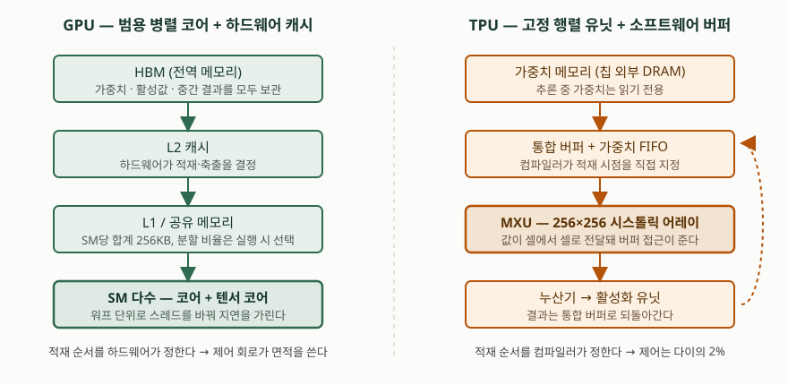
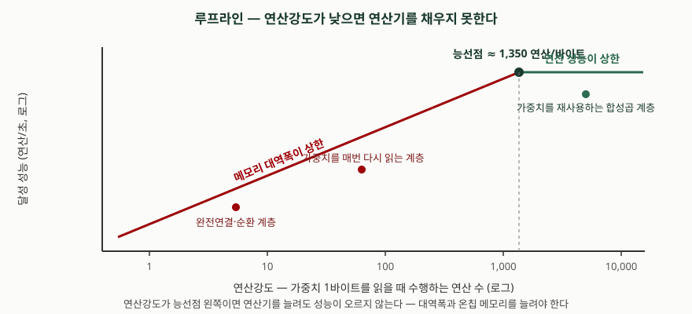

> 실행 검증 없음. 구조·수치는 공개된 1차 자료 — Google이 ISCA에 발표한 TPU 논문 두 편,
> Google Cloud TPU 공식 문서, NVIDIA의 CUDA 가이드와 제품 사양 — 에 적힌 값만 옮겼다.
> 벤더가 자사 제품을 두고 발표한 성능 주장은 **그 사실을 밝히고** 인용했으며,
> 원 출처를 확인하지 못한 시장 규모·점유율·가격 수치는 쓰지 않았다.

문항은 네 갈래로 나눠 묻는다. 두 가속기가 각각 무엇인지, 무엇이 다른지,
요즘 왜 TPU 쪽으로 기우는지, 효율성 관점에서 무엇이 장점이고 앞으로 어떻게 될지다.
물은 순서를 그대로 대항목으로 쓴다.

---

## Ⅰ. 개요

GPU와 TPU는 둘 다 신경망의 행렬 곱을 빠르게 하려고 쓰지만, **출발점이 다르다.**
GPU는 그래픽 파이프라인에서 출발해 범용 병렬 프로세서로 넓어진 쪽이고,
TPU는 처음부터 신경망 추론 하나만 보고 설계한 주문형 반도체(ASIC)다.

이 차이가 답안의 축이다. GPU는 **무엇이 올지 모르는 코드**를 빠르게 돌리려고
캐시·분기 예측·멀티스레딩을 갖췄고, TPU는 **무엇이 올지 안다**는 전제로 그 기능들을
전부 뺐다. Google은 TPU 설계 원칙을 "도메인 특화 프로세서에서는 최소주의가 미덕"이라고
적었는데, 빼는 쪽이 설계 선택이라는 뜻이다.

따라서 "어느 쪽이 빠른가"는 성립하지 않는 질문이다. 답안에서 세워야 할 질문은
**어떤 조건에서 어느 쪽의 전제가 맞는가**이고, 그 조건은 연산 유형·정밀도·배치 크기·
지연 제약·전력 예산으로 나뉜다. 아래에서 그 다섯 축을 따라 내려간다.

---

## Ⅱ. GPU와 TPU 개념 (가)

### 가. GPU — 범용 병렬 프로세서

**정의**: GPU(Graphics Processing Unit)는 다수의 스트리밍 멀티프로세서(SM)로 이루어져
수천 개의 스레드를 동시에 실행하는 범용 병렬 프로세서이며, 신경망 학습에는
GPGPU(General-Purpose computing on GPU) 형태로 쓰인다.

설계 철학은 NVIDIA의 CUDA 가이드가 직접 적고 있다. GPU는 **캐시와 흐름 제어보다
데이터 처리에 더 많은 트랜지스터를 쓴다.** 메모리 지연을 큰 캐시로 가리는 대신,
대기 중인 스레드를 다른 스레드로 바꿔 끼워 연산으로 가린다. 프로그램은 독립적으로
실행되는 스레드 블록으로 나뉘므로, SM이 많은 GPU일수록 같은 프로그램이 빨라진다.

구성요소는 **네 가지**로 정리된다.

| 구성요소 | 역할 |
|---|---|
| ① 스트리밍 멀티프로세서(SM) | 연산 코어와 텐서 코어를 담는 실행 단위. 워프 단위 SIMT로 스케줄 |
| ② 텐서 코어 | 행렬 곱–누산을 명령 하나로 처리하는 전용 유닛. 저정밀 포맷을 지원 |
| ③ 메모리 계층 | 레지스터 → L1·공유 메모리 → L2 → HBM. 적재·축출을 하드웨어가 결정 |
| ④ 인터커넥트 | NVLink로 GPU 간, InfiniBand·RoCE로 노드 간 연결 |

공개된 사양으로 규모를 보면, Blackwell 세대는 SM당 동시 워프 64개, SM당 32비트 레지스터
64K개, L1·텍스처·공유 메모리 합계 256KB를 가지며 B200 기준 HBM3·HBM3e를 최대 180GB까지
붙인다. 텐서 코어가 다루는 포맷은 FP4·FP6/FP8·INT8·FP16/BF16·TF32이고,
FP32와 FP64 경로도 별도로 남아 있다. GPU 간 NVLink 대역폭은 1.8TB/s다.
**정밀도 경로가 FP4부터 FP64까지 끊기지 않고 이어진다**는 점이 뒤의 비교에서 중요해진다.

### 나. TPU — 신경망 전용 주문형 반도체

**정의**: TPU(Tensor Processing Unit)는 기계학습 워크로드를 가속하기 위해 Google이
자체 개발한 주문형 반도체(ASIC)로, 행렬 곱 유닛(MXU)의 시스톨릭 어레이와
소프트웨어가 관리하는 온칩 메모리를 중심으로 구성되며, XLA 컴파일러가 생성한 코드로만
실행된다.

1세대 TPU의 구성은 논문에 그대로 적혀 있다. 핵심은 **다섯 블록**이다.

| 구성요소 | 1세대 기준 제원 | 역할 |
|---|---|---|
| ① 행렬 곱 유닛(MXU) | 256×256 = 65,536개 8비트 MAC | 클록마다 256원소 부분합 하나를 생산 |
| ② 누산기 | 4MiB, 32비트 × 4,096 × 256원소 | 16비트 곱 결과를 모은다 |
| ③ 통합 버퍼 | 24MiB 온칩 SRAM | 중간 활성값 보관. 소프트웨어가 관리 |
| ④ 가중치 메모리·FIFO | 칩 외부 8GiB DRAM + 4단 FIFO | 추론 중 가중치는 읽기 전용 |
| ⑤ 활성화 유닛 | ReLU·Sigmoid·풀링 | 누산기 출력을 비선형 변환해 버퍼로 되돌림 |

명령 집합은 열두 개 남짓이고, 호스트가 PCIe로 보낸다. 버스가 느리므로 명령은
반복 필드를 가진 CISC 형태이며 명령당 평균 클록 수가 10~20에 이른다.
다이 면적 배분이 설계 의도를 그대로 드러낸다 — **데이터 버퍼 37%, 연산 30%, 입출력 10%,
제어는 단 2%**다. CPU·GPU에서 가장 크고 설계하기 어려운 부분이 제어인데, TPU는 그 자리를
버퍼와 연산기로 바꿔 넣었다.

빼버린 기능 목록도 논문이 열거한다. **캐시, 분기 예측, 비순차 실행, 멀티프로세싱,
추측적 프리페치, 주소 병합, 멀티스레딩, 문맥 전환**이다. 평균 성능은 올리지만
99퍼센타일 응답 시간은 올리지 못하는 기능들이라는 것이 제외 근거였다.

현행 Cloud TPU의 MXU는 128×128 시스톨릭 어레이이고, 최신 세대인 TPU7x(Ironwood)는
칩당 TensorCore 2개와 SparseCore 4개, HBM 192GiB에 대역폭 7,380GBps,
BF16 2,307 TFLOPs·FP8 4,614 TFLOPs를 공식 문서에 싣고 있다. 팟 하나는 9,216칩이다.

---

## Ⅲ. GPU와 TPU 비교 (나)

### 가. 데이터 경로의 대비

> **출처**: [Jouppi et al., *In-Datacenter Performance Analysis of a Tensor Processing Unit*, ISCA 2017, §2 TPU Origin / Figure 1·2 (arXiv:1704.04760)](https://arxiv.org/abs/1704.04760), [NVIDIA Blackwell Tuning Guide, §1.4 Shared Memory (CUDA 13.4)](https://docs.nvidia.com/cuda/blackwell-tuning-guide/index.html)

양쪽 모두 HBM에서 출발해 연산기로 들어가지만, **중간 단계를 누가 통제하느냐**가 갈린다.
GPU의 L1·L2는 하드웨어가 적재와 축출을 결정하는 캐시이고, TPU의 통합 버퍼는
컴파일러가 적재 시점을 직접 지정하는 스크래치패드다. 캐시는 어떤 접근 패턴이 올지
모를 때 평균을 지켜 주고, 스크래치패드는 패턴을 미리 알 때 낭비를 없앤다.

시스톨릭 실행의 목적도 여기 있다. 큰 SRAM을 읽는 데 드는 전력이 산술 연산보다 훨씬
크기 때문에, 값을 셀에서 셀로 흘려보내 **통합 버퍼 읽기·쓰기 횟수 자체를 줄인다.**
데이터는 왼쪽에서 들어오고 가중치는 위에서 적재되며, 256원소 곱–누산이 대각선
파면으로 배열을 통과한다. 소프트웨어는 이 구조를 몰라도 정확성에는 영향이 없고,
성능을 맞출 때만 유닛의 지연을 신경 쓰면 된다.

### 나. 열 가지 축의 비교

| 비교 축 | GPU | TPU |
|---|---|---|
| ① 분류 | 범용 병렬 프로세서(GPGPU) | 도메인 특화 ASIC |
| ② 연산 구조 | SM 배열 + 텐서 코어, 워프 단위 SIMT | MXU 시스톨릭 어레이 + 벡터·스칼라 유닛 |
| ③ 명령 모델 | 커널을 올리면 하드웨어가 스케줄 | 호스트가 보낸 CISC 명령, 컴파일러가 정적 스케줄 |
| ④ 온칩 메모리 | 캐시 — 하드웨어 관리 | 통합 버퍼 — 소프트웨어 관리 |
| ⑤ 지연 은닉 | 워프 교체(멀티스레딩) | 이중 버퍼링·파이프라인. 멀티스레딩 없음 |
| ⑥ 실행 특성 | 캐시 적중과 스케줄에 따라 변동 | 단일 스레드 결정적 실행 |
| ⑦ 제어 회로 | 칩에서 크고 설계가 어려운 부분 | 1세대 다이의 2% |
| ⑧ 정밀도 | FP4~FP64까지 경로가 이어짐 | 행렬 연산용 저정밀 중심(BF16·FP8·INT8) |
| ⑨ 확장 | NVLink(GPU 간) + InfiniBand·RoCE(노드 간) | ICI + 광회로 스위치(OCS), 3D 토러스 |
| ⑩ 프로그래밍 | CUDA로 커널을 직접 작성 가능 | XLA 컴파일을 통과해야 실행 |

성능 수치는 **같은 시기에 측정된 조합**에서만 의미가 있다. 1세대 TPU 논문은 2015년
배치 기준으로 TPU 다이가 K80 GPU 다이 대비 추론 성능 약 15배, 와트당 성능 약 29배,
Haswell CPU 대비 각각 29배와 83배였다고 보고한다. TPU v4 논문은 비슷한 규모의 시스템에서
NVIDIA A100 대비 1.2~1.7배 빠르고 전력은 1.3~1.9배 적게 쓴다고 적는다.
**세대가 교차하면 숫자가 뒤집힌다**는 점은 논문 자신이 반증 절에서 밝히고 있으므로,
답안에서 배수를 쓸 때는 비교 대상과 시점을 반드시 함께 적어야 한다.

### 다. 적합한 작업이 갈리는 지점

Google Cloud 공식 문서는 TPU가 **맞지 않는** 작업을 명시한다. 분기가 잦거나 원소 단위
연산이 많은 선형대수, 높은 정밀도가 필요한 산술, 주 학습 루프에 커스텀 연산이 들어간
신경망, 동적 텐서 형상이 그것이다. 반대로 GPU를 권하는 경우로는 CPU에서 일부가 돌아야
하는 커스텀 연산이 많은 모델, TPU에 없는 연산을 쓰는 모델을 든다.
TPU를 권하는 쪽은 행렬 연산이 지배적인 모델, 긴 학습, 유효 배치가 큰 대형 모델,
초대형 임베딩을 쓰는 랭킹·추천이다.

**비교의 결론은 우열이 아니라 조건이다.** 연산 유형이 좁고 반복되며 정밀도를 낮출 수
있으면 TPU의 전제가 맞고, 그렇지 않으면 GPU의 전제가 맞다.

---

## Ⅳ. 최근 GPU보다 TPU를 사용하는 이유 (다)

### 가. 워크로드의 무게중심이 학습에서 추론으로 옮겨갔다

Google은 Ironwood를 발표하며 초점이 "모델을 학습시키는 일에서 모델과 응답성 있게
상호작용하게 만드는 일"로 옮겨가고 있다고 적었다. 추론은 사용자 요청 경로에 놓이므로
평균 지연이 아니라 **99퍼센타일 지연 상한**이 제약이 된다.

여기서 TPU의 단일 스레드 결정적 실행이 값을 갖는다. 캐시 적중 여부나 스레드 스케줄에
따라 실행 시간이 흔들리지 않으므로 지연 상한을 보장하기 쉽다. 1세대 논문도 TPU가
성공한 이유로 "99퍼센타일 응답 시간 제약에 잘 맞는 단일 스레드 결정적 실행 모델"을
들었고, 같은 논문이 **K80 GPU는 학습에 뛰어나지만 추론에서는 Haswell CPU보다 조금
빠른 정도**였다고 보고하며 그 원인을 지연보다 처리량에 맞춘 설계로 지목했다.

### 나. 전력이 데이터센터의 실질 제약이 됐다

성능보다 **와트당 성능**이 먼저 걸리는 상황에서는 범용 기능을 들고 있는 쪽이 불리하다.
TPU v4 논문은 비슷한 규모의 A100 시스템 대비 전력을 1.3~1.9배 적게 쓴다고 적고,
에너지 최적화된 웨어하우스 규모 컴퓨터에 놓인 TPU v4가 일반적인 온프레미스
데이터센터의 동시대 가속기 대비 **에너지를 약 3배, CO2e를 약 20배 적게** 쓴다고 보고한다.

### 다. 연산 유형이 좁아져 범용성의 값이 떨어졌다

TPU의 전제는 "무엇이 올지 안다"는 것인데, 트랜스포머 계열이 지배하면서 그 전제가
점점 더 잘 맞게 됐다. 연산이 행렬 곱과 어텐션으로 수렴하면 분기 예측과 캐시가 막아 주던
불확실성이 줄고, **빼버린 기능 때문에 손해 보는 경우 자체가 드물어진다.**
반대로 1세대 당시의 교훈은 그 전제가 틀릴 때 무슨 일이 생기는지를 보여 준다 —
합성곱 신경망은 당시 데이터센터 신경망 워크로드의 약 5%에 불과했고,
그런데도 아키텍처 학계는 그쪽만 보고 있었다는 것이 논문의 지적이었다.

### 라. 확장 네트워크를 칩 설계 안으로 끌어들였다

대규모 학습·추론의 비용은 칩이 아니라 **칩을 잇는 망**에서 나온다. TPU v4는 광회로
스위치(OCS)로 인터커넥트 토폴로지를 동적으로 재구성하고, 사용자가 원하면 꼬인 3D 토러스를
고를 수 있게 했다. 논문은 OCS와 광부품이 **시스템 비용의 5% 미만, 전력의 3% 미만**이며
InfiniBand보다 저렴하고 전력을 덜 쓴다고 적는다. Ironwood 슈퍼팟은 9,216칩을 한 도메인에
묶고 ICI 9.6Tb/s, 공유 HBM 1.77PB를 제공한다고 Google이 밝혔다.

### 마. 행렬 곱이 아닌 부하를 전용 블록으로 흡수했다

추천·랭킹의 임베딩 조회는 행렬 곱이 아니라 불규칙한 수집·분산 연산이라
MXU로는 채워지지 않는다. TPU v4는 **SparseCore**라는 데이터플로 프로세서를 넣어
임베딩 중심 모델을 5~7배 가속하면서 다이 면적과 전력은 약 5%만 썼다고 보고한다.
Ironwood는 칩당 SparseCore를 4개 싣는다.

### 바. 이식 비용이 낮아졌다 — 다만 벤더 주장이다

Google은 vLLM 지원을 강화해 설정만 조금 바꾸면 GPU와 TPU 사이를 오갈 수 있다고
발표했다. 같은 발표에서 Anthropic이 최대 100만 개 TPU 접근을 계획하고 있다는 점과
가격 대비 성능 개선을 인용했는데, **이는 Google이 자사 블로그에 실은 주장이므로
답안에서는 "벤더 발표"임을 밝히고 인용해야 한다.** 독립 검증된 수치가 아니다.

### 사. 그래도 대체가 아니라 분담이다

앞의 근거들은 "TPU가 GPU를 대체한다"로 이어지지 않는다. 공식 문서가 밝힌 TPU
부적합 목록 — 동적 형상, 고정밀 산술, 커스텀 연산 — 은 그대로 남아 있고,
연구·프로토타이핑처럼 모델 구조가 자주 바뀌는 단계에서는 커널을 직접 쓸 수 있는 쪽이
여전히 빠르다. **정해진 모델을 대량으로 서빙하는 구간에 TPU가 들어가고, 탐색 구간에는
GPU가 남는 분담**으로 보는 것이 지금까지 공개된 근거에 맞는 해석이다.

---

## Ⅴ. 효율성 측면에서 TPU의 장점 및 향후 전망 (라)

### 가. 효율이 나오는 자리 — 네 가지

| 출처 | 내용 | 근거 |
|---|---|---|
| ① 연산당 에너지 | 8비트 정수 시스톨릭 곱셈기가 32비트 부동소수점 데이터패스 대비 에너지·면적에서 한 자릿수 유리 | 같은 다이에 MAC 25배(65,536 대 2,496), 온칩 메모리 3.5배(28MiB 대 8MiB)를 담고 전력은 K80의 절반 미만 |
| ② 데이터 이동 감소 | 큰 SRAM 읽기가 산술보다 전력을 많이 쓰므로 시스톨릭 실행으로 버퍼 접근 횟수를 줄임 | ISCA 2017 논문의 행렬 유닛 설계 근거 |
| ③ 제어 오버헤드 제거 | 평균만 개선하고 99퍼센타일은 개선하지 못하는 기능을 제외 | 제어가 다이의 2% |
| ④ 시스템 수준 | 광회로 스위치 기반 인터커넥트, 에너지 최적화 데이터센터 배치 | OCS 비용 5%·전력 3% 미만, 에너지 3배·CO2e 20배 절감 |

①과 ②를 묶으면 효율의 정체가 보인다. **연산을 빨리 하는 것이 아니라, 연산 한 번을 위해
움직이는 바이트 수를 줄이는 것**이다. 큰 온칩 메모리가 바로 그 장치다 —
논문은 넓어진 메모리가 응용의 연산강도를 끌어올려 풍부한 MAC를 더 채우게 한다고 적는다.

### 나. 효율의 상한 — 연산강도가 낮으면 소용없다

> **출처**: [Jouppi et al., *In-Datacenter Performance Analysis of a Tensor Processing Unit*, ISCA 2017, §4 Roofline / Figure 5 (arXiv:1704.04760)](https://arxiv.org/abs/1704.04760)

루프라인 모델에서 가로축은 연산강도, 즉 메모리에서 읽은 바이트당 수행하는 연산 수다.
기울어진 구간에서는 메모리 대역폭이, 평평한 구간에서는 피크 연산 성능이 상한이 된다.
1세대 TPU의 능선점은 **가중치 1바이트당 약 1,350 연산**으로 오른쪽 멀리 있었고,
그래서 측정한 여섯 응용 중 **네 개가 메모리 바운드**였다. 완전연결 계층과 순환 계층이
그쪽이고, 가중치를 재사용하는 합성곱 계층만 연산 바운드였다.

같은 논문이 든 구체적 사례가 한계를 그대로 보여 준다. 한 합성곱 신경망은 연산강도가
높은데도 MXU가 활성인 사이클이 절반에 못 미쳤고, **35%는 가중치가 메모리에서 배열로
올라오기를 기다리는 데** 썼다. 일부 계층의 특징 깊이가 얕아 활성 사이클에도 MAC의 절반만
유효한 가중치를 들고 있었다. 즉 **효율은 하드웨어가 아니라 모델 구조와의 맞물림에서
나온다.** 어긋나면 연산기를 늘려도 유휴만 늘어난다.

여기서 나오는 세 가지 적용 시 고려사항은 답안에 그대로 쓸 수 있다.

1. **지표를 초당 추론 수(IPS)로 요약하지 않는다.** 논문은 같은 TPU에서 4층 모델이
   360,000 IPS, 89층 모델이 4,700 IPS로 **75배** 차이가 났다고 보고한다.
   IPS는 하드웨어가 아니라 모델 복잡도의 역수에 가깝다.
2. **연산강도를 먼저 계산한다.** 능선점 왼쪽이면 투자할 곳은 연산기가 아니라
   대역폭과 온칩 메모리다.
3. **정적 컴파일 전제를 확인한다.** 동적 형상·커스텀 연산이 주 루프에 있으면
   XLA가 타일링을 고정하지 못해 효율 전제가 무너진다.

### 다. 향후 전망 — 공개된 근거로 말할 수 있는 것

**① 추론 중심 설계의 명시화.** Ironwood 세대는 대규모 학습과 추론 모두를 대상으로
한다고 공식 문서가 적으면서도, 밀집·MoE 모델의 사전학습과 **디코드 중심 추론**을
특히 지목한다. 설계 목표가 처리량 단독에서 처리량과 지연의 조합으로 바뀌고 있다.

**② 정밀도를 더 낮추는 쪽.** Ironwood의 공식 제원은 BF16 2,307 TFLOPs, FP8 4,614
TFLOPs로 **정확히 두 배**다. 포맷 폭을 절반으로 줄이면 처리량이 두 배가 되는 관계가
그대로 유지되므로, 수치 안정성이 허용하는 한 더 좁은 포맷으로 내려가는 흐름이 이어진다.
GPU 쪽도 같은 방향이어서 Blackwell 세대의 텐서 코어가 FP4·FP6를 지원한다.

**③ 메모리 중심으로의 이동.** 능선점 문제를 정면으로 미는 방향이다. Ironwood는 칩당
HBM 192GiB에 대역폭 7,380GBps, 슈퍼팟 기준 공유 HBM 1.77PB를 싣는다.
연산기보다 메모리 용량·대역폭이 세대 간 차이를 만든다.

**④ 비행렬 연산의 전용화.** SparseCore처럼 **MXU로 안 채워지는 부하를 따로 떼어
전용 블록에 맡기는** 설계가 늘어난다. 칩당 TensorCore 2개에 SparseCore 4개라는 배치가
그 방향을 보여 준다.

**⑤ 재구성 가능한 광 네트워크.** OCS로 장애를 우회해 작업을 복구하는 구조는
대규모에서 가용성과 활용률을 동시에 올리는 수단이므로 확산이 예상된다.

**⑥ 자체 가속기의 확산과 소프트웨어 생태계.** 여러 하이퍼스케일러가 자체 가속기를
개발 중이라는 사실은 업계 매체가 널리 보도하고 있으나 **공식 제원과 배치 규모가 공개되지
않은 부분이 많아 수치는 인용하지 않는다.** 확실한 쟁점은 소프트웨어다 — ASIC의 효율은
컴파일러가 모델을 얼마나 잘 매핑하느냐에 달려 있고, TPU가 1세대부터 TensorFlow로
작성한 코드를 그대로 받을 수 있었던 점을 논문이 성공 요인으로 꼽았다.
**하드웨어 효율이 아니라 컴파일러와 프레임워크 지원이 채택을 가른다.**

---

## Ⅵ. 결론

GPU와 TPU의 차이는 성능 수치가 아니라 **불확실성을 누가 떠안느냐**에서 갈린다.
GPU는 하드웨어가 떠안아 캐시·분기 예측·멀티스레딩으로 흡수하고, TPU는 컴파일러가
떠안아 그 회로를 전부 버퍼와 연산기로 바꿨다. 전제가 맞을 때 TPU의 효율이 나오고,
틀릴 때는 연산기가 비어 돈다.

최근 TPU 쪽으로 기우는 이유는 **그 전제가 맞는 구간이 넓어졌기 때문**이다.
워크로드가 추론으로 옮겨가며 지연 상한이 제약이 됐고, 전력이 데이터센터의 실질 한계가
됐으며, 모델 구조가 수렴해 범용성의 값이 떨어졌다. 여기에 광회로 스위치 기반
인터커넥트와 임베딩 전용 블록처럼 **칩 바깥의 비용까지 설계에 끌어들인 선택**이 더해졌다.

다만 효율은 하드웨어 속성이 아니라 모델·컴파일러·하드웨어가 맞물린 결과다.
연산강도가 능선점 아래면 연산기를 늘려도 성능이 오르지 않으며, 동적 형상이나 커스텀
연산이 끼면 정적 컴파일 전제가 무너진다. 따라서 선택의 기준은 "무엇이 더 빠른가"가 아니라
**모델 구조가 고정됐는가, 정밀도를 낮출 수 있는가, 지연 상한이 걸려 있는가**이고,
현실적인 구성은 탐색 구간에 GPU, 대량 서빙 구간에 TPU를 두는 분담이다.

> 개념 정리: [GPU 클러스터 인터커넥트 — NVLink·InfiniBand·RoCE](../../network/2026-10-01-gpu-cluster-interconnect-nvlink-infiniband-roce/index.md)
> · 관련 답안: [기출문제 — AI 슈퍼컴퓨팅 플랫폼](../2026-09-30-ai-supercomputing-platform/index.md)

끝

---

## 답안 작성 메모

- **분량 배분**: (가) 0.6장, (나) 1장, (다) 0.8장, (라) 0.8장. (나)가 가장 길어야 한다.
  개념 정의는 누구나 쓰므로 변별이 안 되고, 비교의 축을 몇 개 세웠는지에서 갈린다.
- **먼저 쓸 것**: ① 데이터 경로 대비 도식, ② 비교표, ③ 루프라인 그림.
  셋을 먼저 그려 두면 시간이 모자라도 채점자가 답안의 범위를 읽는다.
  특히 비교표는 열 축 전부를 못 채우더라도 **축 이름만이라도 먼저 적어 둔다.**
- **점수가 갈리는 지점 넷**
  1. **"불확실성을 누가 떠안는가"로 축을 세웠는가.** 코어 수·메모리 용량만 나열한
     답안이 가장 흔하다. 캐시(하드웨어 관리) 대 통합 버퍼(소프트웨어 관리),
     워프 교체 대 정적 스케줄이라는 대비를 먼저 세우고 들어간다.
  2. **배수에 비교 대상과 시점을 붙였는가.** "TPU가 GPU보다 15배 빠르다"는 틀린 문장이다.
     1세대 TPU가 동시대 K80 대비, TPU v4가 A100 대비처럼 **쌍을 명시**해야 한다.
     세대를 교차하면 뒤집힌다는 점은 논문 자신이 반증 절에서 밝히고 있다.
  3. **루프라인으로 한계를 설명했는가.** (라)에서 장점만 나열하면 반쪽이다.
     능선점과 메모리 바운드를 적고, 연산기를 늘려도 안 되는 구간이 있다는 것까지
     써야 "효율성 측면"이라는 물음에 답한 것이 된다.
  4. **대체가 아니라 분담으로 닫았는가.** (다)가 "TPU가 이긴다"로 끝나면 감점 요소다.
     공식 문서가 밝힌 TPU 부적합 조건을 한 줄 적고 분담 구도로 닫는다.
- **시간이 모자라면 버릴 것**: (가)의 구성요소 표 상세 제원, (다)의 이식 비용 항목,
  (라)의 전망 ⑤·⑥. 단, **비교표와 루프라인 그림은 버리지 않는다.**
- **쓰지 말 것**: 시장 점유율·가격·납기 같은 수치. 원 출처가 1차가 아니면 근거가 없다.
  "TPU가 GPU를 대체한다"는 단정, 벤더 블로그 수치를 출처 없이 옮기는 것도 피한다.
  벤더 주장을 쓸 때는 **"Google 발표 기준"처럼 주체를 밝히면 감점이 아니라 가점이 된다.**

---

## 참고 자료

- [Jouppi et al., *In-Datacenter Performance Analysis of a Tensor Processing Unit*, ISCA 2017 (arXiv:1704.04760, 2017-04-16)](https://arxiv.org/abs/1704.04760) — 1세대 TPU 블록 구성, 256×256 MXU와 시스톨릭 실행, 제외한 범용 기능 목록, 다이 면적 배분, 루프라인과 능선점 1,350, K80·Haswell 대비 성능과 와트당 성능, IPS 지표의 한계
- [Jouppi et al., *TPU v4: An Optically Reconfigurable Supercomputer for Machine Learning with Hardware Support for Embeddings*, ISCA 2023 (arXiv:2304.01433, 2023-04-04)](https://arxiv.org/abs/2304.01433) — 광회로 스위치 비용·전력 비중, 꼬인 3D 토러스, SparseCore 가속 배수와 면적, TPU v3·A100·IPU Bow 대비 성능과 전력, 에너지·CO2e 비교
- [Google Cloud, *Introduction to Cloud TPU* (공식 문서)](https://docs.cloud.google.com/tpu/docs/intro-to-tpu) — TPU의 ASIC 정의, 128×128 MXU, XLA 컴파일 전제, TPU·GPU·CPU 적합 작업과 TPU 부적합 조건
- [Google Cloud, *TPU7x (Ironwood)* 사양 (공식 문서)](https://docs.cloud.google.com/tpu/docs/tpu7x) — 칩당 BF16 2,307 TFLOPs·FP8 4,614 TFLOPs, HBM 192GiB·7,380GBps, TensorCore 2개·SparseCore 4개, 팟당 9,216칩, ICI 1,200GBps
- [Google Cloud Blog, *Ironwood TPUs and new Axion-based VMs for your AI workloads* (2025-11-07)](https://cloud.google.com/blog/products/compute/ironwood-tpus-and-new-axion-based-vms-for-your-ai-workloads) — 추론 중심 전환 서술, v5p 대비 10배·v6e 대비 4배 주장, 슈퍼팟 9,216칩·ICI 9.6Tb/s·공유 HBM 1.77PB. **벤더 자사 발표**이므로 성능 주장은 그대로 인용하지 않고 출처를 밝혀 썼다
- [NVIDIA, *CUDA C++ Programming Guide* §1.1 The Benefits of Using GPUs (CUDA 12.6)](https://docs.nvidia.com/cuda/archive/12.6.0/cuda-c-programming-guide/index.html) — 캐시·흐름 제어보다 데이터 처리에 트랜지스터를 쓴다는 설계 원칙, SM 배열과 스레드 블록 확장성
- [NVIDIA, *Blackwell Tuning Guide* (CUDA 13.4)](https://docs.nvidia.com/cuda/blackwell-tuning-guide/index.html) — SM당 동시 워프 64, 32비트 레지스터 64K, L1·텍스처·공유 메모리 합계 256KB, B200의 HBM3·HBM3e 최대 180GB
- [NVIDIA, *HGX Platform* 제품 사양](https://www.nvidia.com/en-us/data-center/hgx/) — 텐서 코어가 다루는 정밀도 목록(FP4·FP8/FP6·INT8·FP16/BF16·TF32)과 FP32·FP64 경로, 5세대 NVLink GPU 간 1.8TB/s
