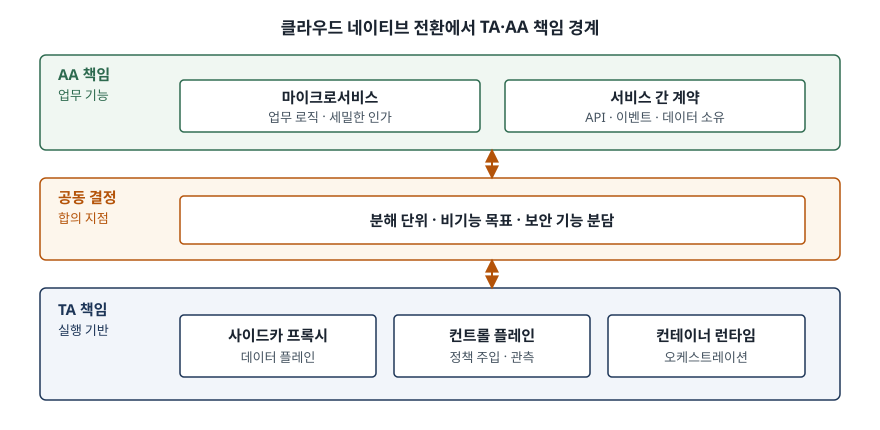

기출문제에서 공공기관이 대국민 포털·통합 업무 시스템·ERP·인허가 관리 시스템을
클라우드 네이티브로 전환하거나 새로 구축하는 상황을 두고, TA(Technical Architect)와
AA(Application Architect)를 묻는다. 요구는 둘이다. 먼저 두 역할을 **범위·책임과
목표·주요 산출물** 세 축으로 비교하고, 다음으로 **협업이 왜 중요하며 어떻게 할
것인지**를 쓰라는 것이다.

점수가 갈리는 곳은 분명하다. 직무 소개를 늘어놓으면 채용 공고와 다를 바 없다.
답안은 **왜 하나의 역할로는 안 되는지**를 기술적 사실로 보여야 한다.
마이크로서비스로 쪼개는 순간 인증·서비스 디스커버리·통신 암호화 같은 기반 기능을
"응용 코드에 넣을 것인가, 기반 계층에 넣을 것인가"라는 선택이 기능마다 생기고,
그 선택지가 곧 TA와 AA의 경계선이다.

> 실행 검증 없음. 공개된 표준과 공공 기관 발간 문서의 근거만으로 정리했다.

---

## Ⅰ. 개요

### 가. 클라우드 네이티브가 역할을 가르는 이유

클라우드 네이티브는 공용·사설·하이브리드 클라우드에서 워크로드를 규모 있게 구축·배포·운영하는
방식으로, **느슨하게 결합된 시스템**을 전제로 한다. 대표 기술로 컨테이너, 서비스 메시,
멀티테넌시, 마이크로서비스, 불변 인프라, 서버리스, 선언적 API 일곱 가지가 제시된다.

모놀리식에서는 응용과 기술을 한 설계서가 감당할 수 있었다. 마이크로서비스로 가면
구성요소 수가 크게 늘고 상호작용 방식이 다양해져, **인증·접근통제, 서비스 디스커버리,
부하분산, 응답 캐싱, 상태 점검, 모니터링** 같은 핵심 기반 기능을 응용과 별개로
설계해야 한다. 이 기반 기능들은 개별 구현할 수도 있고 API 게이트웨이·서비스 메시
같은 아키텍처 프레임워크에 묶어 제공할 수도 있다. 선택지가 생긴 자리마다 역할이 갈린다.

### 나. 아키텍처 기술 표준에서 본 분화

아키텍처 기술 표준은 **이해관계자의 관심사(concern)를 아키텍처 뷰포인트로 틀 잡고,
그 뷰포인트에 따라 뷰를 작성하도록** 규정한다. TA와 AA는 서로 다른 관심사를 맡아
서로 다른 뷰를 쓰는 작성자다. 같은 표준은 **뷰에 담긴 요소들 사이의 대응 관계
(correspondence)를 기록**하도록 요구하는데, 이것이 Ⅳ절 협업 방안의 근거가 된다.

---

## Ⅱ. TA와 AA의 역할 비교

### 가. 범위

| | AA (응용 아키텍트) | TA (기술 아키텍트) |
|---|---|---|
| 다루는 계층 | 업무 기능과 그 구현 구조 | 기능이 올라가 돌아가는 실행 기반 |
| 설계 대상 | 서비스 분해 단위, 서비스 간 호출·이벤트 계약, 데이터 소유권, 공통 컴포넌트, 개발 표준 | 컨테이너 런타임·오케스트레이션, 네트워크·게이트웨이·서비스 메시, 용량·성능·가용성, 배포 파이프라인, 관측·백업·재해복구 |
| 질문의 형태 | "이 업무를 어떤 단위로 쪼개고 무엇으로 잇는가" | "그 단위를 무엇 위에 어떻게 올리고 어떻게 지키는가" |

범위가 맞닿는 지점은 구체적으로 드러난다. API 게이트웨이에 서비스 디스커버리·인증·
부하분산 같은 부가 기능을 붙일 때, 그 기능을 **별도 서비스로 구성해 조합**할 수도 있고
**게이트웨이를 쓰는 코드베이스 안에 직접 구현**할 수도 있다. 앞쪽을 고르면 TA의 영역이,
뒤쪽을 고르면 AA의 영역이 넓어진다. 범위는 조직이 정하는 것이 아니라 **설계 선택의
결과로 정해진다.**

### 나. 책임과 목표

**AA의 목표는 변경의 지역성이다.** 업무 하나가 바뀌었을 때 그 변경이 한 서비스 안에
갇히게 만드는 것. 책임은 세 가지로 묶인다.

- ① 분해 기준 수립 — 업무 능력 단위로 서비스 경계를 긋고 데이터 소유권을 배타적으로 둔다
- ② 계약 관리 — 서비스 간 인터페이스의 하위 호환을 지키고 변경 절차를 정한다
- ③ 일관성 설계 — 분산 환경에서 단일 트랜잭션이 성립하지 않는 구간을 보상 흐름으로 대체한다

**TA의 목표는 비기능 요구의 충족이다.** 가용성·확장성·성능·보안·운영성을 수치로
받아 그것이 실제로 나오는 기반을 만드는 것. 책임은 네 가지다.

- ① 실행 기반 선정과 구성 — 오케스트레이션, 네트워크, 게이트웨이·서비스 메시
- ② 용량 산정과 확장 정책 — 부하 패턴에 따른 자동확장 기준
- ③ 배포와 복구 — 무중단 배포 전략, 백업·재해복구 목표
- ④ 기술 표준 수립 — 사업 전체가 따를 기술 요소 목록과 버전

공공 전환 사업에서 제시되는 **기능분리·자동확장·자동배포** 세 가지로 보면,
기능분리는 AA에, 자동확장과 자동배포는 TA에 무게가 실린다. 다만 **자동확장은
서비스가 상태를 밖으로 내보낸 설계일 때만 성립**하므로 TA 혼자 달성할 수 없다.
분담이 깨끗하게 떨어지지 않는다는 사실 자체가 Ⅲ절의 출발점이다.

### 다. 주요 산출물

| 구분 | AA | TA |
|---|---|---|
| 정의서 | 응용 아키텍처 정의서 | 기술 아키텍처 정의서 |
| 구조 | 서비스 목록·상호작용도, 도메인 모델 | 시스템 구성도, 배포 단위 구성도 |
| 규약 | API·이벤트 인터페이스 정의서, 데이터 소유권 매트릭스 | 기술 표준 목록(기술참조모형), 환경 구성 정의서 |
| 품질 | 공통 컴포넌트 명세, 개발 표준·프레임워크 가이드 | 용량 산정서, 성능·가용성 설계서, 관측·로깅 설계서, 재해복구 설계서 |
| 전환 | 서비스 전환 순서·분할 계획 | 전환 아키텍처, 파이프라인 구성 정의서 |
| 공통 | 아키텍처 결정 기록, 비기능 요구 명세, 책임 분담 매트릭스 | 좌동 |

산출물 축에서 반드시 짚을 것이 **마지막 줄의 공통 산출물**이다. 비교만 적고 공통
산출물을 빼면 (나)에서 쓸 재료가 사라진다.

---

## Ⅲ. TA·AA 협업의 중요성

> **출처**: [NIST SP 800-204, Security Strategies for Microservices-based Application Systems §2.7.2 Service Mesh](https://nvlpubs.nist.gov/nistpubs/SpecialPublications/NIST.SP.800-204.pdf)

### 가. 보안 기능의 분담점이 기술적으로 애매하다

서비스 메시는 서비스 간 통신을 위한 **전용 기반 계층**으로, 서비스 디스커버리·라우팅·
내부 부하분산·암호화·인증·인가·지표·모니터링을 제공한다. 사이드카 프록시가 데이터
플레인을 이루고, 컨트롤 플레인이 접근통제 정책을 프록시에 주입해 **마이크로서비스
코드를 고치지 않고 정책을 바꿀 수 있게** 한다.

그런데 같은 문서는 선을 하나 긋는다. **세밀한 인가는 여전히 마이크로서비스에서
수행해야 할 수 있는데, 업무 로직을 온전히 아는 것은 그 서비스뿐이기 때문이다.**
"인가는 메시가 한다"로 합의하면 업무 규칙에 걸린 인가가 빠지고, "인가는 서비스가
한다"로 합의하면 메시가 이미 하는 일을 중복 구현한다. **기능 단위로 선을 긋지
않으면 공백 아니면 중복이 된다.**

### 나. 비기능 목표가 한 역할에 닫히지 않는다

자동확장은 오케스트레이터 설정만으로 되지 않는다. 세션과 상태를 서비스 밖으로
빼는 설계, 기동 시간이 짧은 이미지, 요청 재시도에 안전한 연산은 전부 AA의
설계 결정이다. 반대로 서비스를 아무리 잘 쪼개도 배포 파이프라인과 관측 기반이
없으면 쪼갠 만큼 운영 비용만 늘어난다.

### 다. 결합도 원칙이 양쪽에 동시에 적용된다

서비스 레지스트리 구성 지침은 **응용 서비스가 레지스트리 같은 기반 서비스와 강하게
결합되어서는 안 되며, 자가 등록·해제 패턴을 피하고 제3자 등록 패턴을 쓰라**고
권고한다. 응용 서비스가 죽거나 요청을 못 받는 상태가 되면 스스로 해제할 수 없어
전체 절차의 무결성이 깨지기 때문이다. 이 한 줄은 **AA에게는 코드 규약이고
TA에게는 기반 구성 요구**다. 한쪽만 읽으면 지켜지지 않는다.

### 라. 대상 시스템 네 종의 성격이 서로 다르다

대국민 포털은 트래픽 변동이 크고 외부에 열려 있다. 통합 업무 시스템은 권한 체계가
복잡하고 내부 연계가 많다. ERP는 패키지 제약 때문에 분해 자유도가 낮다. 인허가
시스템은 법정 처리기한과 외부 기관 연계가 걸린다. TA가 공통 기반을 하나로 깔 때
AA가 네 종의 차이를 요구로 내지 않으면 **포털 기준으로 과대 설계되거나 ERP 기준으로
과소 설계된다.**

### 마. 산출물 불일치는 검수 단계에서야 드러난다

아키텍처 기술 표준은 뷰 사이 요소의 대응 관계를 기록하도록 요구한다. 응용 뷰의
"민원접수 서비스"가 기술 뷰의 어느 배포 단위인지 적어 두지 않으면, 두 문서가 서로
다른 것을 가리켜도 아무도 모른다. 발견 시점이 늦을수록 되돌리는 비용이 커진다.

---

## Ⅳ. TA·AA 협업 방안

조직·절차·산출물·도구 네 축으로 쓴다. 한 축만 쓰면 "회의를 자주 한다" 수준에서 멈춘다.

### 가. 조직 — 결정 권한을 명시한다

- ① 아키텍처 의사결정 조직을 사업 착수와 동시에 구성한다. TA·AA·DA·보안 담당이 참여한다
- ② **결정 권한과 에스컬레이션 경로를 문서로 둔다.** 합의가 안 될 때 누가 정하는지
  정해 두지 않으면 경계 문제는 끝까지 미결로 남는다
- ③ 사업 초기에 공동 아키텍처 정의 기간을 두고, 그 기간의 산출물을 다음 공정의 착수 조건으로 건다

### 나. 절차 — 비기능 요구를 수치로 묶는다

- ① 가용성·응답시간·확장 한계를 **서비스별 목표값으로 배분**한다. 두 역할이 같은 숫자를 본다
- ② 아키텍처 결정 기록(ADR)에 결정·배경·대안·결과를 남긴다. 경계에 관한 결정일수록 근거가 남아야 한다
- ③ 서비스 분해 단위를 확정할 때 TA가 **배포 단위·확장 단위 관점에서 같이 검토**한다.
  업무 관점의 분해와 운영 관점의 분해가 어긋나는 지점을 이때 찾는다
- ④ 전환 단계마다 아키텍처 검토 회의를 열고 점검 항목을 고정한다

### 다. 산출물 — 기능별 책임 분담 매트릭스

핵심 기반 기능 목록을 그대로 행으로 놓고, 각 기능을 어느 계층에서 구현하는지 한 줄씩 정한다.

| 기반 기능 | 구현 위치 | 책임 |
|---|---|---|
| 서비스 식별·전송 암호화 | 서비스 메시 데이터 플레인 | TA |
| 거친 단위 접근통제 | 컨트롤 플레인 정책 | TA |
| 업무 규칙 기반 세밀한 인가 | 마이크로서비스 코드 | AA |
| 서비스 등록·해제 | 제3자 등록(기반) | TA |
| 서비스 위치 조회 | 응용 서비스의 조회 호출 | AA |
| 재시도·회로차단 | 메시 정책 + 멱등 설계 | 공동 |
| 분산 추적 식별자 전파 | 프록시 주입 + 코드 전달 | 공동 |

여기에 **뷰 사이 대응 관계 표**를 하나 더 붙인다. 응용 뷰의 서비스 → 기술 뷰의
배포 단위 → 운영 지표의 대상이 한 줄로 이어져야 추적이 된다.

### 라. 도구 — 합의를 기계가 지키게 한다

- ① 인터페이스 계약을 **기계가 읽는 형식**(인터페이스 명세·스키마 레지스트리)으로 두고
  통합 빌드에서 호환성을 검사한다. 문서 합의는 어기면 모르지만 빌드는 막는다
- ② TA가 표준 템플릿·공통 라이브러리를 **골든 패스**로 제공하고 AA 조직이 그 위에서 개발한다.
  기술 표준을 문서로 내려보내는 대신 쓰기 쉬운 기본값으로 내려보낸다
- ③ 부하 시험과 장애 주입 시험을 공동으로 수행해 목표값 충족 여부를 숫자로 확인한다.
  이 시험이 Ⅳ-나-①의 수치를 검증하는 유일한 수단이다
- ④ 관측 데이터를 같은 축(추적 식별자, 서비스 이름)으로 맞춰 양쪽이 같은 화면을 본다

---

## Ⅴ. 결론

- TA와 AA의 분리는 **관심사의 분리이지 책임의 분리가 아니다.** 범위는 조직도가 아니라
  "이 기능을 응용 코드에 넣을 것인가 기반 계층에 넣을 것인가"라는 설계 선택으로 정해진다
- 클라우드 네이티브 전환에서 비기능 목표는 **어느 한 역할만으로 달성되지 않는다.**
  자동확장은 TA의 설정과 AA의 무상태 설계가 함께 있어야 성립한다
- 협업은 회의가 아니라 **산출물과 검사로 남겨야 한다.** 기능별 책임 분담 매트릭스,
  아키텍처 결정 기록, 빌드에서 걸리는 계약 검사가 합의를 유지하는 장치다
- 성격이 다른 시스템 네 종을 한 기반에 올리는 사업에서는, **차이를 요구로 내는 쪽이 AA이고
  그 차이를 공통 기반의 변형점으로 받아내는 쪽이 TA**다

> 개념 정리: [MSA — 분해 기준과 감당해야 할 비용](../../software-engineering/2026-09-22-msa-decomposition-and-cost/index.md),
> [소프트웨어 아키텍처 4+1 뷰](../../software-engineering/2026-09-18-software-architecture-4plus1-views/index.md)

끝

---

## 답안 작성 메모

**먼저 쓸 것은 Ⅱ의 비교표 두 개다.** (가)가 "범위·책임/목표·주요 산출물"을 명시해
물었으므로 채점자는 세 축이 다 있는지부터 센다. 표를 먼저 그려 세 축을 눈에 보이게
깔고 서술을 붙인다. 축 하나라도 빠지면 거기서 감점이 확정된다.

**점수가 갈리는 지점은 Ⅲ-가다.** 서비스 메시가 인가를 처리하는데도 세밀한 인가는
서비스에 남는다는 사실 하나면, "협업이 중요하다"는 당위가 기술적 필연으로 바뀐다.
이 한 문단이 있고 없고가 답안의 등급을 가른다. 암기할 것은 **"업무 로직을 아는 것은
그 서비스뿐"** 한 구절이다.

**시간이 모자라면 버릴 순서는 Ⅲ-라 → Ⅲ-마 → Ⅳ-라다.** Ⅲ-라는 문제에 제시된 네
시스템을 쓰는 가산점 구간이라 아까우니 두 줄로 줄여 남긴다. Ⅳ는 네 축 제목만
남기고 각 축에 한 줄씩이라도 붙인다. **축이 네 개라는 사실이 점수이므로 축을
통째로 버리지 않는다.**

**빠지기 쉬운 함정이 둘 있다.** 하나는 직무 소개로 흐르는 것이다. 경력 요건이나
자격증을 쓰면 정보관리기술사 답안이 아니다. 다른 하나는 (나)를 "주기적 회의",
"원활한 소통"으로 채우는 것이다. 협업 방안은 **무엇을 산출물로 남기고 무엇을
기계가 검사하는가**까지 내려가야 한다.

**Ⅱ-다의 공통 산출물 줄을 빠뜨리지 않는다.** 비교표만 쓰고 공통 산출물을 빼면
(나)에서 "책임 분담 매트릭스를 쓴다"고 말할 근거가 사라진다. (가)와 (나)를 잇는
다리가 그 한 줄이다.

---

## 참고 자료

- [NIST SP 800-204, Security Strategies for Microservices-based Application Systems (2019-08)](https://nvlpubs.nist.gov/nistpubs/SpecialPublications/NIST.SP.800-204.pdf)
  — §1.2 대상 독자, §2.6 핵심 기반 기능, §2.7.1 API 게이트웨이 구현 방식, §2.7.2 서비스 메시,
  §4.2 서비스 레지스트리 구성 전략(MS-SS-3)
- [CNCF Cloud Native Definition v1.1 (2024-02-26)](https://github.com/cncf/toc/blob/main/DEFINITION.md)
  — 클라우드 네이티브 정의와 대표 기술 일곱 가지
- [ISO/IEC/IEEE 42010:2022, Software, systems and enterprise — Architecture description](https://www.iso.org/standard/74393.html)
  — 이해관계자·관심사·아키텍처 뷰포인트·뷰, 아키텍처 기술 요소 간 대응 관계
- [NIST SP 800-190, Application Container Security Guide (2017-09)](https://nvlpubs.nist.gov/nistpubs/SpecialPublications/NIST.SP.800-190.pdf)
  — 컨테이너 기반 실행 환경의 구성요소와 위협
