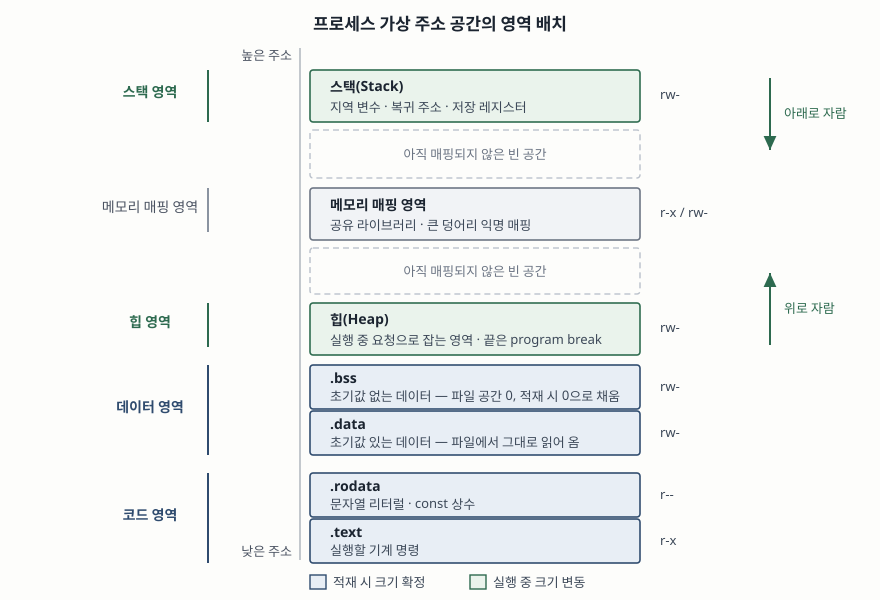
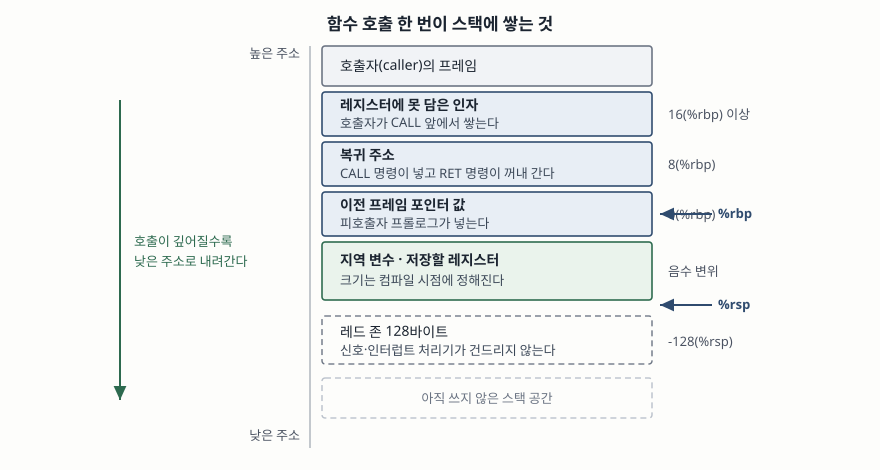

> **실행 검증 없음.** ABI 명세와 언어 표준, 매뉴얼에 적힌 정의와 동작만으로 쓴다.
> 측정값이나 도구 실행 출력은 싣지 않는다.

문항은 프로그램이 실행될 때 운영체제가 메모리를 네 영역으로 나누어 관리한다는 전제에서,
각 영역의 역할과 특징, 그리고 영역 사이의 동작 메커니즘을 묻는다. 하위 항목으로 코드,
데이터, 힙, 스택을 차례로 든다. 답안도 이 순서를 바꾸지 않고, 마지막에 영역 간 메커니즘을
따로 세운다.

---

## Ⅰ. 개요

### 가. 한 덩어리로 두지 않는 이유

실행 파일 하나를 통째로 읽어 연속한 메모리에 올려 두고 쓰는 방식도 생각할 수는 있다.
그러나 이 방식은 두 가지를 포기하게 된다.

첫째, **수명이 다른 것들이 섞인다.** 프로그램 전체 실행 동안 살아 있어야 하는 전역 변수와,
함수가 끝나면 즉시 사라져야 하는 지역 변수와, 해제할 때까지만 살아야 하는 동적 객체는
회수 시점이 전부 다르다. 섞어 두면 어느 바이트를 언제 되돌려 받을 수 있는지 판단할 근거가
사라진다.

둘째, **접근 권한을 걸 수 없다.** 기계 명령은 실행되어야 하고 쓰이면 안 된다. 상수는 읽히기만
해야 한다. 변수는 읽고 써야 한다. 권한은 페이지 단위로만 걸리므로, 성격이 다른 것들이
같은 페이지에 섞이면 가장 느슨한 권한을 공통으로 줄 수밖에 없다.

### 나. 나누는 두 축

그래서 영역 구분의 축은 **수명**과 **접근 권한** 두 가지다. 네 영역은 이 두 축의 조합으로
정리된다.

| 영역 | 수명 | 접근 권한 |
|---|---|---|
| 코드 | 프로세스 전체 | 읽기·실행 (쓰기 없음) |
| 데이터 | 프로세스 전체 | 읽기·쓰기 |
| 힙 | 할당부터 해제까지 | 읽기·쓰기 |
| 스택 | 블록 진입부터 탈출까지 | 읽기·쓰기 |

C 언어 표준은 같은 구분을 **저장 기간(storage duration)** 이라는 이름으로 네 가지로 든다 —
정적(static), 스레드(thread), 자동(automatic), 할당(allocated)이다
([ISO/IEC 9899 작업초안 N2310 §6.2.4 Storage durations of objects](https://www.open-std.org/jtc1/sc22/wg14/www/docs/n2310.pdf)).
언어가 요구하는 네 가지 수명을, 운영체제와 ABI가 네 개의 메모리 영역으로 받아 구현한 것이
이 문항이 묻는 구조다.

### 다. 실제 주소 공간에서의 배치



> **출처**: [System V ABI AMD64 Architecture Processor Supplement, Draft 0.99.7, Figure 3.8 Conventional Segment Arrangements](https://www.uclibc.org/docs/psABI-x86_64.pdf), [Linux man-pages 6.19 — proc_pid_maps(5)](https://man7.org/linux/man-pages/man5/proc_pid_maps.5.html)

AMD64 ABI가 드는 관례적 배치는 낮은 주소부터 **코드 세그먼트 → 데이터 세그먼트 → 스택
세그먼트 → 동적 세그먼트** 순이고, 코드 세그먼트는 `0x400000` 부근에서 시작하며 **0번지
근처는 매핑하지 않는다.** 널 포인터 역참조가 조용히 어떤 값을 읽어 오는 대신 즉시 보호
위반으로 걸리는 것이 이 미매핑 구간 덕이다.

다만 그림에서 보이듯 **실제 주소 공간에는 네 영역만 있는 것이 아니다.** 네 영역은
**단일 스레드 프로그램의 뼈대**를 설명하는 모형이고, 벗어나는 부분은 결론에서 따로 든다.

---

## Ⅱ. 가. 코드(Code) 영역

### 가. 역할

컴파일러가 만들어 낸 **기계 명령이 올라가는 영역**이다. 실행 파일에서는 `.text` 섹션이 여기에
대응한다. ELF 명세는 이 섹션을 "프로그램의 텍스트, 즉 실행 가능한 명령을 담는다"고 정의하고,
섹션 종류를 `SHT_PROGBITS`, 섹션 속성을 `SHF_ALLOC + SHF_EXECINSTR`로 든다
([System V ABI gABI, Sections](https://www.sco.com/developers/gabi/latest/ch4.sheader.html)).
속성에 `SHF_WRITE`가 **없다는 것**이 이 영역의 성격을 그대로 말해 준다.

### 나. 특징 네 가지

① **쓰기 권한이 없다.** 세그먼트 권한 비트는 `PF_X`(실행, 0x1), `PF_W`(쓰기, 0x2),
`PF_R`(읽기, 0x4) 셋이고, 프로그램 헤더 절은 "권한 비트가 0이면 그 종류의 접근은 거부된다",
"어떤 경우에도 명시적으로 지정하지 않는 한 세그먼트가 쓰기 권한을 갖지는 않는다"고 적는다
([System V ABI gABI, Program Header](https://www.sco.com/developers/gabi/latest/ch5.pheader.html)).
같은 절은 전형적인 텍스트 세그먼트가 읽기와 실행만 갖는다고 덧붙인다. 실행 중 코드 영역에
값을 쓰려는 저장 명령은 보호 위반이 된다.

② **크기가 적재 시점에 확정된다.** 명령의 양은 컴파일·링크가 끝난 순간 정해지고 실행 중에
늘지 않는다. 힙·스택과 갈리는 지점이다.

③ **여러 프로세스가 공유할 수 있다.** 내용이 바뀌지 않으므로 같은 실행 파일을 돌리는
프로세스들이 물리 페이지 하나를 함께 볼 수 있다. 공유 라이브러리의 코드가 특히 그렇다.

④ **읽기 전용 상수가 함께 실린다.** `.rodata` 섹션은 `SHT_PROGBITS`에 `SHF_ALLOC`만 갖는다 —
쓰기도 실행도 없다. 쓰기 권한이 없다는 점이 같으므로 적재 시 텍스트 쪽 세그먼트에 묶인다.

### 다. 문자열 리터럴이 여기 놓이는 근거

C 표준은 문자열 리터럴이 **정적 저장 기간을 갖는 배열**을 초기화하는 데 쓰인다고 정하고,
바로 다음 항에서 "프로그램이 그런 배열을 수정하려 시도하면 동작은 정의되지 않는다"고 적는다
(N2310 §6.4.5). 흔히 겪는 사고가 여기서 나온다.

```c
char *p = "hello";   /* p 는 .rodata 의 배열을 가리킨다 */
p[0] = 'H';          /* 정의되지 않은 동작 — 보호 위반으로 끝나기 쉽다 */

char a[] = "hello";  /* a 는 지역 배열, 리터럴을 복사해 초기화한다 */
a[0] = 'H';          /* 정상 */
```

두 줄의 차이는 문법이 아니라 **값이 어느 영역에 있는가**다. 위는 코드 쪽 읽기 전용
세그먼트를 가리키는 포인터이고, 아래는 스택에 만든 배열이다.

---

## Ⅲ. 나. 데이터(Data) 영역

### 가. 역할

**정적 저장 기간을 갖는 변수**가 놓인다. 전역 변수, `static`으로 선언한 변수, 외부·내부 연결을
갖는 객체가 여기 해당한다. 표준은 이 객체들의 수명을 "프로그램의 전체 실행"으로 정하고,
저장된 값이 "프로그램 시작 전에 단 한 번 초기화된다"고 적는다 (N2310 §6.2.4). 실행 환경
항목(N2310 §5.1.2)도 "정적 저장 기간을 갖는 모든 객체는 프로그램 시작 전에 초기값으로
설정되어야 한다"고 같은 요구를 둔다.

### 나. `.data` 와 `.bss` 로 갈리는 이유

데이터 영역은 **초기값이 0이 아닌 것**과 **0인 것**으로 나뉜다. 나누는 이유는 단 하나,
**실행 파일의 크기**다.

| 섹션 | 담는 것 | 섹션 종류 | 파일 공간 | 메모리 초기값 |
|---|---|---|---|---|
| `.data` | 0이 아닌 초기값을 가진 변수 | `SHT_PROGBITS` | 차지한다 | 파일에서 읽은 값 |
| `.bss` | 초기값이 없거나 0인 변수 | `SHT_NOBITS` | **차지하지 않는다** | 0 |

ELF 명세는 `.bss`를 "프로그램의 메모리 이미지에 기여하는 초기화되지 않은 데이터를 담는다.
정의상, 시스템은 프로그램이 실행을 시작할 때 이 데이터를 0으로 초기화한다"고 적고, 이어서
"섹션 종류 `SHT_NOBITS`가 나타내듯 이 섹션은 파일 공간을 차지하지 않는다"고 못 박는다
(gABI, Sections). 10MB짜리 전역 배열을 0으로 두면 실행 파일이 10MB 커지는 것이 아니라
**0바이트 커진다.**

### 다. 0으로 채우는 일은 누가 하는가

파일에 바이트가 없는데 메모리에는 0이 깔려 있어야 한다. 이 간극을 메우는 것이 프로그램 헤더의
두 필드다. 로더는 `p_filesz`만큼을 파일에서 읽어 세그먼트 앞쪽에 놓고, **나머지는 0으로
채운다.**

> 세그먼트의 메모리 크기(`p_memsz`)가 파일 크기(`p_filesz`)보다 크면, 그 "여분" 바이트는
> 값 0을 갖도록 정의되며 세그먼트의 초기화된 영역 뒤에 놓인다 (gABI, Program Header).

같은 절은 `.bss`를 두고 "파일에서 공간을 차지하지 않지만 세그먼트의 메모리 이미지에는
기여한다. 보통 이 초기화되지 않은 데이터는 세그먼트 끝에 놓이며, 그래서 `p_memsz`가
`p_filesz`보다 커진다"고 적는다. **`p_memsz - p_filesz`가 곧 `.bss`의 크기**다.

흔적은 실행 중에도 남는다. 프로세스의 매핑 목록을 보면 `.bss`가 포함된 구간은 i노드 번호가
0으로 나온다 — 매뉴얼은 "0은 그 메모리 구간에 i노드가 연관되어 있지 않다는 뜻이며, BSS
(초기화되지 않은 데이터)가 그런 경우"라고 설명한다
([proc_pid_maps(5)](https://man7.org/linux/man-pages/man5/proc_pid_maps.5.html)).
파일에서 온 바이트가 없으니 가리킬 파일도 없다.

### 라. 특징 정리

- 수명은 프로세스 전체. 함수가 끝나도 값이 남는다
- 크기는 적재 시점에 확정되고 실행 중 늘지 않는다
- 읽기·쓰기 권한을 갖는다
- 초기화가 **프로그램 시작 전에** 끝나 있다. `main` 진입 시점에는 이미 값이 들어 있다

---

## Ⅳ. 다. 힙(Heap) 영역

### 가. 역할

**크기나 개수를 컴파일 시점에 알 수 없는 데이터**를 담는다. 읽어 들일 레코드가 몇 건인지,
사용자가 입력할 문자열이 몇 글자인지는 실행해 봐야 정해진다. 이때 프로그램이 명시적으로
요청해 받아 가는 영역이 힙이고, C 표준이 말하는 **할당 저장 기간**이 여기에 대응한다.

표준은 할당된 객체의 수명을 "할당부터 해제까지"로 정하고, 다음을 함께 요구한다 (N2310 §7.22.3).

- **연속성과 순서는 보장하지 않는다** — "연속한 호출로 할당된 저장소의 순서와 연속성은
  명세되지 않는다." 두 번 연달아 할당한 두 블록이 주소순으로 붙어 있으리라 가정하면 안 된다
- **정렬은 보장한다** — 반환된 포인터는 "기본 정렬 요구를 갖는 어떤 타입의 포인터에
  대입하여 그 타입의 객체에 접근할 수 있도록 적절히 정렬되어" 있다
- **겹치지 않는다** — 각 할당은 "다른 어떤 객체와도 분리된 객체를 가리키는 포인터"를 낸다

### 나. 운영체제에서 받아 오는 두 경로

힙은 프로그램이 직접 운영체제에 요청하는 것이 아니라, **할당기를 한 겹 거친다.** 리눅스
매뉴얼은 두 경로를 구분해 적는다
([malloc(3)](https://man7.org/linux/man-pages/man3/malloc.3.html)).

| 요청 크기 | 경로 | 설명 |
|---|---|---|
| 작은 블록 | `sbrk(2)` | "보통 `malloc()`은 힙에서 메모리를 할당하고, `sbrk(2)`를 써서 필요한 만큼 힙 크기를 조절한다" |
| `MMAP_THRESHOLD` 초과 | `mmap(2)` | "그보다 큰 블록을 할당할 때 glibc 구현은 `mmap(2)`을 써서 사적 익명 매핑으로 할당한다" |

기본 문턱값은 128kB이고 `mallopt(3)`으로 바꿀 수 있다. 큰 덩어리를 따로 떼어 내는 이유는
해제할 때 바로 운영체제에 돌려주기 위해서다. `sbrk`로 늘린 힙은 중간 블록을 해제해도
윗부분이 쓰이고 있으면 경계를 되돌릴 수 없다.

**program break**는 이 경계를 가리키는 이름이다. 매뉴얼은 "`brk()`와 `sbrk()`는 program
break의 위치를 바꾸며, 이것이 프로세스 데이터 세그먼트의 끝을 정의한다 — 즉 program break는
초기화되지 않은 데이터 세그먼트 끝 다음의 첫 위치다"라고 정의한다
([brk(2)](https://man7.org/linux/man-pages/man2/brk.2.html)).
**힙은 데이터 영역의 끝에서 시작해 위로 자란다**는 배치가 여기서 나온다.

### 다. 특징

- **프로그래머가 수명을 관리한다.** 네 영역 중 유일하다. 자동 회수가 없으므로 누수와 이중
  해제가 이 영역에서만 생긴다
- **초기값이 없다.** 매뉴얼은 `malloc()`에 대해 "메모리는 초기화되지 않는다"고, `calloc()`에
  대해 "메모리는 0으로 설정된다"고 갈라 적는다. 할당 직후 값을 읽으면 이전에 그 자리에 있던
  바이트가 나온다
- **단편화가 쌓인다.** 할당과 해제가 뒤섞이면 전체 여유 바이트는 충분한데 연속한 블록을
  내주지 못하는 상태가 된다
- **상한이 걸려 있다.** `RLIMIT_DATA`는 "프로세스 데이터 세그먼트(초기화된 데이터, 초기화되지
  않은 데이터, 힙)의 최대 크기"이고, 이 한계에서 `brk(2)`·`sbrk(2)`는 `ENOMEM`으로 실패한다.
  `mmap(2)`도 Linux 4.7부터 이 한계의 영향을 받는다
  ([getrlimit(2)](https://man7.org/linux/man-pages/man2/getrlimit.2.html))

---

## Ⅴ. 라. 스택(Stack) 영역

### 가. 역할

**함수 호출 한 번에 필요한 상태**를 담는다. 지역 변수, 호출이 끝나고 돌아갈 주소, 보존해야 할
레지스터 값이다. C 표준의 **자동 저장 기간**이 여기 대응한다 — 연결이 없고 `static`도 아닌
객체가 자동 저장 기간을 가지며, 그 수명은 "연관된 블록에 진입한 때부터 그 블록의 실행이
어떤 식으로든 끝날 때까지"다 (N2310 §6.2.4).

같은 항은 두 가지를 덧붙인다. **재귀로 블록에 다시 진입하면 객체의 새 인스턴스가 매번
만들어지고**, 초기화를 지정하지 않으면 **초기값은 불확정이다.** 앞은 재귀가 성립하는 근거이고,
뒤는 초기화하지 않은 지역 변수에 쓰레기 값이 들어 있는 이유다.

### 나. 프레임의 구조



> **출처**: [System V ABI AMD64 Architecture Processor Supplement, Draft 0.99.7 §3.2.2 The Stack Frame, Figure 3.3 Stack Frame with Base Pointer](https://www.uclibc.org/docs/psABI-x86_64.pdf)

AMD64 ABI의 스택 프레임 절(§3.2.2)은 "레지스터 외에도 각 함수는 실행 시간 스택 위에 프레임을
갖는다. 이 스택은 높은 주소에서 아래로 자란다"로 시작한다. 그림이 정하는 자리는 이렇다.

| 위치 | 담긴 것 | 넣는 주체 |
|---|---|---|
| `16(%rbp)` 이상 | 레지스터로 못 넘긴 인자 | 호출자 |
| `8(%rbp)` | 복귀 주소 | `CALL` 명령 |
| `0(%rbp)` | 이전 프레임 포인터 값 | 피호출자 프롤로그 |
| 음수 변위 | 지역 변수·저장 레지스터 | 피호출자 프롤로그 |
| `-128(%rsp)` | 레드 존 | (예약) |

ABI가 함께 거는 제약이 두 가지다.

① **정렬** — "입력 인자 영역의 끝은 16바이트 경계에 정렬되어야 한다. 달리 말하면, 함수 진입점으로
제어가 넘어갈 때 `%rsp + 8` 값은 항상 16의 배수다." 복귀 주소 8바이트가 들어간 뒤의 정렬을
말하는 것이라 `+8`이 붙는다.

② **레드 존** — "`%rsp`가 가리키는 위치 너머의 128바이트 영역은 예약된 것으로 간주되며 신호
또는 인터럽트 처리기가 수정해서는 안 된다. 따라서 함수는 이 영역을 함수 호출을 넘겨 유지할
필요가 없는 임시 데이터에 쓸 수 있다. 특히 잎 함수(leaf function)는 프롤로그와 에필로그에서
스택 포인터를 조정하는 대신 이 영역을 프레임 전체로 쓸 수 있다." 다른 함수를 부르지 않는
함수가 스택 포인터를 건드리지 않고 끝낼 수 있게 해 주는 장치다. 다만 리눅스 커널 코드는
레드 존을 존중하지 않으므로 커널은 `-mno-red-zone`으로 컴파일한다고 같은 문서의 부록이 적는다.

### 다. 프로세스가 시작할 때의 스택

스택은 빈 채로 시작하지 않는다. `_start`가 불릴 때의 초기 상태를 ABI의 프로세스 초기화
절(§3.4)이 정하고 있다. 낮은 주소부터 올라가며 **인자 개수 → 인자 포인터 배열 → 0 → 환경
포인터 배열 → 0 → 보조 벡터 항목들 → 널 보조 벡터 항목 → 문자열이 담긴 정보 블록** 순이다.
`%rsp`가 가리키는 자리에 인자 개수가 놓인다.

`main(int argc, char *argv[], char *envp[])`의 세 인자가 어디서 오는지가 여기서 설명된다.
프로그램이 받아 쓰는 명령행 인자와 환경 변수는 **스택의 가장 높은 쪽에 이미 적재된 채로**
시작한다.

### 라. 특징

- **자동으로 쌓이고 자동으로 사라진다.** 할당·해제 비용이 스택 포인터를 더하고 빼는 것뿐이라
  힙보다 훨씬 싸다
- **크기 상한이 명확하다.** `RLIMIT_STACK`은 "프로세스 스택의 최대 크기"이고 "이 한계에
  도달하면 `SIGSEGV` 신호가 발생한다." 이 신호를 처리하려면 프로세스가 대체 신호 스택을
  써야 한다 — 스택이 다 찼으므로 보통 신호 처리기가 쓸 스택이 없기 때문이다. Linux 2.6.23
  부터는 명령행 인자와 환경 변수도 이 한계에 포함된다 (getrlimit(2))
- **경계는 가드 페이지로 지킨다.** 아래로 자라는 매핑에서 "매핑 아래의 '가드' 페이지에 있는
  주소를 건드리면 매핑이 한 페이지만큼 늘어난다." 다만 성장은 "바로 아래 매핑의 위쪽 끝에서
  한 페이지 이내"까지만 허용되고, 그 뒤에 가드 페이지를 건드리면 `SIGSEGV`가 난다
  ([mmap(2)](https://man7.org/linux/man-pages/man2/mmap.2.html))
- **스레드마다 따로 있다.** 매핑 목록에서 `[stack]`으로 표시되는 것은 "초기 프로세스(주
  스레드라고도 하는)의 스택"뿐이다. 다른 스레드의 스택은 별도 매핑으로 잡힌다 (proc_pid_maps(5))

---

## Ⅵ. 영역 간 동작 메커니즘

### 가. 적재 시점 — 실행 파일이 영역으로 펼쳐진다

섹션(`.text`, `.data`, `.bss`, `.rodata`)은 **링크 시점의 단위**이고, 적재는 그것을 묶은
**세그먼트** 단위로 이뤄진다. 묶는 기준은 **접근 권한**이다. 쓰기가 필요 없는 `.text`와
`.rodata`가 한 세그먼트로, 쓰기가 필요한 `.data`와 `.bss`가 다른 세그먼트로 간다.

로더가 하는 일은 세 가지다.

1. **순서대로 놓는다** — "프로그램 헤더 테이블의 적재 가능 세그먼트 항목은 `p_vaddr` 멤버를
   기준으로 오름차순 정렬되어 나타난다" (gABI, Program Header)
2. **페이지 경계를 맞춘다** — 적재 가능 세그먼트는 `p_vaddr`와 `p_offset`이 페이지 크기로
   나눈 나머지가 같아야 한다. 파일의 바이트를 페이지 단위로 그대로 매핑하기 위한 조건이다
3. **모자란 만큼 0으로 채운다** — 앞서 본 `p_memsz > p_filesz` 규칙이 `.bss`를 만든다

힙과 스택은 이 단계에서 파일로부터 받을 것이 없다. **빈 채로 자리만 잡는다.**

### 나. 호출 시점 — 네 영역이 한 번에 맞물린다

함수 호출 한 번에 코드·스택·데이터·힙이 동시에 관여한다. 순서는 이렇다.

1. 호출자가 **코드 영역**의 `CALL` 명령을 실행한다. 이 명령이 복귀 주소를 **스택 영역**에 넣는다
2. 제어가 피호출자의 첫 명령으로 넘어간다. 프롤로그가 이전 프레임 포인터를 **스택**에 저장하고
   지역 변수 자리를 확보한다
3. 함수 본문이 전역 변수를 읽으면 **데이터 영역**에, 할당 함수를 부르면 **힙 영역**에 닿는다.
   이때 **힙 객체를 가리키는 포인터 변수 자체는 스택에 있다**
4. 에필로그가 프레임을 되돌리고 `RET` 명령이 스택에서 복귀 주소를 꺼내 그리로 점프한다

**포인터가 영역 경계를 가로지른다**는 것이 이 구조의 핵심이다. 스택의 지역 포인터가 힙 객체를
가리키고, 그 힙 객체 안의 포인터가 코드 쪽 읽기 전용 영역의 문자열을 가리킨다. 그래서 대표적인
메모리 오류는 전부 **"어느 영역의 것인지"를 틀리는 데서** 나온다.

| 오류 | 무엇을 틀렸는가 |
|---|---|
| 지역 배열의 주소를 반환 | 블록 탈출과 동시에 수명이 끝난 자동 저장 기간 객체를 밖에서 참조한다 |
| 문자열 리터럴을 `free()` | 할당 저장 기간이 아닌 정적 저장 기간 객체를 해제 함수에 넘긴다 |
| 리터럴을 가리키는 포인터로 쓰기 | 쓰기 권한 없는 세그먼트에 저장한다 |
| 해제한 블록을 다시 참조 | 수명이 끝난 할당 객체를 참조한다 |

### 다. 실행 중 — 힙과 스택이 사이 공간을 나눠 쓴다

고정 크기인 코드·데이터와 달리 힙과 스택은 실행 중 커진다. 두 영역은 **서로 반대 방향으로
자라며 가운데 빈 공간을 나눠 쓴다.**

- **힙은 위로** — `brk`로 program break를 올려 데이터 영역 끝에서부터 높은 주소 쪽으로 늘린다
- **스택은 아래로** — 호출이 깊어질수록 낮은 주소로 내려간다

이 배치가 주는 것은 **유연성**이다. 둘 중 어느 쪽이 많이 필요한지는 프로그램마다 다른데, 경계를
미리 고정하지 않으면 한쪽이 사이 공간을 거의 다 쓸 수도 있다. 대신 치러야 하는 비용이 **경계
충돌 위험**이고, 이를 막는 장치가 둘이다.

1. **한계값** — `RLIMIT_STACK`과 `RLIMIT_DATA`가 각 방향의 성장을 따로 끊는다
2. **가드 페이지** — 아래로 자라는 매핑과 바로 아래 매핑 사이에 접근하면 실패하는 페이지를 둬서,
   스택이 다른 매핑을 덮치기 전에 `SIGSEGV`로 멈추게 한다

실제 64비트 주소 공간은 둘이 만날 만큼 좁지 않으므로 충돌은 드물다. 그러나 두 영역이 같은
빈 공간을 놓고 경쟁하는 관계라는 구조 자체는 변하지 않고, 한계값과 가드 페이지는 그 구조
때문에 필요하다.

### 라. 네 영역 비교

| 구분 | 코드 | 데이터 | 힙 | 스택 |
|---|---|---|---|---|
| C 저장 기간 | (명령) / 정적 | 정적 | 할당 | 자동 |
| 생성 시점 | 적재 시 | 적재 시 (시작 전 초기화) | 할당 함수 호출 시 | 블록 진입 시 |
| 소멸 시점 | 프로세스 종료 | 프로세스 종료 | 해제 함수 호출 시 | 블록 탈출 시 |
| 크기 결정 | 링크 시 확정 | 링크 시 확정 | 실행 중 가변 | 실행 중 가변 (프레임 크기는 컴파일 시) |
| 초기값 | 파일 내용 | `.data`는 파일값, `.bss`는 0 | `malloc` 불확정 / `calloc` 0 | 불확정 |
| 접근 권한 | `r-x` (`.rodata`는 `r--`) | `rw-` | `rw-` | `rw-` |
| 성장 방향 | 없음 | 없음 | 높은 주소 쪽 | 낮은 주소 쪽 |
| 상한 | 파일 크기 | `RLIMIT_DATA` | `RLIMIT_DATA` (`brk` 경로) | `RLIMIT_STACK` |
| 관리 주체 | 컴파일러·링커·로더 | 컴파일러·링커·로더 | **프로그래머** | 컴파일러 |
| 대표 오류 | 상수 수정 | — | 누수·이중 해제·단편화 | 수명 밖 참조·오버플로 |

---

## Ⅶ. 결론

네 영역 구분은 메모리를 넷으로 쪼갠 행정적 분류가 아니라, **수명과 접근 권한이라는 두 요구를
동시에 만족시키려 할 때 나오는 결과**다. 수명이 세 갈래(프로그램 전체 / 블록 / 명시적 해제까지)로
갈리고 권한이 두 갈래(실행·읽기 / 읽기·쓰기)로 갈리면, 그 조합을 담는 그릇은 넷이 된다.

실무에서 이 구조를 알아야 하는 자리는 세 곳이다. **첫째, 장애 분석이다.** 보호 위반이 났을 때
문제의 주소가 어느 영역에 속하는지만 알아도 원인 후보가 크게 좁혀진다. **둘째, 용량 산정이다.**
스레드 수를 늘릴 때 늘어나는 것은 힙이 아니라 스택이고, 한계값도 따로 걸려 있다. **셋째,
방어적 설계다.** 쓰기 권한이 없는 영역에 상수를 두는 것, 가드 페이지로 경계를 지키는 것은
전부 이 구분 위에서만 성립한다.

주의할 것은 **네 영역이 전부가 아니라는 점**이다. 공유 라이브러리와 큰 덩어리 할당이 들어가는
메모리 매핑 영역, 스레드 저장 기간 객체를 담는 영역이 따로 있고, 멀티스레드 프로그램에서는
스택이 스레드 수만큼 생긴다. 네 영역은 단일 스레드 프로그램의 뼈대를 설명하는 모형으로 쓰고,
실제 주소 공간을 다룰 때는 확장분을 함께 봐야 한다.

> 개념 정리: [프로세스와 스레드 — 문맥 교환 비용](../../system/2026-09-29-process-thread-context-switch-cost/index.md)

끝

---

## 답안 작성 메모

**무엇부터 쓰는가.** 배치 도식을 먼저 그린다. 이 문항은 네 영역을 묻기 때문에 채점자가
가장 먼저 확인하는 것이 "네 개를 다 알고 있는가, 위치 관계가 맞는가"다. 도식 하나로 그것이
끝나고, 이후 서술은 그 그림을 가리키면서 쓰면 된다. 낮은 주소부터 코드·데이터·힙 →
(빈 공간) → 스택 순, 힙은 위로 스택은 아래로 화살표. 여기까지 3분이면 된다.

**점수가 갈리는 지점은 "영역 간 동작 메커니즘"이다.** 네 영역의 역할과 특징은 대부분의
수험생이 쓴다. 변별이 생기는 곳은 마지막 항목이고, 여기를 "힙은 위로 스택은 아래로 자란다"
한 줄로 끝내면 앞을 아무리 잘 써도 평이한 답안이 된다. 최소한 셋은 넣는다.

1. **적재 메커니즘** — 섹션이 권한 기준으로 세그먼트에 묶이고, `p_memsz`와 `p_filesz`의
   차이가 `.bss`를 만든다. 이 한 줄이 "실행 파일에 없는 데이터가 메모리에 0으로 생기는"
   현상을 설명한다
2. **호출 메커니즘** — `CALL`이 복귀 주소를 스택에 넣고 `RET`이 꺼내 간다. 이 왕복이
   코드 영역과 스택 영역을 잇는 연결이다
3. **포인터가 경계를 가로지른다** — 스택의 포인터 변수가 힙 객체를 가리킨다. 여기서
   대표적 메모리 오류 표로 이어 가면 "구조를 아는 답안"이 된다

**시간이 모자라면 무엇을 버리는가.** 버리는 순서는 ① 초기 프로세스 스택 레이아웃
(`argc`/`argv`/`envp`가 스택에 적재된 채 시작한다는 부분), ② 레드 존, ③ 가드 페이지다.
셋 다 깊이를 더하는 재료지만 문항이 직접 묻지는 않았다. 반대로 **절대 버리지 않을 것**은
`.data`/`.bss` 구분과 그 이유다 — 데이터 영역 항목에서 이것을 안 쓰면 "데이터 영역은
전역 변수가 들어간다" 한 줄짜리 답이 된다.

**자주 틀리는 것 두 가지.** 첫째, **문자열 리터럴을 데이터 영역에 넣는 것**이다. 쓰기 권한이
없으므로 읽기 전용 쪽이고, 그래서 `char *p = "..."; p[0] = ...`이 보호 위반으로 끝난다.
둘째, **힙을 "운영체제가 주는 영역"으로만 쓰는 것**이다. 실제로는 할당기가 한 겹 끼어
있고, 그래서 `free()`를 해도 운영체제로 바로 반환되지 않는 경우가 생긴다. 이 한 겹을
짚어 주면 단편화 설명이 자연스럽게 붙는다.

**확장 질문 대비.** "왜 힙과 스택은 반대 방향으로 자라는가"를 물으면 경계를 미리 고정하지
않아 한쪽이 사이 공간을 많이 쓸 수 있다는 유연성으로 답한다. "네 영역이 전부인가"를 물으면
메모리 매핑 영역과 스레드 저장 기간 영역을 든다. 둘 다 결론에 한 문장씩 깔아 두면 질문이
와도 당황하지 않는다.

---

## 참고 자료

- [System V Application Binary Interface — Sections (gABI Chapter 4)](https://www.sco.com/developers/gabi/latest/ch4.sheader.html) — `.text`·`.data`·`.bss`·`.rodata`의 섹션 종류와 속성
- [System V Application Binary Interface — Program Loading and Dynamic Linking (gABI Chapter 5)](https://www.sco.com/developers/gabi/latest/ch5.pheader.html) — `PT_LOAD`, `p_filesz`/`p_memsz`, `PF_X`/`PF_W`/`PF_R`
- [System V ABI AMD64 Architecture Processor Supplement, Draft 0.99.7 (2014-11-17)](https://www.uclibc.org/docs/psABI-x86_64.pdf) — §3.2.2 The Stack Frame, §3.4 Process Initialization, Figure 3.8 Conventional Segment Arrangements, Figure 3.9 Initial Process Stack
- [ISO/IEC 9899 작업초안 N2310 (2018-11-06)](https://www.open-std.org/jtc1/sc22/wg14/www/docs/n2310.pdf) — §6.2.4 Storage durations of objects, §6.4.5 String literals, §7.22.3 Memory management functions, §5.1.2 Execution environments
- [Linux man-pages 6.19 — proc_pid_maps(5)](https://man7.org/linux/man-pages/man5/proc_pid_maps.5.html) — 매핑 목록의 필드와 `[heap]`·`[stack]` 표기
- [Linux man-pages 6.19 — brk(2)](https://man7.org/linux/man-pages/man2/brk.2.html) — program break의 정의
- [Linux man-pages 6.19 — malloc(3)](https://man7.org/linux/man-pages/man3/malloc.3.html) — `sbrk`/`mmap` 경로와 `MMAP_THRESHOLD`
- [Linux man-pages 6.19 — getrlimit(2)](https://man7.org/linux/man-pages/man2/getrlimit.2.html) — `RLIMIT_STACK`·`RLIMIT_DATA`
- [Linux man-pages 6.19 — mmap(2)](https://man7.org/linux/man-pages/man2/mmap.2.html) — `MAP_ANONYMOUS`, `MAP_GROWSDOWN`과 가드 페이지
