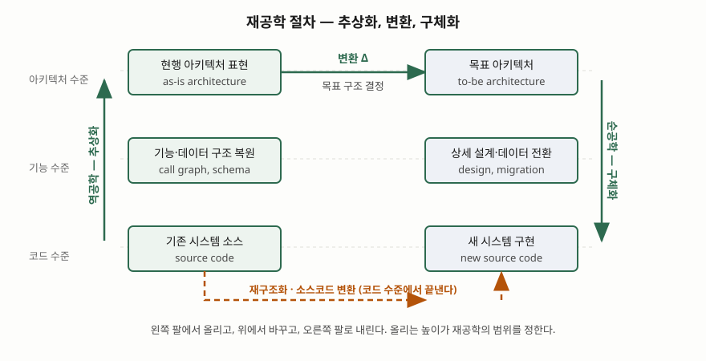

> **실행 검증 없음.** 표준과 원 논문의 정의·절차만으로 쓴다. 측정값이나 도구 실행 결과는 싣지 않는다.

문항은 소프트웨어 유지보수를 위한 재공학과 역공학을 묻는다. 묻는 순서는 재공학의 개념과
목적, 재공학의 절차, 역공학의 개념과 활용 방안 셋이다. 답안도 이 순서를 바꾸지 않는다.

---

## Ⅰ. 개요

### 가. 유지보수 단계에서 레거시가 만드는 문제

인도 이후의 소프트웨어는 결함 수정·환경 적응·기능 개선·예방 조치를 위해 계속 바뀐다.
변경이 쌓이면 설계 문서가 코드와 어긋나고, 결국 **코드만이 유일하게 믿을 수 있는 산출물**이
되는 상태에 이른다. 이 상태에서는 변경 영향 범위를 계산할 수 없어 작은 수정에도 회귀 결함이
따라붙는다.

### 나. 두 활동의 위치

소프트웨어 공학 지식체계는 유지보수 기법을 네 가지로 든다 — **프로그램 이해, 재공학, 역공학,
그리고 변경을 자동으로 흘려보내는 통합·배포 체계**다
([SWEBOK Guide V4.0a, Software Maintenance KA §4](https://www.computer.org/education/bodies-of-knowledge/software-engineering)).
재공학과 역공학은 이 가운데 **레거시를 직접 다루는 두 기법**이고, 서로 포개진 관계다.
역공학이 재공학의 앞 구간이 된다.

> **가르는 한 줄**: 역공학은 시스템을 **바꾸지 않고**, 재공학은 **바꾼다.**

---

## Ⅱ. 재공학(Re-engineering)의 개념 및 목적

### 가. 정의 — 세 자료가 같은 뼈대를 쓴다

| 출처 | 정의 |
|---|---|
| Chikofsky & Cross, IEEE Software 7(1) (1990) | 대상 시스템을 **검토해 새 형태로 재구성하고, 그 새 형태를 구현**하는 것 |
| 미 국방부 재공학 워크숍 용어집 (SB-1, 1992) | 기존 대상 시스템의 **검토와 변경**을 통해 새 형태로 재구성하는 것 |
| SWEBOK Guide V4.0a (2024) | 소프트웨어를 검토·변경해 새 형태로 재구성하고 **그 새 형태를 구현**하는 데까지 이르는 것 |

세 정의가 공통으로 요구하는 것은 **① 검토 ② 변경 ③ 새 형태의 구현** 세 가지다. 셋 중 하나라도
빠지면 재공학이 아니다. 검토만 하면 역공학이고, 외부 동작을 보존한 채 표현만 바꾸면 재구조화다.

Jacobson과 Lindström은 같은 뜻을 식으로 적었다 — **재공학 = 역공학 + Δ + 순공학**
([OOPSLA '91, Re-engineering of old systems to an object-oriented architecture](https://doi.org/10.1145/117954.117975)).
Δ가 0이면 역공학과 순공학을 붙여 원래 시스템을 다시 만든 것일 뿐이므로, **Δ를 무엇으로
둘 것인지가 재공학 과제의 실질**이다.

### 나. 목적 — 5가지

| # | 목적 | 무엇을 해결하는가 |
|---|---|---|
| ① | **유지보수성 회복** | 변경 영향 범위를 계산할 수 있는 구조로 되돌려 변경 비용과 회귀 결함을 줄인다 |
| ② | **생애주기 연장** | 지원이 끊긴 언어·미들웨어·하드웨어에서 벗어나 운영 가능 기간을 늘린다 |
| ③ | **업무 규칙 자산의 보존** | 문서에 없고 코드에만 남은 규칙을 식별해 새 시스템으로 옮긴다 |
| ④ | **품질 속성의 재배치** | 성능·확장성·보안처럼 구조가 결정하는 속성을 목표 구조에서 다시 잡는다 |
| ⑤ | **기술부채의 일괄 상환** | 변경마다 누적되던 부채를 한 번의 과제로 정리한다 |

주의할 점이 하나 있다. 지식체계는 재공학이 **유지보수성 향상보다는 노후 레거시의 교체를 위해
수행되는 경우가 많다**고 적는다(SWEBOK Guide V4.0a, Software Maintenance KA의 재공학 항목).
목적을 유지보수성 하나로만 쓰면 현장의 실제 동기를 놓친다.

### 다. 유사 개념과의 구분

| 구분 | 역공학 | 재구조화 | 리팩토링 | **재공학** | 재개발(대체) |
|---|---|---|---|---|---|
| 시스템 변경 | 없음 | 내부만 | 내부만 | **새 형태로** | 버리고 새로 |
| 추상화 이동 | 위로 | 없음 | 없음 | **위로 갔다 아래로** | 아래로만 |
| 외부 동작 | 보존 | 보존 | 보존 | **의도적으로 바꿀 수 있다** | 요구사항부터 다시 |
| 기존 자산 | 분석 대상 | 수정 대상 | 수정 대상 | **이어받는 대상** | 폐기 |
| 산출물 | 문서·모델 | 바뀐 코드 | 작은 변환의 연속 | **새 구현** | 새 구현 |

재공학과 재개발을 가르는 기준은 **역공학 구간의 유무**다. 재개발은 기존 시스템을 올려다보지 않고
요구사항에서 다시 내려온다. 그래서 코드에만 남은 업무 규칙을 잃을 위험을 안는다.

---

## Ⅲ. 재공학 절차

### 가. 절차의 뼈대 — 추상화 → 변환 → 구체화

재공학 절차는 **추상화 수준을 올렸다가 내리는 한 번의 왕복**이다. 미 카네기멜런대 소프트웨어
공학연구소는 이 모양을 말굽(horseshoe)에 빗대어, **왼쪽 팔은 기존 시스템에서 사실을 추출하는
구간, 오른쪽 팔은 개발 활동 구간, 두 팔을 잇는 다리는 옛것에서 새것으로 가는 변환의 집합**이라고
정리했다([SEI, Requirements for Integrating Software Architecture and Reengineering Models: CORUM II (1998)](https://www.sei.cmu.edu/library/requirements-for-integrating-software-architecture)).

> **출처**: [SEI, Requirements for Integrating Software Architecture and Reengineering Models: CORUM II (1998)](https://www.sei.cmu.edu/library/requirements-for-integrating-software-architecture), [E. J. Chikofsky, J. H. Cross II, Reverse Engineering and Design Recovery: A Taxonomy, IEEE Software 7(1) pp.13-17 (1990)](https://doi.org/10.1109/52.43044)

### 나. 수행 절차 — 5단계

| 단계 | 활동 | 주요 산출물 | 완료 판정 |
|---|---|---|---|
| **1. 대상 선정** | 포트폴리오 분석, 재공학·재개발·존치 중 선택, 범위와 예산 확정 | 현황 목록, 타당성 분석서, 과제 계획 | 재개발 대비 우위가 수치로 설명되는가 |
| **2. 역공학** | 소스·스키마·운영 데이터에서 구성요소와 상호관계 식별, 현행 아키텍처 복원 | 호출 관계도, 논리 스키마, 업무 규칙 목록 | 식별된 규칙이 현업 확인을 거쳤는가 |
| **3. 변환 설계 (Δ)** | 목표 아키텍처 결정, 보존·변경·폐기 기능 구분, 데이터 전환 규칙 정의 | 목표 아키텍처 정의서, 기능 대응표, 전환 규칙서 | 기존 기능이 셋 중 하나로 빠짐없이 분류됐는가 |
| **4. 순공학** | 목표 구조에 따른 설계·구현, 데이터 전환, 인터페이스 재구성 | 새 소스, 전환된 데이터, 연계 명세 | 대응표의 모든 항목이 구현에 매핑됐는가 |
| **5. 이행·검증** | 병행 운영, 기존·신규 결과 대조, 전환, 구 시스템 폐기 | 대조 결과, 전환 계획서, 폐기 기록 | 같은 입력에 같은 결과가 나오는가 |

2~4단계가 말굽의 왼쪽 팔·다리·오른쪽 팔에 각각 대응한다. 1단계와 5단계는 말굽 모델에 없고
**과제를 실제로 돌리기 위해 앞뒤로 붙는 구간**이다. 특히 5단계의 병행 운영은 Δ가 0이 아닌 이상
"결과가 같아야 하는 범위"를 먼저 합의해야 성립한다.

국제표준은 재공학 자체의 절차를 따로 규정하지 않는다. 유지보수 표준
(ISO/IEC/IEEE 14764:2022)은 유지보수 활동과 과업, 문제·변경 분석, 그리고 소프트웨어 폐기를
규정하므로, 재공학 과제는 **이 표준의 변경 분석과 폐기 절차 안에서 수행되는 큰 변경**으로
다뤄진다. 답안에서는 재공학 절차를 표준 조항처럼 쓰지 말고 **모델에 근거한 절차**로 밝혀 쓴다.

### 다. 변환 수준 — 어디까지 올릴 것인가

재공학 도구와 변환은 **코드 수준부터 소프트웨어 아키텍처까지 서로 다른 추상화 수준에서
동작한다**(SEI, CORUM II). 올리는 높이가 곧 과제의 성격을 정한다.

| 수준 | 변환 내용 | 해당 활동 | 한계 |
|---|---|---|---|
| **코드 수준** | 표현 형태만 바꾼다 | 재구조화, 소스코드 번역, 재문서화 | 구조 결함은 그대로 옮겨 간다 |
| **기능 수준** | 기능 단위를 다시 묶는다 | 모듈 재구성, 데이터 재공학 | 아키텍처 제약은 남는다 |
| **아키텍처 수준** | 구조와 품질 속성을 다시 잡는다 | 계층 재설계, 서비스 분할, 플랫폼 전환 | 비용과 위험이 가장 크다 |

미 국방부 재공학 워크숍 용어집(SB-1, 1992)은 재공학의 하위 활동으로 **재문서화, 재구조화,
소스코드 번역, 재목적화(retargeting), 데이터 재공학**을 든다. 이들은 서로 배타적인 선택지가
아니라 **위 표의 어느 수준에서 변환을 끝낼지에 따라 조합되는 수단**이다.

---

## Ⅳ. 역공학(Reverse Engineering)의 개념 및 활용 방안

### 가. 개념

대상 시스템을 분석해 **① 구성요소와 그 상호관계를 식별하고 ② 시스템을 다른 형태 또는 더 높은
추상화 수준으로 표현**하는 과정이다(Chikofsky & Cross, 1990). 지식체계는 여기에 한 가지를 더
못 박는다 — **역공학은 수동적(passive)이며, 소프트웨어를 바꾸지도 새 소프트웨어를 만들지도
않는다**(SWEBOK Guide V4.0a, Software Maintenance KA의 역공학 항목).

유형은 **3가지**다(같은 자료).

| 유형 | 내용 | 대표 산출물 |
|---|---|---|
| **재문서화** (Re-documentation) | 같은 추상화 수준에서 사람이 읽을 표현을 만들거나 고친다 | 호출 관계도, 제어 흐름도, 운영 매뉴얼 |
| **설계 복구** (Design recovery) | 관찰 결과에 **도메인 지식·외부 정보·추론**을 더해 상위 추상화를 식별한다 | 설계서, 업무 규칙 목록 |
| **데이터 역공학** (Data reverse engineering) | 물리 데이터베이스에서 **논리 스키마를 복원**한다 | 개념·논리 데이터 모델 |

같은 논문은 역공학의 목적을 **6가지**로 든다 — ① 복잡도 대처 ② 대안 관점 생성 ③ 잃어버린 정보
복구 ④ 부작용 탐지 ⑤ 상위 추상화 합성 ⑥ 재사용 촉진.

### 나. 활용 방안 — 6가지

| # | 활용 | 무엇에 쓰는가 | 주요 기법 |
|---|---|---|---|
| ① | **재공학의 입력** | 말굽의 왼쪽 팔 전체. 현행 아키텍처와 기능 대응표의 근거가 된다 | 정적 분석, 아키텍처 복원 |
| ② | **변경 영향 분석** | 수정 요청의 파급 범위를 계산해 회귀 시험 범위를 정한다 | 프로그램 슬라이싱, 의존성 분석 |
| ③ | **데이터 전환 설계** | 제약이 코드에만 있는 물리 스키마에서 논리 모델을 복원해 전환 규칙을 만든다 | 데이터 역공학, 데이터 프로파일링 |
| ④ | **부작용·취약점 탐지** | 문서에 없는 숨은 결합과 보안 결함을 드러낸다 | 데이터 흐름 분석, 동적 분석 |
| ⑤ | **상호운용 확보** | 명세가 없는 연계 인터페이스의 규약을 복원해 접속을 성립시킨다 | 프로토콜·메시지 분석 |
| ⑥ | **재사용 자산 식별** | 그대로 떼어 쓸 수 있는 구성요소를 골라낸다 | 구성요소 후보 분석 |

②~⑥은 재공학 과제가 없어도 **일상 유지보수에서 그 자체로 쓰인다.** 역공학을 재공학의 부속
단계로만 쓰면 활용 방안을 좁게 답하는 셈이 된다.

### 다. 적용 시 고려사항

- **산출물에 신뢰 수준을 표시한다.** 도구가 기계적으로 뽑은 호출 관계와 사람이 추론한 업무
  규칙은 확실성이 다르다. 후자는 현업 확인 여부를 함께 남긴다.
- **도구가 설계 복구를 대신하지 못한다.** 도구는 구성요소와 관계까지는 잘 뽑지만, 설계 복구가
  요구하는 도메인 지식과 추론은 사람이 넣어야 한다.
- **권리 범위를 먼저 확인한다.** 라이선스가 역분석을 금지할 수 있고, 저작권법의
  프로그램코드역분석 조항(제101조의4)은 **호환에 필요한 정보를 얻을 목적**으로 그 정보를
  달리 얻기 어려울 때 필요한 범위에 한해 허용한다
  ([국가법령정보센터, 저작권법](https://www.law.go.kr/%EB%B2%95%EB%A0%B9/%EC%A0%80%EC%9E%91%EA%B6%8C%EB%B2%95)).
- **복원한 현행 기준선을 형상관리 대상으로 둔다.** 역공학 산출물은 만든 순간부터 낡기 시작하므로,
  변경 요청과 함께 갱신되지 않으면 한 번 더 복원해야 한다.

---

## Ⅴ. 결론

재공학은 **검토·변경·구현 셋을 모두 포함하는 활동**이고, 역공학은 그중 앞 구간을 담당하면서
동시에 일상 유지보수의 독립된 기법이기도 하다. 절차의 핵심은 **어느 추상화 수준까지 올릴
것인가**이며, 그 높이가 비용·위험·효과를 동시에 결정한다. 코드 수준에서 끝내면 싸지만 구조
결함을 그대로 옮기고, 아키텍처 수준까지 올리면 품질 속성을 다시 잡을 수 있으나 위험이 커진다.
따라서 재공학 과제의 첫 산출물은 코드가 아니라 **재공학과 재개발 중 하나를 고른 근거**여야 한다.

> 개념 정리: [소프트웨어 재공학과 역공학](../../software-engineering/2026-10-23-software-reengineering-reverse-engineering/index.md)

끝

---

## 답안 작성 메모

- **먼저 쓸 것**: 재공학 정의 한 줄과 "재공학 = 역공학 + Δ + 순공학" 식. 이 둘을 개요 끝이나
  대항목 첫머리에 박아 두면 나머지 항목이 전부 이 식의 전개로 읽힌다.
- **점수가 갈리는 지점**:
  - 절차를 **추상화 → 변환 → 구체화**의 왕복으로 설명했는가. 단순히 "분석 → 설계 → 구현"으로
    쓰면 재개발 절차와 구분되지 않아 (가)에서 쓴 정의와 모순이 생긴다.
  - **변환 수준 3가지**(코드·기능·아키텍처)를 들었는가. 이 표가 있으면 "왜 재공학의 비용이
    과제마다 다른가"가 설명되고, 없으면 절차가 평면적으로 읽힌다.
  - 역공학 활용 방안을 **재공학 바깥까지** 넓혔는가. 영향 분석·데이터 전환·취약점 탐지는
    재공학 과제가 없어도 쓰이는 용도다.
- **시간이 모자라면 버릴 것**: 유사 개념 비교표(리팩토링·재개발 열)를 줄이고 재공학과 재개발
  두 열만 남긴다. 역공학 6가지 목적은 두문자로 한 줄만 적는다.
- **버리면 안 되는 것**: 모식도와 5단계 절차표. 문항이 "절차를 설명하라"고 직접 요구했으므로
  이 둘이 빠지면 배점의 중심이 비는 것으로 읽힌다.
- **흔한 실수**: 재공학의 목적을 "유지보수성 향상"으로만 적는 것. 지식체계는 오히려 노후 레거시
  교체가 더 흔한 동기라고 적는다. 목적을 복수로 들고 그 사실을 한 줄 덧붙이면 깊이가 드러난다.

## 참고 자료

- [E. J. Chikofsky, J. H. Cross II, Reverse Engineering and Design Recovery: A Taxonomy, IEEE Software 7(1) pp.13-17 (1990-01)](https://doi.org/10.1109/52.43044)
- [SWEBOK Guide V4.0a, Chapter 7 Software Maintenance (IEEE Computer Society, 2024)](https://www.computer.org/education/bodies-of-knowledge/software-engineering)
- [ISO/IEC/IEEE 14764:2022, Software engineering — Software life cycle processes — Maintenance](https://www.iso.org/standard/80710.html)
- [SEI, Requirements for Integrating Software Architecture and Reengineering Models: CORUM II (1998)](https://www.sei.cmu.edu/library/requirements-for-integrating-software-architecture)
- [SEI, Options Analysis for Reengineering (OAR): Issues and Conceptual Approach (1999)](https://www.sei.cmu.edu/library/options-analysis-for-reengineering-oar-issues-and-conceptual-approach)
- [I. Jacobson, F. Lindström, Re-engineering of old systems to an object-oriented architecture, OOPSLA '91 (1991)](https://doi.org/10.1145/117954.117975)
- [미 국방부 소프트웨어 재공학 워크숍(SB-1, 1992) 용어 정리](https://www2.informatik.hu-berlin.de/swt/projekt98/lehre/define.htm)
- [국가법령정보센터 — 저작권법](https://www.law.go.kr/%EB%B2%95%EB%A0%B9/%EC%A0%80%EC%9E%91%EA%B6%8C%EB%B2%95)
