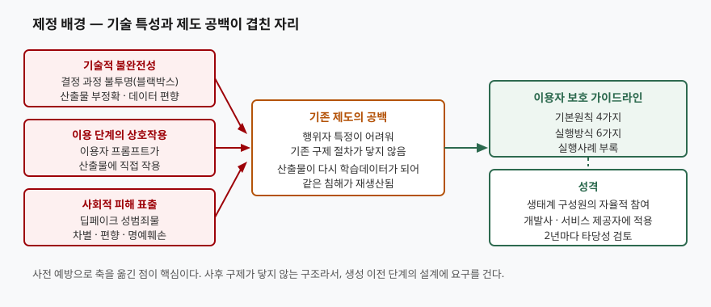
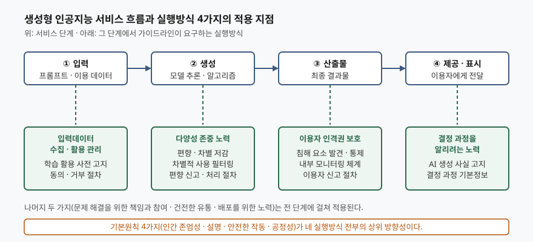

> 실행 검증 없음. 가이드라인의 목적·용어 정의·기본원칙·실행방식·부칙은 방송통신위원회가
> 공표한 본문과 보도자료에 적힌 것만 옮겼다. 가이드라인이 인용한 기업 설문의 비율처럼
> 원 출처가 1차 자료가 아닌 수치는 쓰지 않았다.

문항은 두 갈래로 나눠 묻는다. 가이드라인이 왜 제정됐는지, 그리고 가이드라인이 제시하는
이용자 보호 실행방식 네 가지가 무엇이고 각각이 생성형 AI 서비스에서 왜 중요한지다.
물은 순서를 그대로 대항목으로 쓴다.

---

## Ⅰ. 개요

방송통신위원회는 2025년 2월 28일 「생성형 인공지능 서비스 이용자 보호 가이드라인」을
제정하고 한 달 뒤인 3월 28일부터 시행했다. 적용 대상은 **생성형 인공지능 개발사 및
서비스 제공자**이며, 서비스 전반에 걸쳐 추구해야 할 **기본원칙 4가지**와 이를 실현하기
위한 **실행방식 6가지**로 구성된다.

이 가이드라인의 성격을 한 줄로 끊으면 **사전 예방으로 축을 옮긴 자율적 실천 지침**이다.
가이드라인은 목적 조항에서 "생성형 인공지능 생태계 구성원의 책임감을 바탕으로 자율적인
참여를 통한 효과적인 이용자 보호 체계를 구축"한다고 밝힌다. 침해가 일어난 뒤 책임을 묻는
구조가 생성형 AI에서는 잘 작동하지 않으므로, 산출물이 만들어지기 전 단계의 **시스템 설계와
운영 절차**에 요구를 거는 쪽을 택했다.

답안에서 중요한 것은 가이드라인 항목을 옮겨 적는 일이 아니다. 각 실행방식이 **정보시스템에
무엇을 구현하라고 요구하는지** — 어느 지점에 필터가 들어가고, 어떤 메타데이터를 붙이고,
어떤 동의 절차와 로그가 필요한지 — 까지 내려가야 정보관리기술사의 답안이 된다.

---

## Ⅱ. 가이드라인 제정 배경 및 필요성 (가)

> **출처**: [생성형 인공지능 서비스 이용자 보호 가이드라인 — Ⅰ. 배경 및 필요성, Ⅴ. 실행 방식 (방송통신위원회, 2025.2.28.)](https://user-archive.kisdi.re.kr/download/AIguideline.pdf)

### 가. 배경 — 세 가지 요인이 겹쳤다

가이드라인은 배경을 세 갈래로 적는다.

**① 기술의 불완전성.** 가이드라인은 딥러닝 기반 시스템이 복잡한 내부 구조를 가져
이용자는 물론 개발자조차 결정 과정을 명확히 파악하기 어렵다는 점을 **'블랙박스' 문제**로
부른다. 여기에 파운데이션 모델을 개발하는 대표 기업조차 산출물의 정확성을 완전히 보장하지
못한다는 점, 학습데이터에 내재된 편향이 그대로 산출물에 반영된다는 점을 덧붙인다.

**② 이용 단계의 상호작용.** 가이드라인이 기존 인공지능 서비스와 구분해 짚는 지점이다.
생성형 AI는 **이용자가 입력한 프롬프트가 산출물에 직접 작용**한다. 그래서 이용자 책임의
무게가 더 크지만, 사업자가 기술과 서비스에 대한 정보를 월등히 많이 가지므로 책임을
이용자에게만 물을 수 없다고 적는다.

**③ 사회적 피해의 표출.** 보도자료는 첨단조작기술영상(딥페이크) 성범죄물, 차별·편향 등의
부작용이 심각하게 대두돼 이용자 안전과 권리를 보호할 제도적 기반 마련 필요성이 지속적으로
제기돼 왔다고 밝힌다. 본문은 혐오 표현 표출, 피싱을 통한 민감정보 수집, 특정인을 연상케
하는 사진·영상 생성으로 인한 경제적 이익 침해를 사례로 든다.

### 나. 필요성 — 기존 제도가 닿지 않는 두 자리

배경만으로는 "왜 새 가이드라인이어야 하는가"에 답하지 못한다. 가이드라인이 드는 근거는
**기존 제도의 구조적 공백 두 가지**다.

| 공백 | 가이드라인의 서술 | 제도적 함의 |
|---|---|---|
| 행위자 특정 곤란 | 알고리즘이 만든 표현물이 명예훼손 결과를 가져와도 행위자가 특정되지 않을 가능성이 있고, 개발사·서비스 제공자도 대개 악의적으로 구성하지 않았으므로 책임을 묻기 어렵다 | 사후 구제 중심의 기존 절차가 작동하지 않음 → **사전 관리 방안**이 필요 |
| 침해의 재생산 | 생성형 AI가 만들어 낸 정보가 다시 학습 데이터로 사용되어 명예훼손 등의 반복적 재생산이 가능하다 | 한 번의 삭제로 끝나지 않음 → **생성 이전 단계**에서 끊어야 함 |

이 두 가지가 "사전 단계에서 관리할 방법을 강구하는 일이 중요하다"는 가이드라인의 결론을
만든다. 답안에서 배경과 필요성을 가르는 선이 여기다. **배경은 현상이고, 필요성은
기존 제도가 그 현상을 처리하지 못한다는 사실**이다.

### 다. 제정 경위와 성격

가이드라인은 방송통신위원회의 「이용자 중심의 지능정보사회를 위한 기본원칙」(2019)을
기조로 하고, 국내 기준으로 범부처 인공지능 윤리기준(2020), 국제 기준으로 OECD의
「인공지능에 대한 권고」(2024 개정)와 UNESCO의 「인공지능 윤리에 대한 권고」(2021)를
참조했다고 밝힌다. 정보통신정책연구원(KISDI)과 인공지능 전문가가 참여하는 연구반이
국내외 피해 사례와 서비스별 이용자 보호 현황을 검토해 마련했다.

부칙은 두 조항이다. **① 제정 후 1개월이 경과한 날부터 시행**하고, **② 시행일을 기준으로
매 2년이 되는 시점마다 타당성을 검토해 개선 등의 조치를 취한다.** 답안에서 자율규제의
한계를 지적할 때 이 재검토 주기를 근거로 쓸 수 있다.

---

## Ⅲ. 이용자 보호 실행방식 4가지와 중요한 이유 (나)

가이드라인은 실행방식을 **6가지** 제시한다. 그중 서비스 처리 흐름의 각 단계에 직접
대응하는 **4가지**를 골라 쓴다. 나머지 둘(문제 해결을 위한 책임과 참여, 건전한 유통·배포를
위한 노력)은 전 단계에 걸치므로 Ⅳ에서 함께 다룬다.

> **출처**: [생성형 인공지능 서비스 이용자 보호 가이드라인 — Ⅴ. 생성형 인공지능 서비스 이용자 보호를 위한 실행 방식 (방송통신위원회, 2025.2.28.)](https://user-archive.kisdi.re.kr/download/AIguideline.pdf)

### 가. 네 가지 요약

| 실행방식 | 적용 단계 | 가이드라인이 요구하는 것 | 생성형 AI에서 중요한 이유 |
|---|---|---|---|
| ① 이용자 인격권 보호 | 산출물 | 침해 요소를 발견·통제하는 알고리즘, 내부 모니터링 체계, 이용자 신고 프로세스 | 행위자 특정이 어려워 사후 구제가 닿지 않고, 침해 산출물이 다시 학습돼 재생산된다 |
| ② 결정 과정을 알리려는 노력 | 제공·표시 | AI로 생성됐음을 자율적으로 선택한 방식으로 고지, 결정 과정의 기본정보 제공 | 블랙박스 구조라 이용자가 한계를 모른 채 신뢰하게 되고, 오류 시 책임 소재가 불분명해진다 |
| ③ 다양성 존중 노력 | 생성 | 편향·차별 저감 노력, 자체 원칙·기준, 차별적 사용 필터링, 편향 신고·처리 절차 | 검색과 달리 **하나의 답변**만 제시되므로 편향이 선택지 없이 그대로 전달된다 |
| ④ 입력데이터 수집·활용 과정에서의 관리 | 입력 | 학습 활용 시 사전 고지와 동의·거부 절차, 선택권 보장, 감시 조직 또는 책임자 | 대화 기록이 선호·연령·성별은 물론 사상·신념 같은 민감정보까지 담을 수 있다 |

### 나. ① 이용자 인격권 보호

**요구사항.** 개발사는 인격권 침해 요소를 발견·통제하는 알고리즘을 구축하도록 노력하고,
서비스 제공자는 타인의 인격권을 침해하는 결과물이 생성되지 않도록 관리할 책임을 인지해
내부 모니터링 체계나 이용자 신고 프로세스를 마련한다. 산출물이 권리를 침해하지 않도록
서비스 제공 범위와 방법도 고려한다.

**왜 중요한가.** Ⅱ에서 본 두 공백이 그대로 이유가 된다. 기존 명예훼손 구제는 "누가 썼는가"를
전제로 설계돼 있는데, 생성형 AI 산출물은 그 전제가 성립하지 않는다. 게다가 침해 산출물이
학습데이터로 되돌아가면 **삭제해도 모델 안에 남아 다시 나온다.** 그래서 보호의 지점이
'유통된 뒤'가 아니라 '생성되기 전과 직후'로 당겨진다.

**정보시스템에 무엇을 요구하는가.** 입력 프롬프트에 대한 사전 차단·경고, 산출물에 대한
사후 차단, 유사 표현물의 재생성을 억제하는 통제 장치, 신고 접수부터 검증·조치까지의
처리 워크플로, 그리고 연령대에 따른 보호 조치다. 가이드라인 부록은 권리 침해 정보를
프롬프트에 입력하면 경고문구를 제시하거나 일정 시간 차단하는 방식을 실행사례로 든다.

### 다. ② 결정 과정을 알리려는 노력

**요구사항.** 산출물이 생성형 AI로 생성되었음을 **자율적으로 선택한 방식**으로 알리고,
관련 사업자의 정당한 이익을 침해하지 않는 범위에서 결정 과정을 이해할 수 있는 기본정보를
이용자가 쉽게 접근·이해할 수 있는 방식으로 제공한다.

**왜 중요한가.** 가이드라인은 불투명한 결정 과정이 만드는 쟁점을 두 가지로 적는다.
**신뢰성 문제**와 **책임 소재의 모호성**이다. 특히 이용자가 부정확성 같은 기술적 한계를
이해하지 못한 채 서비스를 이용하는 상황에서 문제가 생기는 것을 위험으로 본다. 중요한
의사결정이나 민감한 정보를 다루는 분야일수록 이 우려가 커진다.

**정보시스템에 무엇을 요구하는가.** 산출물에 생성 사실을 표시하는 경로, 출처 표기 또는
출처 링크, 사용된 모델에 대한 정보 제공, 설명 요청에 대한 응답 절차다. 표시 방식을
"자율적으로 선택"하도록 둔 점은 주의해서 읽어야 한다. 인공지능 기본법은 생성형 AI
산출물에 대한 표시 의무를 별도로 규정하므로, **가이드라인의 자율 표시와 법률의 의무 표시가
겹치는 자리**를 답안에서 짚으면 가점 요소가 된다.

### 라. ③ 다양성 존중 노력

**요구사항.** 개발사와 서비스 제공자는 알고리즘 설계, 데이터 수집·입력, 알고리즘 실행 등
기술적으로 실현 가능한 범위에서 편향과 차별을 줄이고, 편향성을 줄이고 다양성을 보장하는
자체 원칙이나 기준을 마련한다. 서비스 제공자는 차별적 사용에 대한 방지·필터링 기능을
제공하고, 산출물이 편향적이라고 판단됐을 때 바로 신고할 수 있는 직관적인 방법과 처리
절차를 마련한다.

**왜 중요한가.** 가이드라인이 드는 이유가 **생성형 AI의 구조적 차이**를 정확히 짚는다.
기존 검색 엔진은 결과를 목록으로 나열해 이용자가 복수의 결과를 취합했지만, 생성형 AI는
프롬프트를 분석해 일반적으로 **하나의 콘텐츠를 생성**한다. 선택지가 사라지면 편향된
답변이 곧 유일한 답변이 된다. 가이드라인은 그 폐해를 세 가지로 적는다.
**① 사회적 편견 강화, ② 차별·불공정한 대우라는 윤리적 문제, ③ 특정 집단 데이터 부족으로
인한 성능 저하와 기술 발전 저해**다.

**정보시스템에 무엇을 요구하는가.** 서비스 운영 전 여러 시나리오에서 수행하는 편향성 테스트,
자체 필터링 시스템, 서비스의 주요 위치에 배치한 신고 채널과 신고 양식, 위험관리 전담 조직이
편향 제보에 대응하거나 기술적으로 조정(fine-tune)하는 절차다. 개인화로 인해 특정 성향의
콘텐츠만 노출될 수 있다는 사실을 안내하는 것도 실행사례에 포함된다.

### 마. ④ 입력데이터 수집·활용 과정에서의 관리

**요구사항.** 이용자의 입력·생성 데이터를 학습데이터로 활용한다면 **사전에 고지하고 동의
혹은 거부할 수 있는 절차**를 마련하며, 활용 여부에 대한 이용자의 선택권을 보장하도록
노력한다. 기업 내 감시 조직을 갖추거나 책임자를 선정해 데이터가 안전하고 정당하게 활용되도록
관리한다.

**왜 중요한가.** 가이드라인은 세 가지를 든다. **① 프라이버시 침해** — 이용 행위 기록을 통해
선호도·나이·성별을 습득·처리할 수 있고, 경우에 따라 사상이나 신념을 포함한 민감정보까지
분석 대상이 된다. **② 선택권 미보장** — 제공할 학습데이터의 범위를 이용자가 정확한 정보에
기반해 선택할 수 없으면 원하는 수준의 서비스를 받지 못할 수 있다. **③ 데이터 관리 부실로
인한 품질 저하** — 최신성·정확성이 유지되지 않으면 잘못된 결과가 나오고, 편향이 그대로
학습되면 신뢰할 수 없는 결과를 산출한다.

**정보시스템에 무엇을 요구하는가.** 개인정보 수집·이용 동의 절차와 연계한 학습 활용
선택 화면을 가입 또는 이용 단계에 두고, **언제든 거부할 방법을 접근하기 쉬운 위치에**
상시 제공하며, 활용하지 않는 경우에도 이용약관이나 FAQ에 그 사실을 밝힌다. 현행법상
고지만 하는 경우에도 이해하기 쉬운 방식으로 명확히 안내해야 한다.

---

## Ⅳ. 적용 시 고려사항

가이드라인을 실제 서비스에 적용할 때 판단이 갈리는 지점이다. 답안에서 Ⅲ을 받아
한 단계 더 내려가는 자리다.

**① 자율 지침과 법적 의무가 겹치는 자리를 구분한다.** 가이드라인은 자율적 참여를 전제로
하지만, AI 생성물 표시나 고영향 인공지능의 안전성·신뢰성 확보 조치는 인공지능 기본법이
의무로 정한다. 사업자는 **법이 의무로 정한 것은 의무로, 가이드라인만 권고하는 것은 자율로**
나눠 내부 정책을 설계해야 한다. 둘을 섞으면 의무 사항이 자율 수준으로 내려앉는다.

**② 필터링의 과차단과 누락을 함께 본다.** 인격권 보호와 다양성 존중은 모두 필터를
요구하지만, 필터는 오탐과 미탐을 동시에 낸다. 과차단은 정당한 표현을 막아 또 다른
이용자 권익 침해가 되고, 미탐은 보호 실패가 된다. 임계값 하나로 정하지 말고 **콘텐츠
유형과 이용자 연령대에 따라 정책을 분리**하고, 신고·이의 절차로 보정하는 구조를 둔다.

**③ 학습데이터 거부권의 소급 적용 범위를 정한다.** 이용자가 거부하면 이후 수집은 막을 수
있지만, 이미 학습된 모델에서 해당 데이터의 기여분을 제거하는 것은 재학습 없이는 어렵다.
동의 절차를 설계할 때 **거부의 효력이 미치는 범위를 사전에 명시**해야 분쟁을 줄인다.

**④ 남은 두 실행방식으로 운영 체계를 닫는다.** 문제 해결을 위한 책임과 참여는 서비스
제공자와 이용자 각자의 책임 범위를 정의해 이용 단계에서 안내하고 모니터링 시스템 또는
위험관리 체계를 갖추라고 요구한다. 건전한 유통·배포를 위한 노력은 부적절한 콘텐츠 생성·공유
방지 안내, 프롬프트 입력값과 산출물의 도덕적·윤리적 기준 준수 검토, 청소년 유해 콘텐츠
유포 방지를 요구한다. 앞의 네 가지가 처리 흐름의 통제 지점이라면, 이 둘은 **그 통제를
운영으로 묶는 관리 체계**에 해당한다.

**⑤ 재검토 주기와 기술 변화 속도의 간극을 본다.** 부칙은 2년마다 타당성을 검토하도록
정했는데, 멀티모달·에이전트형 서비스처럼 이용 형태 자체가 바뀌는 변화는 그 주기보다 빠르게
온다. 사업자 내부 정책은 가이드라인 개정을 기다리지 말고 자체 기준으로 먼저 메워야 한다.

---

## Ⅴ. 결론

생성형 인공지능 서비스 이용자 보호 가이드라인은 **사후 구제가 구조적으로 닿지 않는
영역에서 보호 지점을 생성 이전으로 당긴 자율 지침**이다. 행위자 특정이 어렵고 침해가
학습을 통해 재생산된다는 두 가지 공백이 제정의 직접적 필요성이었다.

실행방식 4가지는 각각 서비스 처리 흐름의 한 단계를 맡는다. **입력에서는 학습 활용의
동의·거부 절차로, 생성에서는 편향 저감과 필터링으로, 산출물에서는 인격권 침해 탐지와
신고 처리로, 제공 단계에서는 AI 생성 사실 고지와 결정 과정 정보 제공으로** 이용자를
보호한다. 네 지점 중 하나라도 비면 그 단계는 통제 없이 지나간다.

실무 적용의 요점은 세 가지다. 법적 의무와 자율 권고를 구분해 정책을 설계할 것,
필터링의 과차단과 미탐을 함께 관리할 것, 그리고 가이드라인 항목을 선언으로 남기지 말고
**동의 화면·필터·로그·신고 워크플로라는 구현물로 내릴 것**이다. 자율 지침의 실효성은
결국 시스템에 얼마나 내려갔는지로 판가름난다.

> 개념 정리: [인공지능 기본법과 EU AI법 — 위험 기반 규제 구조 비교](../../it-management/2026-10-05-korea-ai-basic-act-vs-eu-ai-act/index.md)

끝

---

## 답안 작성 메모

**무엇부터 쓰는가.** 개요에서 제정 주체·제정일·시행일·적용 대상·구성(기본원칙 4 + 실행방식 6)을
한 문단에 넣는다. 개수가 곧 점수이므로 4와 6을 반드시 숫자로 적는다. 문항이 묻지 않았어도
구성 개수를 밝혀야 "4가지를 골라 쓴다"는 다음 전개가 자연스러워진다.

**(가)에서 점수가 갈리는 지점.** 배경만 쓰고 필요성을 빠뜨리는 답안이 많다. 배경은 현상
나열이고 필요성은 **기존 제도가 그 현상을 처리하지 못한다는 논증**이다. 행위자 특정 곤란과
침해의 재생산 두 가지를 쓰면 필요성이 선다. 둘 중 하나만 쓸 시간이면 재생산 쪽을 남긴다 —
생성형 AI 고유의 구조라 변별력이 크다.

**(나)에서 점수가 갈리는 지점.** "각 방식이 중요한 이유"를 묻고 있으므로 항목을 나열만 하면
절반이다. 각 방식마다 **생성형 AI의 어떤 특성 때문에 그 방식이 필요한가**를 한 줄씩 붙인다.
특히 다양성 존중은 "검색은 목록, 생성형은 단일 답변"이라는 대비가 핵심이다. 이 한 줄이
들어가면 암기 답안과 구분된다.

**시간이 모자라면 무엇을 버리는가.** Ⅳ의 ⑤(재검토 주기)를 먼저 버리고, 다음으로 Ⅳ의
③(소급 적용)을 버린다. Ⅳ의 ①(법적 의무와 자율의 구분)은 끝까지 남긴다 — 정보관리기술사
답안에서 제도와 시스템을 잇는 자리라 배점이 걸린다. Ⅲ의 표는 버리지 않는다. 네 항목을
한눈에 세게 해 주는 장치라 채점자가 항목 수를 확인하는 데 쓰인다.

**모식도 전략.** 두 장을 다 그릴 시간이 없으면 Ⅲ의 흐름도 한 장만 그린다. 입력·생성·산출물·제공
네 상자를 가로로 놓고 아래에 실행방식 네 개를 붙이는 구조라 2분이면 옮겨 그릴 수 있고,
(나)의 답을 그림 하나로 요약한다. Ⅱ의 배경 관계도는 글로 대체해도 손실이 적다.

**빠지기 쉬운 함정.** 이 가이드라인을 법령처럼 서술하면 감점 요인이다. 목적 조항이 명시한
"자율적인 참여"를 한 번 짚고 가야 한다. 반대로 자율이라는 이유로 실효성을 깎아내리기만 하는
결론도 약하다. 자율 지침이 **법적 의무와 어떻게 맞물려 작동하는지**를 쓰는 쪽이 낫다.

---

## 참고 자료

- [생성형 인공지능 서비스 이용자 보호 가이드라인 (방송통신위원회, 2025.2.28. 제정)](https://user-archive.kisdi.re.kr/download/AIguideline.pdf) — 목적·용어 정의·적용 범위·기본원칙·실행 방식·부칙·실행 사례 부록
- [「생성형 인공지능 서비스 이용자 보호 가이드라인」 발표 (방송통신위원회 보도자료, 2025.2.28.)](https://www.kmcc.go.kr/user.do?boardId=1113&boardSeq=65685&cp=4&dc=K05030000&mode=view&nop=10&page=A05030000) — 제정 배경, 6가지 실행 방식 요약, 재검토 계획
- [생성형 인공지능 서비스 이용자 보호 가이드라인 (대한민국 정책브리핑, 2025.3.7.)](https://www.korea.kr/news/policyNewsView.do?newsId=148940197) — 연구반 구성과 시행일
- [Recommendation of the Council on Artificial Intelligence (OECD, 2024 개정)](https://legalinstruments.oecd.org/en/instruments/OECD-LEGAL-0449) — 가이드라인이 참조한 국제 기준
- [Recommendation on the Ethics of Artificial Intelligence (UNESCO, 2021)](https://www.unesco.org/en/artificial-intelligence/recommendation-ethics) — 가이드라인이 참조한 국제 기준
