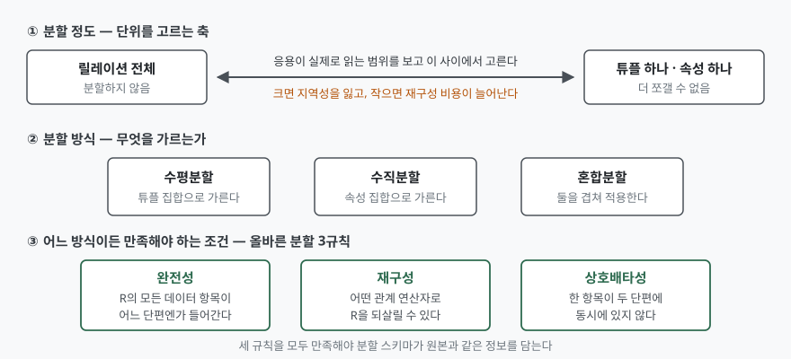
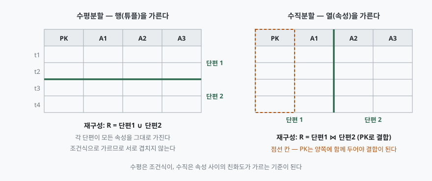

> 실행 검증 없음. 분산 데이터베이스 설계 교과서(Özsu & Valduriez 3판, 2011)와
> 분할 알고리즘 원 논문(SIGMOD 1982, ACM TODS 1984)에 적힌 정의·정리만 옮겼고,
> 측정값이나 실행 출력은 싣지 않았다.

문항은 분산 데이터베이스를 구축할 때의 데이터베이스 분할을 두 갈래로 나눠 묻는다.
먼저 데이터를 어느 단위로 가르는지, 다음으로 수평분할과 수직분할이 무엇인지다.
물은 순서를 그대로 대항목으로 쓴다.

---

## Ⅰ. 개요

분산 데이터베이스 설계는 결국 **분할(fragmentation)과 할당(allocation)** 두 작업으로
정리된다. 전역 스키마의 릴레이션을 어떤 조각으로 나눌지 정하고, 그 조각을 어느 사이트에
둘지 정하는 것이다. 이 둘은 독립된 문제가 아니라 같은 최적화 문제의 두 변수다.

**분할이 필요한 이유는 릴레이션이 분산의 단위로 너무 크기 때문이다.** 분산 파일 시스템은
파일을 그대로 분산 단위로 쓰지만, 관계형 데이터베이스에서는 **응용이 보는 뷰가 릴레이션의
부분집합**이라는 사실을 쓸 수 있다. 한 릴레이션의 서로 다른 부분을 읽는 두 응용이 있을 때
릴레이션을 통째로 두면 둘 중 하나를 잃는다. 양쪽 사이트에 전체를 복제해 쓰지 않는 데이터까지
나르거나, 한 사이트에만 두고 다른 쪽이 매번 통신하게 하거나다. 분할하지 않으면 **한 질의를
여러 조각으로 쪼개 동시에 돌리는 질의 내 병렬성**도 성립하지 않는다.

대가도 분명하다. 하나의 질의가 여러 단편에 걸쳐 수행되면서 결합·합집합 연산이 추가되고,
무결성 제약을 집행할 대상이 여러 사이트로 흩어져 의미 데이터 제어가 비싸진다. 그래서
**어디까지 쪼갤지를 정하는 일 자체가 설계의 핵심**이 되고, 문항의 첫 갈래가 묻는 것이
바로 이 지점이다.

---

## Ⅱ. 데이터베이스 분할 단위 (가)

### 가. 분할 정도 — 단위를 고르는 축

분할 단위는 고정된 목록에서 하나를 고르는 것이 아니라 **범위 위의 한 점을 고르는 것**이다.
한쪽 끝은 **분할하지 않는 것**으로, 릴레이션 하나가 그대로 분산 단위가 된다. 반대쪽 끝은
**튜플 하나 또는 속성 하나**로, 더는 쪼갤 수 없는 상태다. 그 사이에는 유한한 개수의
대안이 놓인다.

이 범위 안에서 적절한 수준을 찾는 일은 **그 데이터베이스를 쓸 응용이 정한다.** 응용이
실제로 읽어 가는 범위가 단편의 경계와 맞아떨어질 때 지역성이 생기기 때문이다. 교과서가
분할의 진짜 어려움이라고 지목하는 대목도 여기다. 단위가 너무 크면 쓰지 않는 데이터까지
딸려 와 지역성을 잃고, 너무 작으면 한 질의가 거는 단편 수가 늘어 재구성 비용이 올라간다.

### 나. 올바른 분할의 3규칙

단위를 정했다고 분할 스키마가 성립하지는 않는다. 분할 결과가 원본과 **같은 정보를 담는지**를
검사하는 규칙이 셋 있다. 릴레이션 R을 단편 R₁, R₂, …, Rₙ으로 분해했다고 하자.

| 규칙 | 조건 | 깨지면 |
|---|---|---|
| **완전성**(completeness) | R의 모든 데이터 항목이 어떤 Rᵢ에서도 발견된다 | 데이터가 사라진다 |
| **재구성**(reconstruction) | 어떤 관계 연산자 ∇가 있어 R = ∇(R₁, …, Rₙ)이 성립한다 | 전역 질의에 답할 수 없다 |
| **상호배타성**(disjointness) | 항목 dᵢ가 Rⱼ에 있으면 다른 어떤 Rₖ(k ≠ j)에도 없다 | 한 갱신이 여러 사이트로 번진다 |

세 규칙은 각각 다른 것을 지킨다. **완전성은 정보의 보존**, **재구성은 전역 뷰의 복원
가능성**, **상호배타성은 갱신의 단일 지점**이다. 셋 중 하나라도 빠지면 분산 투명성이
성립하지 않는다. 다만 **상호배타성은 수직분할에서 기본키를 예외로 둔다** — 결합으로
재구성하려면 기본키가 모든 단편에 있어야 하므로, 비키 속성에 대해서만 상호배타성을 따진다.

### 다. 분할 방식 3가지

가를 수 있는 축은 행과 열뿐이므로 방식도 셋으로 정리된다.

1. **수평분할**(horizontal) — 튜플 집합으로 가른다
2. **수직분할**(vertical) — 속성 집합으로 가른다
3. **혼합분할**(hybrid, 중첩분할) — 수평과 수직을 겹쳐 적용한다



> **출처**: [Özsu & Valduriez, *Principles of Distributed Database Systems* 3판 (2011) 3장 — Distribution Design 강의 슬라이드 Ch.3/9~11](https://users.dimi.uniud.it/~dario.dellamonica/teaching/23_24_2sem_ADBS/course_material/slides/2_distributed_database_architectures/2b_Distribution_Design_ozsu_ch3_SPLIT.pdf)

### 라. 분할 뒤의 할당이 단위를 되정한다

단편을 사이트에 배치하는 방식은 셋이다. **비복제 배치**(각 단편이 한 사이트에만 존재),
**완전복제**(모든 단편이 모든 사이트에), **부분복제**(각 단편이 일부 사이트에)다.
교과서가 드는 판단 기준은 **읽기 전용 질의와 갱신 질의의 비율**이다. 이 비가 1 이상이면
복제가 유리하고, 그렇지 않으면 복제가 오히려 문제를 만든다.

할당을 함께 보아야 하는 이유는 **분할 단위가 할당의 입력이자 결과**이기 때문이다. 단편을
잘게 쪼개면 배치 자유도는 올라가지만 복제·갱신 전파 대상이 늘고, 크게 두면 반대가 된다.
할당 문제 자체가 NP-난해로 정식화되므로 최적해 대신 운영 연구의 발견적 기법을 쓴다.

---

## Ⅲ. 수평분할과 수직분할 (나)

### 가. 수평분할 — 기본 수평분할

수평분할은 **튜플 집합으로 가르되 속성은 그대로 둔다.** 각 단편의 스키마는 원본과 같고,
행만 나뉜다. 가르는 기준은 **조건식**이다.

- **단순 조건식**: 릴레이션 R[A₁, …, Aₙ]에 대해 `Aᵢ θ 값` 형태의 조건.
  θ는 =, <, ≤, >, ≥, ≠ 중 하나이고 값은 Aᵢ의 도메인에 속한다
- **최소항**(minterm): 단순 조건식 집합 Pr = {p₁, …, p_m}이 주어졌을 때, 각 pⱼ를
  긍정(pⱼ) 또는 부정(¬pⱼ) 중 하나로 골라 전부 논리곱한 것

**기본 수평분할은 최소항 집합이 유도한다.** 최소항 mᵢ 하나가 단편 하나에 대응하며,
단편 Rᵢ는 mᵢ를 만족하는 R의 모든 튜플로 이루어진다. 모순이라 빈 단편을 만드는 최소항은
버린다.

이 구성에서 **올바름 3규칙이 저절로 따라온다.** 최소항은 모든 긍정·부정 조합을 빠짐없이
만들므로 모든 튜플이 어느 하나는 만족하고(완전성), 서로 다른 최소항은 적어도 한 조건식의
부호가 달라 동시에 참일 수 없으며(상호배타성), 재구성은 단편들의 합집합이다.

**조건식 집합 자체도 완전하고 최소여야 한다.** 이것이 기본 수평분할 설계의 실제 작업이다.

- **완전**: 그 집합이 만든 어느 단편을 보더라도, 그 안의 두 튜플이 어떤 응용에 대해 같은
  접근 확률을 갖는다. 바꿔 말해 **모든 응용이 한 단편을 통째로 읽거나 전혀 읽지 않는다**
- **최소**: 집합의 모든 조건식이 새 단편을 만들어 내고, 그렇게 갈린 두 단편을 적어도 한
  응용이 다르게 접근한다. 달리 말하면 **완전하면서 그 어떤 진부분집합도 완전하지 않은 집합**

예를 들어 예산 조건으로 찾는 응용과 특정 소재지로 찾는 응용이 둘 다 있는데 조건식 집합을
소재지 하나로만 잡으면, 예산 조건 응용이 한 단편의 일부 튜플만 읽게 되어 완전성이 깨진다.
예산 조건을 더해야 완전해진다. **최소성은 반대 방향의 제약**으로, 어느 응용도 구분하지
않는 조건식을 넣어 단편만 늘리는 일을 막는다.

### 나. 수평분할 — 유도 수평분할

유도 수평분할은 **한 릴레이션의 분할을 링크를 따라 다른 릴레이션으로 전파한다.** 링크 L에서
분할의 출발점이 되는 쪽을 소유(owner) 릴레이션, 전파를 받는 쪽을 멤버(member) 릴레이션이라
한다.

소유 릴레이션 S가 F_S = {S₁, …, S_w}로 분할돼 있고 owner(L) = S, member(L) = R일 때,
R의 유도 수평단편은 **반결합**으로 정의된다.

```text
Rᵢ = R ⋉ Sᵢ        (Sᵢ ∈ F_S)
```

**쓰는 이유는 결합의 지역성이다.** 자주 결합되는 두 릴레이션을 같은 기준으로 갈라 짝이
되는 단편끼리 같은 사이트에 두면, 결합이 사이트 안에서 끝나 통신이 사라진다.

올바름은 **외래키 무결성 제약과 소유 쪽 기본 수평분할의 올바름**에서 나온다. 분할이 1:N
연관을 따라 전파되므로 멤버의 각 튜플은 소유 릴레이션의 정확히 한 튜플과 짝지어지고,
그 소유 튜플은 기본 수평분할의 상호배타성·완전성에 의해 정확히 한 단편에만 들어 있다.
**외래키가 NULL인 튜플은 어느 소유 단편과도 짝지어지지 않으므로 별도 단편으로 모은다** —
이 처리를 빠뜨리면 완전성이 깨진다.

멤버 릴레이션이 **두 개 이상의 소유 릴레이션을 갖는 경우**에는 어느 쪽 분할을 전파할지
골라야 한다. 사원과 프로젝트 양쪽에 걸린 배정 릴레이션이 전형적인 예다. 둘 다 전파할 수
없으므로, 결합 빈도가 높은 쪽을 고르는 것이 판단 기준이 된다.

### 다. 수직분할

수직분할은 **속성 집합으로 가른다.** 각 단편은 원본의 모든 튜플을 갖되 속성의 일부만
가진다. 가르는 기준이 조건식이 아니라는 점이 수평과 근본적으로 다르다. 기준은
**속성 사이의 친화도**, 곧 질의가 두 속성을 얼마나 자주 함께 읽는가다.

속성 Aᵢ와 Aⱼ의 친화도는 **두 속성을 함께 쓰는 질의들의 접근 빈도 합**으로 정의된다.

```text
aff(Aᵢ, Aⱼ) = Σ  use(q, Aᵢ) · use(q, Aⱼ) · acc(q)
               q
```

`use(q, A)`는 질의 q가 속성 A를 쓰면 1, 아니면 0이다. 따라서 **두 속성을 모두 쓰는 질의의
빈도만 더해진다.** 이 값을 속성 친화도 행렬에 담고 군집화 알고리즘으로 가까운 속성끼리
묶는다. 전통적으로는 결합 에너지 알고리즘을 써서 행렬의 행·열을 재배열해 군집을 드러낸 뒤
분할 지점을 찾는다.

재구성은 **결합**이다.

```text
R = R₁ ⋈ R₂ ⋈ … ⋈ Rₙ
```

결합이 성립하려면 각 단편에 공통된 결합 키가 있어야 한다. 그래서 **기본키(또는 내부
튜플 식별자)는 모든 단편이 함께 가진다.** 앞서 상호배타성을 비키 속성에 대해서만 따진다고
한 이유가 이것이다.

수직분할은 **경우의 수가 수평보다 훨씬 많다.** 속성 n개를 묶는 분할의 가짓수가 빠르게
커지므로 최적해를 전수 탐색으로 구할 수 없고, 친화도 기반 군집화 같은 발견적 방법에
의존한다. 수직분할 알고리즘을 체계화한 TODS 1984년 논문도 **논리 레코드나 릴레이션을
단편으로 수직 분할하는 문제**를 다루면서 친화도 군집화를 출발점으로 삼는다.

### 라. 비교



> **출처**: [Özsu & Valduriez, *Principles of Distributed Database Systems* 3판 (2011) 3장 — Distribution Design 강의 슬라이드 Ch.3/9, 18, 38, 62](https://users.dimi.uniud.it/~dario.dellamonica/teaching/23_24_2sem_ADBS/course_material/slides/2_distributed_database_architectures/2b_Distribution_Design_ozsu_ch3_SPLIT.pdf)

| 구분 | 수평분할 | 수직분할 |
|---|---|---|
| 가르는 대상 | 튜플(행) 집합 | 속성(열) 집합 |
| 단편의 스키마 | 원본과 동일 | 원본의 부분집합 |
| 가르는 기준 | 조건식(단순 조건식의 최소항) | 속성 친화도 |
| 설계 입력 | 질의에 나타나는 조건식과 그 빈도 | 질의별 속성 사용 여부와 접근 빈도 |
| 재구성 연산 | 합집합 | 결합 |
| 중복 보유 | 없음 | 기본키를 모든 단편이 보유 |
| 상호배타성 대상 | 모든 속성 | 비키 속성 |
| 올바름의 근거 | 최소항의 망라성과 상호 배타성 | 군집화가 반환한 분할의 성질 |
| 하위 구분 | 기본 수평분할 / 유도 수평분할 | 구분 없음 |
| 탐색 난도 | 조건식 수에 따라 최소항이 늘어남 | 속성 조합이 커서 발견적 기법 필요 |

**혼합분할**은 둘을 중첩해 적용한 것이다. 재구성할 때는 **잎에서 뿌리 방향으로 올라오며
각 단계의 분할 종류에 맞는 연산자를 적용한다.** 수직으로 나뉜 층은 결합으로, 수평으로
나뉜 층은 합집합으로 되돌린다. 순서를 뒤집으면 복원되지 않는다.

---

## Ⅳ. 적용 시 고려사항

### 가. 분할 기준은 데이터 모양이 아니라 질의에서 뽑는다

조건식 집합의 완전성·최소성이 둘 다 **응용의 접근 패턴으로 정의된다**는 점이 이를 말해 준다.
지역 코드나 날짜처럼 그럴듯해 보이는 컬럼으로 갈라도, 그 컬럼이 질의 조건에 나타나지 않으면
단편 수만 늘고 지역성은 생기지 않는다. 설계 입력으로 **질의에 나타나는 조건식과 그 빈도**를
먼저 모은다.

### 나. 단편 수와 질의가 거는 사이트 수는 맞교환이다

분할의 단점으로 교과서가 드는 것이 **질의가 둘 이상의 단편에서 수행되는 상황**이다.
단편이 상호배타적이지 않을 때 특히 나빠진다. 단편을 늘리는 결정은 지역성 이득과 분산 질의
비용을 함께 놓고 판단해야 하고, 이 판단은 할당 방식이 정해져야 숫자가 나온다.

### 다. 유도 수평분할은 참조 무결성에 기댄다

유도 분할의 완전성과 상호배타성은 **외래키 제약이 실제로 집행되고 있다는 전제** 위에
성립한다. 제약 없이 응용이 값만 맞춰 쓰는 구조라면 짝이 없는 멤버 튜플이 어느 단편에도
들어가지 않을 수 있다. NULL 외래키를 담을 단편을 따로 두는 처리까지 설계에 포함한다.

### 라. 수직분할의 기본키 중복은 비용이지 흠이 아니다

기본키를 모든 단편이 갖는 것은 상호배타성 위반이 아니라 **재구성을 가능하게 하는 설계
요소**다. 다만 저장 공간이 단편 수만큼 늘고, 키 값이 바뀌는 갱신이 모든 단편에 전파된다.
키를 바꾸지 않는 설계(대리키 사용)가 함께 가야 한다.

### 마. 데이터 디렉터리도 분할·할당의 대상이다

어느 단편이 어느 사이트에 있는지를 담는 데이터 디렉터리 자체가 데이터베이스의 일부다.
따라서 **디렉터리에도 분할과 할당 문제가 그대로 적용된다.** 디렉터리를 한 사이트에 몰면
그 사이트가 단일 장애점이자 병목이 된다.

### 바. 분할 기준이 데이터 분포와 어긋나면 단편 크기가 쏠린다

조건식 집합이 완전하고 최소여도 **각 최소항이 받는 튜플 수까지 고르게 되지는 않는다.**
한 단편에 데이터가 몰리면 그 사이트만 포화되어 분산의 효과가 사라진다. 조건식을 정한 뒤
실제 데이터 분포로 단편 크기를 추정하는 단계를 설계에 넣는다.

---

## Ⅴ. 결론

데이터베이스 분할은 **단위를 고르는 문제**와 **가르는 축을 고르는 문제**로 나뉜다. 단위는
릴레이션 전체와 튜플·속성 하나 사이의 범위에서 응용의 접근 범위를 보고 고르고, 어떤 단위를
고르든 완전성·재구성·상호배타성 세 규칙을 만족해야 원본과 같은 정보를 담는다.

가르는 축은 행과 열뿐이므로 방식은 수평·수직·혼합 셋이다. **수평분할은 조건식이 기준이고
합집합으로 되돌리며**, 조건식 집합의 완전성·최소성이 설계의 실제 작업이 된다. 결합이 잦은
릴레이션에는 반결합으로 분할을 전파하는 유도 수평분할을 쓴다. **수직분할은 속성 친화도가
기준이고 결합으로 되돌리며**, 결합을 위해 기본키를 모든 단편이 함께 가진다.

분할은 할당과 묶여야 숫자가 나온다. 단편을 어디에 몇 벌 두느냐가 정해져야 지역성 이득과
분산 질의 비용을 비교할 수 있기 때문이다. **분할만 설계하고 할당을 뒤로 미루면 단위를
고른 근거 자체가 비는 설계**가 된다.

> 개념 정리: [분산 데이터베이스 — 투명성 6가지](../../database/2026-09-23-distributed-database-transparency/index.md)
> 개념 정리: [속성 친화도 행렬과 결합 에너지 알고리즘 — 수직분할 설계](../../database/2026-11-05-vertical-partitioning-affinity-bond-energy/index.md)

끝

---

## 답안 작성 메모

**먼저 쓸 것은 3규칙이다.** 문항이 (가)에서 "분할 단위"를 물었을 때 수평·수직·혼합만 나열하고
끝내는 답안이 가장 흔한데, 그건 (나)의 선행 요약이지 (가)의 답이 아니다. (가)의 핵심은
**분할 정도라는 축**과 **올바른 분할 3규칙**이고, 방식 세 가지는 그 뒤에 붙이는 분류다.
3규칙을 표로 먼저 박아 두면 (나)에서 수평·수직을 설명할 때 "이 방식에서는 이 규칙이
어떻게 보장되는가"로 자연스럽게 이어진다.

**점수가 갈리는 지점은 세 곳이다.**

1. **재구성 연산자를 정확히 적는가** — 수평은 합집합, 수직은 결합. 수직에서 기본키를
   모든 단편에 중복 보유한다는 단서까지 써야 결합이 성립하는 근거가 선다
2. **유도 수평분할을 아는가** — 수평분할을 조건식 하나로만 설명하면 절반이다. 반결합으로
   소유 릴레이션의 분할을 전파한다는 정의와, 왜 그렇게 하는지(결합의 지역성)를 쓴다
3. **조건식 집합의 완전성·최소성** — 분할 결과의 완전성과 다른 개념이다. 두 완전성을
   섞어 쓰면 감점된다. "모든 응용이 한 단편을 통째로 읽거나 전혀 읽지 않는다"가 조건식
   집합의 완전성이고, "모든 데이터 항목이 어느 단편엔가 들어간다"가 분할의 완전성이다

**시간이 모자라면 버릴 것은 Ⅳ의 뒷부분이다.** 고려사항은 최소 세 개만 남기고(질의에서
기준을 뽑는다 / 단편 수와 분산 질의의 맞교환 / 유도 분할의 참조 무결성 전제), 디렉터리와
스큐는 한 줄씩으로 줄인다. 대신 **비교표와 모식도는 끝까지 지킨다** — 논술형에서 표와
그림은 채점자가 항목을 세는 자리이므로 문장 몇 줄보다 배점이 크다.

**모식도는 두 번째 것 하나로 줄여도 된다.** 격자 두 개에 가로 굵은 선과 세로 굵은 선만
그으면 되므로 답안지에 2분이면 옮긴다. 기본키 열에 점선 테두리를 치고 "양쪽 보유"만
적으면 수직분할의 핵심이 그림으로 전달된다.

**쓰지 말 것은 제품 이름이다.** 특정 DBMS의 파티셔닝 기능으로 설명하면 분산 데이터베이스
설계 이론을 묻는 문항에서 초점이 어긋난다. 샤딩이라는 말도 수평분할의 한 구현 형태로만
한 줄 언급하고 넘어간다.

---

## 참고 자료

- M. Tamer Özsu, Patrick Valduriez, *Principles of Distributed Database Systems*, 3rd Edition, Springer, 2011 — Chapter 3, Distributed Database Design
- [Özsu & Valduriez, Distribution Design (Ch.3) 강의 슬라이드](https://users.dimi.uniud.it/~dario.dellamonica/teaching/23_24_2sem_ADBS/course_material/slides/2_distributed_database_architectures/2b_Distribution_Design_ozsu_ch3_SPLIT.pdf) — 교과서 3판에 딸린 저자 슬라이드
- [S. Ceri, M. Negri, G. Pelagatti, "Horizontal data partitioning in database design", ACM SIGMOD 1982, p.128](https://doi.org/10.1145/582353.582376)
- [S. Navathe, S. Ceri, G. Wiederhold, J. Dou, "Vertical partitioning algorithms for database design", ACM Transactions on Database Systems 9(4), 1984-12, pp.680–710](https://doi.org/10.1145/1994.2209)
- [J. A. Hoffer, D. G. Severance, "The use of cluster analysis in physical data base design", VLDB 1975, p.69](https://doi.org/10.1145/1282480.1282486)
