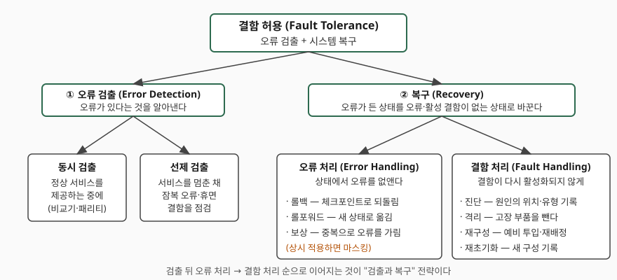
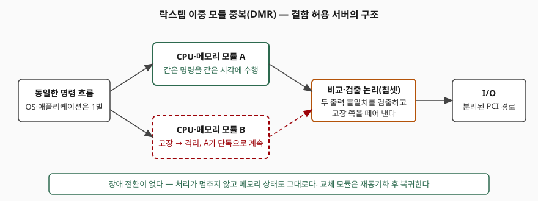
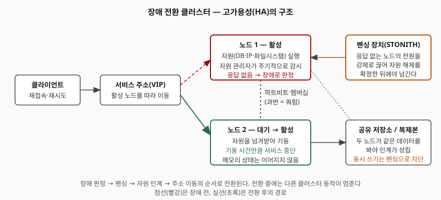

문항은 가용성 보장을 세 갈래로 묻는다. 결함 허용 시스템(FTS)은 어떻게 만드는지,
고가용성(HA)은 어떻게 만드는지, 그리고 둘이 어디서 갈리는지다. 물은 순서를 그대로
대항목으로 쓴다. 두 방식은 **같은 식의 다른 항을 공략한다**는 것이 답안의 축이다 —
FTS는 실패가 밖으로 드러나지 않게 하고, HA는 실패를 허용하되 복구 시간을 줄인다.

> 답안의 가용성 수식(MTBF·MTTR, 나인별 중단 시간, 직렬·병렬, TMR 다수결)은
> 파이썬으로 직접 계산해 검산했다. 기록은 [code/output.txt](code/output.txt)에 있다.
> 그 밖의 동작 설명은 논문·공식 문서에 적힌 것만 옮겼고, 제품 측정값은 싣지 않았다.

---

## Ⅰ. 개요

### 가. 가용성의 정의

Avizienis 등의 신뢰성 분류 논문(IEEE TDSC, 2004)은 가용성을 **"올바른 서비스를 제공할
준비가 되어 있음"** 으로, 신뢰성을 "올바른 서비스의 연속성"으로 정의한다. ISO/IEC 25010은
가용성을 "요구될 때 운영 가능하고 접근 가능한 정도"로, 결함 허용을 "하드웨어·소프트웨어
결함이 있어도 의도대로 동작하는 정도"로 둔다. 두 정의가 같은 말을 한다 — 가용성은
**쓰려는 순간에 쓸 수 있는가**이고, 그것을 시간 비율로 재면 다음 식이 된다.

> 가용성 A = MTBF ÷ (MTBF + MTTR)
> (MTBF: 평균 고장 간격, MTTR: 평균 복구 시간)

Jim Gray의 Tandem 기술 보고서(1985)가 이 식을 쓰고, AWS 신뢰성 문서도 의존 시스템의
가용성을 추정할 때 같은 식을 쓴다. 식이 보여 주는 것은 **가용성을 올리는 길이 둘뿐**이라는
점이다. 분모의 MTTR을 0에 가깝게 만들거나, 분자의 MTBF를 키우거나다.

### 나. 두 접근의 자리

| 접근 | 공략하는 항 | 실패를 어떻게 다루나 |
|---|---|---|
| **결함 허용 시스템(FTS)** | 실패가 서비스에 **나타나지 않게** 한다 | 부품 수준 중복으로 결함을 가린다. 사용자에게는 실패가 없었던 것과 같다 |
| **고가용성(HA)** | **MTTR**을 수리 시간에서 전환 시간으로 줄인다 | 실패를 인정하고 다른 노드로 서비스를 옮긴다. 짧은 중단이 남는다 |

Gray는 예비 모듈이 즉시 인계하면 수리가 순간적으로 일어난 것처럼 보이고, 그러면
고장은 "실패가 아니라 지연으로 보인다"고 적는다. FTS는 그 지연마저 없애려는 쪽이고,
HA는 그 지연을 초·분 단위로 받아들이는 쪽이다. 같은 MTBF(AWS 문서의 예제 값 150일)를
두고 MTTR만 바꿔 계산하면 두 접근이 식 위에서 어디에 놓이는지가 보인다.

```text
MTBF 3600시간(150일) 으로 고정하고 MTTR 만 바꾼다
  MTTR 1시간 (사람이 복구)                       A = 99.97223%
  MTTR 1분 (클러스터 장애 전환)                    A = 99.99954%
  MTTR 1초 (프로세스 쌍 인계)                     A = 99.99999%
  MTTR 0 (락스텝 — 실패가 지연으로도 안 보임)           A = 100.00000%
```

사람이 복구하면 세 개의 9, 클러스터가 전환하면 네 개, 프로세스 쌍이 인계하면 일곱 개다.
숫자는 모형의 값이지 실측이 아니다. 다만 **같은 부품으로도 복구 시간을 어디까지
줄이느냐에 따라 나인이 바뀐다**는 구조는 그대로다.

---

## Ⅱ. 결함 허용 시스템(FTS)의 구현 방법 (가)

### 가. 원리 — 결함이 실패로 번지는 연쇄를 끊는다

결함(fault)이 활성화되면 오류(error)가 되고, 오류가 서비스 경계에 닿으면 실패(failure)다.
결함 허용은 이 연쇄의 **오류 단계에서 개입**한다. 위 논문의 분류(§5.2.1)에 따르면 결함
허용은 **오류 검출과 시스템 복구** 두 활동으로 이뤄진다.



> **출처**: [Avizienis, Laprie, Randell, Landwehr, Basic Concepts and Taxonomy of Dependable and Secure Computing, IEEE TDSC 1(1), 2004, §5.2.1 Fig. 5.1](https://drum.lib.umd.edu/handle/1903/6459)

- **오류 검출 2가지**: 동시 검출(정상 서비스 중에, 비교기·패리티 등)과 선제 검출(서비스를
  멈춘 채 잠복 오류·휴면 결함을 점검, 기동 시 점검·메모리 스크러빙)
- **오류 처리 3가지**: 롤백(체크포인트로 되돌림), 롤포워드(오류 없는 새 상태로 옮김),
  보상(상태에 든 중복으로 오류를 가림). 보상을 **상시 적용하는 것이 마스킹**이다
- **결함 처리 4가지**: 진단 → 격리 → 재구성(예비 투입·작업 재배정) → 재초기화

논문은 이 조합으로 **네 가지 전략**을 든다. 검출 후 롤백(후방 복구), 검출 후 롤포워드
(부분 전방 복구), 검출 후 보상(완전 전방 복구), 보상을 상시 적용하는 마스킹과 복구다.
답안에서 "어느 전략으로 결함을 허용하는가"를 쓸 수 있으면 구현 방법이 나열에서
설계가 된다.

### 나. 하드웨어 결함 허용 — 동일 설계 채널의 중복 수행

논문의 구현 절(§5.2.2)은 결함 허용의 널리 쓰이는 방법을 **"여러 채널로 같은 계산을
여러 번 수행"** 하는 것으로 정리한다. 물리 결함을 겨냥할 때는 **하드웨어 부품이
독립적으로 고장 난다는 가정** 아래 같은 설계의 채널을 둔다.

**① 이중 모듈 중복(DMR) — 락스텝**



> **출처**: [Stratus ftServer 4700 Datasheet, "Lockstep hardware technology"](https://www.stratus.com/wp-content/uploads/ftServer-4700.pdf), [Avizienis et al., 2004, §5.2.2 Implementation of Fault Tolerance](https://drum.lib.umd.edu/handle/1903/6459)

복제된 CPU·메모리 모듈이 **같은 명령을 같은 시각에** 수행한다. 제조사 자료는 전용
칩셋이 PCI I/O를 메인보드에서 분리하고 결함을 검출·격리하는 논리를 담으며, 한쪽 부품이
고장 나도 다른 쪽이 능동 예비로 "성능 저하 없이" 처리를 이어 간다고 적는다. 교체한
모듈은 다시 끼우면 자동으로 재동기화된다. 핵심은 **장애 전환이라는 사건 자체가 없다**는
점이다. 메모리 상태가 그대로 살아 있으므로 애플리케이션은 고장을 모른다.

**② 삼중 모듈 중복(TMR) — 다수결 투표**

채널을 셋으로 늘리고 출력에 **다수결 투표기**를 두면, 한 모듈의 오류는 나머지 둘의
일치로 가려진다. 위 분류의 **보상**을 상시 적용하는 마스킹 전략이다. 각 모듈이 독립으로
신뢰도 R을 가질 때 셋 중 둘 이상이 정상일 확률은 다음과 같다.

> R_TMR = 3R² − 2R³ (8가지 경우를 열거해 같은 값임을 검산)

```text
      R         식        열거     단일 대비
   0.30   0.21600   0.21600      불리
   0.50   0.50000   0.50000      같음
   0.70   0.78400   0.78400      유리
   0.90   0.97200   0.97200      유리
   0.99   0.99970   0.99970      유리
```

표가 보여 주는 함정이 하나 있다. **R이 0.5 아래면 TMR이 단일 모듈보다 나쁘다.**
중복은 부품이 충분히 믿을 만할 때만 이득이다. 논문도 마스킹이 "보호 중복의 점진적
소실을 숨긴다"고 경고한다. 한 모듈이 죽은 채로 마스킹만 계속되면 두 번째 고장에서
무방비가 되므로, 실제 구현은 마스킹에 **오류 검출과 결함 처리를 더해** 고장 모듈을
교체하는 경로를 갖춘다.

**③ 페일패스트 모듈과 예비 교체**

Gray는 결함 허용 하드웨어의 처방을 다섯으로 정리한다. 시스템을 모듈로 계층 분해하고,
모듈 MTBF를 1년 이상으로 설계하고, 각 모듈을 **페일패스트**(제대로 동작하거나 멈추거나,
둘 중 하나)로 만들고, "나 살아 있음" 메시지나 와치독으로 고장을 즉시 검출하고, 예비
모듈이 **초 단위로 인계**하게 둔다. 그의 계산에 따르면 모듈 MTBF가 1년 수준이어도
이렇게 짝을 지으면 체감 MTBF가 수십 년에서 수백 년으로 늘어난다. 폰 노이만의 초기
모델이 중복 배수 2만을 요구한 것과 달리 **모듈화 덕에 배수 2로 충분**해진 것이
현대 결함 허용 설계의 출발점이다.

### 다. 소프트웨어 결함 허용 — 다른 설계, 또는 다시 실행

하드웨어 중복은 **소프트웨어 결함을 그대로 복제한다.** 락스텝에서 두 모듈은 같은
버그를 같은 순간에 밟는다. Gray는 락스텝 프로세스 쌍이 "Heisenbug에는 내성이 없다"고
적는다. 그래서 소프트웨어 쪽은 다른 방법이 필요하다.

**④ 프로세스 쌍과 트랜잭션**

Gray는 Tandem의 장애 통계를 분석한 뒤 소프트웨어 결함 허용의 열쇠를 다섯으로 들었다.
프로세스와 메시지로 모듈화(프로세스가 서비스 단위이자 실패 단위), 방어적 프로그래밍으로
**페일패스트 소프트웨어**, 하드웨어·일시적 소프트웨어 결함을 견디는 **프로세스 쌍**,
데이터·메시지 무결성을 위한 **트랜잭션**, 그리고 둘의 결합이다. 프로세스 쌍은 주
프로세스가 상태 변화를 백업 프로세스에 체크포인트로 보내다가 주가 죽으면 백업이
이어받는 구조다. 그는 체크포인트 방식을 락스텝·상태·자동·델타·지속의 다섯으로 나누고,
가장 단순한 **지속(persistence) 프로세스 쌍에 트랜잭션을 결합**하면 미완료 작업을
롤백하고 입력 메시지부터 다시 실행하므로 결함 허용 실행이 된다고 결론짓는다.

이 방식이 소프트웨어 결함에 듣는 이유가 **Heisenbug 가설**이다. 운영 중 만나는
소프트웨어 결함 대부분은 드문 타이밍·경합·한계 조건에서만 나타나는 일시적 결함이라,
"조용한 상태로 되돌려 다시 실행하면 꽤 높은 확률로 성공한다." 백업은 **새 상태에서**
다시 실행하므로 같은 버그를 또 밟지 않을 가능성이 크다.

**⑤ 설계 다양성(N-버전·복구 블록)**

재실행으로도 안 풀리는 **고정 설계 결함(Bohrbug)** 에는 논문이 다른 답을 준다. 같은
기능을 **따로 설계·구현한 채널**로 돌리는 설계 다양성(Randell 1975, Avizienis & Chen 1977)
이다. 복수 버전을 동시에 돌려 투표하거나(N-버전), 한 버전의 결과가 수락 검사를 통과하지
못하면 다음 버전을 순차로 돌린다(복구 블록). 논문은 또 한 부품 안에 기능 처리와 동시
오류 검출을 함께 넣은 **자기 검사 부품**이 오류 봉쇄 영역을 명확히 한다고 적는다.

### 라. 구현 방법 다섯 가지 정리

| 번호 | 방법 | 겨냥하는 결함 | 전략(분류 기준) |
|---|---|---|---|
| ① | 락스텝 DMR | 하드웨어 물리 결함 | 동시 검출 + 격리·재구성 |
| ② | TMR 다수결 | 하드웨어 물리 결함 | 보상(마스킹) + 복구 |
| ③ | 페일패스트 모듈 + 예비 | 하드웨어 물리 결함 | 검출 + 재구성 |
| ④ | 프로세스 쌍 + 트랜잭션 | 하드웨어 + 일시적 소프트웨어 결함 | 롤백(후방 복구) |
| ⑤ | 설계 다양성 | 고정 설계(개발) 결함 | 보상 또는 롤포워드 |

---

## Ⅲ. 고가용성(HA)의 구현 방법 (나)

### 가. 원리 — 단일 장애점을 없애고 복구를 자동화한다

HA는 노드가 죽는 것을 전제한다. 대신 **서비스가 어느 한 노드에 묶이지 않게** 하고,
죽은 노드의 몫을 다른 노드가 **사람 없이** 이어받게 한다. Red Hat의 고가용성 클러스터
문서는 HA 클러스터를 "단일 장애점을 제거하고 노드 간에 서비스를 장애 전환하는"
구성으로 설명한다. 가용성 식으로 보면 MTTR을 사람이 수리하는 시간에서 **클러스터가
전환하는 시간**으로 바꾸는 것이다.

### 나. 장애 전환 클러스터의 구성 요소 — 5가지



> **출처**: [Red Hat Enterprise Linux 8 — Configuring and managing high availability clusters, §1.2.1 Fencing, §1.2.2 Quorum, §1.2.3 Cluster resources, §1.3.1 Pacemaker architecture components](https://docs.redhat.com/en/documentation/red_hat_enterprise_linux/8/html-single/configuring_and_managing_high_availability_clusters/index)

| 요소 | 역할 | 문서의 근거 |
|---|---|---|
| ① 멤버십·메시징 | 노드가 서로 살아 있는지 확인한다(하트비트) | corosync가 "핵심 멤버십과 멤버 간 통신"을 맡는다 |
| ② 자원 관리자 | 자원(DB·IP·파일시스템)을 기동·감시하고 장애 시 옮긴다 | Pacemaker가 "서비스 장애 전환"을 제공한다. 자원 정의에 감시 동작이 없으면 기본으로 추가된다 |
| ③ 쿼럼 | 과반이 있는 쪽만 동작하게 해 분할을 막는다 | "노드 과반이 온라인이면 쿼럼이 있다." 6노드면 4노드 이상. 쿼럼을 잃으면 기본 동작은 **모든 자원 정지** |
| ④ 펜싱(STONITH) | 응답 없는 노드의 전원을 강제로 끊어 자원 해제를 확정한다 | 펜싱 없이는 "데이터 무결성을 보장할 수 없다." 펜싱 중에는 다른 클러스터 동작이 멈춘다 |
| ⑤ 공유 데이터 | 인계받는 노드가 같은 데이터를 봐야 한다 | 공유 스토리지(GFS2·lvmlockd) 또는 복제 |

**펜싱이 왜 필수인가**가 이 항목의 점수 지점이다. 노드가 응답하지 않는 것과 죽은 것은
다르다. 네트워크만 끊긴 노드가 여전히 디스크에 쓰고 있는데 다른 노드가 같은 자원을
기동하면 **두 노드가 같은 데이터를 동시에 쓴다**(스플릿 브레인). 문서는 이 경우 시스템이
"노드가 자원을 놓았다고 잘못 가정"해 데이터 손상으로 간다고 적고, 펜싱을 끈 구성은
운영 환경에 "완전히 부적절"하다고 못박는다. 쿼럼은 어느 쪽이 살아남을지를 정하고,
펜싱은 진 쪽이 정말로 멈췄음을 보장한다. 둘은 짝이다.

### 다. 구성 방식 — 4가지

| 방식 | 구조 | 전환 시 중단 | 맞는 자리 |
|---|---|---|---|
| **액티브-스탠바이** | 한 노드가 자원을 실행, 다른 노드는 대기 | 자원 기동 시간만큼(초~분) | 상태를 가진 서비스(DB·파일 서버) |
| **액티브-액티브** | 모든 노드가 동시에 처리, 앞단 부하분산기가 분배 | 살아남은 노드로 즉시 분산 | 상태 없는 서비스(웹·API) |
| **데이터 복제** | 주 노드의 변경을 대기 노드에 동기·비동기로 전달 | 승격 시간 + (비동기면) 유실 구간 | 공유 스토리지가 없는 곳, 원격지 |
| **지리적 분산** | 센터 단위로 위 구성을 복제 | 비동기 지연만큼 유실, 전환은 대개 수동 | 센터 재해 대비 |

액티브-액티브는 중단이 가장 짧지만 **애플리케이션이 상태를 노드에 두지 않아야**
성립한다. DB처럼 상태가 무거운 서비스는 액티브-스탠바이나 복제로 가고, 그때
동기화 수준(동기·비동기)이 RPO를 정한다. 복제 방식은 별도 개념 글에서 다뤘다.

### 라. 숫자로 설계한다 — 나인과 합성 법칙

목표 가용성은 **연간 허용 중단 시간**으로 환산해야 설계 근거가 된다. AWS 문서의 표와
같은 값이 나온다.

```text
   99.000%  →  3일 15시간 36분      (5256.0분)
   99.900%  →  8시간 45분          (525.6분)
   99.950%  →  4시간 22분          (262.8분)
   99.990%  →  52분              (52.6분)
   99.999%  →  5분               (5.3분)
```

여기에 두 합성 법칙이 붙는다. **직렬 의존은 곱**이고 **병렬 중복은 1 − 실패확률의 곱**이다.

```text
  직렬: 99.99% 짜리 3개에 전부 의존  → 99.9700%  (곱)
  병렬: 99.9% 짜리 2개 중 하나만 살면 됨 → 99.9999%  (1 - 실패확률의 곱)
```

직렬 법칙이 뜻하는 것은, 아무리 좋은 노드를 써도 **의존 체인이 길어지면 가용성은
내려간다**는 점이다. 병렬 법칙은 독립 노드 둘이면 나인이 더해진다는 뜻인데, 전제가
**독립**이다. 같은 랙·같은 전원·같은 소프트웨어 버전이면 독립이 아니고, 논문이 말한
"실패 독립성 커버리지"가 깨진다.

### 마. HA 구현 절차 — 5단계

1. **목표 설정**: RTO·RPO를 숫자로 정하고 나인으로 환산한다
2. **단일 장애점 식별**: 서버·스토리지·네트워크 경로·전원·DNS를 전부 적는다
3. **구성 선택**: 상태 유무에 따라 액티브-스탠바이/액티브-액티브, 복제 모드를 고른다
4. **펜싱·쿼럼 구성**: 펜싱 장치 없이는 지원되는 구성이 아니다
5. **전환 훈련**: 활성 노드를 실제로 내려 RTO를 **실측**한다. 설계값이 아니라 측정값이 근거다

---

## Ⅳ. FTS와 HA의 비교 (다)

### 가. 비교표

| 비교 항목 | 결함 허용 시스템(FTS) | 고가용성(HA) |
|---|---|---|
| **목표** | 실패가 서비스에 나타나지 않게 한다 | 실패에서 빨리 돌아온다 |
| **가용성 식에서의 자리** | 고장이 실패로 세어지지 않는다(MTTR ≈ 0) | MTTR을 수리에서 전환 시간으로 줄인다 |
| **중복 단위** | 부품·명령 수준(CPU·메모리·I/O 경로) | 노드·서비스 수준 |
| **장애 시 동작** | 고장 쪽을 격리하고 나머지가 **계속** 수행 | 장애 판정 → 펜싱 → 자원 인계 → 주소 이동 |
| **서비스 중단** | 없음 | 초~분. 펜싱 중에는 다른 동작도 멈춤 |
| **메모리 상태·진행 중 트랜잭션** | 그대로 유지 | 소실. 애플리케이션이 재접속·재시도해야 함 |
| **주로 막는 결함** | 하드웨어 물리 결함 | 노드·OS·프로세스 장애 전반 |
| **소프트웨어 결함** | 락스텝은 **같은 버그를 같이 밟는다**. 프로세스 쌍·설계 다양성을 따로 둬야 함 | 재기동으로 일시적 결함은 풀림. 데이터 손상은 복제돼 같이 감 |
| **애플리케이션 변경** | 불필요 — 표준 OS·애플리케이션이 그대로 돈다 | 상태 분리·재시도·세션 외부화 등 설계 반영 필요 |
| **비용 구조** | 전용 하드웨어, 부품 2~3벌 | 범용 서버 + 클러스터 소프트웨어 |
| **확장 방향** | 단일 시스템 안에서(수직) | 노드 추가(수평) |
| **운영 복잡도** | 제조사 자료는 복제 부품을 "단일 시스템으로" 보이게 한다고 설명 | 클러스터 상태(쿼럼·펜싱·제약)를 운영자가 이해해야 함 |
| **적용 예** | 거래 처리·공정 제어처럼 1회 중단도 비싼 곳 | 웹·API·DB 등 일반 업무 시스템 |

### 나. 갈리는 지점 셋

1. **실패를 숨기는가, 받아들이는가.** FTS의 사용자는 고장을 모른다. HA의 사용자는 짧은
   중단과 끊긴 세션을 겪는다. 답안에서 "둘 다 가용성이 높다"로 끝내면 변별이 없다.
   **중단 길이가 아니라 상태가 이어지는지**가 본질적 차이다.
2. **무엇을 복제하는가.** FTS는 명령 실행을, HA는 서비스 배치를 복제한다. 그래서 FTS는
   소프트웨어 결함에 약하고(두 모듈이 같은 버그를 같은 순간에 밟는다), HA는 데이터
   손상에 약하다(복제가 손상을 그대로 따라간다). 둘 다 **백업을 대신하지 못한다.**
3. **비용이 어디에 붙는가.** FTS는 하드웨어 가격에, HA는 애플리케이션 설계와 운영에
   붙는다. 중단 1분의 손실이 하드웨어 가격 차이를 넘으면 FTS가, 아니면 HA가 맞다.
   선택 기준은 기술 우열이 아니라 **중단 비용의 크기**다.

### 다. 함께 쓴다

둘은 배타적이지 않다. 결함 허용 서버를 HA 클러스터의 노드로 쓰면 부품 고장은 FTS가,
센터 장애는 HA가 막는다. Gray의 프로세스 쌍은 **소프트웨어로 구현한 결함 허용**인데
클러스터 노드 사이에 걸쳐 동작하므로 두 범주의 경계에 있다. 설계 문서에서는
"어느 계층의 어떤 결함을 어느 수단이 막는가"를 표로 적어야 빈 자리가 보인다.

---

## Ⅴ. 결론

가용성은 MTBF ÷ (MTBF + MTTR)이고, 이 식에서 FTS와 HA는 서로 다른 항을 공략한다.
FTS는 동일 설계 채널의 중복 수행(락스텝 DMR·TMR 다수결·페일패스트 모듈)과
소프트웨어 쪽의 프로세스 쌍·설계 다양성으로 **고장이 실패로 세어지지 않게** 하고,
HA는 멤버십·자원 관리자·쿼럼·펜싱·공유 데이터의 다섯 요소로 **실패에서 돌아오는
시간을 사람의 수리에서 기계의 전환으로** 줄인다. 어느 쪽을 고를지는 중단 1회의 비용이
정하고, 실제 시스템은 둘을 계층별로 겹쳐 쓴다. 어느 경우든 중복의 전제는 **독립**이며,
독립이 깨진 중복은 식 위에서는 나인을 더하지만 현장에서는 같이 죽는다.

> 개념 정리: [데이터베이스 이중화와 복제 방식](../../database/2026-10-27-database-replication-ha/index.md)

끝

---

## 답안 작성 메모

- **먼저 쓸 것**: Ⅰ의 가용성 식과 "두 접근은 다른 항을 공략한다"는 한 줄. 이 축이
  서면 (가)·(나)·(다)가 전부 그 축 위에 놓인다. 그다음 (다)의 비교표를 먼저 그려 두고
  (가)·(나)를 채운다 — 비교표가 있으면 시간이 모자라도 채점자가 세 항목을 다 읽는다.
- **분량 배분**: 25점에 A4 세 장이면 (가) 1장, (나) 1장, (다) 0.7장, 개요·결론 0.3장.
  (가)와 (나) 모두 **도식 1개 + 항목 수 명시**를 넣는다.
- **점수가 갈리는 지점 셋**
  1. (가)에서 하드웨어 중복만 쓰고 끝내지 않았는가. 락스텝이 소프트웨어 버그를
     그대로 복제한다는 한계와, 그래서 프로세스 쌍·설계 다양성이 필요하다는 연결이
     있어야 "구현 방법"이 된다.
  2. (나)에서 펜싱과 쿼럼을 **왜** 두는지 썼는가. 구성 요소 나열은 누구나 한다.
     스플릿 브레인 → 동시 쓰기 → 데이터 손상의 연쇄를 한 줄로 적으면 달라진다.
  3. (다)에서 "중단 시간"이 아니라 **"상태가 이어지는가"** 로 갈랐는가. 중단 길이는
     정도의 차이지만 메모리 상태·진행 중 트랜잭션의 유지 여부는 종류의 차이다.
- **시간이 모자라면 버릴 것**: (가)의 TMR 수식 표와 (나)의 합성 법칙 숫자. 식 한 줄
  (3R² − 2R³, 직렬은 곱·병렬은 1 − 곱)만 남기고 표는 뺀다. 도식과 비교표는 버리지 않는다.
- **쓰지 말 것**: 특정 제품의 "99.999%" 같은 제조사 주장치를 사실로 쓰는 것, 근거 없는
  전환 시간(초 단위) 수치. 숫자를 쓰려면 식에서 계산한 값과 문서에 적힌 한계값
  (쿼럼 과반, 펜싱 필수)만 쓴다.

---

## 참고 자료

- [Avizienis, Laprie, Randell, Landwehr, Basic Concepts and Taxonomy of Dependable and Secure Computing, IEEE TDSC 1(1), 2004 — UMD DRUM TR 2004-47](https://drum.lib.umd.edu/handle/1903/6459)
- [Jim Gray, Why Do Computers Stop and What Can Be Done About It?, Tandem Technical Report 85.7, 1985 (UCLA 전재)](https://lasr.cs.ucla.edu/classes/239_1.fall00/papers/gray85.txt)
- [Red Hat Enterprise Linux 8 — Configuring and managing high availability clusters](https://docs.redhat.com/en/documentation/red_hat_enterprise_linux/8/html-single/configuring_and_managing_high_availability_clusters/index)
- [AWS Well-Architected Framework, Reliability Pillar — Availability](https://docs.aws.amazon.com/wellarchitected/latest/reliability-pillar/availability.html)
- [Stratus ftServer 4700 Datasheet](https://www.stratus.com/wp-content/uploads/ftServer-4700.pdf)
- [ISO/IEC 25010 — Reliability (iso25000.com 요약, 제3자 전재)](https://iso25000.com/index.php/en/iso-25000-standards/iso-25010/62-reliability)
