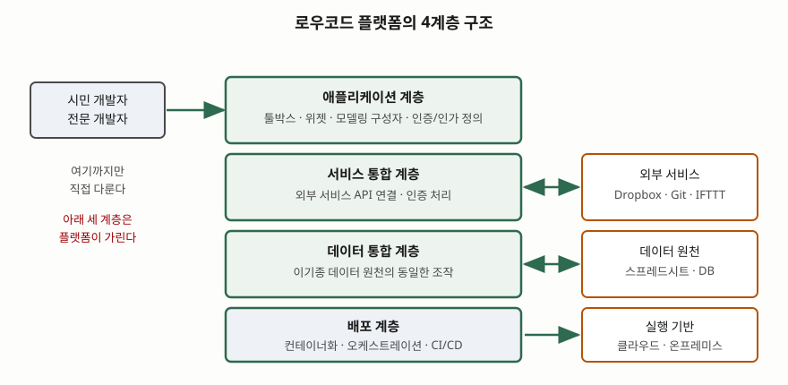
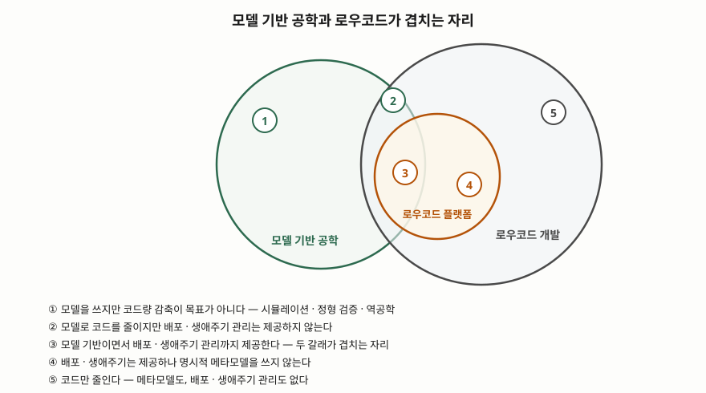

> **실행 검증 없음.** 학술 논문과 시장분석 기관의 정의만으로 쓴다. 플랫폼을 직접 돌려
> 측정한 값은 싣지 않는다.

문항은 신규 정보시스템 개발에 로우코드 플랫폼을 적용하려는 상황을 두고 셋을 묻는다.
로우코드의 주요 특징, 노코드와 로우코드의 비교, 로우코드 적용 시 한계점이다.
답안도 이 순서를 바꾸지 않는다.

용어의 **정의 자체는 시장분석 기관이 먼저 내놓았고**(Forrester, Gartner) 이들의 보고서는
2차 자료에 해당한다. 이 답안은 그 정의를 **동료 심사를 거친 논문이 인용·검증한 경로로만**
가져오고, 특징·한계의 근거는 논문의 조사 결과에서 취한다.

---

## Ⅰ. 개요

### 가. 수작업 코드를 줄이려는 시도의 계보

로우코드는 갑자기 등장한 접근이 아니다. 1980년대의 4세대 언어와 CASE 도구,
1990년대의 신속 응용 개발(RAD), 2000년대의 최종사용자 개발, 그리고 지난 20년의
모델 기반 공학(MDE)까지, **직접 쓰는 코드의 양을 줄이려는 시도는 10년 주기로 이름을
바꿔 왔다**
([Di Ruscio 외, Low-code development and model-driven engineering, SoSyM 21(2), 2022](https://doi.org/10.1007/s10270-021-00970-2)).
따라서 답안의 첫 과제는 "무엇이 새로운가"를 가르는 것이다.

### 나. 정의 — 두 기관이 서로 다른 축을 잡았다

| 출처 | 연도 | 정의의 축 |
|---|---|---|
| Forrester, 최초 사용 | 2014 | **최소한의 수작업 코딩**과 적은 초기 투자(설치·교육·배포)로 업무 애플리케이션을 빠르게 제공하는 플랫폼 |
| Forrester, 개정 | 2017 | 프로그래밍 대신 **시각적·선언적 기법**을 쓰는 제품 또는 클라우드 서비스. 시작 비용이 낮고 비용이 사업 가치에 비례해 오른다 |
| Gartner, LCAP 시장 구분 | 2016 | 같은 구간을 **로우코드 애플리케이션 플랫폼(LCAP)**으로 부르고, 그 안에 전사급(enterprise) LCAP를 따로 둔다 |

2014년 정의는 **코드량**을, 2017년 정의는 **표현 수단**을 축으로 잡는다. 기관이 공통으로
강조한 변화는 한 가지다 — 이전 세대의 선언적 도구와 로우코드를 가르는 것은 표기법이
아니라 **플랫폼성**, 즉 배포와 생애주기 관리까지 제품 안에 들어왔다는 점이다.

Gartner가 말한 전사급 LCAP의 요건은 **9가지**다 — 고성능, 확장성, 고가용성,
재해복구, 보안, SLA, 자원 사용 추적, 공급자의 기술지원, 그리고 로컬·클라우드 서비스
양방향의 API 접근. 이 목록은 뒤의 한계점 항목에서 그대로 **평가 기준**으로 쓰인다.

### 다. 지금 다시 떠오른 이유 — 5가지

같은 논문의 채택 배경 절(§5)은 4GL·CASE가 실패한 자리에서 로우코드가 살아남는
이유로 다섯을 든다.

| # | 배경 | 내용 |
|---|---|---|
| ① | **클라우드 배포** | 코드 생성에서 그치지 않고 확장 가능한 클라우드에 바로 올려 전 세계에 공개한다 |
| ② | **디지털 네이티브 인력** | 도메인 전문가 자신이 컴퓨터에 익숙해져 필요한 훈련량이 줄었다 |
| ③ | **설치 없음** | 브라우저만으로 평가·개발·배포가 가능해 진입 장벽이 낮다 |
| ④ | **개발자 수급 격차** | 숙련 개발자가 난도 높은 과제로 쏠리면서, 수작업으로 만들기엔 비싼 업무 앱 구간이 비었다 |
| ⑤ | **학습 매체의 변화** | 전문가가 쓴 책 대신 영상·화면 녹화로 학습 자료가 유통되고, 사용자가 직접 만들어 공유한다 |

①과 ③이 **플랫폼 쪽 변화**, ②·④·⑤가 **수요와 인력 쪽 변화**다. 답안에서 이 둘을
구분해 쓰면 "왜 하필 지금인가"에 대한 답이 선다.

---

## Ⅱ. 로우코드의 주요 특징

### 가. 구조 — 4계층

로우코드 플랫폼은 네 계층으로 구성된다.

> **출처**: [A. Sahay, A. Indamutsa, D. Di Ruscio, A. Pierantonio, Supporting the understanding and comparison of low-code development platforms, Euromicro SEAA 2020, pp.171-178, §II-A Fig.1](https://doi.org/10.1109/SEAA51224.2020.00036)

| 계층 | 무엇을 담당하는가 |
|---|---|
| **애플리케이션 계층** | 사용자가 직접 만지는 그래픽 환경. 툴박스·위젯으로 화면을 구성하고, 산출물에 적용할 인증·인가 방식을 정의하며, 모델링 구성자로 동작을 명세한다 |
| **서비스 통합 계층** | 외부 서비스를 각자의 API와 인증 방식으로 연결한다 |
| **데이터 통합 계층** | 원천이 이기종이어도 **같은 방식으로 조작**되도록 데이터를 통합한다 |
| **배포 계층** | 전용 클라우드 또는 온프레미스에 올린다. 컨테이너화·오케스트레이션과 지속적 통합·배포가 여기서 처리된다 |

구조를 이렇게 쌓은 결과가 로우코드의 성격을 결정한다. **사용자는 최상위 계층만 다루고
아래 세 계층은 플랫폼이 가린다.** 데이터베이스가 SQL인지 NoSQL인지, 마이크로서비스가
어떻게 오케스트레이션되는지, 인증·부하분산·데이터 무결성을 누가 보장하는지를 개발자가
책임지지 않는다. 이것이 생산성의 원천이자, 뒤에서 볼 한계의 원천이다.

### 나. 개발 절차 — 6단계

플랫폼이 지원하는 전형적 절차는 여섯 단계다(Di Ruscio 외, 2022, 플랫폼 개관 절 §3).

| 단계 | 활동 | 산출물 |
|---|---|---|
| ① **도메인 모델링** | 개념과 관계를 엔터티·속성·관계로 정의한다. 보통 가장 먼저 수행된다 | 도메인 모델 |
| ② **UI 정의** | 데이터를 생성·편집·조회할 폼과 페이지를 구성하고 역할·보안을 지정한다 | 화면 정의 |
| ③ **비즈니스 로직 명세** | 제어·데이터 흐름을 그래픽 워크플로나 텍스트 업무 규칙으로 적는다 | 워크플로, 규칙 |
| ④ **외부 서비스 연계** | 전용 API로 제3자 데이터·서비스를 소비한다 | 커넥터 설정 |
| ⑤ **생성·배포** | 코드를 생성하거나 모델을 해석해 사설·공용 환경에 올린다 | 실행 가능한 앱 |
| ⑥ **유지보수** | 모니터링 기능으로 운영 중 발생한 요구·결함에 대응한다 | 운영 지표 |

앞선 분류 연구는 ⑥을 빼고 5단계로 보되, 시작점을 둘로 갈라 **데이터부터 쌓는 방식
(Data to UI)과 UI부터 그리는 방식(UI to Data)**이 플랫폼마다 다르다고 적는다
(Sahay 외, 2020). 둘 다 ③과 ④의 순서는 개발자 취향에 따라 바뀔 수 있다.

### 다. 기능 축 — 9가지

여덟 개 주요 플랫폼을 분석해 도출한 기능 분류체계는 아홉 갈래다(Sahay 외, 2020,
분류체계 절 §IV). **플랫폼 선정 기준표를 이 아홉 줄로 쓰면 답안이 비어 보이지 않는다.**

| # | 기능군 | 포함되는 것 |
|---|---|---|
| ① | 그래픽 사용자 인터페이스 | 드래그앤드롭 설계기, 폼, 사전 제작 대시보드, 고급 리포팅 |
| ② | 외부 서비스·데이터 원천 상호운용 | 외부 서비스 연동, 데이터 원천 접속 |
| ③ | 보안 지원 | 인증 방식, 적용 보안 프로토콜, 접근 통제 |
| ④ | 협업 개발 지원 | 온라인·오프라인 협업 모델 |
| ⑤ | 재사용 지원 | 사전 정의 템플릿, 사전 제작 대시보드·폼·리포트 |
| ⑥ | 규모 확장 지원 | 동시 사용자 수, 데이터 트래픽, 저장 용량 |
| ⑦ | 비즈니스 로직 명세 수단 | 업무 규칙 엔진, 그래픽 워크플로 편집기, API 호출 |
| ⑧ | 애플리케이션 빌드 방식 | **코드 생성** 또는 **런타임 모델 해석** |
| ⑨ | 배포 지원 | 앱 스토어 게시, 로컬·클라우드 배포 |

⑧은 특히 중요하다. **코드를 생성해 배포하는 플랫폼과, 모델을 해석해 실행을 관리하는
플랫폼은 산출물의 성격이 다르다.** 조사된 여덟 플랫폼 가운데 코드 생성 방식을 지원한
것은 한 곳뿐이고 나머지는 런타임 모델 해석 쪽이었다(같은 논문의 비교표 Table II).
산출물로 받을 소스가 애초에 없는 경우가 더 흔하다는 뜻이고, 이것이 Ⅳ장 한계의 뿌리다.

### 라. 실무자가 인식하는 특징

개발자 커뮤니티 게시물 301건을 코딩해 분석한 연구는, 실무자가 로우코드를 설명할 때
쓰는 표현을 **11가지 용어, 106건**으로 정리했다
([Luo 외, Characteristics and Challenges of Low-Code Development, ACM/IEEE ESEM 2021](https://doi.org/10.1145/3475716.3475782)).

| 표현 | 건수 |
|---|---|
| 드래그앤드롭 | 23 |
| 비주얼 프로그래밍 | 16 |
| 사전 설계된 템플릿 | 10 |
| 비전문 프로그래머 친화 | 9 |
| 보이는 대로 얻는다(WYSIWYG) | 7 |
| 업무 프로세스 | 6 |

구현 단위는 137건 중 **API 기반 47, 템플릿 기반 34, 컴포넌트 기반 25**로 나뉘었다.
즉 실무에서 로우코드 개발은 **직접 짜는 일이 아니라 이미 있는 것을 호출하고 끼워 맞추는
일**로 인식된다. 같은 연구가 집계한 편익 상위 두 항목도 개발 속도(65건)와
학습·사용 용이성(52건)이었다.

### 마. 모델 기반 공학과의 관계

"로우코드는 MDE의 새 이름인가"는 이 주제의 단골 논점이다. 앞의 SoSyM 논문은
벤 다이어그램으로 **다섯 영역**을 나눠 답한다.

> **출처**: [D. Di Ruscio, D. Kolovos, J. de Lara, A. Pierantonio, M. Tisi, M. Wimmer, Low-code development and model-driven engineering: Two sides of the same coin?, Software and Systems Modeling 21(2) pp.437-446 (2022), 비교 절 §4 Fig.8](https://doi.org/10.1007/s10270-021-00970-2)

결론은 **부분 집합도 동의어도 아니다**이다. 모든 모델 기반 접근이 코드량 감축을
목표로 하지는 않고(①), 모든 로우코드가 명시적 메타모델을 쓰지도 않는다(④·⑤).
둘을 가르는 축은 셋이다.

| 축 | 로우코드 플랫폼 | 모델 기반 공학 |
|---|---|---|
| **실행 기반** | 대체로 클라우드. 개발 환경 설치도 앱 배포도 불필요 | 가능하지만 일반적이지 않다. 데스크톱 기반이 다수 |
| **대상 사용자** | 비기술 배경의 시민 개발자를 겨냥 | 개발 프로세스 안에서 쓰므로 전문 개발자가 다수 |
| **적용 도메인** | 1세대는 업무 앱. 최근 IoT·챗봇·기계학습으로 확장 | 자동차·전력·사이버물리시스템 등 전문 공학 영역도 포함 |

---

## Ⅲ. 노코드와 로우코드의 비교

### 가. 먼저 밝힐 것 — 경계가 표준화되지 않았다

**노코드(NCDP)는 표준이나 공인된 시장 구분으로 확립된 용어가 아니다.** 앞의 SoSyM
논문은 노코드가 마케팅에서 널리 쓰이지만 **시장분석 기관들이 이를 별개의 시장 구간으로
삼는 데 반대하고 있다**고 적고, 논문 자신도 둘을 호환 가능한 것으로 취급한다고 밝힌다.
다른 비교 연구도 로우코드에 통일된 정의가 없다고 기록한다.

실증 자료도 같은 방향이다. 개발자 Q&A 사이트에서 "no-code"로 검색하면 19,455건이
나오지만 앞 500건 중 관련 게시물은 **6건(1.2%)**에 불과해, 해당 연구는 이 검색어를
아예 제외했다(Luo 외, 2021, 자료 수집 절 §3.2.1). 반면 같은 연구가 모은 소셜 커뮤니티
게시물에서는 노코드 게시판이 가장 많은 표본을 냈다. 요약하면 이렇다.

> **노코드는 개발자 담론의 용어가 아니라 비개발자 커뮤니티와 마케팅의 용어다.**

답안에서는 이 사실을 먼저 적고 비교표로 넘어가야 한다. **정의가 정립되는 중이라는
서술 자체가 점수가 되는 문항**이고, 반대로 표준 구분인 것처럼 단정하면 틀린 서술이 된다.

### 나. 그럼에도 실무에서 통용되는 구분선

구분의 축은 **수작업 코드를 끼워 넣을 자리가 제품 안에 있는가**다. 로우코드 플랫폼은
추가 맞춤화를 위해 절차적 코드를 명세할 수 있도록 열어 두는 반면, 노코드는 시각
언어·GUI·설정만으로 프로그래밍을 없애는 것을 지향한다.

| 비교 축 | 노코드 (NCDP) | 로우코드 (LCDP / LCAP) |
|---|---|---|
| **지향** | 프로그래밍을 **없앤다** | 수작업 코딩을 **최소화한다** |
| **코드 삽입 지점** | 제공하지 않거나 수식·단순 표현식 수준 | 절차적 코드로 추가 맞춤화 가능 |
| **주 사용자** | 업무 담당자 | 시민 개발자 + 전문 개발자 혼성 |
| **용어의 지위** | 마케팅 용어. 기관이 별도 시장으로 구분하기를 거부 | Forrester(2014)·Gartner(2016)가 시장 구간으로 정의 |
| **적용 범위** | 플랫폼이 제공하는 기능 조합 안 | 조합 + 코드로 넓힌 영역 |
| **한계가 드러나는 지점** | 요구가 조합 밖으로 나가는 순간 **더 갈 길이 없다** | 코드로 넘어가되 플랫폼의 설계 제약을 따라야 한다 |
| **산출물 이관** | 사실상 불가 | 플랫폼의 내보내기 지원 범위에 달려 있다 |

### 다. 선택 기준 — 축은 "요구의 변동 폭"이다

사용자 수나 조직 규모보다 먼저 볼 것은 **요구사항이 플랫폼 제공 기능 안에 머무는가**다.
머문다면 노코드가 싸고 빠르다. 벗어날 가능성이 있다면 **벗어나는 순간 쓸 수 있는 탈출구가
있는 쪽**, 즉 로우코드를 골라야 한다. 노코드에서 로우코드로 넘어가는 전환은 플랫폼
교체이지 설정 변경이 아니기 때문이다.

---

## Ⅳ. 로우코드 적용 시 한계점

한계는 **6가지**로 묶인다. 앞의 두 가지는 플랫폼 구조에서 비롯된 구조적 한계,
뒤의 네 가지는 운영과 조달에서 드러나는 한계다.

### 가. 구조적 한계

**① 플랫폼 간 상호운용성 부재와 공급자 종속**

대부분의 로우코드 플랫폼은 **독점·폐쇄 소스이며 이 영역에는 표준이 없다.** 그 결과
설계·구현·서비스를 플랫폼 사이에 주고받을 수 없고, 이미 정의한 아키텍처와 산출물의
재사용이 막힌다(Sahay 외, 2020, 경험 보고 절 §VI).

종속의 실질은 두 겹이다. 겉은 **클라우드 종속** — 특정 사업자의 기술 스택에서만 도는
앱이 나온다. 더 중요한 것은 **개발 산출물** 쪽이다. 내보내기가 가능한가, 가능하다면 그
산출물을 다른 플랫폼이 읽어 해석할 수 있는가. 모델링 언어(UML, BPMN), 메타모델링
언어(MOF, Ecore), 모델 교환 형식(XMI, HUTN)처럼 모델 기반 공학이 쌓아 온 표준을
로우코드에 재사용할 수 있을지는 아직 탐색 대상으로 남아 있다(Di Ruscio 외, 2022,
상호 학습 절 §6).

**② 확장 한계 — 플랫폼이 주지 않은 기능은 붙이기 어렵다**

제공되지 않는 기능을 추가하는 일은 독점 플랫폼에서 **어렵거나 불가능하다.** 가능하더라도
상당한 분량의 코딩이 필요하고, 그 코드는 확장 대상 플랫폼의 아키텍처·설계 제약을
따라야 한다(Sahay 외, 2020). 같은 논문은 결론 직전에 더 직접적으로 적는다 —
**개발 가능 범위가 제공 모듈의 기능에 달려 있어, 사용자가 초기 요구사항을 플랫폼이
제공하는 선택지에 맞춰 조정해야 할 수 있다.**

정보시스템 관점에서 이 문장의 뜻은 분명하다. **요구공학의 방향이 뒤집힌다.**
요구에서 설계로 내려가는 것이 아니라, 플랫폼이 할 수 있는 것에서 요구를 깎아 올린다.
적용 대상 업무를 고를 때 이것을 받아들일 수 있는 영역인지가 첫 판단 기준이 된다.

### 나. 운영·조달에서 드러나는 한계

**③ 소스 접근 불가에서 오는 유지보수·결함 검증의 벽**

실무자 조사가 집계한 한계 15가지 가운데 **소스코드 접근 불가 4건, 유지보수·디버깅
곤란 3건**이 함께 나온다. 같은 연구는 그 연결을 짚는다 — **코드에 접근할 수 없으면
플랫폼 자체의 결함인지를 확인할 방법이 없다.** 장애가 났을 때 원인 규명이 공급자의
지원 창구에 전적으로 의존하게 되므로, **SLA와 기술지원 조건이 기술 평가 항목으로
올라와야 한다.** 앞서 적은 전사급 LCAP 요건에 SLA와 공급자 기술지원이 들어 있는
이유가 여기 있다.

**④ 성능·규모 확장성을 외부에서 평가할 수 없다**

로우코드 플랫폼은 대량·고속·다양한 데이터를 다룰 수 있어야 하지만, **개방 표준이 없어
확장성을 평가하거나 연구하거나 개선에 기여하는 일 자체가 매우 어렵다**(Sahay 외, 2020).
실무자 조사에서도 적재·게시가 느리다는 지적이 9건으로 상위에 있었다. 요지는
"느리다"가 아니라 **"빠른지 느린지를 도입 전에 독립적으로 확인할 수단이 없다"**는 것이다.
따라서 **도입 판단은 벤치마크 수치가 아니라 대상 업무로 만든 시범 구현으로 해야 한다.**

**⑤ 학습 곡선 — 겨냥한 사용자층과 실제 필요 역량이 어긋난다**

실무자 조사에서 가장 많이 꼽힌 한계가 **높은 학습 곡선(96건 중 21건)**이다. 여기에
경험 있는 개발자만 쓸 수 있다는 지적 4건, 기본적인 프로그래밍 지식이 필요하다는 지적
2건이 더해진다. 분류 연구도 같은 결론에 닿는다 — **일부 플랫폼은 여전히 소프트웨어
개발 지식을 요구하므로, 주 대상이어야 할 시민 개발자의 채택이 제약된다.**

**⑥ 비용 구조**

높은 가격이 13건으로 두 번째 한계였다. 가격은 **개발자 1인당 월 단가**로 환산되며,
배포할 애플리케이션 수와 데이터를 어디에 두는가(온프레미스·클라우드·혼합)가 단가를
움직인다(Sahay 외, 2020, 추가 비교 축 절 §V-B). 인원이 늘수록 선형으로 증가하는
구조이므로, **자체 개발과의 총소유비용 비교는 초기 구축비가 아니라 운영 기간 전체의
라이선스 합계로 해야 한다.**

### 다. 적용 시 고려사항 — 5가지

| # | 판단 항목 | 무엇을 확인하는가 |
|---|---|---|
| ① | **빌드 방식** | 코드 생성인가 런타임 모델 해석인가. 이관 가능한 산출물이 남는지가 여기서 갈린다 |
| ② | **내보내기와 표준** | 산출물을 어떤 형식으로 내보낼 수 있고, 그것을 다른 도구가 읽을 수 있는가 |
| ③ | **요구의 변동 폭** | 요구가 제공 모듈 밖으로 나갈 가능성. 나간다면 확장 수단과 그 제약을 먼저 확인한다 |
| ④ | **대상 업무의 중요도** | 핵심 업무인가 주변 업무인가. 종속 비용은 생애주기가 길수록 커진다 |
| ⑤ | **총소유비용** | 1인당 월 단가 × 운영 기간 + 배포 앱 수 + 데이터 보관 위치에 따른 가산 |

덧붙여 둘 것이 하나 있다. **보안·컴플라이언스와 코드 최적화는 아직 독립적으로
평가되지 못한 영역이다.** 분류 연구는 이 두 항목을 조사 범위에서 제외하면서 그 이유를
**플랫폼 내부 가시성이 없거나 제한적이었기 때문**이라고 밝혔다. 평가 자료가 없다는
사실 자체가 공공·금융처럼 통제 요구가 강한 영역에서는 **그 자체로 위험 요인**이다.

---

## Ⅴ. 결론

로우코드의 새로움은 시각적 개발이 아니라 **배포와 생애주기 관리까지 플랫폼 안으로
들어왔다는 점**에 있다. 4계층 구조에서 사용자는 최상위 한 층만 다루고 아래 세 층을
플랫폼에 맡기는데, 생산성의 원천과 한계의 원천이 똑같이 여기서 나온다. 맡긴 만큼
빨라지고, 맡긴 만큼 들여다볼 수 없게 된다.

노코드와의 경계는 표준화되어 있지 않다. 그러나 **수작업 코드를 끼워 넣을 자리가 있는가**
라는 한 축은 실무에서 유효하며, 요구가 플랫폼 제공 기능 밖으로 나갈 가능성이 선택을
가른다.

따라서 적용 판단은 "빠른가"가 아니라 **"요구가 플랫폼 밖으로 나갔을 때 무엇이 남는가"**
여야 한다. 코드 생성형인지 모델 해석형인지, 산출물을 내보낼 수 있는지, 내보낸 것을
다른 도구가 읽을 수 있는지 — 이 셋을 확인하지 않은 도입은 개발 기간을 줄이는 대신
**시스템의 수명을 공급자의 수명에 묶는 결정**이 된다. 로우코드는 전통적 개발을 대체하는
수단이 아니라, 적용 영역을 골라 쓰는 수단이다.

> 개념 정리: [모델 기반 공학(MDE)](../../software-engineering/2026-11-05-model-driven-engineering-mde/index.md)

끝

---

## 답안 작성 메모

- **먼저 쓸 것**: 개요에서 "로우코드의 차별점은 표기법이 아니라 플랫폼성"이라는 한 줄과
  4계층 모식도. 이 둘을 앞에 박아 두면 Ⅱ·Ⅲ·Ⅳ가 전부 이 구조의 전개로 읽힌다.
  한계점을 쓸 때 "앞의 계층도에서 아래 세 층을 못 보기 때문"이라고 되짚으면 (다)가
  (가)와 끊기지 않는다.
- **점수가 갈리는 지점**:
  - (나)에서 **노코드가 표준 구분이 아니라는 사실을 밝혔는가.** 두 용어를 확립된 구분처럼
    단정하고 비교표만 그리면, 아는 것처럼 보이지만 틀린 서술이다. "정의가 정립되는 중"을
    먼저 적고 그 위에 통용 기준을 올려야 한다.
  - (다)에서 **공급자 종속을 '클라우드 종속'으로만 쓰지 않았는가.** 더 무거운 것은 개발
    산출물 쪽이다. 내보낼 수 있는가, 내보낸 것을 남이 읽는가 — 이 두 질문까지 가야 한다.
  - **빌드 방식(코드 생성 / 런타임 모델 해석)을 구분했는가.** 이 구분이 있어야 "왜 종속이
    생기는가"가 설명된다. 없으면 한계점이 근거 없는 우려 나열로 읽힌다.
- **시간이 모자라면 버릴 것**: 기능 축 9가지 표를 세 줄(상호운용·확장성·빌드 방식)로
  줄인다. 채택 배경 5가지는 두문자 한 줄로 적는다. 벤 다이어그램은 버려도 된다.
- **버리면 안 되는 것**: 4계층 모식도, 노코드 비교표, 한계점 6가지의 제목 줄. 문항이
  비교와 한계를 직접 요구했으므로 이 셋이 빠지면 배점의 중심이 비는 것으로 읽힌다.
- **흔한 실수**: 한계점을 "보안이 약하다", "성능이 떨어진다"로 단정하는 것. 조사 연구는
  오히려 **이 두 항목을 평가할 수 없었다**고 적는다. 단정 대신 "독립 평가 수단이 없다"로
  쓰는 편이 정확하고, 그 위에 "그래서 시범 구현으로 확인해야 한다"는 대응까지 붙일 수 있다.
- **수치를 쓸 때**: 시장 규모나 생산성 배수를 외워 쓰지 않는다. 쓰려면 실무자 조사의
  한계 순위(학습 곡선 21, 가격 13, 맞춤화 부족 11)처럼 **출처가 분명한 집계**를 쓴다.

## 참고 자료

- [D. Di Ruscio, D. Kolovos, J. de Lara, A. Pierantonio, M. Tisi, M. Wimmer, Low-code development and model-driven engineering: Two sides of the same coin?, Software and Systems Modeling 21(2) pp.437-446 (2022-01), 오픈 액세스](https://doi.org/10.1007/s10270-021-00970-2)
- [A. Sahay, A. Indamutsa, D. Di Ruscio, A. Pierantonio, Supporting the understanding and comparison of low-code development platforms, 46th Euromicro Conference on Software Engineering and Advanced Applications (SEAA) pp.171-178 (2020)](https://doi.org/10.1109/SEAA51224.2020.00036)
- [Y. Luo, P. Liang, C. Wang, M. Shahin, J. Zhan, Characteristics and Challenges of Low-Code Development: The Practitioners' Perspective, ACM/IEEE International Symposium on Empirical Software Engineering and Measurement (ESEM '21) (2021)](https://doi.org/10.1145/3475716.3475782)
- [U. Frank, M. Maier, A. Bock, Low Code Platforms: Promises, Concepts and Prospects — A Comparative Study of Ten Systems, ICB Research Report No. 70, Universität Duisburg-Essen (2021-12)](https://umo.ris.uni-due.de/fileadmin/fileupload/WI-UMO/ICB_Report_70.pdf)
