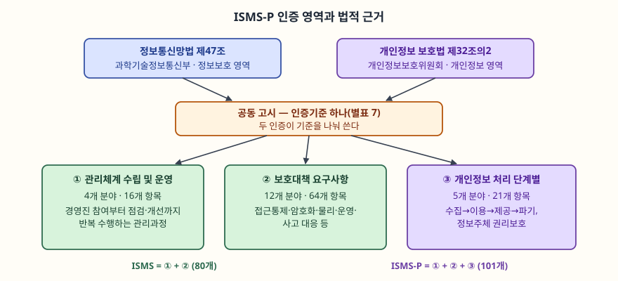
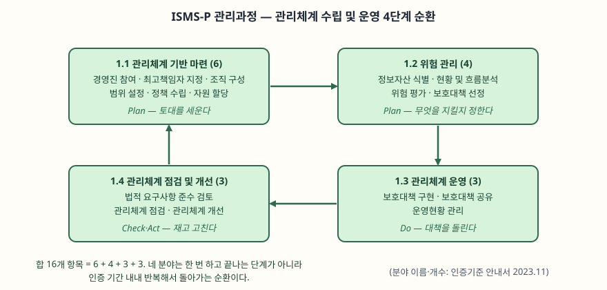

문항은 정보보호 및 개인정보보호 관리체계(ISMS-P)를 네 갈래로 나눠 묻는다. (가) 인증
영역과 법적 근거, (나) 관리과정, (다) 간편인증 제도, (라) 강화 방안이다. "가·나·다·라"로
나눠 물었으므로 순서를 바꾸지 않고 그대로 대항목으로 쓴다. 답안의 축은 ISMS-P가
**두 법률의 요구를 하나의 인증기준으로 통합한 체계**이고, 그 핵심이 한 번 받고 끝나는
자격이 아니라 **반복해서 돌아가는 관리과정**이라는 점이다.

> 실행 검증 없음. 법 조문·고시·인증기준 안내서(2023.11)와 개인정보보호위원회·과학기술
> 정보통신부의 공식 보도자료를 근거로 정리했다. 간편인증 수치는 2024년 7월 보도자료
> 기준이고, 강화 방안 일부는 발표 단계임을 본문에 구분해 적었다.

---

## Ⅰ. 개요

ISMS-P는 신청인의 정보보호 및 개인정보보호 조치가 **인증기준에 적합함을 한국인터넷
진흥원 또는 인증기관이 증명하는 것**이다(인증 고시 제2조제1호). 원래 정보통신망법의
정보보호 관리체계(ISMS)와 개인정보 보호법의 개인정보보호 관리체계(PIMS)가 따로
운영되다가, 한 기업이 비슷한 통제를 두 번 심사받는 부담을 줄이려고 2018년에 하나로
통합됐다. 지금은 두 부처가 **공동 고시**로 인증기준 하나를 두고, 개인정보 영역을 빼면
ISMS, 전부 포함하면 ISMS-P가 된다.

문항이 묻는 네 가지는 서로 이어진다. 법적 근거(가)가 **무엇을 왜 인증하는지**를 정하고,
관리과정(나)이 **어떻게 운영하는지**를 정하며, 간편인증(다)과 강화 방안(라)은 그 제도를
**누구에게 어떻게 적용할지**를 양쪽으로 조정한다. 간편인증은 작은 기업의 문턱을 낮추는
쪽이고, 강화 방안은 큰 사고를 낸 곳의 책임을 높이는 쪽이다.

---

## Ⅱ. 인증 영역과 법적 근거 (가)

### 가. 법적 근거 — 2개 법률, 1개 공동 고시

> **출처**: [정보통신망법 제47조](https://www.law.go.kr/법령/정보통신망이용촉진및정보보호등에관한법률/제47조), [개인정보 보호법 제32조의2](https://www.law.go.kr/법령/개인정보보호법/제32조의2), [정보보호 및 개인정보보호 관리체계 인증 등에 관한 고시 별표 7](https://www.law.go.kr/행정규칙/정보보호및개인정보보호관리체계인증등에관한고시)

| 구분 | 정보보호 영역(ISMS) | 개인정보 영역(ISMS-P의 추가분) |
|---|---|---|
| **근거 법** | 정보통신망법 제47조 | 개인정보 보호법 제32조의2 |
| **소관 부처** | 과학기술정보통신부 | 개인정보보호위원회 |
| **대상** | 정보통신망의 안정성·신뢰성 | 개인정보 처리·보호 조치의 적법성 |
| **유효기간** | 3년 | 3년 |

두 법이 각각 "관리체계를 인증한다"고 정하고(정보통신망법 제47조제1항, 개인정보 보호법
제32조의2제1항), 그 세부를 **하나의 공동 고시**가 통합해 규정한다(고시 제1조). 그래서
답안에서 "법적 근거"를 물으면 **법 두 개와 고시 하나**를 모두 적어야 한다. 법만 적으면
인증기준이 어디서 나오는지 빠진다.

### 나. 인증 영역 — 3개 영역 101개 기준

인증기준은 세 영역으로 나뉘고, 각 영역이 분야와 항목으로 내려간다.

| 영역 | 분야 | 항목 | 무엇을 보는가 |
|---|---|---|---|
| **① 관리체계 수립 및 운영** | 4 | 16 | 경영진 참여·범위 설정·위험관리·점검의 **순환** |
| **② 보호대책 요구사항** | 12 | 64 | 위험평가로 고른 대책 — 접근통제·암호화·물리·운영·사고 대응 |
| **③ 개인정보 처리 단계별 요구사항** | 5 | 21 | 수집→이용→제공→파기, 정보주체 권리보호 |

**인증 범위가 영역으로 갈린다.** ISMS는 ①·② 두 영역 **80개**를, ISMS-P는 세 영역
전부 **101개**를 적용한다(고시 제23조제1항). 즉 ISMS-P는 ISMS에 개인정보 영역 21개를
더한 것이다. ①영역은 관리체계를 **운영하는 내내 반복**해야 하는 것이고, ③영역은 대부분
**법적 요구사항과 직접 연결**된다. ②영역은 ①의 위험평가 결과에 따라 고른다.

의무 대상은 정보통신망법 제47조제2항이 정한다. 주요정보통신서비스 제공자, 집적정보통신
시설 사업자, 그리고 대통령령 기준 해당자(정보통신 매출 100억 이상, 일평균 이용자
100만 이상 등)다. **현행법에서 의무인 것은 ISMS**이고, ISMS-P는 그 의무를 더 넓은
기준으로 대신 채울 수 있다.

---

## Ⅲ. 관리과정 (나)

### 가. 관리과정이 ①영역이다

문항의 "관리과정"은 ①영역 **관리체계 수립 및 운영**의 네 분야를 가리킨다. 이 영역이
다른 두 영역과 다른 점은, 나머지가 **갖춰야 할 상태**를 보는 반면 이 영역은 **돌아가야
할 과정**을 본다는 데 있다. 그래서 네 분야가 PDCA(계획-실행-점검-조치)의 순환을 이룬다.

> **출처**: [ISMS-P 인증기준 안내서 2023.11, 제1영역 관리체계 수립 및 운영](https://www.privacy.go.kr/front/bbs/bbsView.do?bbsNo=BBSMSTR_000000000049&bbscttNo=20677)

### 나. 네 분야 16개 항목

| 분야 | 항목 수 | 핵심 활동 | PDCA |
|---|---|---|---|
| **1.1 관리체계 기반 마련** | 6 | 경영진 참여, 최고책임자 지정, 조직 구성, 범위 설정, 정책 수립, 자원 할당 | Plan |
| **1.2 위험 관리** | 4 | 정보자산 식별, 현황 및 흐름분석, 위험 평가, 보호대책 선정 | Plan |
| **1.3 관리체계 운영** | 3 | 보호대책 구현, 보호대책 공유, 운영현황 관리 | Do |
| **1.4 관리체계 점검 및 개선** | 3 | 법적 요구사항 준수 검토, 관리체계 점검, 관리체계 개선 | Check·Act |

합이 **16개**다. 과정의 순서는 이렇다. 먼저 경영진이 참여해 **범위와 정책을 세우고**
(1.1), 그 범위 안의 자산을 식별해 **위험을 평가하고 대책을 고른다**(1.2). 고른 대책을
**구현해 운영하고**(1.3), 운영한 결과를 **점검해 결함을 고친다**(1.4). 1.4의 개선이
다시 1.1·1.2로 돌아가 범위와 위험을 갱신하므로, 네 분야는 **한 바퀴 돌고 끝나는 단계가
아니라 인증 기간 내내 반복되는 고리**다.

### 다. 왜 과정을 인증하는가

이 구조가 점수 지점이다. 보호대책 64개를 전부 갖춰도, 그것을 **고르고 점검하는 과정**이
없으면 환경이 바뀔 때 대책이 낡는다. 위험 평가(1.2)가 2영역 보호대책을 **선택하는 근거**가
되고, 점검·개선(1.4)이 그 선택이 여전히 맞는지 **되먹임**한다. 그래서 1영역은 "관리체계가
살아 움직이는가"를 보는 영역이고, ISMS-P가 체크리스트가 아니라 **관리체계** 인증인 이유가
여기에 있다.

---

## Ⅳ. ISMS-P 간편인증 제도 (다)

### 가. 도입 배경과 시행

기존 인증기준은 **중견기업 이상을 기준으로 설계**돼, 중소기업에는 항목 수와 비용이
과했다. 개인정보보호위원회와 과학기술정보통신부는 중소기업의 인증 부담을 줄이려고
**간편인증 제도를 2024년 7월 24일부터 시행**했다(보도자료 2024-07-23). 기준 항목을
줄이고 수수료를 낮춘 것이 골자다.

### 나. 적용 대상

| 대상 | 조건 |
|---|---|
| **중소기업** | 정보통신서비스 부문 매출액 **300억 원 미만** |
| **중기업 중 설비 미보유** | 매출 300억 이상이나 자체 서버·네트워크·보안 설비 없이 웹호스팅·클라우드를 이용 |

보도자료는 **전체 의무 대상 중 약 16%(85개 기업)** 가 적용받을 수 있다고 밝혔다. 반대로
주요정보통신서비스 제공자, 집적정보통신시설 사업자, 일부 상급종합병원·대학, 금융회사,
가상자산사업자는 **제외**된다. 파급력이 큰 곳은 간편인증으로 가지 못하게 막은 것이다.

### 다. 기준과 수수료

| 구분 | 표준 인증 | 간편 인증 |
|---|---|---|
| **ISMS 기준** | 80개 | 40개 또는 44개 |
| **ISMS-P 기준** | 101개 | 62개 또는 65개 |
| **ISMS 수수료** | 800~1,400만 원 | 400~700만 원 (약 50% 절감) |
| **ISMS-P 수수료** | 1,000~1,800만 원 | 600~1,100만 원 (약 40% 절감) |

기준을 36~40개 줄여 **62개 또는 65개**로 낮췄다. "또는"이 붙는 이유는, 설비를 전혀
보유하지 않은 기업이 자체 설비를 가진 중소기업보다 더 많이 감면받기 때문이다. 수수료는
**약 40~50% 절감**된다. 다만 간편인증도 **인증의 효력은 표준 인증과 같다** — 기준을
줄였을 뿐 인증 자체를 약화한 것은 아니다.

---

## Ⅴ. ISMS-P 제도의 강화 방안 (라)

간편인증이 작은 기업의 문턱을 낮추는 쪽이라면, 강화 방안은 **인증을 받고도 큰 사고를
낸 곳의 책임을 높이는** 쪽이다. 인증 기업에서 대규모 유출이 이어지자 나왔다.

### 가. 인증 취소 기준 신설 (시행 단계)

과학기술정보통신부와 개인정보보호위원회는 2025년 12월 29일, 사후관리를 강화해 **다음의
경우 원칙적으로 인증을 취소**하기로 발표했다.

| 취소 사유 | 내용 |
|---|---|
| **대규모 유출** | **1,000만 명 이상** 피해가 발생한 사고 |
| **반복 위반** | 법 위반이 되풀이되는 경우 |
| **고의·중과실** | 사회적 파장이 큰 사고를 고의 또는 중대한 과실로 낸 경우 |
| **사후관리 거부** | 점검을 거부하거나 자료를 미제출·허위 제출하는 경우 |

사후심사는 **외부 인터넷 접점 자산 식별, 접근권한 관리, 패치 관리** 등 실제로 사고가
나는 지점을 집중해서 본다. 의무 대상 기업은 취소 뒤 **1년의 재신청 유예기간**을 받고,
그 기간의 과태료는 면제된다. 정보통신망법에도 중대 위반 시 인증을 취소할 수 있게 하는
개정이 진행 중이다.

### 나. 제도 전면 개편 (발표 단계)

두 부처는 2026년 4월 10일, 인증제 실효성 강화방안을 발표했다. 아직 고시로 확정되지
않았으므로 **발표된 방안**으로 구분해 적는다.

1. **의무 대상 신설** — 주요 공공시스템 운영기관, 이동통신사업자, 본인확인기관, 대규모
   개인정보처리자를 ISMS-P 의무 대상에 편입
2. **3단계 차등** — 강화인증·표준인증·간편인증으로 나눠, 파급력이 큰 곳에 강화 기준 적용
3. **심사 방식 전환** — 서면 중심에서 **현장 중심**으로. 예비심사로 핵심 기준을 먼저 보고
   취약점 진단·모의침투를 도입
4. **사후관리 강화** — 상시 점검, 중대 결함 시 인증 취소

사후관리 강화는 2026년 하반기, 의무화와 차등 체계는 2027년부터 시행한다고 밝혔다.
간편인증(다)과 강화 방안(라)을 함께 놓고 보면 제도의 방향이 드러난다. **위험이 낮은
곳은 문턱을 낮추고, 위험이 높은 곳은 기준과 책임을 높이는** 차등화다.

---

## Ⅵ. 결론

ISMS-P는 정보통신망법 제47조와 개인정보 보호법 제32조의2를 **하나의 공동 고시**로
통합한 인증으로, 3개 영역 101개 기준(관리체계 16 + 보호대책 64 + 개인정보 21)으로
이뤄진다. 핵심은 ①영역의 **관리과정**이 PDCA로 순환하며 관리체계를 살아 있게 한다는
점이다. 제도는 양방향으로 움직인다. 2024년 간편인증은 중소기업의 기준을 36~40개 줄여
문턱을 낮췄고, 2025년 이후 강화 방안은 대규모 유출·반복·고의 사고에 인증 취소를 걸어
책임을 높였다. 둘을 합치면 ISMS-P는 **위험의 크기에 맞춰 적용을 차등화하는** 방향으로
가고 있다. 답안에서는 네 항목을 "제도 소개"로 나열하기보다, 간편인증과 강화 방안이
**같은 차등화의 두 끝**임을 결론에서 묶으면 변별이 선다.

> 개념 정리: [ISMS-P 인증 — 3개 영역 인증기준과 의무 대상](../../security/2026-10-07-isms-p-certification-three-domains/index.md)

끝

---

## 답안 작성 메모

- **먼저 쓸 것**: Ⅰ의 "두 법을 하나의 고시로 통합"과 (가)의 영역 표(16+64+21=101).
  이 숫자가 서면 (나)의 관리과정이 ①영역임이 자연스럽게 연결된다. (가)의 도식을 먼저
  그려 두고 네 항목을 채운다.
- **분량 배분**: 25점에 A4 세 장이면 (가) 0.8장, (나) 0.8장, (다) 0.6장, (라) 0.5장,
  개요·결론 0.3장. (나)의 PDCA 순환 도식과 (가)·(다)의 비교표를 반드시 넣는다.
- **점수가 갈리는 지점 셋**
  1. (가)에서 **법 두 개 + 고시 하나**를 다 적었는가. 법만 적으면 인증기준의 출처가 빈다.
     ISMS 80 / ISMS-P 101의 영역 구분까지 써야 "영역"을 물은 데 답한 것이 된다.
  2. (나)에서 관리과정이 **왜 순환인지** 썼는가. 네 분야를 나열만 하면 1.4의 개선이
     1.1로 되돌아가는 고리가 안 보인다. "위험평가가 보호대책을 고르는 근거"라는 1영역과
     2영역의 연결을 한 줄 넣으면 달라진다.
  3. (다)·(라)를 **따로 소개하지 않고 묶었는가.** 간편인증과 강화 방안이 같은 차등화의
     양 끝이라는 결론이 있으면 네 항목이 하나의 구도로 읽힌다.
- **시간이 모자라면 버릴 것**: (다)의 수수료 표와 (라)의 2026년 개편 4가지 중 3·4번.
  간편인증은 "대상·기준·수수료 절감"의 한 줄, 강화는 "1,000만 명 이상 유출 시 인증
  취소"의 한 줄만 남긴다. 도식 둘과 영역 표는 버리지 않는다.
- **쓰지 말 것**: 간편인증 기준 개수를 어림으로 쓰는 것(62/65는 보도자료 값), 강화 방안의
  시행 시점을 확정처럼 쓰는 것. 2026년 개편은 발표 단계이므로 "발표된 방안"으로 적는다.

---

## 참고 자료

- [정보통신망 이용촉진 및 정보보호 등에 관한 법률 제47조 (법률 제21988호, 2026-10-02 시행)](https://www.law.go.kr/법령/정보통신망이용촉진및정보보호등에관한법률/제47조)
- [개인정보 보호법 제32조의2 (법률 제21445호, 2026-09-11 시행)](https://www.law.go.kr/법령/개인정보보호법/제32조의2)
- [정보보호 및 개인정보보호 관리체계 인증 등에 관한 고시 (2024-07-24 시행)](https://www.law.go.kr/행정규칙/정보보호및개인정보보호관리체계인증등에관한고시)
- [개인정보보호위원회·과학기술정보통신부, ISMS-P 인증기준 안내서 (2023.11)](https://www.privacy.go.kr/front/bbs/bbsView.do?bbsNo=BBSMSTR_000000000049&bbscttNo=20677) — 제1영역 관리체계 수립 및 운영 분야·항목
- [개인정보보호위원회, "중소기업의 정보보호 인증부담 완화를 위한 ISMS·ISMS-P 간편인증 제도 시행" (2024-07-23)](https://pipc.go.kr/np/cop/bbs/selectBoardArticle.do?bbsId=BS074&mCode=C020010000&nttId=10379) — 적용 대상·기준 수·수수료
- [보안뉴스, "개인정보 대규모 유출하면 ISMS·ISMS-P 인증 취소…정부, 정보보호 기준 대폭 강화" (2025-12-29)](https://www.boannews.com/html/detail.html?idx=141218) — 2차 자료, 인증 취소 기준 보도
- [정책브리핑, "개인정보 유출 사전예방 강화…개인정보보호 인증제 전면 개편" (2026-04-10)](https://www.bokjiro.go.kr/ssis-tbu/cms/pc/news/news/1309615_1114.html) — 2차 자료, 2026년 개편 방안 발표
