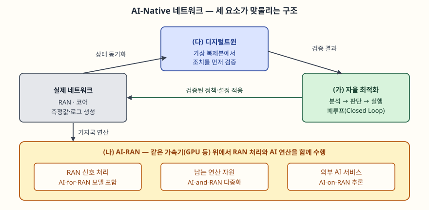

문항은 AI-Native 네트워크를 세 갈래로 나눠 묻는다. (가) 자율 최적화, (나) AI-RAN,
(다) 디지털트윈 기반 네트워크 관리다. "가·나·다"로 물었으므로 순서를 바꾸지 않고 그대로
대항목으로 쓴다. 답안의 축은 **AI가 네트워크 "위에" 얹힌 도구가 아니라 운영·무선 처리·자원
구조 안으로 들어왔다**는 점이고, 세 항목은 각각 **운영(자율 최적화)**, **인프라(AI-RAN)**,
**검증(디지털트윈)** 을 맡는다.

> 실행 검증 없음. 표준·공개 문서를 근거로 정리했다.
> **AI-Native는 표준이 정의한 용어가 아니다.** 아래 Ⅰ의 정의는 ITU-R M.2160의 서술을
> 근거로 세운 작업 정의다. AI-RAN은 1차 표준이 없어 산업 단체 자료를 쓴다: AI-RAN Alliance
> 백서(2024-12 게시)는 본문을 읽지 못했고, 세 갈래의 구분은 SoftBank 연구 소개·The Mobile Network·
> Insight Research의 설명 3건이 같은 내용으로 일치하는 범위만 썼다. (§10)

---

## Ⅰ. 개요

AI-Native 네트워크는 **AI/ML이 무선 구간 처리, 네트워크 운영, 컴퓨팅 자원 구조에 처음부터
포함되어 설계된 네트워크**다. 기존에는 완성된 네트워크에 분석 서버를 덧붙이는 방식이었다.

근거는 ITU-R M.2160(IMT-2030 프레임워크)이다. 이 권고는 **편재 지능(ubiquitous intelligence, 절
2.2.1)** 을 사용자·응용 추세로 들고, 세 가지를 적는다.

- AI/ML 기반 자율 관리가 사람 개입 없이 **자기 감시·자기 조직·자기 최적화·자기 치유**를 어느 정도 수행할 수 있다
- **AI로 강화된 무선 인터페이스**가 기대된다
- IMT-2030이 **AI를 제공하는 기반 구조**가 되어 추론·모델 학습·모델 배포를 네트워크와 단말에 분산한다

이 세 가지가 문항의 세 갈래와 겹친다. 첫째가 (가), 둘째와 셋째가 (나), 그리고 운영 변경을
미리 검증하는 장치가 (다)다.

> **출처**: [Recommendation ITU-R M.2160-0 절 2.2.1 Ubiquitous intelligence](https://www.itu.int/dms_pubrec/itu-r/rec/m/R-REC-M.2160-0-202311-I!!PDF-E.pdf), [3GPP TR 28.915 v19.0.0 절 4.2.2](https://etsi.org/deliver/etsi_tr/128900_128999/128915/19.00.00_60/tr_128915v190000p.pdf), [AI-RAN Alliance](https://ai-ran.org/wp-content/uploads/2024/12/AI-RAN_Alliance_Whitepaper.pdf) (AI-RAN 부분은 2차 자료 기반)

---

## Ⅱ. 자율 최적화 (가)

### 가. 정의

**자율 최적화(self-optimization)** 는 네트워크가 측정값을 바탕으로 파라미터를 스스로 조정해
성능을 유지·개선하는 기능이다. 3GPP는 SON(Self-Organizing Networks)을
**자기 구성·자기 최적화·자기 치유 3그룹**으로 나눈다. 자기 구성은 새 기지국 투입, 자기 최적화는
측정값에 따른 파라미터 조정, 자기 치유는 장애를 신속히 보완하고 운영자가 원인을 분석할 시간을
버는 것이다.

### 나. 기존 SON에서 AI 기반으로

3GPP SON 명세(TS 28.313)는 분산형으로 RACH 최적화, 이동성 강인성 최적화(MRO), 자동
이웃 관계(ANR)를, 중앙집중형으로 커버리지·용량 최적화(CCO)와 PCI 설정을 다룬다. 이 기능들은
**정해진 알고리즘이 정해진 지표를 보고 정해진 파라미터를 바꾸는** 구조다.

AI-Native에서는 이 폐루프에 **학습·예측**이 들어간다. 아래 4단계를 자동으로 반복한다.

| 단계 | 내용 | AI가 들어가는 곳 |
|---|---|---|
| ① 관측 | 성능 지표·로그·트레이스 수집 | 이상 징후 탐지 |
| ② 분석 | 원인·추세 분석 | 예측(트래픽·장애) |
| ③ 판단 | 어떤 파라미터를 얼마나 바꿀지 결정 | 강화학습·최적화 모델 |
| ④ 실행 | 설정 변경 적용, 효과 확인 | 효과 평가 후 다음 사이클 입력 |

분석 단계를 맡는 표준 구성요소가 3GPP의 관리 데이터 분석(MDA, TS 28.104)이다.
TR 28.915는 현재 자동화 기능이 **분석 서비스와 의사결정 능력은 갖췄지만 네트워크의 동작 자체를
모델링하는 능력이 비어 있다**고 짚는다(절 4.1). 이 빈칸이 (다)의 디지털트윈이 들어가는 자리다.

### 다. 도입 시 고려사항 (3가지)

① **검증 없는 적용 위험** — 학습 모델이 낸 설정을 곧바로 실망(實網)에 적용하면 오판이 서비스
품질 저하로 이어진다. 적용 전 검증 단계가 필요하다.
② **루프 간 충돌** — 부하 분산, 에너지 절감, 이동성 최적화가 같은 파라미터나 같은 셀에
서로 반대 방향으로 작용할 수 있다. 목표 우선순위와 조정 규칙을 정해 둔다.
③ **모델 관리** — 트래픽 패턴이 바뀌면 예측 정확도가 떨어진다. 모델의 학습·배포·성능 감시를
수명주기로 관리한다.

---

## Ⅲ. AI-RAN (나)

### 가. 정의와 3가지 갈래

**AI-RAN**은 무선 접속망(RAN)과 AI를 결합하는 접근이다. AI-RAN Alliance(2024년 MWC에서
출범)는 이를 세 갈래로 나눈다. 아래 설명은 2차 자료 3건이 일치하는 범위다.

| 갈래 | 방향 | 내용 |
|---|---|---|
| **AI-for-RAN** | AI가 RAN을 개선 | 채널 추정, 스펙트럼 효율 향상 등 RAN 성능을 AI로 높인다 |
| **AI-and-RAN** | 자원 공유 | RAN 처리와 AI 연산이 같은 컴퓨팅 자원을 나눠 쓰고, 놀고 있는 자원을 AI 작업에 돌린다 |
| **AI-on-RAN** | RAN 위에서 AI 서비스 | 기지국 인프라(엣지)에서 외부 AI 응용을 실행한다 |

세 갈래의 차이는 **무엇이 무엇을 위해 쓰이는가**다. 첫째는 AI가 RAN을 위해 쓰이고, 셋째는
RAN 설비가 AI 응용을 위해 쓰이며, 둘째는 둘이 같은 자원을 나눈다.

### 나. 표준 측면 — AI-for-RAN의 구체화

3GPP는 Rel-18에서 **NR 무선 인터페이스의 AI/ML 적용 연구(TR 38.843)** 를 진행했다. 연구
과정 문서 기준으로 대상 사례는 **CSI 피드백 개선, 빔 관리, 측위 정확도 향상**이고, 목표는
공통 AI/ML 프레임워크의 기능 요구사항을 정하는 것이며 **기존 RAN 구조를 전제로 새 인터페이스는
도입하지 않는다**고 적는다. 연구 과정 문서(2023년판)만 확인했으므로 최종본의 구성은 다시 확인한다.

### 다. 운영 측면 — O-RAN의 지능형 제어기

O-RAN은 RAN 지능형 제어기(RIC)를 제어 시간 척도로 둘로 나눈다. NTT 도코모 기술저널(2022)은
**Non-RT RIC이 1초 이상, Near-RT RIC이 1초 미만**의 루프를 맡고, 두 제어기가 **A1 인터페이스**로
정책 관리·보강 정보·ML 모델 관리 서비스를 주고받는다고 설명한다. Non-RT RIC 위의 응용을 **rApp**,
Near-RT RIC 위의 응용을 **xApp**이라 한다. 이 구분은 (가)의 폐루프를 시간 척도별로 나눠
배치하는 틀로 쓸 수 있다. ML 모델 관리 서비스는 해당 기고 시점에 세부가 미정이었다.

### 라. 도입 시 고려사항 (3가지)

① **실시간 제약** — RAN 신호 처리는 시간 한도가 엄격하므로 AI 연산을 추가해도 처리가 한도 안에서
끝나야 한다. AI-and-RAN의 자원 공유는 이 한도를 우선한다.
② **범용 가속기 의존** — 전용 칩 대신 범용 가속기를 쓰면 소프트웨어로 기능을 바꿀 수 있지만,
성능·전력 이점은 근거 없이 단정하지 않고 사업자 환경에서 측정한다.
③ **모델 이식성과 상호운용** — 단말과 망이 함께 쓰는 AI 모델(예: CSI 압축)은 양쪽 구현이 맞아야
하므로 표준 프레임워크 확정 여부가 도입 시점을 좌우한다.

---

## Ⅳ. 디지털트윈 기반 네트워크 관리 (다)

### 가. 정의와 구조

3GPP TR 28.915(Rel-19)는 **네트워크 디지털트윈(NDT)** 을 **이동통신망 또는 그 일부의 가상
복제본으로, 속성·동작·상호작용을 담은 것**으로 정의한다(절 3.1). 3GPP는 이미 네트워크 자원
모델(NRM)로 망의 **속성**을 모델링해 왔고, NDT는 여기에 **동작**을 모델링하는 능력을 더한다(절 4.1).

NDT는 자동화 기능(MDA, SON 등)이 쓰는 **모델링 기능**이다. 이 보고서는 NDT가 자동화 기능 안에
통합되거나(옵션 1), 분리되어 있을 수 있다(옵션 2)고 둘 다 허용한다(절 4.2.2).

### 나. 구현 방식 — 에뮬레이션과 시뮬레이션 (2가지)

| 구분 | 에뮬레이션 | 시뮬레이션 |
|---|---|---|
| 방식 | 실제 알고리즘·기능을 복제해 가상 환경에서 실행 | 수학 모델로 동작을 흉내 |
| 장점 | 이상 상황에서도 동작이 정확, 구성요소별 모델 불필요 | 자원이 적게 든다 |
| 단점 | 실제 망과 비슷한 컴퓨트·저장·네트워크 자원이 든다 | 과부하·오류 같은 극단 상황은 제조사만 정확히 안다 |

TR 28.915는 둘이 배타적이지 않으며 **NDT가 둘 다 지원해야 한다**고 쓴다(절 4.2.3.3).

### 다. 운영 흐름 — 수명주기와 활용

NDT 수명주기 관리는 **생성, 구성, 활성화, 비활성화, 재구성, 삭제 6단계**다(절 4.4).
소비자가 NDT 생성을 요청하면 제공자가 인스턴스를 만들고, 소비자는 그 위에서 설정이나 정책의
영향을 평가해 결과 보고서를 받는다(절 4.2.2).

보고서가 든 활용 사례는 11가지이고(절 4.3), 대표 사례는 **RAN 에너지 절감 정책 검증**(절 5.1)이다.
기존에는 정책을 실망에 반복 적용하며 조정해 중복 설정과 성능 악화 위험이 생겼는데, NDT에서
영향을 먼저 추정하면 이를 줄일 수 있다. 이 흐름이 Ⅱ의 폐루프 ③판단과 ④실행 사이에 들어가
"검증된 설정만 적용"하게 하는 근거다. 나머지는 신호 폭주 분석, 비상 대비, 장애·위험 예측, ML
학습 데이터 생성, 구성 검증 등이다.

TR 28.915의 권고는 NDT의 용어·개념을 3GPP 관리 체계에 정의하고, 수명주기 관리와 활용 사례별
요구사항·솔루션을 규범 작업으로 명세하는 것이다. 즉 **표준화는 아직 연구 단계에서 규범 작업으로
넘어가는 중**이다. 참고로 M.2160은 디지털트윈을 IMT-2030이 물리 세계를 복제해 제공하는
**응용**으로도 다루는데(절 2.2.4), 이 답안의 NDT는 **망 자체를 복제하는 운영 도구**라 구분한다.

> 개념 정리: [디지털 트윈 — ISO 23247 프레임워크](../../emerging-tech/2026-10-15-digital-twin-iso-23247/index.md)

### 라. 도입 시 고려사항 (3가지)

① **충실도와 비용의 균형** — 에뮬레이션은 정확하지만 비싸고 시뮬레이션은 싸지만 극단 상황에
약하다. 검증 대상의 위험도에 맞춰 고른다.
② **동기화** — 복제본이 실제 망 상태와 어긋나면 검증 결과가 틀린다. 상태 동기화 주기를 정한다.
③ **적용 범위 한정** — 결과는 어디까지나 근사치이므로 전 망이 아니라 영향이 큰 변경부터 쓴다.

---

## Ⅴ. 결론

AI-Native 네트워크는 **자율 최적화가 운영을 맡고(가), AI-RAN이 무선·연산 인프라를 바꾸며(나),
디지털트윈이 변경을 먼저 검증하는(다)** 구조로 정리된다. 세 요소가 하나의 폐루프를 이룰 때
사람 개입이 줄어도 서비스 품질이 유지된다.

도입의 관건은 두 가지다. 표준이 아직 정립되는 중이라(AI-Native는 정의된 용어가 아니고 NDT 관리는
연구에서 규범 작업으로 넘어가는 단계) **단계적으로 적용**해야 하고, 자동화의 범위를 넓힐수록
**검증과 모델 관리 체계**를 함께 갖춰야 한다.

끝

---

## 답안 작성 메모

- **먼저 쓸 것**: Ⅰ에서 "AI가 운영·무선·인프라 안으로 들어왔다"는 한 줄 정의와 3요소 모식도.
  모식도는 박스 7개이므로 5분 안에 옮겨 그릴 수 있다. 세 항목이 따로 놀지 않고 **폐루프 하나로
  연결된다**는 것이 이 답안의 점수 지점이다.
- **시간이 모자라면 버릴 것**: Ⅲ-다의 O-RAN(RIC) 설명과 Ⅳ-다의 활용 사례 나열. 세 갈래 표와
  NDT 정의·에뮬레이션/시뮬레이션 비교표는 남긴다.
- **점수가 갈리는 곳**: (나)는 **세 갈래를 구분해 쓰는 것**(AI-for-RAN / AI-and-RAN / AI-on-RAN),
  (다)는 **NDT와 자동화 기능의 관계**와 **에뮬레이션 대 시뮬레이션 비교**다. (가)는 SON 3그룹에서
  AI 기반으로 넘어가는 차이를 한 줄로 쓰면 된다.
- **주의**: AI-Native와 AI-RAN은 정의가 정립되는 중이다. 시험에서는 "표준화 진행 중"이라고
  밝히고 쓰는 것이 안전하다. 성능 개선 수치는 근거가 없으므로 쓰지 않는다.

## 참고 자료

- [Recommendation ITU-R M.2160-0 — Framework and overall objectives of the future development of IMT for 2030 and beyond (2023-11)](https://www.itu.int/dms_pubrec/itu-r/rec/m/R-REC-M.2160-0-202311-I!!PDF-E.pdf)
- [3GPP TR 28.915 v19.0.0 — Study on management aspect of Network Digital Twin (ETSI TR 128 915, 2026-01)](https://etsi.org/deliver/etsi_tr/128900_128999/128915/19.00.00_60/tr_128915v190000p.pdf)
- [3GPP — Self-Organizing Networks 개요](https://3gpp.org/technologies/son)
- 3GPP TS 28.313 — Self-Organizing Networks (SON) for 5G networks (Rel-18/19), TS 28.104 — Management Data Analytics (MDA). 제목과 기능 범위만 확인했고 규범 본문은 읽지 않았다
- 3GPP TR 38.843 — Study on AI/ML for NR air interface (Rel-18). 연구 과정 문서(2023)만 확인
- [AI-RAN Alliance 백서 (2024-12 게시, 본문 미확인)](https://ai-ran.org/wp-content/uploads/2024/12/AI-RAN_Alliance_Whitepaper.pdf), [SoftBank — AI-RAN Alliance 소개](https://www.softbank.jp/en/corp/technology/research/topics/070/), [The Mobile Network — AI and the RAN](https://the-mobile-network.com/?p=19426), [Insight Research — The AI-RAN Alliance](https://www.insight-corp.com/blogs/the-ai-ran-alliance-the-idea-whose-time-has-come/)
- [NTT DOCOMO Technical Journal — Toward Open and Intelligent Wireless Networks](https://ssw.web.docomo.ne.jp/orex/en/technical/vol30_1_005en/)
