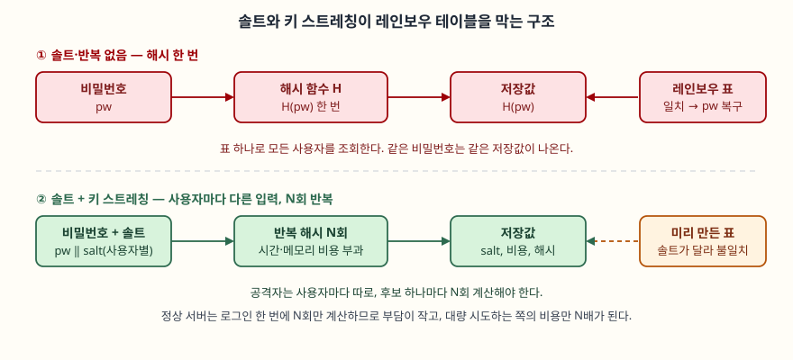

문항은 단방향 해시 함수를 네 갈래로 묻는다. (가) 단방향 해시 함수의 문제점, (나) 레인보우
테이블, (다) 해시 솔트와 키 스트레칭, (라) 해시 함수의 활용이다. "가·나·다·라"로 나눠
물었으므로 순서를 바꾸지 않고 그대로 대항목으로 쓴다. 답안의 축은 **해시 함수가 "되돌릴 수
없다"는 성질이 곧 "추측해서 맞출 수 있다"는 약점으로 이어진다**는 점이다. 입력이 짧고
예측 가능하면 되돌릴 필요가 없다. 후보를 하나씩 해시해서 비교하면 된다.

> 실행 검증 없음. 표준 문서(FIPS 180-4, FIPS 202, RFC 9106, RFC 2104)와 원 논문을
> 근거로 정리했다. 해시 속도나 표의 크기 같은 측정값은 싣지 않았다.

---

## Ⅰ. 개요

**단방향 해시 함수(One-way Hash Function)** 는 임의 길이의 입력을 고정 길이의 출력(해시값,
다이제스트)으로 바꾸되, 출력에서 입력을 거꾸로 구하기 어렵게 만든 함수다. 같은 입력은
언제나 같은 출력을 내므로 입력의 "지문"으로 쓰인다. 대표 표준은 SHA-2 계열(FIPS 180-4)과
SHA-3(FIPS 202)이다.

보안 함수로서 해시가 갖춰야 할 성질은 **3가지**다.

| 성질 | 뜻 |
|---|---|
| ① 역상 저항성(Preimage resistance) | 출력 h가 주어질 때 H(x)=h인 x를 찾기 어렵다 |
| ② 제2 역상 저항성(Second preimage resistance) | 입력 x가 주어질 때 H(x′)=H(x)인 다른 x′를 찾기 어렵다 |
| ③ 충돌 저항성(Collision resistance) | H(x)=H(y)인 서로 다른 (x, y) 쌍을 찾기 어렵다 |

문제는 이 3가지가 **"입력이 충분히 무작위일 때"** 라는 전제 위에서만 성립한다는 점이다.
(가)~(다)는 그 전제가 깨지는 곳과 이를 보완하는 방법을 순서대로 묻는다.

---

## Ⅱ. 단방향 해시 함수의 문제점 (가)

단방향이라는 성질만으로는 안전하지 않은 이유를 **5가지**로 정리한다.

| 번호 | 문제점 | 원인 | 결과 |
|---|---|---|---|
| ① | 입력 공간이 작으면 역산된다 | 비밀번호처럼 사람이 고른 입력은 후보가 한정되어 있다 | 후보를 해시해 비교하는 사전·무차별 대입으로 원문을 찾는다 |
| ② | 같은 입력은 같은 출력이다 (결정성) | 해시에는 무작위 요소가 없다 | 저장값이 같은 사용자는 비밀번호가 같다는 사실이 드러나고, 미리 계산한 표를 모든 사용자에게 쓸 수 있다 |
| ③ | 빠를수록 공격에 유리하다 | 범용 해시는 대량 데이터를 빠르게 처리하도록 설계됐다 | 공격자가 초당 시도할 수 있는 횟수가 늘어난다 |
| ④ | 충돌은 존재하며 약한 알고리즘은 실제로 찾아진다 | 출력 길이가 고정이라 입력 수가 출력 수보다 많다(비둘기집 원리). 생일 공격은 n비트 출력에서 약 2^(n/2)번의 계산이면 충돌을 찾는다 | MD5, SHA-1은 충돌 쌍이 공개되어 서명·무결성 용도로 쓸 수 없다 |
| ⑤ | 인증 기능이 없다 | 해시는 키가 없어 누구나 같은 값을 다시 계산한다 | 해시를 함께 보내면 공격자가 데이터를 바꾸고 해시도 새로 계산해 붙인다. 또 Merkle–Damgård 구조의 SHA-2는 H(m)과 m의 길이를 알면 H(m‖추가 데이터)를 계산하는 길이 확장 공격이 가능하다 |

①~③이 비밀번호 저장에서 문제가 되는 것이고, ④는 서명·무결성, ⑤는 메시지 인증에서
문제가 되는 것이다. 즉 해시를 어디에 쓰느냐에 따라 앞에 서는 문제가 다르다.
⑤의 해결책은 키를 섞는 **HMAC(RFC 2104)** 이고, 길이 확장 공격은 SHA-3의 스펀지 구조에는
해당하지 않는다. 비밀번호 저장에서의 해법은 (나)·(다)에서 다룬다.

---

## Ⅲ. 레인보우 테이블 (나)

### 가. 정의

**레인보우 테이블(Rainbow Table)** 은 해시값에서 원문을 찾기 위해 **"시간–메모리 절충(time–memory
trade-off)"** 을 적용해 미리 만들어 둔 조회표다. 모든 (원문, 해시) 쌍을 저장하면 표가 너무
커서 쓸 수 없고, 저장하지 않고 매번 계산하면 시간이 너무 든다. 그 중간을 택한 것이다.
Hellman이 1980년에 제안한 절충 방식을 Oechslin이 2003년에 개선한 것이 레인보우 테이블이다.

### 나. 구성 원리 — 체인과 축소 함수

해시는 출력에서 입력으로 되돌릴 수 없으므로, **축소 함수(Reduction function, R)** 를 써서
해시값을 다시 "그럴듯한 원문 후보"로 바꾼다. 원문과 해시를 번갈아 거치는 **체인(chain)** 을
만든다.

```text
p0 --H--> h0 --R1--> p1 --H--> h1 --R2--> p2 --H--> ... --Rk--> pk
```

표에는 체인의 **시작점(p0)과 끝점(pk)만** 저장하고 중간은 버린다. 이 때문에 표의 크기가
줄어든다. Hellman 방식은 모든 단계에서 같은 축소 함수를 쓰는데, 이러면 서로 다른 체인이
중간에 같은 값을 만나는 순간 이후가 전부 같아져(체인 병합) 저장 공간만 낭비한다.
**레인보우 테이블은 단계마다 다른 축소 함수(R1, R2, …, Rk)를 써서** 다른 위치에서 만난
체인이 병합되지 않게 한다. 이름의 "무지개"는 단계마다 함수가 달라지는 것을 가리킨다.

### 다. 조회 절차 — 4단계

주어진 해시값 h에서 원문을 찾는 절차다.

① h에 마지막 축소 함수 Rk를 적용해 후보를 만들고, 그 값이 표의 끝점에 있는지 본다.
② 없으면 위치를 한 칸씩 앞으로 옮겨 (R(k−1)→H→Rk), (R(k−2)→H→R(k−1)→H→Rk) … 순으로
같은 방식으로 끝점을 계산해 대조한다.
③ 끝점이 일치하면 그 체인의 시작점 p0에서 다시 체인을 따라가 h를 만드는 원문을 찾는다.
④ 찾은 원문의 해시가 h와 같은지 확인한다. 다른 값이 나오면 **거짓 경보**이므로 다음
위치로 넘어간다.



> **출처**: [Oechslin, Making a Faster Cryptanalytic Time-Memory Trade-Off, CRYPTO 2003](https://lasec.epfl.ch/pub/lasec/doc/Oech03.pdf), [RFC 9106 §3.1](https://www.rfc-editor.org/rfc/rfc9106.html#section-3.1)

### 라. 특징과 한계

| 항목 | 내용 |
|---|---|
| 장점(공격자 측) | 표를 한 번 만들면 같은 알고리즘을 쓰는 모든 대상에 재사용한다. 조회 시간이 전수 대입보다 짧다 |
| 한계 ① | **특정 해시 알고리즘과 문자 집합·길이**에 맞춘 표다. 알고리즘이 바뀌거나 비밀번호가 길고 복잡하면 표가 커진다 |
| 한계 ② | **솔트가 있으면 쓸 수 없다.** 솔트마다 다른 표가 필요하다 |
| 한계 ③ | 거짓 경보와 체인 병합 때문에 표가 보장하는 성공 확률이 100%가 아니다 |

---

## Ⅳ. 해시 솔트와 키 스트레칭 (다)

### 가. 해시 솔트(Hash Salt)

**솔트(Salt)** 는 해시하기 전에 비밀번호에 덧붙이는 **사용자마다 다른 무작위 값**이다.
H(비밀번호 ‖ 솔트)를 저장하고 솔트는 해시와 함께 저장한다. 솔트는 비밀이 아니다. 공격자가
솔트를 알아도 되도록 설계한다.

| 효과 | 설명 |
|---|---|
| ① 같은 비밀번호도 다른 저장값 | 결정성(문제점 ②)이 사라져 저장값만으로 비밀번호가 같은 사용자를 알 수 없다 |
| ② 레인보우 테이블 무력화 | 표는 솔트가 정해져야 만들 수 있으므로, 솔트가 사용자마다 다르면 사용자마다 표를 따로 만들어야 하고 표의 재사용 이점이 없어진다 |
| ③ 대량 공격 비용 증가 | 후보 하나를 해시해도 한 사용자에게만 비교할 수 있다 |

솔트의 요건은 **고유성과 길이**다. RFC 9106(§3.1)은 비밀번호 해시용 솔트로 16바이트를
권장하고 사용자마다 고유해야 한다고 적는다. 솔트는 암호학적 난수 생성기로 만든다.
솔트만으로는 **한 사용자의 비밀번호를 후보 하나씩 맞춰 보는 공격**을 막지 못한다는 점이
다음 항목으로 이어진다.

### 나. 키 스트레칭(Key Stretching)

**키 스트레칭(Key Stretching)** 은 해시를 **의도적으로 느리고 비싸게** 만들어, 후보 하나를
시험하는 비용을 높이는 기법이다. 문제점 ③(빠를수록 공격에 유리하다)에 대한 대응이다.
방법은 **2가지**다.

| 방식 | 원리 | 예 |
|---|---|---|
| ① 반복 횟수 증가 | 해시를 N번 되풀이한다. 정상 로그인은 1회당 N번만 계산하지만 공격자는 후보마다 N번 계산한다 | PBKDF2, bcrypt |
| ② 메모리 요구 | 계산 중 큰 메모리를 쓰게 해서, 병렬 장치(GPU·ASIC)로 값싸게 대량 시도하는 이점을 줄인다 | scrypt, Argon2 |

반복 횟수만 늘리는 방식은 병렬 장치로 대응하기 쉽고, 메모리 요구 방식은 시간뿐 아니라
**메모리라는 자원**까지 소비하게 만든다. RFC 9106(§4)은 모르면 Argon2id를 고르라고 권고하고,
기본값으로 반복 1회·병렬 4·메모리 2GiB(첫 번째 권장)와, 메모리가 부족할 때 반복 3회·병렬 4·
메모리 64MiB(두 번째 권장)를 든다. 비용 설정값은 **저장값 안에 함께 기록**해 두면, 나중에
비용을 올려도 기존 사용자를 로그인 시점에 점진적으로 새 비용으로 바꿀 수 있다.

### 다. 솔트와 키 스트레칭 비교

| 구분 | 솔트 | 키 스트레칭 |
|---|---|---|
| 막는 공격 | 사전 계산(레인보우 테이블), 동일 비밀번호 식별 | 후보를 하나씩 맞춰 보는 대량 시도 |
| 비용을 높이는 대상 | 공격자의 **준비 단계** | 공격자의 **시도 1회당** 비용 |
| 비밀 여부 | 비밀이 아님 | 설정값(비용)도 비밀이 아님 |
| 단독 사용 | 느린 해시를 못 느리게 한다 | 사용자 간 동일 입력 문제가 남는다 |

**둘은 서로 보완한다.** 솔트는 표 재사용을 막고, 스트레칭은 후보 하나의 비용을 올린다. 하나만
쓰면 나머지 공격이 남는다. 그래서 비밀번호 저장에는 둘을 함께 구현한 알고리즘(bcrypt, scrypt,
Argon2id, PBKDF2)을 쓰고, SHA-256 같은 범용 해시를 한 번 적용해 저장하지 않는다.

---

## Ⅴ. 해시 함수의 활용 (라)

해시 함수의 활용을 **6가지**로 정리한다. 각각 위 3가지 성질 중 무엇에 기대는지가 함께 적혀야
한다.

| 번호 | 활용 | 방식 | 기대는 성질 |
|---|---|---|---|
| ① | 무결성 검증 | 파일·메시지의 해시를 별도 경로로 받아 다시 계산해 비교한다 | 제2 역상·충돌 저항성 |
| ② | 전자서명 | 긴 문서를 해시한 뒤 그 해시에 서명한다. 서명 비용이 줄고 문서 변경이 서명 검증 실패로 드러난다 | 충돌 저항성 |
| ③ | 메시지 인증(HMAC) | 비밀 키와 메시지를 함께 해시해 변조와 출처를 확인한다(RFC 2104) | 해시 + 비밀 키 |
| ④ | 비밀번호 저장 | 솔트와 키 스트레칭을 적용한 해시만 저장한다(Ⅳ) | 역상 저항성 + 비용 |
| ⑤ | 머클 트리·블록체인 | 해시를 트리·연결 구조로 묶어 일부만 바뀌어도 루트 해시가 달라지게 한다 | 충돌 저항성 |
| ⑥ | 식별·중복 제거 | 내용의 해시를 이름으로 삼아 같은 내용인지 비교한다(버전 관리 도구, 중복 제거 저장소) | 충돌 저항성 |

①·②·⑤·⑥은 **충돌 저항성**이 깨지면 같이 무너진다. 그래서 SHA-1 같은 알고리즘이 약해지면
인증서·서명 용도에서 먼저 퇴출된다. ④는 충돌이 아니라 **역상과 속도**의 문제라서, 같은
SHA-256이라도 ①에는 맞고 ④에는 맞지 않는다.

---

## Ⅵ. 결론

단방향 해시 함수는 되돌리기 어렵다는 성질로 무결성·서명·인증의 토대가 되지만, 입력이 예측
가능하면 **역산이 아니라 추측**으로 뚫린다. 레인보우 테이블은 이 추측을 시간–메모리 절충으로
미리 계산해 둔 것이고, 솔트는 그 사전 계산을 무력화하며, 키 스트레칭은 후보 하나의 시험
비용을 높인다. 정리하면 **용도에 맞는 해시를 고르는 것**이 핵심이다. 무결성에는 충돌 저항성이
강한 SHA-2·SHA-3를, 메시지 인증에는 HMAC을, 비밀번호에는 솔트·스트레칭이 내장된 Argon2id 등을
쓴다. 알고리즘은 약해지므로 **저장값에 알고리즘과 비용을 함께 기록해 교체 경로**를 열어 둔다.

> 개념 정리: [HMAC과 해시 길이 확장 공격](../../security/2026-11-06-hmac-length-extension-attack/index.md)
> 개념 정리: [머클 트리와 포함 증명](../../security/2026-11-06-merkle-tree-inclusion-proof/index.md)

끝

---

## 답안 작성 메모

- **시간 배분.** (가) 5개 문제점 표에 5분, (나) 레인보우 테이블 체인 그림에 8분, (다) 솔트·
  스트레칭 비교에 8분, (라) 6가지 활용에 5분, 개요·결론에 4분 정도를 잡는다.
- **점수가 갈리는 지점.** (나)는 "미리 계산한 표"라고만 쓰면 감점이다. **체인과 축소 함수,
  시작점·끝점만 저장하는 시간–메모리 절충**을 써야 레인보우 테이블을 안다는 것이 보인다.
  (다)는 솔트와 스트레칭이 **각각 무엇을 막는지** 구분해야 한다. 솔트는 사전 계산을, 스트레칭은
  시도 비용을 막는다.
- **시간이 모자라면.** (가)의 ④·⑤(충돌, 인증)와 (라)의 ⑤·⑥을 줄이고, (나)의 체인 그림과
  (다)의 비교표는 남긴다. 문항이 비밀번호 저장 맥락(나·다)에 무게를 둔다.
- **도식 옮겨 그리기.** 위 도식은 박스 8개다. 답안지에는 윗줄 "비밀번호→H→저장값←레인보우 표"와
  아랫줄 "비밀번호+솔트→반복 H→저장값(솔트 포함)"만 가로 두 줄로 그리고, 아랫줄 오른쪽에
  "표 불일치"를 적으면 된다.
- **개념 정리.** 이 답안에 나온 HMAC과 머클 트리는 별도 개념 글로 정리한다.

---

## 참고 자료

- [FIPS 180-4 Secure Hash Standard (SHS)](https://csrc.nist.gov/pubs/fips/180-4/upd1/final) — NIST, 2015
- [FIPS 202 SHA-3 Standard](https://csrc.nist.gov/pubs/fips/202/final) — NIST, 2015
- [RFC 9106 Argon2 Memory-Hard Function for Password Hashing and Proof-of-Work Applications](https://www.rfc-editor.org/rfc/rfc9106.html) — IETF, 2021
- [RFC 2104 HMAC: Keyed-Hashing for Message Authentication](https://www.rfc-editor.org/rfc/rfc2104) — IETF, 1997
- [Oechslin, Making a Faster Cryptanalytic Time-Memory Trade-Off](https://lasec.epfl.ch/pub/lasec/doc/Oech03.pdf) — CRYPTO 2003
- [Hellman, A Cryptanalytic Time–Memory Trade-Off](https://doi.org/10.1109/TIT.1980.1056220) — IEEE Transactions on Information Theory, 1980
