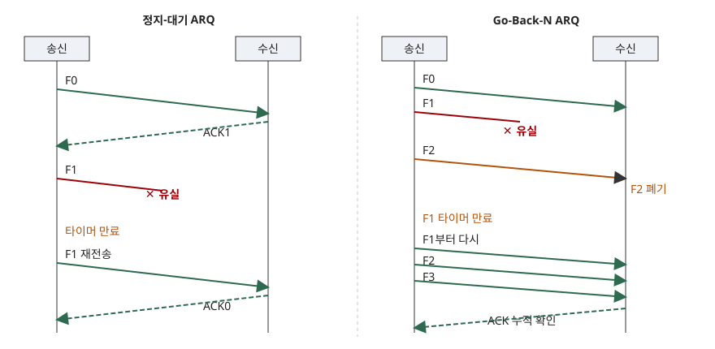

> 실행 검증 없음. 문장의 근거는 RFC 3366과 RFC 9293의 본문이며, 효율 식은 시간 관계에서 직접 유도했다.
> 문항은 신뢰성 있는 전송을 위한 오류 제어를 (가) 검출과 정정의 개념, (나) 정지-대기 ARQ와 Go-Back-N ARQ의 개념과 수행절차, (다) 두 ARQ의 비교로 나누어 묻는다.

## 답안

### Ⅰ. 개요

데이터 통신에서 오류 제어란 전송 중 비트가 바뀌거나 프레임이 사라지는 것을 **알아내고 바로잡아** 상위 계층에 오류 없는 데이터를 올려 보내는 기능이다. 잡음·감쇠·혼잡으로 손실은 피할 수 없으므로(RFC 3366 §1.2 링크의 패킷 손실 원인), 수신 측이 오류를 알아내는 수단과 그 뒤에 복구하는 수단이 한 쌍으로 필요하다.

### Ⅱ. 오류 검출과 오류 정정의 개념 (가)

**1. 개념 비교**

| 구분 | 오류 검출(Error Detection) | 오류 정정(Error Correction) |
|---|---|---|
| 정의 | 수신 데이터에 오류가 있는지만 판별 | 오류 위치까지 찾아 수신 측이 직접 복원 |
| 부가 정보 | 적다(검사 비트 몇 개) | 많다(오류 위치를 가리킬 만큼의 중복) |
| 복구 방법 | 재전송을 요구(ARQ) | 수신 측 복호(FEC) |
| 대표 기법 | 패리티, 체크섬, CRC | 해밍 코드, 컨볼루션 코드 |
| 적합한 곳 | 지연이 짧고 재전송이 싼 유선 | 재전송이 비싼 위성·무선, 단방향 방송 |

**2. 오류 검출 기법 3가지**

① **패리티 검사** — 1의 개수를 짝수(또는 홀수)로 맞추는 비트 1개를 붙인다. 홀수 개 비트 오류만 잡는다.
② **체크섬** — 데이터를 일정 단위로 더한 값을 붙인다. TCP는 세그먼트마다 체크섬으로 오류를 검출하고, 순서번호로 손실을 검출한다(RFC 9293 §2.2 핵심 개념).
③ **CRC** — 데이터를 다항식으로 보고 약속된 생성 다항식으로 나눈 나머지를 붙인다. 링크 계층의 무결성 검사는 보통 CRC다(RFC 3366 §1.1).

**3. 오류 정정 방식 2가지**

① **FEC(Forward Error Correction)** — 중복 비트를 미리 넣어 수신 측이 복원한다. 재전송이 없어 지연이 일정하지만 오류가 없을 때도 중복 비용을 낸다. RFC 3366은 FEC가 무선 링크의 물리 계층 설계에 흔하고 ARQ와 함께 쓸 수 있다고 밝힌다(§1.1).
② **ARQ(Automatic Repeat reQuest)** — 검출 부호로 오류를 알아내고 송신 측이 재전송한다. 오류가 있을 때만 비용이 든다. 두 방식의 장점을 섞어 FEC로 줄인 뒤 남은 오류를 ARQ로 거르는 **Hybrid ARQ**도 있다.

**4. 정정 능력의 기준** — 부호 간 최소 해밍 거리가 d이면 d−1개 오류까지 검출하고 ⌊(d−1)/2⌋개 오류까지 정정한다. 정정이 검출보다 훨씬 많은 중복을 요구하는 이유다.

### Ⅲ. 정지-대기 ARQ와 Go-Back-N ARQ (나)

ARQ는 프레임마다 무결성 검사를 하고 사라지거나 깨진 프레임을 재전송한다(RFC 3366 §1.1). 방식은 **정지-대기**와 **슬라이딩 윈도우** 두 계열로 나뉘고, Go-Back-N과 Selective Repeat가 후자에 속한다(§1.4).

> **출처**: [RFC 3366 §1.4 Commonly-used ARQ Techniques](https://www.rfc-editor.org/rfc/rfc3366#section-1.4), [RFC 9293 §3.4 Sequence Numbers](https://www.rfc-editor.org/rfc/rfc9293#section-3.4)

**1. 정지-대기(Stop-and-Wait) ARQ**

- 개념: 프레임 1개를 보내고 그 확인 응답(ACK)이 올 때까지 다음 프레임을 보내지 않는 방식이다. RFC 3366은 단순하지만 비효율적이며 대역폭-지연 곱이 작은 링크에만 맞다고 평가한다(§1.4.1).
- 수행절차 (4단계)
  ① 송신 측이 프레임을 보내고 사본을 보관하며 타이머를 시작한다
  ② 수신 측이 검사에 통과하면 ACK를 돌려보내고, 실패하면 폐기한다
  ③ ACK가 오면 타이머를 끄고 사본을 지운 뒤 다음 프레임을 보낸다
  ④ 타이머가 먼저 만료되면 같은 프레임을 재전송한다
- 순서번호는 0과 1, 1비트면 된다. 같은 번호가 연속으로 오면 ACK가 유실돼 재전송된 중복임을 알 수 있다.

**2. Go-Back-N ARQ**

- 개념: 송신 측이 윈도우 크기 N만큼의 프레임을 ACK 없이 연속 전송하고, 오류가 난 프레임부터 그 뒤를 모두 재전송하는 슬라이딩 윈도우 방식이다. 수신 윈도우는 1이라 **순서가 맞는 프레임만 받는다.**
- 수행절차 (5단계)
  ① 송신 측이 윈도우 안에서 순서번호를 붙여 연속 전송하고 가장 오래된 미확인 프레임에 타이머를 건다
  ② 수신 측은 기대한 번호의 프레임이면 받고 ACK를 보낸다
  ③ 다른 번호의 프레임은 폐기하고 마지막 정상 프레임까지의 ACK를 되풀이한다
  ④ ACK가 오면 윈도우를 앞으로 민다. ACK는 그 번호 이전을 모두 확인하는 누적 확인이다(TCP의 ACK 의미와 같다, RFC 9293 §3.4)
  ⑤ 타이머가 만료되면 가장 오래된 미확인 프레임부터 윈도우 안의 프레임을 모두 재전송한다
- k비트 순서번호에서 송신 윈도우는 2^k − 1 이하로 제한한다. 윈도우가 2^k이면 ACK가 전부 유실됐을 때 새 프레임과 재전송 프레임의 번호가 같아져 구분할 수 없다.

### Ⅳ. 두 ARQ의 비교 (다)

한 프레임의 전송 시간을 t_f, 편도 전파 지연을 t_p라 하고 a = t_p / t_f로 둔다. 오류가 없을 때 정지-대기는 t_f 동안 보내고 2t_p를 쉬므로 이용률이 1/(1+2a)이다. Go-Back-N은 같은 주기(t_f + 2t_p)에 N개를 보내므로 min(1, N/(1+2a))이다.

| 구분 | 정지-대기 ARQ | Go-Back-N ARQ |
|---|---|---|
| 송신 윈도우 | 1 | N (최대 2^k − 1) |
| 수신 윈도우 | 1 | 1 |
| 순서번호 | 1비트 | k비트 |
| ACK 방식 | 프레임마다 개별 ACK | 누적 ACK |
| 오류 시 재전송 | 해당 프레임 1개 | 해당 프레임과 이후 전부 |
| 오류 없을 때 이용률 | 1/(1+2a) | min(1, N/(1+2a)) |
| 수신 버퍼 | 필요 없음 | 필요 없음(폐기) |
| 구현 | 가장 단순 | 타이머·재전송 큐 필요 |
| 적합한 링크 | 지연이 짧은 저속 링크 | 지연이 큰 고속 링크, 오류율이 낮을 때 |

고려사항은 세 가지다. ① 지연×대역폭이 크면 정지-대기는 대부분의 시간을 기다린다. ② 오류율이 높으면 Go-Back-N은 멀쩡히 도착한 프레임까지 다시 보내 낭비가 커지고, 이때는 오류 프레임만 다시 보내는 Selective Repeat와 TCP의 선택적 확인(SACK)이 낫다(RFC 9293은 SACK를 고성능에 권장되는 옵션으로 둔다). ③ 재전송 횟수 상한(지속성)을 두지 않으면 링크 재전송이 상위 TCP의 재전송 타이머와 겹친다. RFC 3366은 낮은 지속성 링크에서 시도를 2~5회 정도로 제한하는 예를 든다(§2.4).

### Ⅴ. 결론

오류 제어는 **검출 부호로 알아내고, FEC나 ARQ로 복구한다**는 두 단계다. 정지-대기는 단순하지만 지연이 큰 링크에서 이용률이 낮고, Go-Back-N은 윈도우로 이용률을 끌어올리되 오류 한 번에 윈도우 전체를 다시 보낸다. 링크의 지연·오류율·구현 비용을 보고 방식을 고른다.

> 개념 정리: [CRC와 해밍 코드 — 오류 검출·정정 부호의 원리](../../network/2026-11-06-crc-hamming-code-error-detection-correction/index.md)
> 개념 정리: [Selective Repeat ARQ와 TCP SACK — 선택적 재전송과 윈도우 크기 제약](../../network/2026-11-06-selective-repeat-arq-tcp-sack/index.md)

끝

## 답안 작성 메모

- **먼저 쓸 것**: (나)의 절차 번호와 그림. 채점자는 "정지-대기 4단계, Go-Back-N 5단계"처럼 개수와 순서를 센다. 타임라인은 왼쪽 오른쪽 두 칸으로 5분 안에 그릴 수 있다.
- **점수가 갈리는 곳**: Go-Back-N의 **수신 윈도우 1과 폐기**, **누적 ACK**, **윈도우 ≤ 2^k − 1**. 이 세 가지가 없으면 정지-대기를 길게 늘인 답안이 된다.
- **시간이 모자라면 버릴 것**: 해밍 거리 문장과 Hybrid ARQ. (가)는 표 하나와 검출 기법 3가지, 정정 방식 2가지만 남긴다.
- **더하면 좋은 것**: (다)에 이용률 식 한 줄. 지연이 클수록 두 방식의 차이가 커지는 이유를 숫자로 보여 준다.

## 참고 자료

- [RFC 3366 Advice to Link Designers on Link ARQ](https://www.rfc-editor.org/rfc/rfc3366) (BCP 62, 2002-08)
- [RFC 9293 Transmission Control Protocol (TCP)](https://www.rfc-editor.org/rfc/rfc9293) (2022-08)
