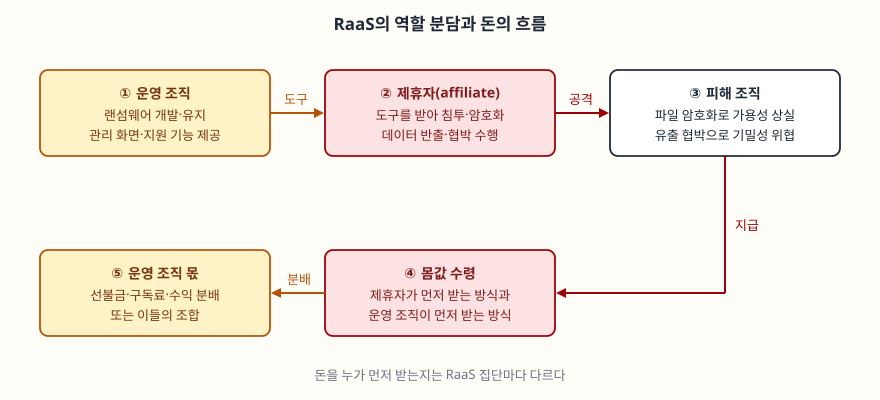

문항은 랜섬웨어를 세 갈래로 묻는다. (가) 랜섬웨어와 RaaS의 개념과 비교, (나) 주요 감염 경로와
암호화 동작 원리, (다) 피해 예방과 침해사고 발생 시 대응 절차다. "가·나·다"로 나눠 물었으므로
순서를 바꾸지 않고 그대로 대항목으로 쓴다. 답안의 축은 **랜섬웨어가 이제 한 사람의 악성코드가
아니라 역할이 나뉜 분업 구조의 결과물**이라는 점이다. 이 구조가 진입 장벽을 낮추므로 방어도
특정 변종이 아니라 침투 경로와 복구 체계 전체를 기준으로 짠다.

> 실행 검증 없음. CISA·NIST 발간 문서를 근거로 정리했다. 피해 규모나 점유율 같은 통계는
> 원 출처를 확인하지 못해 싣지 않았다. 암호 알고리즘의 구체적 이름은 CISA 문서에 적혀 있지
> 않으므로 일반적인 암호 설계 원리(NIST SP 800-57)로만 설명한다.

---

## Ⅰ. 개요

**랜섬웨어(Ransomware)** 는 기기의 파일을 암호화해 그 파일과 이에 의존하는 시스템을 쓸 수 없게 만들고,
복구의 대가로 금전을 요구하는 악성코드다(CISA #StopRansomware Guide의 정의). NIST IR 8374r1은
여기에 공격자가 정보를 **먼저 훔쳐** 공개하지 않는 조건으로 추가 금전을 요구하는 경우까지 포함한다.
피해가 **가용성(암호화)** 과 **기밀성(유출)** 두 축으로 나뉘는 이유다.

과거에는 공격자가 악성코드를 만들고 직접 뿌렸다. 지금은 만드는 쪽과 뿌리는 쪽이 갈렸다.
(가)는 그 구조를, (나)는 기술적 동작을, (다)는 방어를 묻는다.

---

## Ⅱ. 랜섬웨어와 RaaS의 개념 및 비교 (가)

### 1. 개념

| 구분 | 정의 |
|---|---|
| 랜섬웨어 | 파일을 암호화해 사용 불능으로 만들고 복구 대가를 요구하는 악성코드. 데이터 탈취 후 공개 협박(이중 갈취)을 겸하기도 한다 |
| RaaS (Ransomware as a Service) | 랜섬웨어의 기능을 유지·관리하는 집단이 그 변종을 제휴자(affiliate)에게 제공하고 공격 수행을 지원하며, 선불금·구독료·수익 분배 또는 이들의 조합을 받는 모델 |

RaaS의 정의는 CISA·FBI·MS-ISAC 공동 권고(AA23-165A, 2023-06-14)의 서문을 따랐다.

> **출처**: [CISA AA23-165A Understanding Ransomware Threat Actors: LockBit](https://www.cisa.gov/news-events/cybersecurity-advisories/aa23-165a) — 서문의 RaaS 정의, 대가를 받는 순서가 집단마다 다르다는 설명

### 2. 비교

| 비교 항목 | 전통적 랜섬웨어 | RaaS |
|---|---|---|
| 공격 주체 | 제작자가 직접 공격 | 운영 조직과 제휴자로 **분업** |
| 필요한 능력 | 개발과 침투 모두 | 제휴자는 제공받은 도구와 기반 시설을 사용 |
| 수익 구조 | 공격자 단독 | 선불금·구독료·수익 분배 등으로 나눔 |
| 피해 규모 | 제작자 역량에 한정 | 제휴자 수에 비례해 늘어남 |
| 방어 관점 | 특정 코드의 탐지 | 같은 도구를 쓰는 **서로 다른 침투 방식**을 모두 막아야 함 |

RaaS에서는 암호화 도구가 같아도 침투를 맡은 제휴자가 달라 경로가 제각각이다. 그래서 변종의
서명(signature)만으로는 막을 수 없고, (다)에서 침투 경로별 통제를 따로 세워야 한다.

---

## Ⅲ. 랜섬웨어의 주요 감염 경로와 암호화 동작 원리 (나)

### 1. 주요 감염 경로 6가지

CISA #StopRansomware Guide는 예방을 최초 침투 경로 **6가지**로 나눈다.

| 번호 | 경로 | 내용 |
|---|---|---|
| ① | 인터넷에 노출된 취약점·설정 오류 | 공개 서비스의 취약점, 보안이 약한 원격 접속 서비스(RDP, VPN) |
| ② | 탈취된 자격증명 | 유출·재사용된 계정으로 정상 로그인 |
| ③ | 피싱 | 악성 첨부·링크가 담긴 메일 |
| ④ | 선행 악성코드 | 이미 감염된 시스템이 랜섬웨어 배포의 발판이 됨 |
| ⑤ | 고급 사회공학 | 사람을 속여 접근 권한을 얻는 정교한 수법 |
| ⑥ | 제3자·MSP | 위탁업체나 관리 서비스 제공자의 접근 경로를 통한 침투 |

AA23-165A도 같은 갈래를 보인다. 공개 응용 프로그램의 취약점 악용, 외부 원격 서비스(RDP) 악용,
피싱, 유효 계정 도용, VPN·RDP 무차별 대입이 최초 접근 수단으로 적혀 있다. **한 가지 통제로 덮이지
않는다**는 점이 이 표의 요점이다.

### 2. 암호화 동작 원리 — 4단계

변종마다 세부는 다르지만, 방어 설계에 필요한 일반적 흐름은 아래 **4단계**로 정리된다.
(알고리즘 이름과 키 처리 방식은 CISA 문서에 적혀 있지 않다. 아래는 일반 암호 설계 원리에
근거한 정리다.)

| 단계 | 동작 | 방어에 주는 뜻 |
|---|---|---|
| ① 침투·권한 확대 | 최초 접근 뒤 관리자 권한과 내부 확산 경로를 확보 | 암호화 전에 탐지·차단할 시간이 있다 |
| ② 복구 수단 훼손 | 접근 가능한 백업을 찾아 삭제하거나 암호화하려 시도(CISA 가이드) | 네트워크에 붙은 백업은 같이 사라진다 |
| ③ 파일 암호화 | 대량 파일에는 빠른 **대칭키**를 쓰고, 그 대칭키는 **공개키**로 보호한다 | 키가 피해 시스템에 평문으로 남지 않아 복호화가 어렵다 |
| ④ 협박 | 복호화 키를 대가로 요구. 이중 갈취는 반출한 데이터의 공개를 함께 협박 | 복구해도 기밀성 피해가 남는다 |

③이 핵심이다. 대칭 암호는 빠르지만 같은 키로 풀리고, 공개키 암호는 느린 대신 암호화 키(공개키)와
복호화 키(개인키)가 분리된다. NIST SP 800-57은 대량 데이터 보호에 대칭키를, 그 키를 안전하게
전달하는 데 공개키 방식을 쓰는 구분을 설명한다. 이 둘을 섞은 하이브리드 구조에서는
**개인키를 공격자만 쥐므로 피해자가 파일 암호화 키를 알아낼 수 없다.**
이 때문에 "암호 알고리즘의 약점을 찾아 풀겠다"는 접근은 대부분 가능하지 않고, 대응의 무게가
암호화 전 차단과 복구 체계로 간다.

> 개념 정리: [대칭키와 공개키 — 쓰임이 갈리는 지점](../../security/2026-09-29-symmetric-vs-public-key-hybrid/index.md)

---

## Ⅳ. 랜섬웨어 피해 예방 및 침해사고 대응 절차 (다)

### 1. 피해 예방 — 경로별 통제 6가지

| 침투 경로 | 예방 통제 |
|---|---|
| 노출된 취약점·설정 | 패치 관리, 외부 노출 자산 점검, 원격 접속 서비스 최소화와 다중 인증(MFA) |
| 탈취 자격증명 | MFA, 최소 권한, 계정 사용 모니터링 |
| 피싱·사회공학 | 메일 필터링, 첨부 실행 제한, 사용자 교육 |
| 선행 악성코드 | 엔드포인트 탐지·대응(EDR), 허용 목록 기반 실행 |
| 제3자·MSP | 위탁업체 접근 통제와 계약상 보안 요구 |
| (공통) 피해 확산 | 네트워크 분할, 제로 트러스트 원칙 |

NIST IR 8374r1도 제로 트러스트 원칙과 내부망 분할, 인가된 앱만 실행하는 설정, 엔드포인트 보안
솔루션의 상시 운영을 같은 맥락에서 든다. 예방이 뚫릴 때를 대비한 **복구 통제**가 따로 필요하다.
CISA 가이드는 **오프라인 상태의 암호화된 백업**을 유지하고 그 가용성과 무결성을 정기적으로
시험하라고 적는다. 백업은 만들어 두는 것보다 **복원해 본 적이 있는지**가 중요하다.

> 개념 정리: [랜섬웨어 대응 체계 — 예방·탐지·복구](../../security/2026-10-13-ransomware-defense-prevention-detection-recovery/index.md),
> [불변 백업과 에어갭](../../security/2026-10-26-immutable-backup-and-air-gap/index.md)

### 2. 침해사고 대응 절차 — 4단계

사고 발생 후 순서는 CISA 대응 체크리스트 **4단계**를 따른다.

| 단계 | 핵심 활동 |
|---|---|
| ① 탐지와 분석 | 영향받은 시스템 식별·격리, 복구 우선순위 분류, 로그 검토와 위협 헌팅 |
| ② 보고와 통지 | 이해관계자 참여, 수사·대응 기관 신고, 유출 통지 의무 이행 |
| ③ 격리와 제거 | 시스템 이미지·메모리 확보, 악성 파일 제거, 최초 침투 지점과 지속성 수단 제거, 계정 재설정 |
| ④ 복구와 사후 활동 | 오프라인·암호화 백업에서 중요 업무 순으로 복원, 교훈 정리, 침해지표(IoC) 공유 |

대응에서 틀리기 쉬운 곳이 **3가지**다.

1. **격리는 전원 차단이 아니라 네트워크 분리다.** 메모리에만 있는 휘발성 증거가 전원과 함께
   사라진다. 전원 차단은 네트워크를 분리할 수 없을 때의 수단이다.
2. **제거보다 증거 확보가 먼저다.** 이미지와 메모리를 먼저 확보해야 무엇이 반출됐는지 확정해
   유출 통지 의무를 이행할 수 있다.
3. **복구해도 사고는 끝나지 않는다.** 이중 갈취에서는 유출 축이 남으므로, 재감염을 막는 침투
   경로 제거와 유출 범위 확정이 복구와 별개로 이어진다.

> 개념 정리: [침해사고 대응 절차 6단계](../../security/2026-09-29-incident-response-six-phases/index.md)

---

## Ⅴ. 결론

랜섬웨어는 **암호화(가용성)와 유출 협박(기밀성)** 을 함께 노리고, RaaS가 이를 분업 구조로 바꿔
진입 장벽을 낮췄다. 같은 도구를 쓰는 제휴자의 침투 경로가 제각각이므로 방어는 **침투 경로 6가지별
예방, 오프라인·암호화 백업과 복원 시험, 대응 4단계** 세 축으로 세운다. 개인키를 공격자만 쥐는
하이브리드 암호화 때문에 사후에 풀어내기는 어렵다. 사고 전에 막고 사고 후에 되돌릴 체계를
미리 만들어 두는 것이 핵심이다.

끝

---

## 답안 작성 메모

- **시간 배분.** (가) 개념·비교표에 7분, (나) 감염 경로 표와 암호화 4단계에 10분, (다) 예방 표와
  대응 4단계에 10분, 개요·결론에 3분 정도를 잡는다.
- **점수가 갈리는 지점.** (나)의 "암호화 동작원리"를 "파일을 암호화한다"로 끝내면 감점이다.
  **대칭키로 파일을 암호화하고 그 키를 공개키로 보호하며, 개인키는 공격자가 쥔다**는 구조를
  써야 왜 사후 복호화가 어려운지 설명된다. (다)는 백업만 쓰지 말고 **경로별 예방과 복구, 이중
  갈취의 유출 축**까지 나눠 쓴다.
- **시간이 모자라면.** (가)의 비교표 항목을 줄이고, (나)의 6가지 경로는 이름만 적고, (다)의 대응
  4단계 표는 남긴다. 숫자(6가지, 4단계, 3가지)가 곧 점수다.
- **도식 옮겨 그리기.** 위 도식은 박스 5개다. 답안지에는 "운영 조직 → 제휴자 → 피해 조직" 한 줄과
  "피해 조직 → 몸값 → 운영 조직 몫" 아랫줄만 그리면 된다.

---

## 참고 자료

- [CISA — #StopRansomware Guide (2023-09)](https://www.cisa.gov/stopransomware/ransomware-guide) — 랜섬웨어 정의, 이중 갈취, 침투 경로 6가지, 오프라인·암호화 백업, 대응 체크리스트 4단계
- [CISA·FBI·MS-ISAC — AA23-165A Understanding Ransomware Threat Actors: LockBit (2023-06-14)](https://www.cisa.gov/news-events/cybersecurity-advisories/aa23-165a) — RaaS 정의, 제휴자 모델, 최초 접근 수단
- [NIST IR 8374r1 — Ransomware Risk Management: A CSF 2.0 Community Profile (2026-06)](https://csrc.nist.gov/pubs/ir/8374/r1/final) — 랜섬웨어 정의, 제로 트러스트·분할·허용 목록 등 통제
- [NIST SP 800-57 Part 1 Rev. 5 — Recommendation for Key Management (2020-05)](https://csrc.nist.gov/pubs/sp/800/57/pt1/r5/final) — 대칭키와 공개키 방식의 용도 구분
