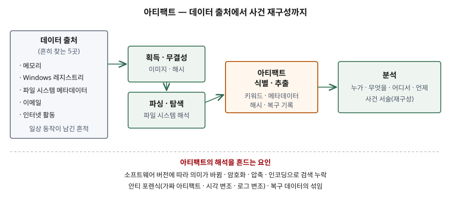

기출문제에서 디지털 포렌식의 아티팩트를 묻는다. "증거가 되는 파일"로 한 줄 쓰고 레지스트리·
프리패치 같은 이름을 나열하기 쉬운 문제다. 점수는 아티팩트가 **누가 일부러 남긴 것이 아니라
시스템이 일상 동작에서 남긴 흔적**이라는 점, 그리고 그 흔적을 **어디서 찾고 어떻게 꺼내며 왜
잘못 읽을 수 있는지**를 표준 문서의 개수로 쓰는 데서 난다.

> 실행 검증 없음. 개념 문제이므로 NIST IR 8354와 Microsoft 공식 문서 근거만으로 정리했다.

---

## Ⅰ. 정의

**아티팩트(Artifact)** 는 NIST IR 8354 용어집이 쓰는 정의로, **주어진 데이터 출처에서 추출할 수
있고 포렌식 조사의 질문에 답하는 데 쓸모 있는, 해석 가능한 데이터의 단일 단위**다.

같은 문서의 요약은 아티팩트를 기기가 **일상 동작 중에 만드는 흔적**으로 설명한다. 사용자가
무엇을 했고, 누구와 했고, 어디에 있었고, 언제 일어났는지가 이 흔적에 남는다. 컴퓨터는 사용자에게
보여 주는 것보다 훨씬 많은 데이터를 저장하고(사진의 시각·위치 정보, 데이터의 추가 사본, 시스템
활동 기록), 포렌식은 이것을 드러내 사건을 재구성한다.

NIST CSRC 용어집은 같은 낱말을 "증거 한 조각"으로 짧게 정의한다(NISTIR 7692 인용). 포렌식에
맞춰 범위와 쓸모까지 적은 것은 NIST IR 8354 쪽이므로 답안에는 이것을 쓴다.

## Ⅱ. 구성요소

> **출처**: [NIST IR 8354 §4.6 Identification and Extraction of Artifacts, Appendix A Glossary](https://nvlpubs.nist.gov/nistpubs/ir/2022/NIST.IR.8354.pdf) — 획득·파싱·식별·분석의 순서는 같은 문서 요약의 7가지 작업 분류를 줄여 그린 것

### 가. 포렌식 작업 7가지 속 아티팩트의 자리 — NIST IR 8354

| 순서 | 작업 | 아티팩트와의 관계 |
|---|---|---|
| ① | 원본 보호 | 쓰기 방지로 아티팩트가 바뀌지 않게 한다 |
| ② | 데이터 획득 | 이미지 파일로 복사한다 |
| ③ | 무결성 확인 | 암호 해시로 변경을 검출한다 |
| ④ | 삭제 데이터 복구 | 지워진 파일·내부 기록을 되살린다 |
| ⑤ | 파싱·탐색 | 파일 시스템 구조를 해석한다 |
| ⑥ | **아티팩트 식별·추출** | 관심 항목을 찾아 꺼낸다 |
| ⑦ | **아티팩트 분석** | 추출한 것으로 사건 서술을 만든다 |

①~⑤는 아티팩트를 **온전하게 가져오는** 단계이고, ⑥·⑦이 아티팩트를 **쓰는** 단계다.

### 나. 흔히 찾는 데이터 출처 5곳 — NIST IR 8354 §4.6.3

| 출처 | 남는 것 | 근거 문서 |
|---|---|---|
| ① 메모리 | 실행 중인 프로그램, 네트워크 연결 | NIST IR 8354 |
| ② Windows 레지스트리 | 사용자 활동, 하드웨어·소프트웨어 변경 | 하이브 파일은 `%SystemRoot%\System32\Config`, 사용자별 하이브는 프로필에 있다(Microsoft Learn) |
| ③ 파일 시스템 메타데이터 | 파일 생성·열람·수정 시각 | NTFS 변경 저널은 파일·디렉터리가 바뀔 때마다 그 내용을 볼륨별로 기록한다(Microsoft Learn) |
| ④ 이메일 | 본문, 첨부, 발신·수신 시각, 전달 경로 | NIST IR 8354 |
| ⑤ 인터넷 활동 | 방문 기록, 캐시, 내려받기 | NIST IR 8354 |

### 다. 식별·추출 방법 6가지 — NIST IR 8354 §4.6

① **키워드 검색** — 특정 문자열을 담은 파일을 찾는다
② **문서 검색** — 특정 주제를 다루는 파일을 찾는다
③ **메타데이터 속성 일치** — 특정 날짜에 수정된 파일처럼 조건에 맞는 메타데이터를 찾는다
④ **파일 속성 일치** — 알려진 파일의 암호 해시와 비교한다
⑤ **알려진 내용 파일 검사** — 연락처 목록처럼 필요한 정보가 든 파일을 직접 본다
⑥ **복구 파일·기록 검사** — 되살린 파일과 내부 기록을 본다

알려진 아티팩트는 **아티팩트 목록**을 참고해 바로 꺼낸다. 위치를 모르면 **간접 탐색**을 한다.
NIST IR 8354는 휴대폰이 특정 차량에 연결된 적이 있는지 묻는 경우, 같은 기종을 시험용 차량에
연결한 뒤 그 차대번호가 어디에 저장되는지 찾아 위치를 알아내는 예를 든다(§4.6.1).

## Ⅲ. 활용 및 고려사항

### 활용 — 3가지

- **사건 재구성**: 여러 아티팩트의 시각을 엮어 누가 언제 무엇을 했는지 서술한다
- **알려진 파일 식별**: 해시 목록으로 금지 콘텐츠나 특정 도구의 존재를 확인한다(§4.6.2)
- **장애·침해 원인 분석**: 레지스트리·로그·변경 저널로 설정 변경과 실행 이력을 추적한다

### 해석을 흔드는 요인 — 4가지

| 요인 | 내용 | 근거 |
|---|---|---|
| ① 버전 의존 | 운영체제·애플리케이션 버전이 바뀌면 **같은 아티팩트의 의미가 달라질 수 있다** | 요약, 핵심 시사점 2.4 |
| ② 검색 누락 | 암호화·압축 파일, UTF-16처럼 검색하지 않은 인코딩, 낱말 사이에 서식 태그가 끼는 문서에서 키워드가 안 잡힌다 | §4.6, 시사점 4.2 |
| ③ 안티 포렌식 | 파일 삭제, **가짜 아티팩트 생성**, 시각 변조, 로그 변조로 조사를 방해한다. 정교하면 탐지가 조사관 역량에 달린다 | 용어집, 시사점 4.3 |
| ④ 복구 데이터의 섞임 | 되살린 아티팩트는 일부가 빠지거나 무관한 데이터와 섞일 수 있어 관련성을 따로 판단해야 한다 | 시사점 4.1 |

### 정보시스템이 미리 할 것

아티팩트는 시스템 설계가 남기는 것이므로, 남길지 말지는 운영 쪽이 정한다. 로그와 감사 기록의
**보존 기간과 별도 저장소**, 서버 간 **시각 동기화**, 아티팩트를 해석할 때 필요한 **운영체제·
애플리케이션 버전 기록**을 미리 갖춰야 ①·③의 요인을 줄일 수 있다.

> 개념 정리: [디지털 포렌식 절차와 증거 무결성](../../security/2026-09-28-digital-forensics-process-evidence-integrity/index.md)

끝

## 답안 작성 메모

- **먼저 쓸 것**: NIST IR 8354 정의 한 줄과 "일상 동작이 남긴 흔적"이라는 설명. 아티팩트가 증거
  파일 일반과 다른 점이 여기서 드러난다.
- **점수가 갈리는 지점**: 출처 이름을 나열하는 데서 끝내지 않고 **식별·추출 방법**과 **해석을
  흔드는 요인**을 쓰는지. 특히 ① 버전 의존은 같은 문서가 초록에 따로 적을 만큼 강조하는
  한계이므로 빠뜨리지 않는다.
- **시간이 모자라면**: 7가지 작업 표를 버리고 그림 하나로 대신한다. 출처 표의 근거 칸도 버린다.
- 프리패치·점프 목록·Amcache처럼 수험서에 자주 나오는 Windows 아티팩트는 이번에 확인한 1차
  자료에 정의가 없어 싣지 않았다. 답안에 쓰려면 "예시"로만 덧붙이고 정의 문장에 넣지 않는다.

## 참고 자료

- [NIST IR 8354, Digital Investigation Techniques: A NIST Scientific Foundation Review (2022-11)](https://nvlpubs.nist.gov/nistpubs/ir/2022/NIST.IR.8354.pdf)
- [NIST CSRC Glossary — artifact](https://csrc.nist.gov/glossary/term/artifact)
- [Microsoft Learn — Registry Hives](https://learn.microsoft.com/en-us/windows/win32/sysinfo/registry-hives)
- [Microsoft Learn — Change Journals](https://learn.microsoft.com/en-us/windows/win32/fileio/change-journals)
