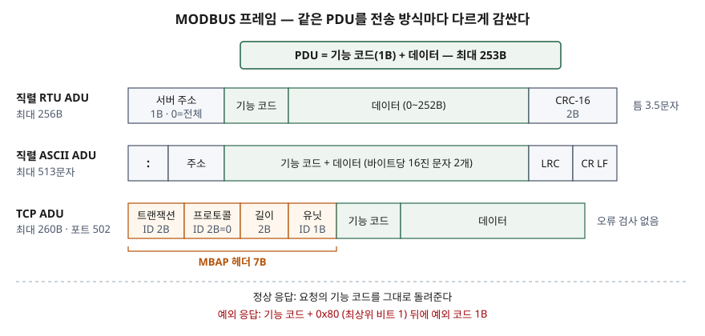

기출문제에서 MODBUS 프로토콜을 묻는다. 산업 현장 이야기로 흘러 "PLC끼리 쓰는 통신"으로
끝내기 쉽지만, 정보관리기술사 답안에서 점수가 붙는 곳은 **프레임 구조와 데이터 모델을
명세의 숫자로** 쓰는 것, 그리고 **인증이 없는 프로토콜을 정보시스템에 붙일 때 무엇을
해야 하는지**다.

> 실행 검증 없음. Modbus Organization이 발행한 명세 4종의 본문을 근거로 정리했다.

---

## Ⅰ. 정의

**MODBUS**는 명세가 쓰는 정의로, **OSI 7계층에 놓이는 응용 계층 메시징 프로토콜로서
서로 다른 버스·네트워크에 연결된 장치 사이에 클라이언트/서버 통신을 제공한다.** 요청-응답
방식이고, 무엇을 할지는 **기능 코드**로 지정한다(응용 프로토콜 명세의 범위 절 §1.1).

1979년부터 직렬 통신의 사실상 표준으로 쓰였고, TCP/IP 위에서는 예약된 시스템 포트 502를
쓴다. 응용 계층 PDU를 하위 계층과 무관하게 정의해 두고, 전송 방식마다 앞뒤에 필드를 덧붙이는
것이 설계의 핵심이다(§4.1).

## Ⅱ. 구성요소

> **출처**: [MODBUS Application Protocol Specification V1.1b3 §4.1 Protocol description](https://www.modbus.org/file/secure/modbusprotocolspecification.pdf) · [MODBUS over Serial Line V1.02 §2.5 The two serial Transmission Modes](https://www.modbus.org/file/secure/modbusoverserial.pdf) · [MODBUS Messaging on TCP/IP Implementation Guide V1.0b §3.1.3 MBAP Header description](https://www.modbus.org/file/secure/messagingimplementationguide.pdf)

### 가. 프레임 구조 — PDU와 ADU

| 구분 | 구성 | 크기 |
|---|---|---|
| PDU | 기능 코드(1B) + 데이터 | 최대 253B |
| 직렬 ADU | 서버 주소(1B) + PDU + CRC(2B) | 최대 256B |
| TCP ADU | MBAP 헤더(7B) + PDU | 최대 260B |

PDU가 253B인 이유는 최초 구현인 RS-485 직렬 ADU의 한계 256B에서 주소 1B와 CRC 2B를 뺀 값을
그대로 물려받았기 때문이다(§4.1). 다중 바이트 값은 **빅 엔디언**으로 보낸다(§4.2).

### 나. 데이터 모델 4가지 — 응용 프로토콜 명세 §4.3

| 테이블 | 단위 | 접근 | 담는 값 |
|---|---|---|---|
| ① 이산 입력(Discrete Inputs) | 1비트 | 읽기 전용 | I/O 시스템이 제공하는 값 |
| ② 코일(Coils) | 1비트 | 읽기·쓰기 | 응용 프로그램이 바꿀 수 있는 값 |
| ③ 입력 레지스터(Input Registers) | 16비트 | 읽기 전용 | I/O 시스템이 제공하는 값 |
| ④ 홀딩 레지스터(Holding Registers) | 16비트 | 읽기·쓰기 | 응용 프로그램이 바꿀 수 있는 값 |

테이블마다 65,536개 항목을 고를 수 있다. PDU 주소는 **0부터** 65535까지이고, 데이터 모델의
번호는 **1부터** n까지다(§4.4). 둘을 장치의 실제 메모리에 어떻게 대응시킬지는 제조사가 정한다.

### 다. 기능 코드 3분류와 예외 응답 — §5, §7

기능 코드는 1B이고 유효 범위는 1~127이다. 128~255는 예외 응답용이다.

- ① **공개(Public)** — 명세가 정의하고 유일성과 적합성 시험을 보장한다
- ② **사용자 정의(User-Defined)** — 65~72, 100~110. 유일성이 보장되지 않는다
- ③ **예약(Reserved)** — 일부 회사가 기존 제품에 쓰고 있어 공개 사용이 불가하다

| 코드 | 기능 | 한 번에 다루는 양 |
|---|---|---|
| 0x01 / 0x02 | 코일 읽기 / 이산 입력 읽기 | 1~2000비트 |
| 0x03 / 0x04 | 홀딩 레지스터 읽기 / 입력 레지스터 읽기 | 1~125개 |
| 0x05 / 0x06 | 코일 1개 쓰기 / 레지스터 1개 쓰기 | 1개 |
| 0x0F / 0x10 | 코일 여러 개 쓰기 / 레지스터 여러 개 쓰기 | 1~1968비트 / 1~123개 |

오류가 나면 서버는 **요청 기능 코드에 0x80을 더한 값**(최상위 비트를 1로)과 예외 코드 1B를
돌려준다. 예외 코드는 01 허용되지 않은 기능, 02 잘못된 데이터 주소, 03 잘못된 데이터 값,
04 서버 장치 고장이 기본이다(§7).

### 라. 전송 방식 3가지

| 구분 | RTU | ASCII | TCP |
|---|---|---|---|
| 부호화 | 바이트 그대로(2진) | 바이트당 16진 문자 2개 | 바이트 그대로 |
| 프레임 경계 | 3.5문자 이상 무신호 구간 | `:`로 시작, CR LF로 끝 | MBAP의 길이 필드 |
| 오류 검사 | CRC-16 | LRC | ADU에 없음(TCP·이더넷에 맡김) |
| 주소 | 서버 주소 1B | 서버 주소 문자 2개 | 유닛 ID 1B |
| 위치 | **필수·기본값** | 선택 | 포트 502 |

직렬 회선은 마스터 1대와 슬레이브 최대 247대로 이뤄진다. 주소 1~247은 개별 슬레이브,
0은 브로드캐스트, 248~255는 예약이다. 브로드캐스트는 쓰기 명령만 가능하고 응답이 없다
(직렬 명세 §2.1, §2.2). TCP의 유닛 ID는 게이트웨이 뒤의 직렬 슬레이브를 가리킬 때 쓴다.

## Ⅲ. 활용 및 고려사항

### 활용

PLC·HMI·드라이브·I/O 장치 사이의 값 읽기·쓰기, 그리고 게이트웨이를 두어 직렬 버스와
이더넷 TCP/IP 망을 잇는 데 쓴다(응용 프로토콜 명세 §3). 정보시스템 쪽에서는 SCADA·MES가
현장 장치의 레지스터를 주기적으로 읽어 오는 통로가 된다.

### 고려사항 — 4가지

| 항목 | 내용 |
|---|---|
| ① 인증·암호화 부재 | 프레임에 인증·암호 필드가 없다. 망에 닿기만 하면 0x05·0x06·0x10 같은 쓰기 기능 코드를 보낼 수 있다 |
| ② 주소 0/1 기준 혼동 | 데이터 모델은 1부터, PDU는 0부터 센다. 문서의 "레지스터 1"을 PDU 주소 1로 보내면 한 칸 어긋난다 |
| ③ 값 해석 | 명세는 16비트 레지스터까지만 정한다. 32비트 정수·실수를 두 레지스터에 담는 방식은 장치 매핑에 따르므로 연계 시 제조사 문서를 확인한다 |
| ④ 브로드캐스트·타이밍 | 브로드캐스트는 응답이 없어 성공 여부를 알 수 없다. RTU는 19,200bps 이하에서 1.5·3.5문자 타이머를 엄격히 지키고, 그보다 빠르면 750µs·1.750ms 고정값을 권고한다 |

①의 대안이 **MODBUS/TCP Security**다. 기존 ADU를 바꾸지 않고 **TLS 1.2 이상**으로 감싸며
IANA가 **포트 802**를 배정했다. X.509v3 인증서로 클라이언트·서버를 **상호 인증**하고,
인증서의 Role 확장 필드에서 꺼낸 역할로 요청마다 **권한을 판정**한다. 거부하면 예외 코드
01을 돌려준다. TLS를 고른 근거는 IEC 62443-3-3·62443-4-2 관점의 데이터 흐름 분석이다
(보안 명세 §5, §6, §8.4, §10.1). 이 명세를 지원하지 않는 기존 장치는 망 분리와 접근 통제로
보완해야 한다.

끝

## 답안 작성 메모

- **먼저 쓸 것**: 정의 한 줄(응용 계층·클라이언트/서버·기능 코드)과 프레임 그림. PDU 253B,
  MBAP 7B, 포트 502는 숫자 하나로 점수가 갈리는 지점이다.
- **점수가 갈리는 지점**: 데이터 모델 4가지를 **비트/16비트 × 읽기 전용/읽기·쓰기**로 나눠
  쓰는지, 그리고 Ⅲ에서 **인증 부재 → MODBUS/TCP Security(TLS, 802, 역할 기반 인가)** 로
  이어 가는지. 후자가 있어야 정보관리 답안이 된다.
- **시간이 모자라면**: 기능 코드 표의 "한 번에 다루는 양" 칸과 ASCII 열을 버린다. 전송 방식은
  RTU와 TCP 둘만 남긴다.
- 문서에 따라 마스터/슬레이브(직렬 명세)와 클라이언트/서버(응용·TCP 명세)를 섞어 쓴다. 답안에서는
  직렬은 마스터/슬레이브, 그 밖은 클라이언트/서버로 나눠 쓰면 명세와 어긋나지 않는다.

## 참고 자료

- [Modbus Organization — Specifications and Implementation Guides](https://modbus.org/modbus-specifications)
- [MODBUS Application Protocol Specification V1.1b3 (2012-04-26)](https://www.modbus.org/file/secure/modbusprotocolspecification.pdf)
- [MODBUS over Serial Line Specification and Implementation Guide V1.02 (2006-12-20)](https://www.modbus.org/file/secure/modbusoverserial.pdf)
- [MODBUS Messaging on TCP/IP Implementation Guide V1.0b (2006-10-24)](https://www.modbus.org/file/secure/messagingimplementationguide.pdf)
- [MODBUS/TCP Security Protocol Specification v36 (2021-07-30)](https://www.modbus.org/file/secure/modbussecurityprotocol.pdf)
