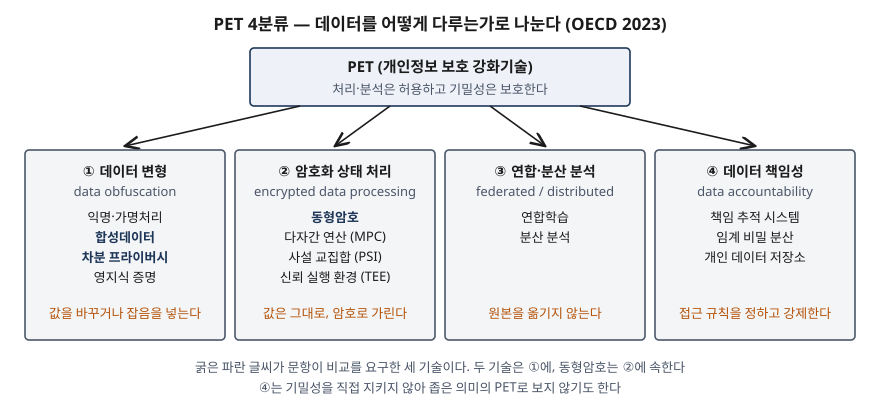
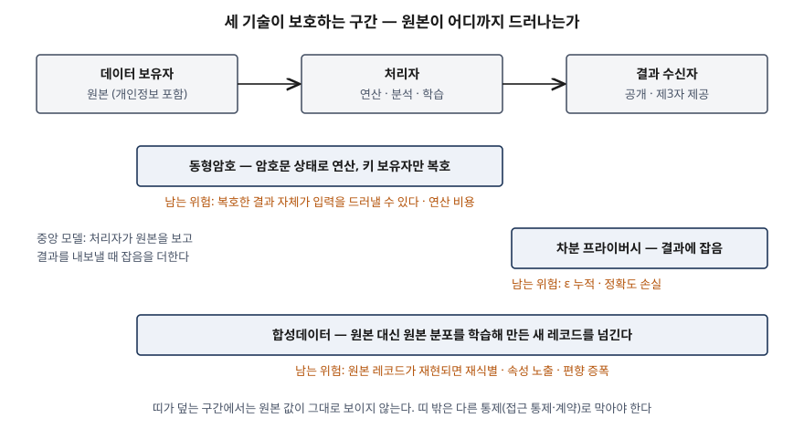

기출문제에서 AI 확산으로 데이터의 가치가 커진 상황을 배경으로 개인정보 보호 강화기술(PET)을 들고,
세 가지를 차례로 묻는다. PET가 무엇이고 왜 나왔는지, 어떤 기술들로 나뉘는지, 그리고 그중
동형암호·차분 프라이버시·합성데이터 셋을 자세히 비교하라는 것이다. 기술 이름을 나열하고 각각
한 줄씩 설명하면 평이한 답안이 된다. 점수는 **세 기술이 보호하는 구간이 서로 다르다**는 것을
보이는 데서 난다. 동형암호는 처리 중인 데이터를, 차분 프라이버시는 내보내는 결과를, 합성데이터는
넘겨주는 데이터셋 자체를 지킨다. 그래서 하나가 다른 하나를 대신하지 못하고, 실무에서는 조합해 쓴다.

> 실행 검증 없음. 개념 문제이므로 OECD 보고서(2023-03), HomomorphicEncryption.org 표준(2018-11),
> NIST SP 800-226(2025-03)·800-188(2023-09), 개인정보보호위원회 합성데이터 안내서(2024-12)
> 근거만으로 정리했다.

---

## Ⅰ. 개요

### 가. 활용과 보호가 부딪히는 지점

AI 모델은 학습 데이터가 많고 현실에 가까울수록 성능이 오른다. 그런데 현실에 가까운 데이터일수록
개인정보를 담고 있다. 기존 대응은 둘 중 하나였다. 원본을 그대로 쓰되 법·계약으로 접근을 묶거나,
식별자를 지우고 값을 뭉개 비식별 처리를 한 뒤 쓰는 것이다. 앞의 방식은 데이터가 한 번 넘어가면
통제가 끝나고, 뒤의 방식은 많이 가릴수록 쓸모가 줄어든다.

### 나. PET가 바꾸는 것

PET는 이 둘 사이에 **기술적 보호를 끼워 넣는다.** 데이터를 암호로 가린 채 연산하거나, 결과에
수학적으로 계산된 잡음을 더하거나, 원본 대신 원본을 닮은 새 데이터를 만든다. OECD는 PET가
프라이버시와 효용 사이의 전통적 맞교환 대신 둘을 함께 끌어올릴 여지를 연다는 Royal Society의
평가를 소개한다. 다만 같은 보고서가 PET는 **만능 해법이 아니며 법적 틀을 대신하지 못한다**고
분명히 적는다.

## Ⅱ. (가) PET의 정의 및 등장 배경

### 가. 정의

| 출처 | 정의 |
|---|---|
| OECD (2023-03) 작업 정의 | 데이터의 기밀성(경우에 따라 무결성·가용성까지)을 보호하면서 데이터 처리와 분석을 가능하게 하는 디지털 기술·접근법·도구의 모음. 보호 대상은 데이터 주체의 프라이버시와 데이터 관리자의 영업상 이익이다 |
| OECD 같은 보고서 요약 | 개인정보의 기밀성을 지키면서 정보의 수집·처리·분석·공유를 허용하는 기술. 데이터 수집·처리를 최소화하면서 비교적 높은 효용을 낸다 |
| 영국 ICO (2022, OECD 재인용) | 개인정보 사용 최소화, 데이터 보안 극대화, 개인의 권한 강화로 데이터 보호 원칙을 구현하는 기술 |
| 미국 백악관 (2022, OECD 재인용) | 참여자 간 데이터 공유·분석을 허용하면서 탈연관성과 기밀성을 유지하는 기술. MPC·동형암호·영지식 증명·연합학습·보안 엔클레이브·차분 프라이버시·합성데이터 생성을 예로 든다 |

OECD는 PET에 **보편적으로 합의된 정의가 없다**고 밝히고, 정의마다 만들어질 당시의 기술 수준과
목적이 반영돼 있다고 본다. 2000년대 초 정의는 이용자가 자기 정보 공개를 스스로 통제하는 도구에
초점을 뒀고, 최근 정의는 **데이터를 처리하는 조직이 쓰는 기술**로 무게가 옮겨 갔다.

답안 첫 줄용 정의: **PET란 데이터를 암호화된 상태로 처리하거나, 잡음·변형으로 개인을 가리거나,
원본을 옮기지 않고 분석하는 방식으로, 데이터의 분석·공유 가치는 유지하면서 개인정보의 기밀성을
기술적으로 보장하는 기술의 총칭이다.**

### 나. 등장 배경 — 5가지

| 구분 | 이전 방식의 문제 | PET가 겨냥하는 것 | 근거 |
|---|---|---|---|
| ① **처리 중 노출** | 저장·전송 중 암호화는 보편화됐지만, 처리하려면 평문으로 풀어야 했다. 처리 단계가 보안과 프라이버시 양쪽의 가장 큰 취약점이었다 | 사용 중 암호화(in-use encryption) | OECD §3.3.1 |
| ② **비식별 처리의 한계** | 익명처리한 데이터가 다른 데이터와 결합돼 재식별되는 일이 반복됐다. 처리 시점에 앞으로 결합될 모든 데이터를 예상할 수 없다 | 수학적 보장(차분 프라이버시), 원본과 1:1 대응 제거(합성데이터) | OECD §3.2.3, NIST SP 800-226 §1.1 |
| ③ **전달 후 통제 상실** | 데이터가 한 번 넘어가면 정보주체는 재사용을 기술적으로 막을 수단이 없고, 여러 단계·여러 관할로 퍼질수록 위험이 커진다 | 넘어간 뒤에도 기술적으로 보호가 이어지는 구조 | OECD §1.3 |
| ④ **고지·동의 방식의 한계** | 보호 부담을 정보주체에게 지우는 방식이 한계에 부딪혀, 처리하는 조직이 책임지는 쪽으로 옮겨 갔다 | 설계 단계부터의 보호(data protection by design) | OECD §2.2·§1.4, GDPR 제25조 |
| ⑤ **연산 능력 향상** | 동형암호 같은 기법은 오래전에 알려졌지만 계산 비용 때문에 쓸 수 없었다 | 기존 기법을 실제 배포 가능한 수준으로 | OECD 요약·§3.3.1 |

여기에 AI가 겹친다. 모델을 학습시키려면 여러 기관의 데이터를 모아야 하는데(②③), 모으는 순간
처리 단계 노출(①)이 생긴다. 보안이 경계 방어에서 "내부에도 공격자가 있다"는 제로 트러스트로
옮겨 간 것처럼, OECD는 프라이버시도 **신뢰를 가정하지 않고 적대적 환경에서 데이터를 지키는**
방향으로 옮겨 가고 있으며 PET가 그 기반이라고 본다.

## Ⅲ. (나) PET의 주요 기술 분류 및 핵심 기술

### 가. 분류 — 4분류 14기술 (OECD 2023)

OECD는 PET를 **데이터 보호 메커니즘**에 따라 4분류로 나누고 14개 기술을 배치한다. 한 기술이
여러 분류에 걸치면 주된 분류 하나에 넣는다.

> **출처**: [OECD, Emerging privacy-enhancing technologies: Current regulatory and policy approaches (2023-03) §2.4 Proposed working definition and taxonomy, §3.1 Categories of PETs, Table 1](https://doi.org/10.1787/bf121be4-en)

| 분류 | 보호 방식 | 핵심 기술 (14개) | 대표 활용 | 한계 |
|---|---|---|---|---|
| ① **데이터 변형** (data obfuscation) | 잡음을 더하거나 식별 요소를 지워 데이터 자체를 바꾼다 | 익명처리, 가명처리, 합성데이터, 차분 프라이버시, 영지식 증명 (5) | 프라이버시 보존 기계학습, 공개 없는 사실 확인(나이 확인) | 정보가 새지 않게 하기 어렵다(재식별), 합성데이터의 편향 증폭, 숙련 인력 부족 |
| ② **암호화 상태 처리** (encrypted data processing) | 값은 바꾸지 않고 암호로 가린 채 처리한다 | 동형암호, 다자간 연산(MPC), 사설 교집합(PSI), 신뢰 실행 환경(TEE) (4) | 공개하기에 너무 민감한 데이터의 연산, 접촉자 추적 | 데이터 정제 불가, 결과를 통한 누출, 높은 연산 비용 |
| ③ **연합·분산 분석** (federated and distributed analytics) | 원본을 옮기지 않고 분석 작업을 데이터 쪽으로 보낸다 | 연합학습, 분산 분석 (2) | 휴대기기 예측 입력 학습 | 안정적인 연결 필요, 모델 정보는 처리자에게 공개해야 함 |
| ④ **데이터 책임성** (data accountability) | 언제 누가 접근하는지 규칙을 정하고 강제·기록한다 | 책임 추적 시스템, 임계 비밀 분산, 개인 데이터 저장소(PIMS) (3) | 접근 규칙 강제, 정보주체 자기 통제 | 좁은 활용, 설정 복잡, 기밀성을 직접 지키지 않아 좁은 의미의 PET로 보지 않기도 한다 |

분류는 출처마다 다르다. OECD가 함께 소개하는 미국 샌프란시스코 연방준비은행(2021)은 **데이터를
바꾸는 것(altering)·가리는 것(shielding)·시스템·구조** 3분류를 쓴다. 차분 프라이버시와 합성데이터는
"바꾸는 것", 동형암호는 "가리는 것"으로 OECD와 같은 쪽에 놓인다. 어느 분류든 **원본 값을 바꾸는가,
값은 두고 가리는가**가 첫 번째 갈림길이다.

### 나. 핵심 기술 — 분류별 작동 방식

| 기술 | 무엇을 하는가 | 분류 |
|---|---|---|
| ① 익명·가명처리 | 식별 요소를 지우거나 대체한다. 가명처리는 추가 정보와 결합하면 되돌릴 수 있어 많은 법역에서 여전히 개인정보다 | 데이터 변형 |
| ② 합성데이터 | 원본의 통계적 성질을 학습한 모형으로 새 레코드를 만들어 원본 대신 내보낸다 | 데이터 변형 |
| ③ 차분 프라이버시 | 한 사람을 넣거나 빼도 결과 분포가 거의 같도록 잡음을 더한다 | 데이터 변형 |
| ④ 영지식 증명 | "소득이 기준 이상인가" 같은 참·거짓만 증명하고 근거 값은 드러내지 않는다 | 데이터 변형 |
| ⑤ 동형암호 | 암호문끼리 연산한 결과를 복호하면 평문 연산 결과와 같다. 처리자는 평문을 보지 않는다 | 암호화 상태 처리 |
| ⑥ MPC · PSI | 여러 참여자가 각자의 입력을 숨긴 채 함수 값을 함께 계산한다. PSI는 그중 두 집합의 공통 원소만 알아내는 형태다 | 암호화 상태 처리 |
| ⑦ TEE | 운영체제와 분리된 프로세서 내 보호 영역에서 코드를 실행해, 운영체제가 손상돼도 그 안의 데이터를 읽지 못하게 한다 | 암호화 상태 처리 |
| ⑧ 연합학습 | 원본은 각 기기·기관에 두고 학습된 매개변수만 모아 모델을 갱신한다 | 연합·분산 분석 |

## Ⅳ. (다) 동형암호·차분 프라이버시·합성데이터 상세 비교

### 가. 세 기술의 원리

**① 동형암호 (Homomorphic Encryption)**

암호문 상태에서 연산을 하고, 그 결과를 복호하면 평문을 연산한 것과 같은 값이 나오는 암호 방식이다.
HomomorphicEncryption.org 표준(2018)은 암호문 덧셈(`EvalAdd`)·곱셈(`EvalMult`)의 정확성을 이렇게
정의하고, 공개키·비밀키 외에 연산을 맡은 쪽에 넘기는 **평가 키**를 둔다. 평가 키만 가진 쪽은 암호문에서
평문에 대한 정보를 얻지 못한다.

| 구분 | 지원 연산 | 대표 | 근거 |
|---|---|---|---|
| 부분 동형 (PHE) | 덧셈 또는 곱셈 중 하나만 무제한 | Paillier(덧셈), 지수형 ElGamal(덧셈) | ISO/IEC 18033-6:2019 |
| 준동형·단계형 (SHE·leveled) | 덧셈·곱셈 모두, 단 정해진 깊이까지 | BGV, BFV | HE 표준 §1.1.3 |
| 완전 동형 (FHE) | 덧셈·곱셈 모두 깊이 제한 없이 | 부트스트래핑을 붙인 BGV·BFV, GSW 계열 | Gentry 2009, HE 표준 §1.1.4 |

깊이에 제한이 생기는 이유는 **잡음**이다. 격자 기반 암호문에는 안전성을 위한 잡음이 들어 있고,
연산할 때마다 잡음이 커져 일정 수준을 넘으면 복호가 실패한다. 표준은 이를 되돌리는 갱신 연산
(`Refresh`)으로 재선형화·모듈러스 전환·**부트스트래핑**을 두는데, 부트스트래핑은 잡음이 커진
암호문을 같은 평문의 잡음이 일정한 암호문으로 바꾼다. 표준은 GSW 계열로 BGV·BFV에 부트스트래핑을
구현하면 완전 동형이 된다고 적는다.

평문 공간도 갈린다. BGV·BFV는 **정수(모듈러 정수)를 정확히** 계산하고, CKKS는 **실수 근삿값**을
계산해 기계학습 연산에 맞다. 표준 v1.1은 CKKS를 언급만 하고 다음 판에 넣겠다고 밝힌다. 안전성은
LWE·RLWE(오류가 섞인 격자 문제)의 어려움에 기댄다.

**② 차분 프라이버시 (Differential Privacy)**

데이터셋에서 한 사람을 넣거나 빼도 분석 결과의 확률분포가 e^ε 배 이상 달라지지 않도록 잡음을 더해,
개인이 입는 프라이버시 손실의 상한을 ε으로 수량화하는 **수학적 정의**다(NIST SP 800-226 §2.1.1).
보장은 두 요소로 정해진다. 얼마나 비슷해야 하는가(ε, 필요하면 δ)와, "한 사람"을 무엇으로 볼 것인가
(프라이버시 단위)다. 잡음은 한 사람이 결과를 바꿀 수 있는 최대 폭(민감도 Δ)을 ε으로 나눈 척도로
넣는다(라플라스 메커니즘).

성질 가운데 실무에 직접 걸리는 것은 둘이다. **합성(composition)** — 같은 데이터에 대한 분석을 거듭하면
ε이 더해진다. **후처리 불변** — 차분 프라이버시 결과를 어떻게 가공해도 보장이 약해지지 않는다. 잡음을
넣는 위치에 따라 처리자가 원본을 보고 결과에 잡음을 넣는 **중앙 모델**과, 개인이 자기 값에 잡음을 넣어
보내는 **지역 모델**로 나뉜다(같은 문서 §4.2).

**③ 합성데이터 (Synthetic Data)**

원본의 구조와 통계적 분포를 학습한 모형으로 만든 가상 데이터다(개인정보보호위원회 안내서). OECD는
실제 데이터 대신 모집단 모형에서 생성한 데이터를 내보내는 기밀성 보호 방식으로 정의한다. 원본 레코드가
전혀 없는 **완전 합성**과 일부 셀만 바꾼 **부분 합성**으로 나뉘고, 부분 합성은 원본 레코드가 남아 위험이
크다(NIST SP 800-188 §4.4). 안전성은 생성 뒤에 구별·연결·추론 위험도를 **측정해서** 확인하고, 차분
프라이버시로 학습한 생성 모형을 쓰면 후처리 불변성에 따라 합성데이터도 ε 보장을 갖는다.

### 나. 보호 구간 — 세 기술은 다른 곳을 지킨다

> **출처**: [OECD (2023-03) §3.2 Data obfuscation tools, §3.3 Encrypted data processing tools](https://doi.org/10.1787/bf121be4-en), [NIST SP 800-226 (2025-03) §4.2 Trust Models](https://doi.org/10.6028/NIST.SP.800-226), [NIST SP 800-188 (2023-09) §4.4 Synthetic Data](https://doi.org/10.6028/NIST.SP.800-188)

동형암호는 **처리자에게서** 원본을 숨긴다. 결과는 키 보유자가 복호하므로, 결과를 받는 사람에게서
무엇을 숨기는지는 동형암호가 정하지 않는다. 차분 프라이버시(중앙 모델)는 반대로 처리자는 원본을
보고, **결과 수신자에게서** 개인을 숨긴다. 합성데이터는 원본을 넘기지 않으므로 처리자와 수신자 모두에게서
원본 레코드를 숨기되, 생성 모형이 원본을 얼마나 닮게 만들었는가에 안전성이 달려 있다.

### 다. 상세 비교 — 12가지 기준

| 기준 | 동형암호 | 차분 프라이버시 | 합성데이터 |
|---|---|---|---|
| ① OECD 분류 | 암호화 상태 처리 | 데이터 변형 | 데이터 변형 |
| ② 원본 값 | 바꾸지 않고 암호로 가린다 | 결과(또는 입력)에 잡음을 더한다 | 원본 레코드 대신 새 레코드를 만든다 |
| ③ 보호 구간 | 처리 중(사용 중 데이터) | 공개되는 결과 | 공유·공개되는 데이터셋 |
| ④ 신뢰 가정 | 처리자를 믿지 않는다. 키 보유자만 믿는다 | 중앙: 처리자를 믿고 수신자를 믿지 않는다. 지역: 정보주체만 믿는다 | 생성 주체를 믿는다. 이후 사용자는 믿지 않는다 |
| ⑤ 안전성 근거 | 계산적 안전성. RLWE·LWE 격자 문제의 어려움, IND-CPA | 수학적 정의. 손실 상한 ε | 경험적 측정. 구별·연결·추론 위험도 (DP 학습 시 ε) |
| ⑥ 결과 정확도 | BGV·BFV는 정확, CKKS는 근삿값 | ε을 줄이면 오차가 커진다. 오차 폭은 Δ/ε에 비례 | 생성 모형이 담은 성질만 남는다 |
| ⑦ 연산 비용 | 평문 분석보다 크게 높다 | 잡음 생성 비용은 작다 | 생성 모형 학습 비용, 이후 분석은 평문과 같다 |
| ⑧ 반복 분석 | 분석마다 암호 연산을 다시 한다 | 분석마다 ε이 누적돼 예산이 소진된다 | 한 번 만들면 반복 분석해도 추가 손실이 없다 |
| ⑨ 데이터 정제 | 처리자가 값을 볼 수 없어 정제를 못 한다 | 처리자가 원본으로 정제할 수 있다 | 생성 전 전처리 단계에서 한다 |
| ⑩ 남는 위험 | 결과 자체가 입력을 드러낼 수 있다(단일 레코드 결과) | ε을 크게 잡으면 보호가 약하다. 적정 ε에 대한 합의 기준이 없다 | 원본 레코드가 합성에 나타나면 재식별, 속성 노출, 편향 증폭 |
| ⑪ 적합 용도 | 외부 위탁 연산, 클라우드 분석, 기관 간 암호화 집계 | 통계 공개, 질의 응답형 데이터 서비스 | AI 학습, 소프트웨어 테스트, 데이터 개방 |
| ⑫ 근거 표준 | ISO/IEC 18033-6:2019, HomomorphicEncryption.org 표준 v1.1 | NIST SP 800-226 | NIST SP 800-188 §4.4, 개인정보보호위원회 안내서 |

⑤가 세 기술을 가르는 핵심이다. 동형암호는 "암호를 깨기 어렵다"는 가정에, 차분 프라이버시는 "어떤
공격자도 e^ε 배 이상 확신할 수 없다"는 정의에, 합성데이터(DP 없이)는 "측정해 보니 위험이 임계값
아래였다"는 사후 확인에 기댄다. 보장의 형태가 다르므로 감독기관이나 심의위원회에 설명하는 방식도
달라진다.

⑩에서 OECD는 동형암호 같은 암호화 처리도 **결과가 정보를 흘리지 않는다는 보장은 없다**고 적는다.
결과가 한 사람의 값만으로 계산되면 그 값이 그대로 드러난다. 합성데이터에 대해서는 캐나다
프라이버시 위원회(OPC 2022)를 인용해 원본 레코드가 합성데이터에 나타나면 재식별이 가능하다고 적고,
차분 프라이버시에 대해서는 대규모 배포 일부가 충분한 보호를 주지 못하는 ε을 골랐다는 비판을 든다.

### 라. 조합 — 서로의 빈 구간을 메운다

| 조합 | 메우는 빈 구간 | 근거 |
|---|---|---|
| 동형암호·MPC + 차분 프라이버시 | 암호화 처리는 처리자로부터 지키지만 결과 누출은 막지 못한다. 결과에 잡음을 더해 수신자로부터 지킨다 | OECD §3.3.3 (결과 누출 한계) |
| 합성데이터 + 차분 프라이버시 | 사후 측정에 기대던 안전성을 ε 보장으로 바꾼다. 후처리 불변이라 합성 결과도 보장을 갖는다 | NIST SP 800-188 §4.4.7, NIST SP 800-226 §3.6 |
| 연합학습 + 차분 프라이버시 | 매개변수만 모아도 학습 데이터 일부가 복원될 수 있다. 매개변수에 잡음을 더한다 | OECD §3.4.1 (매개변수 누출 우려) |

## Ⅴ. 결론

### 가. 정보시스템에 PET를 도입할 때 고려사항 — 4가지

- ① **위협 모델부터 정한다**: 누구에게서 원본을 숨겨야 하는가 — 처리자인가, 결과 수신자인가, 데이터를
  받아 갈 제3자인가. 이 답이 동형암호·차분 프라이버시·합성데이터 중 무엇을 쓸지를 정한다. 기술을 먼저
  고르면 보호 구간 밖에 원본이 그대로 남는다
- ② **결과 단계의 누출을 따로 검사한다**: 암호화 처리를 써도 결과는 평문으로 풀린다. 집계 단위가 너무
  작은 질의를 막는 최소 집계 기준이나 결과 잡음을 파이프라인에 넣는다. OECD는 결과가 누출되는지를 계산
  완료 전에 시험하는 방법이 연구 중이며 시스템 설계에 포함돼야 한다고 적는다
- ③ **법적 지위를 PET와 별도로 판단한다**: PET를 썼다는 것만으로 익명정보가 되지 않는다. OECD는
  규제기관이 특정 PET가 특정 법적 요건을 충족하는지 확정적 입장을 잘 내지 않는다고 적는다. 국내에서도
  합성데이터는 안전성 검증 결과를 보고 익명정보인지 가명정보인지 판단한다(개인정보보호위원회 안내서).
  매개변수(ε, 생성 모형 설정)와 검증 결과를 기록해 두어야 그 판단을 다시 할 수 있다
- ④ **비용과 데이터 품질 원칙을 함께 본다**: 동형암호는 연산 비용이 커서 프라이버시 이익이 비용을
  정당화하는 경우에만 맞는다. 또 처리자가 데이터를 볼 수 없으면 오류를 고칠 수 없어, OECD는 이것이
  개인정보는 정확·완전해야 한다는 데이터 품질 원칙과 부딪칠 수 있다고 지적한다. 입력 검증을 데이터
  보유자 쪽으로 옮겨야 한다

### 나. 맺음

PET는 데이터를 넘겨받는 쪽을 신뢰한다는 가정을 기술로 대신하는 도구 묶음이다. OECD 4분류 가운데
데이터 변형과 암호화 상태 처리가 중심이고, 동형암호·차분 프라이버시·합성데이터는 각각 **처리 중·공개
결과·공유 데이터셋**이라는 다른 구간을 지킨다. 보장의 근거도 계산적 안전성·수학적 정의·사후 측정으로
다르다. 그러므로 하나를 골라 끝내는 것이 아니라 위협 모델에 맞춰 조합하고, 매개변수와 검증 결과를
정보시스템의 데이터 거버넌스 기록으로 남기는 것이 PET 도입의 핵심이다.

> 개념 정리: [차분 프라이버시(Differential Privacy) — 프라이버시 손실 매개변수 ε과 누적 손실](../../security/2026-10-03-differential-privacy-epsilon-composition/index.md)
>
> 개념 정리: [합성데이터 — 유용성과 안전성의 상충, 구별·연결·추론 위험도](../../data-analysis/2026-10-03-synthetic-data-utility-privacy-tradeoff/index.md)
>
> 개념 정리: [가명처리용 암호 기법 — 형태보존·순서보존·동형 암호가 분석에서 남기는 것과 새는 것](../../security/2026-10-12-pseudonymization-ope-fpe-he-leakage/index.md)

끝

## 답안 작성 메모

- **먼저 쓸 것**: Ⅳ-다 비교표와 Ⅳ-나 보호 구간 모식도. 문항 (다)가 "상세 비교"를 요구하므로 배점이 가장
  크다. 표의 12개 기준 가운데 ②③④⑤⑩ 다섯 줄이 핵심이고, 시간이 없으면 이 다섯 줄만 남긴다.
- **점수가 갈리는 지점**:
  - Ⅲ에서 분류를 **개수와 함께** 쓰는지 (4분류 14기술). 분류 이름만 쓰고 개수를 빼면 감점 요인이다
  - Ⅳ에서 **보호 구간이 다르다**를 그림 한 장으로 보이는지. 표만 있으면 "셋 다 개인정보를 보호한다"는
    평면적 비교로 읽힌다
  - Ⅳ-다 ⑤에서 안전성 근거를 **계산적·정의적·경험적**으로 구분하는지. 이것이 기술사 답안과 일반 요약을 가른다
  - Ⅳ-라 조합을 쓰는지. 동형암호도 결과 누출은 못 막는다는 한계를 짚으면 조합이 자연스럽게 나온다
- **시간이 모자라면**: Ⅱ-가 정의 표를 OECD 정의 한 줄로 줄이고, Ⅲ-나 핵심 기술 표를 버린다(그림에 이름이
  다 있다). Ⅳ-가의 동형암호 PHE·SHE·FHE 표는 한 줄 요약으로 줄인다.
- **수치**: 본문에 쓴 숫자는 OECD 분류 개수(4분류 14기술)와 표준 판 번호뿐이다. 시장 규모, 동형암호의
  평문 대비 몇 배 느린지 같은 성능 수치는 쓰지 않았다. OECD도 "크게 높다"로만 적는다.
- 문항이 (가)(나)(다) 세 항목으로 물었으므로 Ⅱ·Ⅲ·Ⅳ를 그 순서 그대로 대항목으로 썼다.

## 참고 자료

- [OECD, Emerging privacy-enhancing technologies: Current regulatory and policy approaches, OECD Digital Economy Papers No. 351 (2023-03)](https://doi.org/10.1787/bf121be4-en) — Executive summary, §1.3 Evolving paradigms, §2.2 Existing definitions, §2.3 Existing categorisations, §2.4 Proposed working definition and taxonomy, §3.1~§3.5, Table 1
- [M. Albrecht et al., Homomorphic Encryption Standard v1.1, HomomorphicEncryption.org (2018-11-21)](https://homomorphicencryption.org/standard/) — §1.1.1 Notation and Definitions, §1.1.2 Properties, §1.1.3 BGV and BFV, §1.1.4 GSW, §1.1.5 Other Schemes, §2.1.1 LWE and RLWE
- [ISO/IEC 18033-6:2019, Encryption algorithms — Part 6: Homomorphic encryption](https://www.iso.org/standard/67740.html) — 덧셈 동형 2방식(지수형 ElGamal, Paillier). 본문은 확인하지 못했고 표준 소개 페이지의 범위 설명을 따랐다
- [NIST SP 800-226, Guidelines for Evaluating Differential Privacy Guarantees (2025-03)](https://doi.org/10.6028/NIST.SP.800-226) — §1.1, §2.1.1 The Math of Differential Privacy, §2.1.2 Properties, §3.6 Synthetic Data, §4.2 Trust Models
- [NIST SP 800-188, De-Identifying Government Datasets: Techniques and Governance (2023-09)](https://doi.org/10.6028/NIST.SP.800-188) — §4.4 Synthetic Data, §4.4.7 Creating a Synthetic Dataset with Differential Privacy
- [개인정보보호위원회, 데이터의 안전한 활용을 위한 합성데이터 생성·활용 안내서 (2024-12)](https://www.data.go.kr/data/15142321/fileData.do) — 제2장 정의·유형, 제3장 안전성·유용성 검증
- [C. Gentry, Fully Homomorphic Encryption Using Ideal Lattices, STOC 2009](https://doi.org/10.1145/1536414.1536440)
- [Z. Brakerski, C. Gentry, V. Vaikuntanathan, (Leveled) Fully Homomorphic Encryption without Bootstrapping, ITCS 2012](https://doi.org/10.1145/2090236.2090262) — BGV
- [J. H. Cheon, A. Kim, M. Kim, Y. Song, Homomorphic Encryption for Arithmetic of Approximate Numbers, ASIACRYPT 2017](https://doi.org/10.1007/978-3-319-70694-8_15) — CKKS
- [C. Dwork, A. Roth, The Algorithmic Foundations of Differential Privacy, Foundations and Trends in Theoretical Computer Science 9(3–4) (2014)](https://www.cis.upenn.edu/~aaroth/Papers/privacybook.pdf)
- [Regulation (EU) 2016/679 (GDPR) Article 25 — Data protection by design and by default](https://eur-lex.europa.eu/eli/reg/2016/679/oj)
