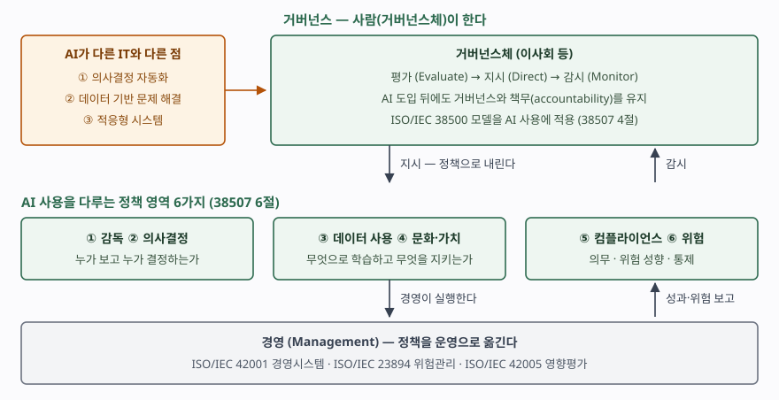

기출문제에서 AI 거버넌스를 설명하라고 묻는다. 10점 단답형에서 가장 흔한 실수는
"윤리 원칙을 세우고 위험을 관리한다"로 끝내는 것이다. 그렇게 쓰면 AI 윤리, AI
위험관리, AI 경영시스템과 구별되지 않는다. 점수가 갈리는 곳은 **거버넌스는
거버넌스체(이사회 등)가 하는 일이고, 경영이 하는 일과 층이 다르다**는 선을
긋는 것, 그리고 **AI가 기존 IT 거버넌스에 무엇을 더 요구하는지**를 근거 있게 쓰는 것이다.

> 실행 검증 없음. 정의·적용 범위·절 구성은 ISO/IEC 38507:2022의 공개 미리보기
> (표지·목차·머리말·서문·1~3절)를 근거로 했다. **본문 4~6절은 유료라 열지 못했으므로,
> 각 절은 목차의 절 제목까지만 근거로 삼고 그 아래 설명은 제목을 풀어 쓴 것이다.**

---

## Ⅰ. 정의

**AI 거버넌스**는 조직의 **거버넌스체(governing body)** 가 조직 안의 인공지능 사용이
**효과적·효율적이고 수용 가능하도록** 평가·지시·감시하는 활동이다.

근거 표준은 **ISO/IEC 38507:2022**(Governance implications of the use of artificial
intelligence by organizations)이다. ISO/IEC JTC 1의 **SC 40(IT 서비스 관리·IT 거버넌스)
과 SC 42(인공지능)가 공동으로** 만들어 2022년 4월 제1판으로 발행했다. IT 거버넌스 표준인
ISO/IEC 38500을 인용 규격으로 삼아, 그 원칙과 모델을 AI 사용에 적용한 지침이다.

정의에서 세 가지를 끊어 둔다.

- **주체는 사람이다.** 표준 서문은 강조점이 AI 기술이 아니라 **사람이 수행하는
  거버넌스**에 있다고 적는다. 기술은 그 영향을 이해하는 데 필요한 만큼만 다룬다.
- **"사용"을 가장 넓게 잡는다.** 생애주기 어느 단계에서든 AI 시스템을 **개발하거나
  적용하는 것** 전부이고, AI를 공급하거나 쓰는 **상대방과의 관계까지** 포함한다.
  외부 모델을 사다 쓰는 조직도 대상이다.
- **경영과 구별된다.** 정책의 운영 측면은 **경영(management)이 구현한다.** 거버넌스는
  방향을 정하고 지켜보는 층이고, 위험관리·편향 관리·품질·컴플라이언스의 세부는
  다른 표준으로 넘긴다.

## Ⅱ. 구성요소 — AI의 차이 3가지와 정책 영역 6가지

> **출처**: [ISO/IEC 38507:2022 공개 미리보기 — Contents, Introduction, 1 Scope](https://www.vde-verlag.de/iec-normen/preview-pdf/info_isoiec38507%7Bed1.0%7Den.pdf) — 4절 거버넌스·책무 유지, 5.2절 AI의 차이 3가지, 6.2~6.7절 정책 영역 6가지는 목차의 절 제목 기준. 평가·지시·감시는 인용 규격 [ISO/IEC 38500:2015](https://www.iso.org/standard/62816.html)의 모델

### 가. 왜 AI에 별도 거버넌스가 필요한가 — 다른 IT와 다른 3가지 (5.2절)

| # | 성질 (절) | 거버넌스에 생기는 질문 |
|---|---|---|
| ① | **의사결정 자동화** (5.2.1) | 사람이 내리던 결정을 시스템이 내리면, 그 결정의 책무는 누구에게 남는가 |
| ② | **데이터 기반 문제 해결** (5.2.2) | 규칙이 코드가 아니라 학습 데이터에서 나오므로, 데이터의 출처·품질·사용 권한을 누가 승인하는가 |
| ③ | **적응형 시스템** (5.2.3) | 배포 뒤에도 동작이 바뀔 수 있으므로, 승인 시점의 판단이 언제까지 유효한가 |

세 성질 때문에 기존 IT 거버넌스를 그대로 쓰면 빈칸이 생긴다. 그래서 4절은 AI를
도입할 때 **거버넌스를 유지하는 것(4.2)** 과 **책무를 유지하는 것(4.3)** 을 따로 다룬다.
AI가 결정을 내려도 조직의 책무가 AI로 넘어가지 않는다는 선을 지키는 것이 출발점이다.

### 나. 거버넌스체가 정책으로 다룰 영역 — 6가지 (6.2~6.7절)

| # | 영역 (절) | 정보시스템에 요구되는 것 |
|---|---|---|
| ① | **AI 감독** (6.2) | AI 시스템 목록(인벤토리), 책임자 지정, 거버넌스체 보고 체계 |
| ② | **의사결정 거버넌스** (6.3) | 어떤 결정을 AI에 맡기고 어디에 사람이 개입하는지의 경계, 결정 기록(로그) |
| ③ | **데이터 사용 거버넌스** (6.4) | 학습·추론 데이터의 계보(lineage), 사용 목적·동의 범위 관리 |
| ④ | **문화와 가치** (6.5) | 조직의 윤리 지침이 개발·조달 기준에 반영되었는지 점검 |
| ⑤ | **컴플라이언스** (6.6) | 의무 식별(6.6.1)과 준수 관리(6.6.2) — 법규 요구와 시스템 통제의 대응표 |
| ⑥ | **위험** (6.7) | 위험 성향(6.7.1)·위험관리(6.7.2)·목표(6.7.3)·위험원(6.7.4)·통제(6.7.5) |

부속서 A는 **규정(normative)** 부속서로 **거버넌스와 조직의 의사결정**을 다룬다.
②의 결정 경계를 정할 때 함께 보는 부분이다.

### 다. 층 구분 — 거버넌스·경영·위험관리

| 층 | 표준 | 묻는 것 | 수행 주체 |
|---|---|---|---|
| 거버넌스 | **ISO/IEC 38507** (+ 38500) | AI를 어디에, 어느 정도 위험까지 쓸 것인가 | 거버넌스체 |
| 경영시스템 | ISO/IEC 42001 | 그 방향을 정책·절차·기록으로 어떻게 돌릴 것인가 (인증 대상) | 경영진·실무 조직 |
| 위험관리·영향평가 | ISO/IEC 23894, 42005 | 개별 위험·영향을 어떻게 찾고 줄일 것인가 | 실무 조직 |

NIST AI RMF는 같은 내용을 한 프레임워크 안에서 **통제(GOVERN) 기능**으로 두고,
이것을 식별·측정·관리 세 기능 전부에 걸치는 **횡단 기능**으로 규정한다.

## Ⅲ. 활용 시 고려사항 — 4가지

- **AI 인벤토리가 없으면 감독이 성립하지 않는다.** 거버넌스체는 조직이 어떤 AI를
  어디에 쓰는지 모르면 평가할 대상이 없다. 현업이 SaaS에 붙은 생성형 AI 기능을
  켜는 것도 "사용"에 들어간다. 조달·계약 단계에서 AI 포함 여부를 신고받는 절차가 먼저다.
- **위험 성향을 숫자나 등급으로 내려보낸다.** "책임 있게 쓴다" 같은 정책은 경영이
  판단에 쓸 수 없다. 고객 대상 자동 결정은 사람 검토 필수, 내부 업무 보조는 사후
  표본 점검처럼 **용도 등급별 허용 기준**을 정해야 6.7절이 실제로 작동한다.
- **국내 규제의 증빙 요구와 연결한다.** 인공지능 기본법(2026-01-22 시행)은 고영향
  AI 사업자에게 제34조의 안전성·신뢰성 확보 조치 6가지와 근거 문서 보관을 요구한다.
  거버넌스체가 이 의무를 6.6절 컴플라이언스 정책에 올리지 않으면 경영 층에서
  증빙이 흩어진다.
- **감시는 지표와 재평가 주기로 만든다.** 적응형 시스템(5.2.3)은 승인 뒤에도
  성능과 편향이 바뀐다. 성능 저하·드리프트·민원 건수 같은 지표를 정기 보고에
  넣고, **중대한 변경이 있으면 재승인**하도록 정해야 평가·지시·감시가 한 바퀴 돈다.

> 관련 답안: [기출문제 — ISO/IEC 42001:2023 인공지능 경영시스템](../2026-10-25-iso-iec-42001-ai-management-system/index.md)
>
> 관련 답안: [기출문제 — NIST AI RMF의 핵심구조 4가지와 신뢰 가능한 AI 특성 7가지](../2026-10-24-nist-ai-rmf-core-and-trustworthy-characteristics/index.md)
>
> 관련 답안: [기출문제 — 인공지능 기본법의 고영향 인공지능: 정의, 활용 영역, 사업자의 안전성·신뢰성 확보 활동](../2026-10-05-high-impact-ai-basic-act/index.md)
>
> 개념 정리: [IT 거버넌스 — COBIT 2019 구성요소](../../it-management/2026-10-16-it-governance-cobit-2019/index.md)
>
> 개념 정리: [ISO/IEC 23894 인공지능 위험관리 — ISO 31000을 AI에 옮긴 세 덩어리와 부속서 3개](../../it-management/2026-10-29-iso-iec-23894-ai-risk-management/index.md)
>
> 개념 정리: [ISO/IEC 38507 AI 거버넌스 — 38500을 AI 사용에 적용한 거버넌스체 지침](../../it-management/2026-11-08-iso-iec-38507-ai-governance-implications/index.md)

끝

## 답안 작성 메모

- **먼저 쓸 것**: 정의 한 줄에 **"거버넌스체가 평가·지시·감시"** 를 넣고, 근거로
  ISO/IEC 38507:2022를 적는다. 이 한 줄이 AI 윤리·AI 위험관리 답안과 갈라놓는다.
- **점수가 갈리는 지점**: ① AI가 다른 IT와 다른 **3가지**(의사결정 자동화·데이터 기반·
  적응형)로 "왜 별도 거버넌스인가"를 설명하는 것, ② 정책 영역 **6가지**, ③ 거버넌스와
  경영(42001)의 **층 구분**. 셋 중 ③을 빠뜨리면 42001 답안과 섞인다.
- **빠지기 쉬운 함정**: 38507을 인증 규격으로 쓰는 것. 인증 대상은 42001이고 38507은
  거버넌스체를 위한 **지침**이다. 그리고 "AI가 결정했으므로 책임이 분산된다"는 식의
  서술 — 표준은 도입 뒤에도 책무를 **유지**하라는 쪽이다.
- **시간이 모자라면**: 층 구분 표와 고려사항 넷째 항목을 버린다. 정의, 차이 3가지,
  정책 영역 6가지, 모식도(위에 거버넌스체 EDM, 가운데 정책 6영역, 아래 경영)는 지킨다.
- 개수를 붙인다 — 차이 **3가지**, 정책 영역 **6가지**, 거버넌스 모델 **3활동**(평가·지시·감시),
  고려사항 **4가지**.

## 참고 자료

- [ISO/IEC 38507:2022, Information technology — Governance of IT — Governance implications of the use of artificial intelligence by organizations](https://www.iso.org/standard/56641.html) — 발행처 공식 목록. 제1판 2022-04, ISO/IEC JTC 1/SC 40·SC 42 공동 작성
- [ISO/IEC 38507:2022 공개 미리보기 (VDE Verlag)](https://www.vde-verlag.de/iec-normen/preview-pdf/info_isoiec38507%7Bed1.0%7Den.pdf) — 목차, 머리말, 서문, 1~3절. 정의·적용 범위·절 구성의 근거
- [ISO/IEC 38500:2015, Information technology — Governance of IT for the organization](https://www.iso.org/standard/62816.html) — 38507의 인용 규격. 평가·지시·감시 모델
- [ISO/IEC 42001:2023, Artificial intelligence — Management system](https://www.iso.org/standard/81230.html) — 경영 층의 인증 규격
- [ISO/IEC 23894:2023, Artificial intelligence — Guidance on risk management](https://www.iso.org/standard/77304.html) — AI 위험관리 지침
- [NIST AI 100-1, Artificial Intelligence Risk Management Framework (AI RMF 1.0), 2023-01](https://doi.org/10.6028/NIST.AI.100-1) — 통제(GOVERN) 기능을 횡단 기능으로 둔다
