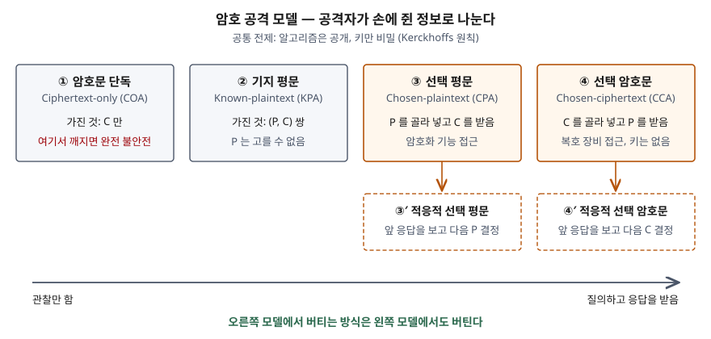

기출문제에서 암호문 공격을 묻는다. "암호문을 분석해 평문을 알아내는 공격"으로 한 줄 쓰고 끝내기 쉬운
문제다. 점수는 공격을 **공격자가 무엇을 손에 쥐었는가**로 나눈 분류를 개수까지 쓰고, 그 분류가
**암호 방식을 평가하는 기준**이 된다는 점, 그리고 지금 표준이 **가장 강한 모델**을 기준으로 삼는다는
점까지 내려가는 데서 난다.

> 실행 검증 없음. 개념 문제이므로 Handbook of Applied Cryptography와 RFC 8017, FIPS 203 근거만으로 정리했다.

---

## Ⅰ. 정의

**암호문 공격(Ciphertext Attack)** 은 암호 방식의 키나 평문을 알아내려는 암호 해독 공격을
**공격자가 손에 쥔 정보와 접근 권한에 따라 나눈 모델**이다. Handbook of Applied Cryptography(이하
HAC)의 암호 방식 공격 절(§1.13.1)은 이 공격들의 목적을 **암호문에서 평문을 체계적으로 되찾거나,
나아가 복호 키를 알아내는 것**으로 적는다.

모든 모델의 전제는 **Kerckhoffs 원칙**이다. HAC(§1.4)는 평문·암호문·키 공간과 암·복호 변환의
집합이 공개돼 있고 **비밀은 고른 키뿐**이라는 것을 암호의 기본 전제로 둔다. 따라서 "알고리즘을
모른다"는 것은 어느 모델에서도 공격자의 제약이 되지 않는다.

## Ⅱ. 구성요소 — 공격 모델 4가지(적응적 변형 2가지 포함 6가지)

> **출처**: [Handbook of Applied Cryptography §1.13.1 Attacks on encryption schemes, §1.4 Security](https://cacr.uwaterloo.ca/hac/about/chap1.pdf) — 능력 축의 포함 관계는 각 모델의 정의에서 따라 나오는 것을 정리한 것

| 구분 | 공격자가 가진 것 | 목표 | HAC의 설명 |
|---|---|---|---|
| ① 암호문 단독 (COA) | 암호문만 | 키 또는 평문 | 이 공격에 깨지는 방식은 **완전히 불안전**하다 |
| ② 기지 평문 (KPA) | 평문과 대응 암호문 쌍 | 키, 다른 암호문의 평문 | 실제로는 ①보다 **조금 더 어려울 뿐**이다 |
| ③ 선택 평문 (CPA) | 고른 평문의 암호문 | 처음 보는 암호문의 평문 | 암호화를 요청할 수 있다 |
| ③′ 적응적 선택 평문 | ③ + 앞 응답에 따라 다음 평문을 고름 | 같음 | ③의 강화판 |
| ④ 선택 암호문 (CCA) | 고른 암호문의 평문 | 복호 장비 없이 다른 암호문 해독 | 복호 장비에 접근하되 **키는 장비 안에 있다** |
| ④′ 적응적 선택 암호문 | ④ + 앞 응답에 따라 다음 암호문을 고름 | 같음 | ④의 강화판 |

① → ④로 갈수록 공격자가 **관찰만 하는 쪽에서 질의하고 응답을 받는 쪽**으로 능력이 커진다.
강한 모델의 공격자는 약한 모델의 공격자가 할 수 있는 일을 모두 할 수 있으므로, **오른쪽 모델에서
안전한 방식은 왼쪽 모델에서도 안전하다.** 그래서 설계 기준은 가장 오른쪽에 둔다.

HAC는 이 공격들이 대부분 **전자서명과 메시지 인증 코드에도 그대로 적용**되고, 그때 목표는 메시지나
MAC 위조가 된다고 덧붙인다.

## Ⅲ. 활용 및 고려사항

### 가. 현대 암호의 설계 기준 — 적응적 선택 암호문(CCA2)

| 근거 | 내용 |
|---|---|
| RFC 8017 (PKCS #1 v2.2) §7, §7.1 | 새 애플리케이션은 **RSAES-OAEP 지원이 필수**이고, OAEP는 **적응적 선택 암호문 공격에 대해 의미론적으로 안전**하다(랜덤 오라클 모델) |
| RFC 8017 §7.2 | 구식 RSAES-PKCS1-v1_5는 **호환성 때문에만** 남겨 두며, Bleichenbacher(1998)가 보인 **선택 암호문 공격**에 이용될 수 있어 대응책을 요구한다 |
| FIPS 203 §3.2 | ML-KEM은 내부 공개키 암호 K-PKE에 **Fujisaki-Okamoto 변환**을 적용해 IND-CCA2를 만족한다고 본다. K-PKE 단독은 IND-CCA2가 아니므로 **따로 쓰면 안 된다** |

④가 현실 위협인 이유는 **복호 결과나 오류 응답을 돌려주는 서버가 곧 복호 장비 접근**이기
때문이다. 복호가 실패했을 때 응답이 달라지면 그 차이가 공격자에게 평문 정보를 준다.

### 나. 정보시스템 적용 시 고려사항 — 4가지

① **암호화 방식 선정**: 공개키 암호화는 OAEP, 키 확립은 ML-KEM처럼 **CCA2 안전성이 증명된
방식**을 쓴다. 구식 패딩은 호환이 필요한 구간에만 남긴다.

② **복호 실패 응답 통일**: 패딩 오류·인증 실패·형식 오류를 **같은 응답과 같은 처리 시간**으로
돌려준다. 오류마다 메시지가 다르면 서버가 ④의 질의 창구가 된다. RFC 8017의 OAEP 복호 절차
(§7.1.2)도 오류 조건을 오류 메시지로든 처리 시간으로든 구별할 수 없게 하라고 적는다.

③ **기밀성과 무결성을 함께**: 복호 전에 암호문의 무결성을 검증하는 인증 암호를 쓰면 공격자가
조작한 암호문이 복호 단계에 닿지 않는다.

④ **키 공간과 키 수명**: ①·② 모델의 기본 대응은 **전수 조사가 불가능한 키 길이**다. HAC(§1.4)는
설계자의 목표를 전수 조사가 **가장 나은 공격이 되게** 하는 것으로 적는다. 키 길이와 사용 기간은
NIST SP 800-57 기준으로 정한다.

> 개념 정리: [암호 안전성 정의 — IND-CPA·IND-CCA1·IND-CCA2와 의미론적 안전성](../../security/2026-11-08-ind-cpa-cca-security-notions/index.md)
>
> 개념 정리: [암호 알고리즘 안전성 — 보안강도, 키 길이, 그리고 암호주기](../../security/2026-10-29-crypto-key-length-and-lifetime/index.md)
>
> 개념 정리: [양자 내성 암호(PQC)와 전환 전략](../../emerging-tech/2026-10-15-post-quantum-cryptography-transition/index.md)
>
> 개념 정리: [차분 암호분석과 선형 암호분석 — S-box의 차분 분포표와 선형 근사표를 직접 세어 보기](../../security/2026-11-09-differential-linear-cryptanalysis-ddt-lat/index.md)
>
> 개념 정리: [부채널 공격 — 구현이 새는 시간·전력·전자파·캐시 정보와 대응 3가지](../../security/2026-11-09-side-channel-attack-countermeasures/index.md)

끝

## 답안 작성 메모

- **먼저 쓸 것**: "공격자가 가진 정보로 나눈 모델"이라는 정의와 Kerckhoffs 전제. 이 두 줄이 없으면
  뒤의 분류가 단순 나열로 읽힌다.
- **점수가 갈리는 지점**: 4가지만 쓰지 않고 **적응적 변형 2가지**까지 써서 6가지로 세는지, 그리고
  "강한 모델에서 안전하면 약한 모델에서도 안전하다"는 포함 관계를 그림 한 장으로 보이는지.
  표준이 CCA2를 기준으로 삼는다는 근거(OAEP, ML-KEM)를 하나라도 대면 차별화된다.
- **시간이 모자라면**: Ⅲ-가 표를 버리고 "OAEP·ML-KEM은 CCA2 안전"을 한 줄로 쓴다. 고려사항은
  ①·②만 남긴다.
- 문항이 "암호문 단독 공격" 하나만 묻는 뜻일 수도 있다. 그 경우에도 위 분류 속에 ①의 위치를
  보여 주는 것이 정의를 가장 분명하게 하므로 구조는 그대로 두고 ① 설명을 늘린다.
- 각 공격의 **구체적인 수행 절차**는 이 문제가 묻는 것이 아니고 답안 분량에도 맞지 않아 쓰지 않았다.

## 참고 자료

- [A. Menezes, P. van Oorschot, S. Vanstone, Handbook of Applied Cryptography, Chapter 1 (CRC Press, 1997)](https://cacr.uwaterloo.ca/hac/about/chap1.pdf)
- [RFC 8017, PKCS #1: RSA Cryptography Specifications Version 2.2 (2016-11)](https://www.rfc-editor.org/rfc/rfc8017)
- [NIST FIPS 203, Module-Lattice-Based Key-Encapsulation Mechanism Standard (2024-08)](https://nvlpubs.nist.gov/nistpubs/FIPS/NIST.FIPS.203.pdf)
- [NIST SP 800-57 Part 1 Rev. 5, Recommendation for Key Management (2020-05)](https://csrc.nist.gov/pubs/sp/800/57/pt1/r5/final)
