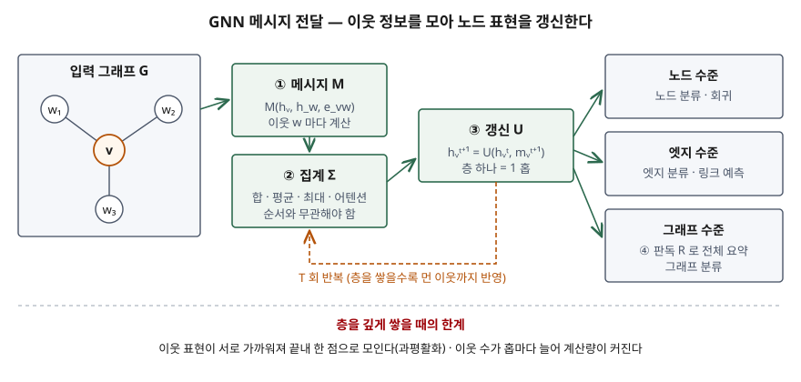

기출문제에서 GNN을 묻는다. "그래프를 입력으로 받는 신경망"이라고 쓰고 GCN·GAT 이름을 늘어놓기
쉬운 문제다. 점수는 그래프가 이미지·문장과 **무엇이 달라서** 별도 신경망이 필요한지, 모든 GNN이
공유하는 **메시지 전달 틀**을 식 한 줄과 그림으로 보이는지, 그리고 **층을 깊게 쌓으면 왜
나빠지는지**까지 쓰는 데서 난다.

> 실행 검증 없음. 개념 문제이므로 원 논문과 IEEE 서베이 근거만으로 정리했다.

---

## Ⅰ. 정의

**GNN(Graph Neural Network, 그래프 신경망)** 은 노드와 엣지로 이루어진 그래프를 입력으로 받아,
**각 노드가 이웃 노드의 정보를 반복해 모으는 방식으로 노드·엣지·그래프 전체의 표현을 학습하는
신경망**이다. 이 모델 이름과 틀은 Scarselli 등(IEEE TNN, 2009)이 정리했고, Wu 등의 서베이는
그래프 데이터를 다루는 딥러닝 기법 전체를 GNN으로 묶는다.

별도 신경망이 필요한 이유는 데이터 모양이다. Wu 등(Fig. 1)이 대비하듯 이미지의 픽셀은 이웃이
**순서가 있고 개수가 고정**이지만, 그래프의 노드는 이웃이 **순서가 없고 개수가 제각각**이다.
따라서 이웃을 어떤 순서로 넣어도 결과가 같은 연산이 필요하다.

## Ⅱ. 구성요소

> **출처**: [Gilmer et al., Neural Message Passing for Quantum Chemistry §2](https://arxiv.org/abs/1704.01212), [Wu et al., A Comprehensive Survey on Graph Neural Networks §III-B, §IX](https://arxiv.org/abs/1901.00596)

### 가. 메시지 전달 틀 — 3개 함수, 2단계 (Gilmer 등 §2)

| 함수 | 식 | 하는 일 |
|---|---|---|
| ① 메시지 M | mᵥᵗ⁺¹ = Σ_{w∈N(v)} Mₜ(hᵥᵗ, h_wᵗ, e_vw) | 이웃 w마다 메시지를 만들어 더한다 |
| ② 갱신 U | hᵥᵗ⁺¹ = Uₜ(hᵥᵗ, mᵥᵗ⁺¹) | 모은 메시지로 자기 표현을 바꾼다 |
| ③ 판독 R | ŷ = R({hᵥᵀ}) | 모든 노드 표현을 그래프 하나의 값으로 요약한다 |

순전파는 **메시지 전달 단계(①·② T회)** 와 **판독 단계(③)** 의 2단계다. R은 노드 순서에
무관해야 한다. 세 함수 모두 학습되는 미분 가능 함수다. 반복 한 번이 한 홉이므로 T층이면
T홉 떨어진 노드까지 반영된다.

### 나. 4가지 유형과 대표 모델 (Wu 등 §III-A)

| 유형 | 특징 | 대표 모델 |
|---|---|---|
| ① 순환 GNN (RecGNN) | 같은 파라미터를 안정된 평형에 이를 때까지 반복 적용 | Scarselli 등(2009) |
| ② 합성곱 GNN (ConvGNN) | 층마다 다른 가중치로 고정된 수의 층을 쌓는다. 스펙트럼 기반·공간 기반으로 나뉜다 | GCN, GAT, GraphSAGE |
| ③ 그래프 오토인코더 (GAE) | 그래프를 저차원 표현으로 압축·복원(네트워크 임베딩), 그래프 생성 | 추천의 링크 예측 |
| ④ 시공간 GNN (STGNN) | 그래프 구조와 시간 변화를 함께 학습 | 교통 속도 예측 |

ConvGNN의 대표 3개가 이웃을 모으는 방식이 다르다.

- **GCN**(Kipf & Welling §2): H⁽ˡ⁺¹⁾ = σ(D̃^−½ Ã D̃^−½ H⁽ˡ⁾ W⁽ˡ⁾). Ã는 자기 연결을 더한 인접 행렬,
  D̃는 그 차수 행렬이다. 이웃을 **차수로 정규화한 가중 평균**으로 모은다
- **GAT**(Veličković 등 §2.1): 두 노드 특징으로 계산한 점수를 이웃 사이 **softmax로 정규화한
  어텐션 계수**로 가중 합한다. 이웃마다 중요도가 달라진다
- **GraphSAGE**(Hamilton 등 §3): 이웃을 **고정 개수만 표본 추출**하고 평균·LSTM·풀링 중 하나로
  모은다. 학습 때 없던 노드에도 표현을 만드는 **귀납적(inductive)** 방식이다

### 다. 출력 수준 3가지 (Wu 등 §III-B)

① **노드 수준** — 노드 분류·회귀 ② **엣지 수준** — 엣지 분류·링크 예측
③ **그래프 수준** — 그래프 분류(판독 함수 R 필요)

## Ⅲ. 활용 및 고려사항

### 활용 — 관계가 곧 데이터인 영역 (Wu 등 §VIII)

| 영역 | 노드 / 엣지 | 출력 수준 |
|---|---|---|
| 분자 물성 예측 | 원자 / 화학 결합 | 그래프 |
| 추천 | 사용자·상품 / 사용자-상품 관계 | 엣지(링크 예측) |
| 인용·소셜 네트워크 | 논문·게시글 / 인용·연결 | 노드(분류) |
| 교통 속도 예측 | 도로 센서 / 센서 간 거리 | 노드 + 시간(STGNN) |

### 고려사항 — 3가지

① **층 깊이와 과평활화**: Wu 등(§IX)은 Li 등의 결과를 인용해 합성곱 층을 늘리면 성능이 크게
떨어지고, 이론상 층이 무한하면 모든 노드 표현이 **한 점으로 모인다**고 적는다. Kipf & Welling의 깊이 실험(부록 B)도
인용 네트워크 3종에서 **2~3층이 가장 좋았고**, 7층을 넘으면 잔차 연결 없이는 학습이 어려워질 수
있다고 보고한다. 층을 늘리기 전에 그 홉 수의 이웃 정보가 정말 필요한지부터 따진다.

② **확장성**: 층마다 이웃이 곱으로 늘어 대규모 그래프에서는 메모리가 먼저 찬다. GraphSAGE가
이웃을 고정 개수만 뽑는 이유가 **배치당 계산량을 고정**하려는 것이다(§3.1).

③ **그래프 구축이 곧 데이터 설계**: 무엇을 노드·엣지로 둘지, 엣지 속성 e_vw에 무엇을 담을지가
성능을 좌우한다. 그래프 DB나 관계형 DB의 조인 결과를 그래프로 바꾸는 **데이터 파이프라인과
갱신 주기**를 함께 설계해야 하고, 새 노드가 계속 들어오면 귀납적 모델을 고른다.

> 개념 정리: [시계열 딥러닝 예측 — LSTM·TCN·Transformer와 TFT의 입력 3종 분리](../../data-analysis/2026-10-27-time-series-deep-learning-tft-inputs/index.md)

끝

## 답안 작성 메모

- **먼저 쓸 것**: 정의 한 줄과 "이웃이 순서 없고 개수가 제각각"이라는 차이. 왜 CNN을 그대로 못
  쓰는지가 여기서 드러난다.
- **점수가 갈리는 지점**: 메시지 전달 식 두 줄(M·U)과 그림. 모델 이름 나열보다 이 틀 하나가
  GCN·GAT·GraphSAGE를 모두 설명한다. 한계로 **과평활화**를 쓰면 차별화된다.
- **시간이 모자라면**: 4가지 유형 표에서 대표 모델 칸을 버리고, 활용 표를 두 줄로 줄인다.
  GCN 식은 "차수로 정규화한 이웃 평균"이라는 말로 대신해도 된다.
- 과평활화라는 이름은 이번에 확인한 Wu 등 서베이 본문에 그대로 나오지 않고, "표현이 한 점으로
  모인다"는 현상으로 적혀 있다. 답안에는 현상을 먼저 쓰고 이름을 괄호로 붙인다.

## 참고 자료

- [F. Scarselli et al., The Graph Neural Network Model, IEEE Transactions on Neural Networks 20(1), pp. 61–80 (2009)](https://doi.org/10.1109/TNN.2008.2005605)
- [J. Gilmer et al., Neural Message Passing for Quantum Chemistry, arXiv:1704.01212 (2017)](https://arxiv.org/abs/1704.01212)
- [T. N. Kipf, M. Welling, Semi-Supervised Classification with Graph Convolutional Networks, ICLR 2017, arXiv:1609.02907](https://arxiv.org/abs/1609.02907)
- [P. Veličković et al., Graph Attention Networks, ICLR 2018, arXiv:1710.10903](https://arxiv.org/abs/1710.10903)
- [W. L. Hamilton, R. Ying, J. Leskovec, Inductive Representation Learning on Large Graphs, NeurIPS 2017, arXiv:1706.02216](https://arxiv.org/abs/1706.02216)
- [Z. Wu et al., A Comprehensive Survey on Graph Neural Networks, arXiv:1901.00596 (IEEE TNNLS, DOI 10.1109/TNNLS.2020.2978386)](https://arxiv.org/abs/1901.00596)
