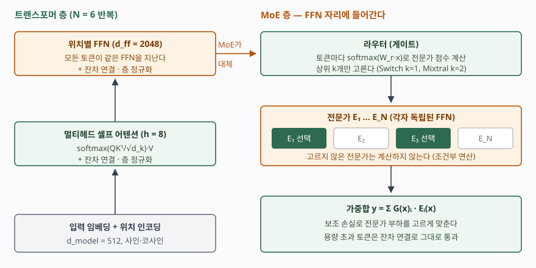

기출문제에서 트랜스포머와 MoE를 한 문항으로 묶어 묻는다. 두 개념을 따로 나열하면
반쪽 답안이 된다. 점수가 갈리는 곳은 **MoE가 트랜스포머 층 안의 어느 자리에 들어가는가**
— 위치별 FFN 자리다 — 를 보이고, 그 결과 **파라미터 수와 토큰당 연산량이 분리된다**는
점을 쓰는 것이다. 이 연결이 있어야 두 개념을 한 문항으로 낸 이유에 답하게 된다.

> 실행 검증 없음. 구성 수치와 수식은 원 논문 4편(1차 자료)에서 그대로 옮겼다.
> 성능 비교 수치는 실험 조건에 따라 달라지므로 싣지 않았다.

---

## Ⅰ. 정의

**트랜스포머(Transformer)** 는 순환(RNN)이나 합성곱 없이 **어텐션만으로** 입력 시퀀스의
모든 위치 사이 관계를 한 번에 계산해 출력 시퀀스를 만드는 신경망 구조다.
Vaswani 등이 2017년 NIPS에서 기계번역 모델로 제안했다.

**MoE(Mixture of Experts, 전문가 혼합)** 는 같은 구조의 **전문가 네트워크 N개**와
입력마다 어느 전문가를 쓸지 정하는 **게이트(라우터)** 로 이뤄진 계층으로, 입력 하나에
**일부 전문가만 계산하는 조건부 연산**(conditional computation)을 한다. Shazeer 등이
2017년에 희소 게이트 MoE 층으로 제안했고, 이후 Switch Transformer·Mixtral처럼
**트랜스포머의 FFN 하위 층을 MoE로 바꾼** 구조가 대형 언어 모델에 쓰인다.

## Ⅱ. 구성요소

> **출처**: [Vaswani et al., Attention Is All You Need §3.1~3.5](https://arxiv.org/abs/1706.03762) · [Shazeer et al., Sparsely-Gated MoE §2, §2.1](https://arxiv.org/abs/1701.06538) · [Fedus et al., Switch Transformers §2.1~2.2, Figure 2](https://arxiv.org/abs/2101.03961) · [Jiang et al., Mixtral of Experts §2](https://arxiv.org/abs/2401.04088)

### 가. 트랜스포머 — 5가지

| # | 구성요소 | 원 논문의 설정 (절) |
|---|---|---|
| ① | **인코더·디코더 스택** | 각각 같은 층 **N = 6개**. 인코더 층은 하위 층 2개, 디코더 층은 인코더 출력을 보는 어텐션이 더해져 3개 (3.1) |
| ② | **스케일드 닷프로덕트 어텐션** | softmax(QKᵀ/√d_k)·V. d_k가 크면 내적 값이 커져 softmax 기울기가 매우 작아지므로 √d_k로 나눈다 (3.2.1) |
| ③ | **멀티헤드 어텐션** | 헤드 **h = 8**, d_k = d_v = 64. 각 헤드가 다른 투영 공간에서 관계를 본 뒤 이어 붙인다 (3.2.2) |
| ④ | **위치별 FFN** | max(0, xW₁+b₁)W₂+b₂, 내부 차원 **d_ff = 2048**. 모든 위치에 같은 가중치를 따로 적용 (3.3) |
| ⑤ | **위치 인코딩·잔차·정규화** | 순서 정보가 없으므로 사인·코사인 위치 인코딩을 더한다(3.5). 하위 층마다 LayerNorm(x + Sublayer(x)), d_model = 512 (3.1) |

어텐션은 세 군데에 쓰인다(3.2.3). **인코더 셀프 어텐션**, 미래 위치를 가리는
**마스크드 디코더 셀프 어텐션**, 질의는 디코더에서·키와 값은 인코더 출력에서 가져오는
**인코더-디코더 어텐션**이다.

### 나. MoE — 4가지

| # | 구성요소 | 원 논문의 설정 |
|---|---|---|
| ① | **전문가 E₁…E_N** | 구조는 같고 파라미터는 따로인 FFN. 출력 y = Σ G(x)ᵢ·Eᵢ(x)이며 G(x)ᵢ = 0인 전문가는 계산하지 않는다 (Shazeer §2) |
| ② | **게이트(라우터)** | 잡음을 더한 점수에서 **상위 k개만 남기고** softmax (Shazeer §2.1). Switch는 **k = 1**, Mixtral은 **k = 2** |
| ③ | **부하 균형 보조 손실** | 몇몇 전문가에 토큰이 몰리지 않게 한다. Switch는 α·N·Σ fᵢ·Pᵢ (fᵢ: 전문가 i로 간 토큰 비율, Pᵢ: 라우터 확률 평균), α = 10⁻² (Switch §2.2) |
| ④ | **전문가 용량** | (배치 토큰 수 ÷ 전문가 수) × 용량 계수. 넘친 토큰은 그 층 계산을 건너뛰고 **잔차 연결로 다음 층에 넘어간다** (Switch §2.2) |

### 다. 비교 — 순환 신경망, 밀집 트랜스포머, MoE 트랜스포머

| 구분 | RNN | 밀집(dense) 트랜스포머 | MoE 트랜스포머 |
|---|---|---|---|
| 층당 연산 복잡도 | O(n·d²) | O(n²·d) (셀프 어텐션) | 어텐션은 같고 FFN만 희소 |
| 순차 연산 수 | O(n) | O(1) | O(1) |
| 먼 위치 사이 경로 길이 | O(n) | O(1) | O(1) |
| 토큰이 지나는 FFN | — | 1개 (전부 같은 것) | 라우터가 고른 k개 |
| 파라미터와 토큰당 연산 | 함께 증가 | 함께 증가 | **분리** — 전문가를 늘려도 토큰당 연산은 k에 묶인다 |
| 예 | LSTM 번역 모델 | 원 논문 Transformer | Switch Transformer, Mixtral 8x7B |

앞의 세 행은 트랜스포머 논문 Table 1의 값이다(n: 시퀀스 길이, d: 표현 차원).
Mixtral은 층마다 전문가 8개 중 2개를 골라, 토큰 하나가 **47B 파라미터에 접근하지만
추론에는 13B만 활성화**한다고 논문이 밝힌다.

## Ⅲ. 활용 시 고려사항 — 4가지

- **연산이 줄어도 메모리는 줄지 않는다.** 어느 전문가가 불릴지 미리 모르므로 전문가
  전부를 메모리에 올려야 한다. Mixtral 논문도 서빙 메모리가 활성 13B가 아니라
  **전체 47B에 비례**한다고 적는다. GPU 수를 정할 때는 전체 파라미터로 계산한다.
- **라우팅 쏠림을 감시한다.** 보조 손실이 없으면 라우터가 몇몇 전문가만 고르게 되고
  나머지는 학습되지 않는다. 학습 중 전문가별 토큰 비율과 **넘쳐서 건너뛴 토큰 비율**을
  지표로 남겨야 한다. 용량 계수를 키우면 건너뛰는 토큰은 줄지만 메모리와 통신이 는다.
- **전문가를 장치에 나누면 통신이 병목이 된다.** 전문가가 여러 GPU에 흩어져 있으면
  라우터가 고른 전문가 쪽으로 토큰을 보내고 결과를 되돌려 받아야 한다. Switch가 k = 1을
  택한 이유 가운데 하나가 이 라우팅·통신 비용을 줄이는 것이다.
- **긴 입력의 비용은 MoE로 풀리지 않는다.** MoE는 FFN만 바꾸므로 셀프 어텐션의
  O(n²) 연산과, 추론 시 위치마다 쌓이는 키·값 캐시는 그대로다. 긴 문맥이 문제라면
  어텐션 쪽(KV 캐시 압축, 제한된 어텐션)을 따로 다뤄야 한다.

> 개념 정리: [KV 캐시 — 트랜스포머 추론의 메모리 병목](../../emerging-tech/2026-10-19-kv-cache-transformer-inference/index.md)
>
> 개념 정리: [시계열 딥러닝 예측 — LSTM·TCN·Transformer와 TFT의 입력 3종 분리](../../data-analysis/2026-10-27-time-series-deep-learning-tft-inputs/index.md)
>
> 개념 정리: [MoE(전문가 혼합) — 라우터, 상위 k 선택, 부하 균형과 전문가 병렬](../../emerging-tech/2026-11-08-mixture-of-experts-routing-load-balancing/index.md)

끝

## 답안 작성 메모

- **먼저 쓸 것**: 두 정의를 한 줄씩 쓰고, 둘째 줄에 **"MoE는 트랜스포머의 FFN 자리를
  대체한다"** 를 넣는다. 이 연결이 문항이 두 개념을 묶은 이유다.
- **점수가 갈리는 지점**: ① 어텐션 수식과 √d_k로 나누는 이유, ② 라우터의 **상위 k개
  선택**과 **부하 균형 손실**, ③ **파라미터와 토큰당 연산의 분리**를 비교표 한 행으로
  보이는 것. ③이 MoE를 쓰는 이유 그 자체다.
- **빠지기 쉬운 함정**: MoE가 메모리까지 줄인다고 쓰는 것. 줄어드는 것은 토큰당 연산이고
  메모리는 전체 파라미터를 따른다. 그리고 MoE를 여러 모델의 앙상블로 쓰는 것 —
  전문가는 **한 층 안의 하위 네트워크**이고 라우터와 함께 한 모델로 학습된다.
- **시간이 모자라면**: RNN 열과 고려사항 셋째·넷째를 버린다. 트랜스포머 5가지, MoE
  4가지, 모식도(왼쪽 트랜스포머 층, FFN에서 오른쪽 라우터→전문가→가중합)는 지킨다.
- 개수를 붙인다 — 트랜스포머 구성 **5가지**, 어텐션 쓰임 **3가지**, MoE 구성 **4가지**,
  원 논문 설정 **N = 6, h = 8, d_model = 512, d_ff = 2048**.

## 참고 자료

- [Vaswani et al., Attention Is All You Need, NIPS 2017 (arXiv:1706.03762v7)](https://arxiv.org/abs/1706.03762) — §3.1 스택 구성, §3.2 어텐션, §3.3 FFN, §3.5 위치 인코딩, Table 1 복잡도 비교
- [Shazeer et al., Outrageously Large Neural Networks: The Sparsely-Gated Mixture-of-Experts Layer, ICLR 2017 (arXiv:1701.06538)](https://arxiv.org/abs/1701.06538) — §2 MoE 층 정의, §2.1 잡음 상위 k 게이트, §4 중요도·부하 손실
- [Fedus, Zoph, Shazeer, Switch Transformers: Scaling to Trillion Parameter Models with Simple and Efficient Sparsity, JMLR 23(120) 2022](https://jmlr.org/papers/v23/21-0998.html) — §2.1 단일 전문가 라우팅, §2.2 전문가 용량과 보조 손실
- [Jiang et al., Mixtral of Experts, arXiv:2401.04088 (2024-01)](https://arxiv.org/abs/2401.04088) — §2 전문가 8개·상위 2개 라우팅, 47B 전체·13B 활성 파라미터
