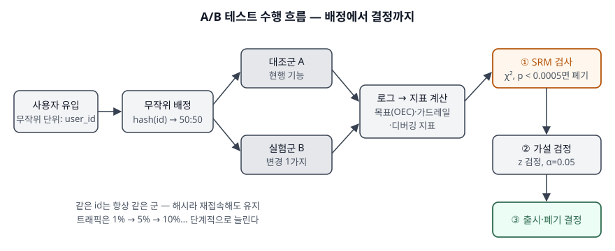

기출문제에서 A/B 테스팅을 묻는다. "두 안을 보여 주고 더 나은 쪽을 고른다"로 쓰면 마케팅
용어 설명에서 끝난다. 정보관리기술사 답안에서 점수가 붙는 곳은 셋이다. **무작위 배정이
왜 인과를 보장하는지**, **표본 크기와 검정을 숫자로 쓸 수 있는지**, 그리고 **배정·로그
시스템이 틀렸을 때 결과를 버리는 장치(SRM 검사)를 아는지**다.

> 계산이 들어가는 문제이므로 표본 크기·z 검정·SRM 검사·A/A 모의실험을 직접 계산해
> 검산했다. 실행 기록은 `code/output.txt`에 있다. 수치는 모두 가상의 실험 값이다.

---

## Ⅰ. 정의

**A/B 테스팅**은 **온라인 통제 실험(online controlled experiment)** 이라고도 하며(Deng & Shi,
KDD 2016 서론), **사용자를 무작위로 대조군(A)과 실험군(B)에 나눠 한 가지 변경만 다르게
노출한 뒤, 미리 정한 지표의 차이를 통계적으로 검정해 그 변경의 인과 효과를 추정하는 실험**이다.

무작위 배정이 핵심이다. 두 군은 변경 하나를 빼면 같은 모집단에서 뽑혔으므로, 지표 차이가
우연의 범위를 넘으면 그 원인을 변경으로 돌릴 수 있다. 오프라인 지표(AUC·NDCG 등)는 실제
사용자 행동과 상관이 낮은 경우가 많아, 출시 판단을 실사용자 실험으로 옮긴 것이 등장 배경이다(같은 논문 §2.1).

## Ⅱ. 구성요소



> **출처**: [Microsoft ExP, Patterns of Trustworthy Experimentation: Pre-Experiment Stage (2020-07)](https://www.microsoft.com/en-us/research/group/experimentation-platform-exp/articles/patterns-of-trustworthy-experimentation-pre-experiment-stage/) · [Microsoft ExP, Diagnosing Sample Ratio Mismatch in A/B Testing (2020-09)](https://www.microsoft.com/en-us/research/articles/diagnosing-sample-ratio-mismatch-in-a-b-testing/) · [NIST/SEMATECH e-Handbook §7.3.3](https://www.itl.nist.gov/div898/handbook/prc/section3/prc33.htm)

### 가. 실험 구성요소 5가지

| 구성요소 | 내용 |
|---|---|
| ① 가설 | 무엇을 바꾸면 어느 지표가 어느 방향으로 움직이는지. 실험 전에 적는다 |
| ② 무작위 단위 | 배정의 기준 id. 사용자 id가 기본이고, 쿠키는 자주 바뀌어 단기 실험에만 쓴다 |
| ③ 배정 | `hash(id)`로 군을 정한다. 같은 사용자는 재접속해도 같은 군에 남는다 |
| ④ 지표 | 아래 3종. 실험 전에 정하고 도중에 바꾸지 않는다 |
| ⑤ 판정 | SRM 검사 → 가설 검정 → 출시·폐기 결정 순서 |

### 나. 지표 3종 — Deng & Shi §3.2

| 종류 | 역할 | 갖춰야 할 성질 |
|---|---|---|
| ① 목표 지표(OEC) | 출시 여부를 가르는 지표. 서비스가 지향하는 방향을 대표한다 | **방향성**과 **민감도** 둘 다 |
| ② 가드레일 지표 | 목표 지표가 못 재는 손실을 막는다. 예: 사용자당 매출, 응답 지연 | 방향성 |
| ③ 디버깅 지표 | 목표 지표가 왜 움직였는지 분해한다. 예: 비율 지표의 분모 건수 | 민감도 |

OEC(Overall Evaluation Criterion)의 두 성질은 같은 논문의 목표 지표 선정 교훈(§3.1)이 필수 조건으로 든다. 방향성은
사용자 경험이 좋아지면 일관되게 한쪽으로 움직이는 것, 민감도는 작은 개선에도 짧은 기간 안에
움직이는 것이다.

### 다. 통계 판정 3단계 — 직접 계산

**① 표본 크기.** 기준 전환율 5%에서 +0.5%p를 α=0.05(양측), 검정력 80%로 잡아내려면

```text
  두 비율 공식      : 군당 31,234명 (총 62,468명)
  2(z0.975+z0.80)^2 = 15.70  -> 어림 계수 16
  16σ²/Δ² 어림      : 군당 30,401명 (σ²=p(1-p)=0.0475)
  효과를 +0.25%p 로 줄이면 : 군당 122,124명
  효과를 +0.10%p 로 줄이면 : 군당 752,703명
```

자주 쓰는 어림식 **n ≈ 16σ²/Δ²** 의 16은 2(1.96+0.84)²≈15.7을 올린 값이다. 검출할 효과
Δ가 절반이 되면 표본은 **네 배**가 된다.

**② SRM(Sample Ratio Mismatch) 검사.** 설계한 배분(50:50)과 실제로 집계된 사용자 수가
통계적으로 다르면 배정·실행·로그 어딘가가 틀린 것이다. Microsoft ExP는 카이제곱 검정으로 보고
**p < 0.0005**면 그 실험 결과를 쓰지 않는다.

```text
  A=31,150 B=30,850 : χ²=  1.45, p=2.28e-01 -> 정상
  A=31,600 B=30,400 : χ²= 23.23, p=1.44e-06 -> SRM — 결과를 쓰지 않는다
```

두 번째는 차이가 2%도 안 되지만 표본이 커서 우연으로 볼 수 없다. 비율만 눈으로 보면 놓친다.

**③ 가설 검정.** 전환율 같은 비율 지표는 NIST 핸드북의 두 비율 비교(§7.3.3) 합동 z 통계량
z = (p̂₂ − p̂₁) / √(p̂(1−p̂)(1/n₁+1/n₂))를 쓴다.

```text
  대조군 A : 1,550/31,000 = 5.00%
  실험군 B : 1,705/31,000 = 5.50%  (상대 개선 +10.0%)
  z = 2.791, 양측 p-value = 0.0053 -> 귀무가설 기각(유의)
```

## Ⅲ. 활용 및 고려사항

### 활용

화면 배치·추천 알고리즘·검색 순위·가격 표시처럼 **배포 단위로 켜고 끌 수 있는 변경**의 출시
판단에 쓴다. 정보시스템 쪽에서는 기능 플래그(feature flag), 배정 서비스, 이벤트 로그 수집,
지표 계산 파이프라인이 한 묶음으로 갖춰져야 실험이 돈다. 트래픽은 1% → 5% → 10%처럼 단계적으로
늘려 장애를 작은 범위에서 먼저 잡는다(Microsoft ExP 사전 단계 패턴).

### 고려사항 — 4가지

| 항목 | 내용 |
|---|---|
| ① 중간 확인(peeking) | 결과를 수시로 열어 보다 유의할 때 멈추면 거짓 양성이 α를 넘는다. 아래 A/A 모의실험에서 5.58% → **19.25%** |
| ② 단기·장기 괴리 | 단기 지표를 이기려고 장기에 해로운 변경을 하는 것이 흔한 실수다(Deng & Shi §3.1). 목표 지표는 단기·장기 방향이 같아야 한다 |
| ③ 간섭 | 한 사용자의 처치가 다른 사용자에게 번지면(메신저·마켓플레이스) 독립 가정이 깨진다. 묶음(cluster) 단위로 배정한다 |
| ④ 다중 비교 | 지표·세그먼트를 많이 볼수록 우연히 유의한 것이 나온다. 목표 지표를 하나로 정하고 나머지는 보조로 읽는다 |

```text
[4] A/A 실험 10,000회 — 전환율 5%, 군당 200명씩 10번 나눠 유입, α=0.05
  마지막에 한 번만 판정         : 거짓 양성 5.58%
  매번 들여다보고 유의하면 멈춤 : 거짓 양성 19.25%
```

**A/A 실험**은 두 군에 같은 것을 보여 주는 실험이다. 차이가 없어야 정상이므로 거짓 양성이
α 근처에 머무는지, SRM이 없는지를 보아 **배정·로그·지표 계산 시스템 자체를 검증**한다.

> 개념 정리: [대수의 법칙과 중심극한정리 — 전제가 깨지는 운영 데이터에서 무엇이 틀어지는가](../../data-analysis/2026-10-08-lln-clt-assumptions-in-operational-data/index.md)
>
> 개념 정리: [가설 검정 — 1종·2종 오류, 유의수준, 검정력과 표본 크기](../../data-analysis/2026-11-09-hypothesis-testing-errors-power-sample-size/index.md)

끝

## 답안 작성 메모

- **먼저 쓸 것**: 정의 한 줄에 "무작위 배정"과 "인과 효과"를 반드시 넣는다. 이 두 단어가
  빠지면 설문 비교와 구분되지 않는다.
- **점수가 갈리는 지점**: 지표 3종(목표·가드레일·디버깅)과 **SRM 검사**. 통계 검정만 쓰는 답안이
  많아서, 배정·로그 시스템이 틀렸을 때 결과를 버리는 장치를 쓰면 정보관리 답안으로 차별화된다.
- **시간이 모자라면**: 표본 크기 계산 결과 블록과 A/A 수치를 버리고 "n ≈ 16σ²/Δ², Δ가 절반이면
  표본 4배" 한 줄만 남긴다.
- 예제의 실험 값(군당 31,000명)은 표본 크기 공식이 요구한 31,234명보다 조금 적다. 실제 답안에서는
  "검정력 80%를 맞춘 표본 확보 후 판정"이라고 순서를 적는다.

## 참고 자료

- [Deng, A. & Shi, X., Data-Driven Metric Development for Online Controlled Experiments: Seven Lessons Learned, KDD 2016](https://www.kdd.org/kdd2016/papers/files/adf0853-dengA.pdf)
- [NIST/SEMATECH e-Handbook of Statistical Methods §7.3.3 How can we determine whether two processes produce the same proportion of defectives?](https://www.itl.nist.gov/div898/handbook/prc/section3/prc33.htm)
- [Microsoft ExP, Diagnosing Sample Ratio Mismatch in A/B Testing (2020-09-14)](https://www.microsoft.com/en-us/research/articles/diagnosing-sample-ratio-mismatch-in-a-b-testing/)
- [Microsoft ExP, Patterns of Trustworthy Experimentation: Pre-Experiment Stage (2020-07-31)](https://www.microsoft.com/en-us/research/group/experimentation-platform-exp/articles/patterns-of-trustworthy-experimentation-pre-experiment-stage/)
- Fabijan, A. et al., Diagnosing Sample Ratio Mismatch in Online Controlled Experiments, KDD 2019, doi:10.1145/3292500.3330722 (위 Microsoft 글의 원 논문, 본문은 읽지 못했다)
