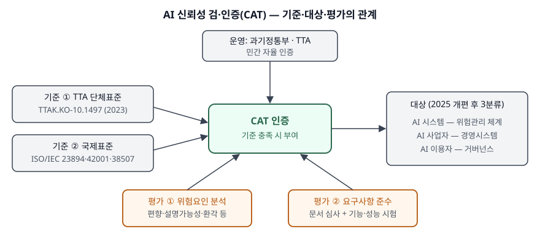

기출문제에서 AI 신뢰성 검·인증 제도(CAT)를 묻는다. 국내 제도라 "AI가 믿을 만한지 인증해
준다"에서 멈추기 쉽다. 점수가 붙는 곳은 **무엇을 기준으로**(단체표준·국제표준), **누구를
대상으로**(시스템·사업자·이용자), **어떻게 평가하는지**(위험요인 분석 → 요구사항 준수 시험)를
나눠 쓰는 것, 그리고 이 인증이 **법정 의무가 아닌 민간 자율 인증**이라는 위치를 짚는 것이다.

> 실행 검증 없음.
>
> 1차 자료 없음. 2차 자료 3건 이상을 교차 확인해 정리했다. (§10) 제도를 운영하는 TTA의 공지와
> 단체표준 원문은 있지만 작성 시점에 TTA 누리집이 접속되지 않아 직접 확인하지 못했다. 대신
> **서로 다른 발표 시점**의 보도 4건(2023-10 설명회, 2024-02 첫 인증, 2024-11 생성형 AI 첫 인증,
> 2025-04 제도 개편)을 교차 확인했다. 같은 보도자료를 옮긴 기사들은 1건으로 셌다.

---

## Ⅰ. 정의

**AI 신뢰성 검·인증 제도(CAT)** 는 과학기술정보통신부와 한국정보통신기술협회(TTA)가 운영하는
**민간 자율 인증**으로, **AI 제품·서비스의 위험요인을 분석하고 TTA 단체표준의 신뢰성 요구사항을
지키는지 시험해 기준을 충족하면 인증을 부여하는 제도**다.

2023년 10월 설명회로 체계가 공개됐고, 근거 단체표준「인공지능 시스템 신뢰성 제고를 위한
요구사항(TTAK.KO-10.1497)」이 2023년 12월 제정된 뒤 2024년 2월 첫 인증이 나왔다. 전문성 있는
제3자 기관이 평가한다는 점에서 사업자의 **자율 점검**과 구분된다.

## Ⅱ. 구성요소

> **출처**: [전자신문, '민간자율 인공지능 신뢰성 인증' 첫 사례 나왔다 (2024-02-06)](https://www.etnews.com/20240206000289) · [데일리안, TTA 국제표준 기반 AI 신뢰성 검·인증 제도 고도화 (2025-04-11)](https://www.dailian.co.kr/news/view/1484608) · [보안뉴스, TTA 생성형 AI 모델 인공지능 신뢰성 인증(CAT) 부여 (2024-11-08)](http://www.boannews.com/news/articleView.html?idxno=134166) (2차 자료 기반)

### 가. 기준 — 2축

| 축 | 내용 | 확인한 보도 |
|---|---|---|
| ① TTA 단체표준 | TTAK.KO-10.1497(2023-12 제정). ISO/IEC TR 24028(신뢰성 개관)·23894(위험관리)·22989(개념·용어)와 호환되게 만들었다 | 전자신문·디지털투데이(2024-02), 데일리안(2025-04) |
| ② 국제표준 | 2025년 개편에서 시험 기준을 ISO/IEC 23894(AI 위험관리), 42001(AI 경영시스템), 38507(AI 거버넌스)로 나눠 정리했다 | 데일리안(2025-04) |

초기 체계는 **신뢰성 요구사항 15개와 검증항목 67개**로 평가했다(바이라인네트워크 2023-10). 개발
안내서의 15개 요구사항 가운데 필수 요구사항을 골라 검증항목을 정하는 방식이다(전자신문 2024-02).
2025년 개편 이후의 항목 수는 확인하지 못했다.

### 나. 대상 — 3분류 (2025 개편)

| 대상 | 주로 보는 것 | 대응 국제표준 |
|---|---|---|
| ① AI 시스템 | 위험관리 체계 | ISO/IEC 23894 |
| ② AI 사업자 | 경영시스템 | ISO/IEC 42001 |
| ③ AI 이용자 | 거버넌스 | ISO/IEC 38507 |

초기에는 제품·서비스(시스템) 단위로 인증했고, 개편에서 대상을 셋으로 나눴다. 대상과 표준의 짝은
보도가 나열한 순서를 따른 것이다.

### 다. 평가 — 2단계

- ① **위험요인 분석** — 그 AI가 쓰이는 맥락에서 무엇이 잘못될 수 있는지 먼저 식별한다. 첫 인증
  사례에서는 영상 검색 솔루션의 인식 정확도 오류와 인종·성별·연령 편향, 지뢰탐지 모듈의 탐지
  정확성 오류와 설명가능성 부재가 위험요인으로 잡혔다(디지털투데이 2024-02). 생성형 AI 모델
  사례에서는 개인정보·지식재산권 위반, 편향된 출력, 설명가능성 부족, 환각을 포함한 성능 저하였다(보안뉴스 2024-11)
- ② **요구사항 준수 평가** — 식별한 위험에 맞춰 요구사항 이행 여부를 본다. 생성형 AI 심사에서는
  거버넌스 체계 구축·운영, 레드팀 취약점 점검, 모델 정보 문서화, 성능 수준 관리를 봤다. 2025년
  개편은 문서·절차 심사 중심에서 **실제 운영 환경을 가정한 기능·성능 시험**을 강화했고, **기업
  규모와 기술 위험도에 따라 심사·시험 기준을 차등** 적용한다(데일리안 2025-04)

보완이 필요한 사항은 검증 과정에서 컨설팅으로 안내한다(전자신문 2024-02). 보도는 "인증 부여"와
"검증 서비스"를 따로 세므로, 인증까지 가지 않고 검증만 받는 경로도 있다.

## Ⅲ. 활용 및 고려사항

### 활용

안전·국방·채용·교육처럼 **AI 판단이 사람에게 직접 영향을 주는 영역**의 제품이 신뢰성을 대외에
입증하는 수단으로 쓴다. 2024년 11월 기준 안전·국방·채용·교육 4개 분야에 인증이 나갔고, 같은 달
생성형 AI 모델에도 처음 부여됐다(보안뉴스 2024-11). 정보시스템 쪽에서는 위험 식별 기록, 데이터
구축 이력, 모델 문서, 레드팀 결과, 성능 모니터링 지표가 **심사에 제출할 증적**이 되므로 개발·운영
과정에서 이것들이 자동으로 남도록 설계해야 한다.

### 고려사항 — 4가지

| 항목 | 내용 |
|---|---|
| ① 법적 위치 | 민간 자율 인증이다. 인공지능 기본법의 고영향 AI 사업자 조치 같은 **법정 의무와의 관계**는 별도로 확인해야 한다 |
| ② 범위 한정 | 인증은 특정 버전의 시스템·조직을 평가 시점에 본 결과다. 모델 재학습·데이터 교체 뒤에도 성립하는지는 운영 중 모니터링으로 따로 보여야 한다 |
| ③ 증적 준비 | 위험요인 분석·데이터 편향 제거·설명가능성 확보를 **문서와 시험 결과**로 보여야 한다. 사후에 모으면 비용이 크다 |
| ④ 다른 인증과 겹침 | ISO/IEC 42001 인증은 경영시스템을, CAT는 시스템·사업자·이용자를 대상으로 한다. 같은 증적을 양쪽에 재사용할 수 있게 매핑해 둔다 |

| 구분 | CAT | ISO/IEC 42001 인증 |
|---|---|---|
| 성격 | 국내 민간 자율 인증 | 국제 경영시스템 인증 |
| 기준 | TTA 단체표준 + 국제표준 | ISO/IEC 42001 |
| 평가 단위 | AI 시스템·사업자·이용자 | 조직의 AI 경영시스템 |
| 시험 | 기능·성능 시험 포함 | 경영시스템 심사 |

> 개념 정리: [ISO/IEC 23894 인공지능 위험관리 — ISO 31000을 AI에 옮긴 세 덩어리와 부속서 3개](../../it-management/2026-10-29-iso-iec-23894-ai-risk-management/index.md)

끝

## 답안 작성 메모

- **먼저 쓸 것**: 정의 한 줄에 "TTA", "민간 자율", "단체표준(TTAK.KO-10.1497)", "위험요인 분석 →
  요구사항 준수 시험"을 넣는다. 표준 번호 하나가 국내 제도를 정확히 안다는 표시가 된다.
- **점수가 갈리는 지점**: 2025년 개편 내용 — 대상 3분류와 국제표준 3개(23894·42001·38507)의 짝,
  기업 규모·위험도별 차등, 기능·성능 시험 강화. 초기 체계(15개 요구사항·67개 검증항목)만 쓰면
  낡은 답안이 된다.
- **시간이 모자라면**: 위험요인 사례와 ISO/IEC 42001 비교표를 버린다. 기준 2축·대상 3분류·평가
  2단계만 남겨도 구조는 선다.
- 이 답안은 2차 자료로 썼다. 버전 명칭(CAT 1.0·2.0 등)과 2025년 이후 항목 수는 TTA 공지 원문으로
  확인되지 않아 넣지 않았다.

## 참고 자료

- [바이라인네트워크, 과기정통부-TTA AI 신뢰성 검·인증 체계 추진 (2023-10-31)](https://byline.network/2023/10/1031_004)
- [전자신문, '민간자율 인공지능 신뢰성 인증' 첫 사례 나왔다 (2024-02-06)](https://www.etnews.com/20240206000289)
- [디지털투데이, 과기정통부-TTA 국내 1‧2호 '민간자율 인공지능 신뢰성 인증' 부여 (2024-02-06)](https://www.digitaltoday.co.kr/news/articleView.html?idxno=505005) — 전자신문과 같은 발표를 다룬 기사라 출처 1건으로 셌다
- [보안뉴스, TTA 생성형 AI 모델 인공지능 신뢰성 인증(CAT) 부여 (2024-11-08)](http://www.boannews.com/news/articleView.html?idxno=134166)
- [데일리안, TTA 국제표준 기반 'AI 신뢰성 검·인증' 제도 고도화 (2025-04-11)](https://www.dailian.co.kr/news/view/1484608)
