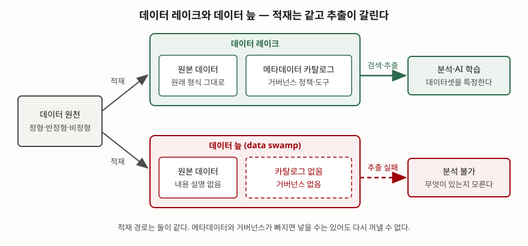

기출문제에서 데이터 늪을 설명하라고 묻는다. "관리가 안 된 데이터 레이크"라고 한 줄로 끝내면
누구나 쓰는 답이 된다. 단답형에서 점수가 붙는 곳은 두 군데다. **데이터 레이크의 정의 요건
가운데 무엇이 빠지면 늪이 되는지**를 짚는 것, 그리고 방지 방안을 "메타데이터를 잘 관리한다"가
아니라 **메타데이터 시스템이 갖출 기능**으로 셀 수 있게 쓰는 것이다.

> 실행 검증 없음. 개념 문제이므로 데이터 레이크 아키텍처·메타데이터 관리 설문 논문(Journal of
> Intelligent Information Systems, 2021)과 데이터 거버넌스 국제표준 ISO/IEC 38505-1:2017의 공개
> 적용 범위, 데이터 레이크 용어를 처음 쓴 James Dixon의 원 게시글을 근거로 정리했다.
> ISO/IEC 38505-1은 유료 표준이라 본문을 열지 못했고, 세부 조항은 답안에 쓰지 않았다.

---

## Ⅰ. 정의

### 가. 데이터 늪

**데이터 늪(data swamp)** 은 적절한 메타데이터 관리가 없어 **운용할 수 없게 된 데이터 레이크**다.
데이터는 계속 적재되지만, 무엇이 어디에 어떤 상태로 들어 있는지 기술한 정보가 없어 **다시 꺼내
쓸 수 없다.** 문헌에서는 데이터 덤프(data dump), 일방향 데이터 레이크(one-way data lake)로도
부르며, 데이터 늪이 가장 널리 쓰인다(Sawadogo·Darmont, 2021, 서론과 메타데이터 관리 절).

### 나. 데이터 레이크 정의와의 관계

데이터 레이크는 2010년 James Dixon이 데이터 마트와 대비해 제시한 개념이다. 데이터 마트는
정제·구조화해 바로 쓰도록 포장한 것이고, 데이터 레이크는 원본을 자연 상태 그대로 담아 둔 것이다.
Sawadogo와 Darmont는 데이터 레이크를 **모든 유형의 데이터를 원래 형식 그대로 보관하는 확장
가능한 저장·분석 시스템**으로 정의하고, 갖춰야 할 특성 6가지를 든다(같은 논문의 정의 절, §2.2).

| 번호 | 특성 | 늪과의 관계 |
|---|---|---|
| ① | 데이터 품질을 강제하는 **메타데이터 카탈로그** | **빠지면 늪이 된다** |
| ② | **데이터 거버넌스** 정책과 도구 | **빠지면 늪이 된다** |
| ③ | 다양한 사용자 계층의 접근성 | ①이 없으면 성립하지 않는다 |
| ④ | 모든 유형 데이터의 통합 | 늪에서도 유지된다 |
| ⑤ | 논리적·물리적 조직 | 늪에서도 형식상 유지된다 |
| ⑥ | 저장과 처리의 확장성 | 늪에서도 유지된다 |

④⑤⑥은 늪에서도 그대로 남는다. 그래서 겉으로는 데이터 레이크가 정상 운영되는 것처럼 보인다.
데이터 늪은 운영 중에 생긴 사고라기보다 **정의 요건 ①②를 빠뜨린 저장소**라고 쓰는 것이 정확하다.

## Ⅱ. 발생 원인과 특징

> **출처**: [Sawadogo, Darmont, *On Data Lake Architectures and Metadata Management*, Journal of Intelligent Information Systems 56(1):97–120, 2021 — §1 Introduction, §2.2 Data Lake Definition](https://arxiv.org/abs/2107.11152)

### 가. 발생 원인 — 3가지

| 번호 | 원인 | 내용 |
|---|---|---|
| ① | **메타데이터 체계 부재** | 데이터 레이크는 질의 시점까지 스키마를 정하지 않는다(schema-on-read, 지연 바인딩). 적재 시점에 구조를 강제하는 장치가 없으므로, 메타데이터가 없으면 내용을 기술하는 정보가 어디에도 남지 않는다 |
| ② | **부적절한 메타데이터 구현** | 메타데이터 체계를 두더라도 맞지 않는 방법·기술로 만들면 결과가 같다. 같은 논문은 늪의 원인을 메타데이터를 **두느냐**뿐 아니라 **어떻게 만드느냐**에서도 찾는다 |
| ③ | **거버넌스의 사후 처리** | 품질·보안·수명주기·계보를 먼저 설계할 대상이 아니라 나중에 관리할 일로 미룬다. 정제 단계마다 사본이 생기면서 어느 사본이 어디서 나왔는지 끊긴다 |

### 나. 데이터 레이크와 비교한 특징

| 구분 | 데이터 레이크 | 데이터 늪 |
|---|---|---|
| 적재 | 원본 그대로, 빠르게 | 같다 |
| 내용 기술 | 카탈로그가 출처·의미·버전을 기록 | 없음. 파일 이름과 경로가 전부 |
| 검색·추출 | 키워드·패턴 질의로 데이터셋을 찾는다 | 찾을 수 없어 원천에서 다시 받는다 |
| 계보 | 원본에서 파생본까지 추적된다 | 사본만 늘고 원본을 특정하지 못한다 |
| 신뢰 | 품질 상태가 기록된다 | 어느 데이터를 믿을지 판단할 근거가 없다 |

## Ⅲ. 방지 방안 및 고려사항

### 가. 메타데이터 시스템이 갖출 기능 — 6가지

원인 ①②에 대한 대응이다. Sawadogo와 Darmont는 메타데이터 시스템이 갖출 기능을 6가지로 든다.

| 번호 | 기능 | 하는 일 |
|---|---|---|
| ① | 시맨틱 보강 | 제목·태그·설명을 붙여 데이터의 의미를 기록한다 |
| ② | 데이터 색인 | 키워드·패턴 질의로 객체를 찾게 한다 |
| ③ | 링크 생성 | 객체 사이의 관계(유사·파생)를 기록한다 |
| ④ | 데이터 다형성 | 한 객체의 여러 표현을 함께 관리해 같은 변환을 반복하지 않는다 |
| ⑤ | 데이터 버전 관리 | 갱신해도 이전 상태를 남겨 재현을 가능하게 한다 |
| ⑥ | 사용 추적 | 생성·읽기·갱신 이력을 남긴다 |

①②③⑥은 늪을 막는 최소 조건이고, ④⑤는 구현 난도가 높아 단계적으로 도입한다.

### 나. 거버넌스를 설계 단계의 축으로 둔다

원인 ③에 대한 대응이다. ISO/IEC 38505-1:2017은 ISO/IEC 38500의 IT 거버넌스 원칙을 데이터에
적용하는 표준으로, IT 시스템이 생성·수집·저장·통제하는 데이터의 사용을 거버넌스 대상으로 둔다.
적재 전에 **데이터 소유자, 보존 기간, 품질 기준, 접근 권한**을 정하지 않은 데이터는 레이크에
들이지 않는다는 규칙이 여기서 나온다.

### 다. 고려사항

- **늪 여부를 재는 객관적 척도는 아직 없다.** 같은 논문은 메타데이터 시스템의 효율을 측정·비교할
  객관적 방법이 알려져 있지 않다고 적는다. 진단은 "원하는 데이터셋을 카탈로그만으로 찾을 수 있는가"
  같은 운영 질문으로 한다.
- **원본은 지우지 않는다.** 정제본만 남기고 원본을 지우면 계보와 재처리가 함께 끊긴다.
- **이미 늪이 된 저장소는 사용 이력부터 본다.** 최근 읽힌 적 없고 소유자도 없는 데이터는 카탈로그에
  올리기 전에 보존 여부를 먼저 정한다.

> 기출 답안: [데이터 레이크 아키텍처와 데이터 스웜프](../2026-10-13-data-lake-architecture-data-swamp/index.md)
>
> 개념 정리: [데이터 웨어하우스·데이터 레이크·레이크하우스](../../database/2026-10-06-dw-lake-lakehouse-schema-timing/index.md)
>
> 개념 정리: [데이터 계보(Data Lineage)와 메타데이터 카탈로그](../../database/2026-10-14-data-lineage-metadata-catalog/index.md)

끝

---

## 답안 작성 메모

- **먼저 쓸 것**: 정의 한 줄에 "메타데이터 관리 부재"와 "적재는 되지만 추출되지 않는다"를 넣는다.
  이 두 마디가 있으면 나머지가 전부 그 설명이 된다.
- **점수가 갈리는 지점**: 데이터 레이크 정의 요건 6가지 가운데 **메타데이터 카탈로그와 거버넌스
  두 가지가 빠진 것이 늪**이라는 연결. 이 연결을 쓰면 원인과 대책이 같은 축에 놓인다.
- **시간이 모자라면 버릴 것**: Ⅱ-나의 비교표를 버리고 모식도 한 장으로 대신한다. 메타데이터 6기능
  표는 남긴다. 단답형에서 셀 수 있는 항목은 이것뿐이다.
- **쓰지 말 것**: "데이터 레이크의 n%가 늪이 된다" 같은 수치. 원 출처가 1차인 통계를 찾지 못했고,
  설문 논문도 늪을 재는 척도가 없다고 적는다.

## 참고 자료

- Sawadogo, P., Darmont, J., [*On Data Lake Architectures and Metadata Management*](https://arxiv.org/abs/2107.11152), Journal of Intelligent Information Systems 56(1):97–120, 2021. DOI 10.1007/s10844-020-00608-7 — 데이터 레이크 정의와 특성 6가지, 데이터 늪, 메타데이터 시스템 기능
- ISO, [ISO/IEC 38505-1:2017 *Information technology — Governance of IT — Governance of data — Part 1: Application of ISO/IEC 38500 to the governance of data*](https://www.iso.org/standard/56639.html) — 데이터 거버넌스 적용 범위 (유료 표준, 공개 적용 범위 기술만 참조)
- Dixon, J., [*Pentaho, Hadoop, and Data Lakes*](https://jamesdixon.wordpress.com/2010/10/14/pentaho-hadoop-and-data-lakes/), 2010-10-14 — 데이터 레이크 용어의 원 출처, 데이터 마트와의 대비
