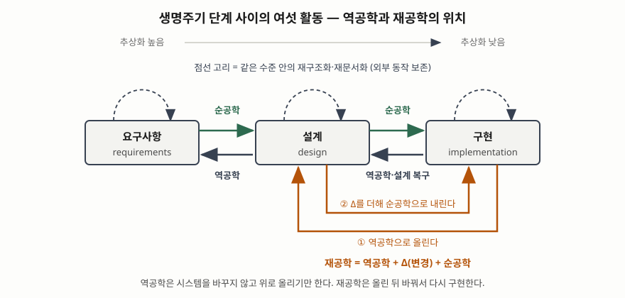

기출문제에서 소프트웨어 역공학과 재공학을 함께 설명하라고 묻는다. 두 용어를 따로 정의하고
끝내면 절반만 쓴 답이 된다. 단답형에서 점수가 붙는 곳은 **두 활동을 가르는 한 줄**과, 둘이
생명주기 단계 사이에서 **어느 방향으로 움직이는지**를 그림 하나로 보이는 것이다.

> 실행 검증 없음. 용어 분류의 원 논문(Chikofsky·Cross, IEEE Software, 1990), 소프트웨어 공학
> 지식체계(SWEBOK Guide V4.0a)의 유지보수 장, 미 국방부 재공학 워크숍 용어집(1992)의 정의만으로 썼다.

---

## Ⅰ. 정의

| 용어 | 정의 | 근거 |
|---|---|---|
| **역공학** (Reverse Engineering) | 대상 시스템을 분석해 **구성요소와 그 상호관계를 식별하고**, 시스템을 **다른 형태나 더 높은 추상화 수준으로 표현**하는 과정 | Chikofsky·Cross (1990) |
| **재공학** (Re-engineering) | 대상 시스템을 **검토하고 변경해 새 형태로 재구성하고, 그 새 형태를 구현**하는 것 | Chikofsky·Cross (1990), SWEBOK V4.0a |

두 정의를 가르는 한 줄은 이것이다. **역공학은 시스템을 바꾸지 않고, 재공학은 바꾼다.**
지식체계는 역공학이 수동적(passive)이어서 소프트웨어를 바꾸지도 새 소프트웨어를 만들지도
않는다고 명시한다(SWEBOK Guide V4.0a, 유지보수 장의 역공학 항목). 재공학은 역공학을 앞 구간으로
품으므로, Jacobson·Lindström의 식대로 **재공학 = 역공학 + Δ(변경) + 순공학**으로 쓸 수 있다.

## Ⅱ. 구성요소 — 생명주기 사이의 여섯 활동

Chikofsky와 Cross는 요구사항·설계·구현 세 단계 사이의 움직임으로 관련 용어 **6가지**를 정의했다.
역공학과 재공학의 위치는 이 그림 안에서 정해진다.

> **출처**: [E. J. Chikofsky, J. H. Cross II, *Reverse Engineering and Design Recovery: A Taxonomy*, IEEE Software 7(1) pp.13-17 (1990) — Figure 1 lifecycle relationships](https://doi.org/10.1109/52.43044)

| 번호 | 활동 | 방향 | 시스템 변경 |
|---|---|---|---|
| ① | 순공학 (forward engineering) | 위에서 아래로 — 요구사항에서 구현으로 | 새로 만든다 |
| ② | **역공학** (reverse engineering) | 아래에서 위로 — 구현에서 설계·요구사항으로 | 없음 |
| ③ | 재문서화 (redocumentation) | 같은 수준 — 사람이 읽을 표현을 새로 만든다 | 없음 |
| ④ | 설계 복구 (design recovery) | 아래에서 위로 — 관찰에 도메인 지식·추론을 더한다 | 없음 |
| ⑤ | 재구조화 (restructuring) | 같은 수준 — 외부 동작을 보존하고 표현을 바꾼다 | 내부만 |
| ⑥ | **재공학** (re-engineering) | 위로 올렸다가 아래로 내린다 | 새 형태로 |

③④는 역공학의 하위 유형이고, ②⑤①은 재공학이 안에서 쓰는 수단이다. 미 국방부 재공학 워크숍
용어집(SB-1, 1992)은 재공학의 하위 과정으로 **역공학, 재구조화, 재문서화, 순공학, 재목적화
(retargeting, 새 하드웨어·운영체제로 옮기기)** 5가지를 든다.

### 두 활동의 비교

| 구분 | 역공학 | 재공학 |
|---|---|---|
| 목적 | 이해와 복원 — 잃어버린 설계 정보를 되찾는다 | 개선과 전환 — 새 형태로 다시 구현한다 |
| 추상화 이동 | 위로만 | 위로 갔다가 아래로 |
| 대상 시스템 | 바꾸지 않는다 | 바꾼다 (외부 동작도 의도적으로 바꿀 수 있다) |
| 산출물 | 호출 관계도·설계서·논리 데이터 모델 | 새 소스·전환된 데이터·새 아키텍처 |
| 관계 | 재공학의 앞 구간이면서 독립 기법 | 역공학을 입력으로 쓴다 |

## Ⅲ. 활용 및 고려사항

### 가. 활용

- **역공학**: 문서가 코드와 어긋난 레거시에서 변경 영향 범위 분석, 물리 스키마에서 논리 모델을
  되찾는 데이터 역공학, 명세 없는 연계 인터페이스의 규약 복원.
- **재공학**: 지원이 끊긴 언어·미들웨어·하드웨어에서 벗어나는 플랫폼 전환, 단일 구조를 서비스로
  나누는 아키텍처 재설계. 지식체계는 재공학이 유지보수성 향상보다 **노후 레거시 교체**를 위해 수행되는
  경우가 많다고 적는다(SWEBOK Guide V4.0a, 유지보수 장의 재공학 항목).

### 나. 고려사항 — 4가지

| 번호 | 항목 | 내용 |
|---|---|---|
| ① | 재공학과 재개발의 선택 | 바꿔야 할 범위가 크면 새로 만드는 편이 싸다. 국방부 용어집 해설은 재목적화에서 **20~30% 넘게 바꿔야 하면** 재개발이 나을 수 있다는 경험칙을 적는다. 과제 첫 산출물은 이 선택의 근거여야 한다 |
| ② | 복원 산출물의 신뢰 수준 | 도구가 기계적으로 뽑은 호출 관계와 사람이 추론한 업무 규칙은 확실성이 다르다. 설계 복구 결과는 현업 확인 여부를 함께 남긴다 |
| ③ | 권리 범위 | 라이선스가 역분석을 금지할 수 있다. 저작권법의 프로그램코드역분석 조항(제101조의4)은 호환에 필요한 정보를 달리 얻기 어려울 때 필요한 범위에서만 허용한다 |
| ④ | 형상관리 | 역공학 산출물은 만든 순간부터 낡는다. 변경 요청과 함께 갱신되도록 형상관리 대상에 넣는다 |

> 기출 답안: [소프트웨어 재공학의 개념·목적·절차와 역공학의 활용](../2026-10-30-software-reengineering-process-and-reverse-engineering/index.md)
>
> 개념 정리: [소프트웨어 재공학과 역공학](../../software-engineering/2026-10-23-software-reengineering-reverse-engineering/index.md)
>
> 개념 정리: [데이터 역공학 — 물리 스키마에서 논리 모델 복원](../../software-engineering/2026-11-04-data-reverse-engineering-logical-schema-recovery/index.md)

끝

---

## 답안 작성 메모

- **먼저 쓸 것**: 정의 표 바로 아래에 "역공학은 바꾸지 않고, 재공학은 바꾼다"와
  "재공학 = 역공학 + Δ + 순공학"을 쓴다. 두 용어를 함께 묻는 문항에 이 두 줄이 바로 답한다.
- **점수가 갈리는 지점**: 생명주기 세 단계 사이의 화살표 그림. 순공학과 역공학이 반대 방향이고,
  재구조화는 같은 수준 안에서 돌며, 재공학은 올렸다 내린다는 것이 그림 하나에 다 들어간다.
  상자 3개와 화살표뿐이라 답안지에 2분이면 옮긴다.
- **시간이 모자라면 버릴 것**: 국방부 용어집의 하위 과정 5가지와 고려사항 ③④. 여섯 활동 표와
  비교표는 남긴다.
- **흔한 실수**: 재구조화와 재공학을 같은 것으로 쓰는 것. 재구조화는 외부 동작을 보존하고 같은
  추상화 수준에서 끝나며, 재공학은 추상화 수준을 오르내리고 외부 동작도 바꿀 수 있다.

## 참고 자료

- [E. J. Chikofsky, J. H. Cross II, Reverse Engineering and Design Recovery: A Taxonomy, IEEE Software 7(1) pp.13-17 (1990-01)](https://doi.org/10.1109/52.43044)
- [SWEBOK Guide V4.0a, Chapter 7 Software Maintenance (IEEE Computer Society, 2024)](https://www.computer.org/education/bodies-of-knowledge/software-engineering)
- [I. Jacobson, F. Lindström, Re-engineering of old systems to an object-oriented architecture, OOPSLA '91 (1991)](https://doi.org/10.1145/117954.117975)
- [미 국방부 소프트웨어 재공학 워크숍(SB-1, 1992) 용어 정리](https://www2.informatik.hu-berlin.de/swt/projekt98/lehre/define.htm)
- [국가법령정보센터 — 저작권법](https://www.law.go.kr/%EB%B2%95%EB%A0%B9/%EC%A0%80%EC%9E%91%EA%B6%8C%EB%B2%95)
