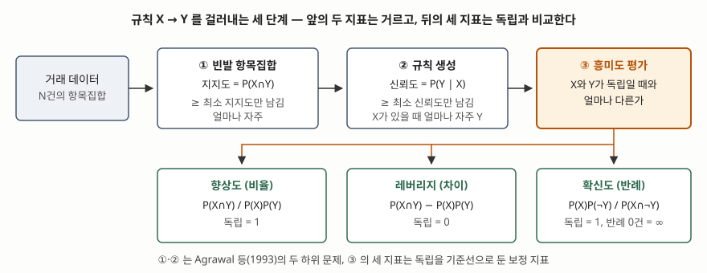

기출문제에서 데이터마이닝의 연관 규칙 분석 지표를 설명하라고 묻는다. 지지도·신뢰도·향상도
세 개를 공식과 함께 쓰면 기본은 채운다. 점수가 갈리는 곳은 **왜 세 개가 필요한가**다 —
신뢰도가 높아도 그 규칙이 아무 의미가 없을 수 있고, 그것을 잡아내려고 향상도가 나왔다.
아래 수치는 전부 가상 카페 거래 10건으로 [`code/rules.py`](code/rules.py)를 돌려 계산했다.

---

## Ⅰ. 정의

**연관 규칙 분석(Association Rule Analysis)** 은 **거래 데이터에서 "항목집합 X를 포함하는 거래는
항목집합 Y도 포함하는 경향이 있다"는 X → Y 형태의 규칙을 찾아내는 데이터마이닝 기법**이다.
X를 조건(antecedent), Y를 결과(consequent)라 하고 X와 Y는 겹치지 않는다. 장바구니 분석이
대표 용도라 시장바구니 분석이라고도 부른다.

Agrawal·Imielinski·Swami(1993)는 이 문제를 **두 하위 문제**로 나눴다. 최소 지지도를 넘는 항목집합을
전부 찾고, 그 집합들에서 최소 신뢰도를 넘는 규칙을 만든다. 지표는 이 두 단계의 **거르는 기준**과,
걸러진 규칙이 **우연 이상인지 판단하는 기준**으로 나뉜다.

## Ⅱ. 지표 5가지



> **출처**: [Agrawal·Imielinski·Swami, "Mining Association Rules between Sets of Items in Large Databases", ACM SIGMOD 1993 §2 Formal Model](https://doi.org/10.1145/170035.170072) · [Hahsler, arules Interest Measures — Support, Confidence, Lift, Leverage, Conviction](https://mhahsler.github.io/arules/docs/measures)

| 구분 | 지표 | 공식 | 범위 / 독립일 때 | 원 출처 |
|---|---|---|---|---|
| 거르는 지표 | **지지도** Support | P(X∩Y) | 0~1 | Agrawal 외 1993 |
| | **신뢰도** Confidence | P(X∩Y) / P(X) = P(Y\|X) | 0~1 | Agrawal 외 1993 |
| 독립과 비교 | **향상도** Lift | P(X∩Y) / (P(X)·P(Y)) | 0~∞ / **1** | Brin 외 1997 |
| | **레버리지** Leverage | P(X∩Y) − P(X)·P(Y) | −0.25~0.25 / **0** | Piatetsky-Shapiro 1991 |
| | **확신도** Conviction | (1 − P(Y)) / (1 − 신뢰도) | 0~∞ / **1** | Brin 외 1997 |

- **지지도**는 규칙이 **얼마나 자주** 나오는가다. 드문 조합을 버려 탐색 공간을 줄인다
- **신뢰도**는 X가 있을 때 Y가 **얼마나 따라오는가**다. 규칙의 방향이 있어 X→Y와 Y→X가 다르다
- **향상도**는 신뢰도를 Y 자체의 빈도로 나눈 비율이다. **1보다 크면 양의 연관, 1이면 독립,
  1보다 작으면 음의 연관**이다. X와 Y를 바꿔도 값이 같다
- **레버리지**는 같은 비교를 비율이 아니라 **차이**로 잰다. 지지도 자체가 작은 조합은 향상도가
  커도 레버리지는 작으므로 **빈도까지 반영한** 판단이 된다
- **확신도**는 규칙의 **반례**(X는 있는데 Y가 없는 거래)가 독립일 때보다 얼마나 적은지다.
  반례가 0건이면 무한대가 되고, 향상도와 달리 **방향이 있다**

### 예제 — 신뢰도만 보면 틀리는 규칙

거래 10건에서 품목별 지지도는 커피 0.8, 빵 0.5, 우유 0.4, 케이크 0.4다. 최소 지지도 0.3,
최소 신뢰도 0.6으로 거른 규칙 일부다. 신뢰도 0.375·향상도 0.9375처럼 끝자리가 5인 값은
출력이 짝수 쪽으로 반올림해 0.37·0.937로 찍혔다.

```text
규칙                   지지도    신뢰도    향상도    레버리지    확신도  판정
{빵}→{우유}             0.40    0.80   2.000     0.20    3.00  채택
{우유}→{빵}             0.40    1.00   2.000     0.20     inf  채택
{빵}→{커피}             0.40    0.80   1.000     0.00    1.00  채택
{케이크}→{커피}           0.30    0.75   0.937    -0.02    0.80  채택 (향상도 < 1: 음의 연관)
```

**{빵}→{커피}가 이 문제의 핵심이다.** 신뢰도 0.8로 기준을 넉넉히 넘었는데 향상도는 정확히 1,
레버리지는 0이다. 빵을 산 사람의 80%가 커피를 샀지만 **전체 손님의 80%도 커피를 샀다.**
빵과 커피는 서로 아무 관계가 없다. {케이크}→{커피}는 신뢰도 0.75로 채택되지만 향상도 0.9375로
오히려 **케이크 손님이 커피를 덜 산다.** 결과 쪽 항목이 흔할수록 신뢰도는 저절로 높아지므로,
**신뢰도만으로 고르면 인기 상품이 결과에 붙은 규칙이 몰려 들어온다.** 향상도·레버리지·확신도가
모두 P(Y)를 공식 안에 넣고 독립을 기준선으로 두는 이유가 이것이다.

## Ⅲ. 활용과 고려사항 — 4가지

- **최소 지지도를 너무 낮추면 항목집합이 폭발한다.** 항목 k개의 부분집합은 2ᵏ개다. Apriori는
  **빈발하지 않은 집합의 상위 집합도 빈발하지 않다**는 성질로 후보를 잘라 이것을 막는다.
  반대로 너무 높이면 매출은 작아도 이익이 큰 드문 조합을 놓친다
- **지지도·신뢰도로 거르고 향상도로 순위를 매긴다.** 앞의 두 지표는 계산 비용을 줄이는 문이고,
  규칙의 의미는 독립과 비교하는 지표로 판단한다. 위 예제처럼 거르는 지표만 통과한 규칙에는
  향상도 1 이하가 섞인다
- **향상도는 드문 조합에서 부풀려진다.** 지지도가 작으면 몇 건만 겹쳐도 비율이 크게 뛴다.
  레버리지나 최소 지지도를 함께 보아 우연을 거른다
- **연관은 인과가 아니다.** 규칙은 동시 출현을 말할 뿐 X 때문에 Y를 샀다는 뜻이 아니다. 진열·
  묶음 할인 같은 조치의 효과는 A/B 테스트처럼 통제 실험으로 따로 확인한다

> 함께 보기: [기출문제 — A/B 테스팅](../2026-11-09-ab-testing-online-controlled-experiments/index.md)

> 개념 정리: [Apriori 알고리즘 — 빈발 항목집합 탐색과 후보 가지치기](../../data-analysis/2026-11-10-apriori-candidate-pruning/index.md)

끝

## 답안 작성 메모

- **먼저 쓸 것**: 지표 표. 공식과 "독립일 때 값" 칸을 같이 그려 두면 향상도·레버리지·확신도
  설명이 "그 칸과 비교한다"로 짧아진다.
- **점수가 갈리는 지점**: ① **신뢰도가 높아도 향상도 1이면 무의미**하다는 반례를 숫자로 드는가,
  ② 향상도는 **대칭**, 신뢰도·확신도는 **방향이 있다**는 차이를 적는가, ③ 지표를 **거르는 것과
  평가하는 것**으로 나눠 쓰는가.
- **개수를 붙인다**: 하위 문제 **2단계**, 지표 **5가지**(기본 3 + 보완 2), 고려사항 **4가지**.
  시간이 없으면 기본 3가지만 써도 문항 요구는 채운다.
- **예제는 작게 만든다**: 거래 10건, 품목 4개면 손으로 계산이 1분 안에 끝난다. 결과 쪽 품목을
  일부러 흔하게(커피 80%) 두어야 신뢰도 함정이 드러난다.
- **시간이 모자라면**: 레버리지·확신도와 고려사항 뒤쪽 두 항목을 버린다. 향상도 반례는 지킨다.
- **쓰지 말 것**: "향상도가 2이므로 빵을 사면 우유를 살 확률이 2배다." 향상도는 **독립일 때 대비
  동시 출현 비율**이지 구매 확률의 배수가 아니다. 그리고 근거 없는 업종별 기준값을 쓰지 않는다.

## 참고 자료

- [R. Agrawal, T. Imielinski, A. Swami, "Mining Association Rules between Sets of Items in Large Databases", *Proc. ACM SIGMOD* 1993, pp. 207–216](https://doi.org/10.1145/170035.170072) — 지지도·신뢰도 정의, 빈발 항목집합과 규칙 생성 두 하위 문제
- [S. Brin, R. Motwani, J. D. Ullman, S. Tsur, "Dynamic Itemset Counting and Implication Rules for Market Basket Data", *Proc. ACM SIGMOD* 1997, pp. 255–264](https://doi.org/10.1145/253260.253325) — 향상도와 확신도의 원 출처. Hahsler 지표 목록의 인용으로 확인, 원문 미열람
- G. Piatetsky-Shapiro, "Discovery, Analysis, and Presentation of Strong Rules", in *Knowledge Discovery in Databases*, AAAI/MIT Press, 1991 — 레버리지의 원 출처. Hahsler 지표 목록의 인용으로 확인, 원문 미열람
- [M. Hahsler, arules Interest Measures](https://mhahsler.github.io/arules/docs/measures) — 지표별 공식·범위·독립일 때 값·원 출처를 정리한 R 패키지 문서
- [P.-N. Tan, M. Steinbach, V. Kumar, *Introduction to Data Mining* Ch.6 Association Analysis 강의 슬라이드](https://www-users.cse.umn.edu/~kumar001/dmbook/dmslides/chap6_basic_association_analysis.pdf) — 지지도·신뢰도 예제와 Apriori 원리
- 전체 소스: [`code/rules.py`](code/rules.py) · 실행 기록: [`code/output.txt`](code/output.txt)
