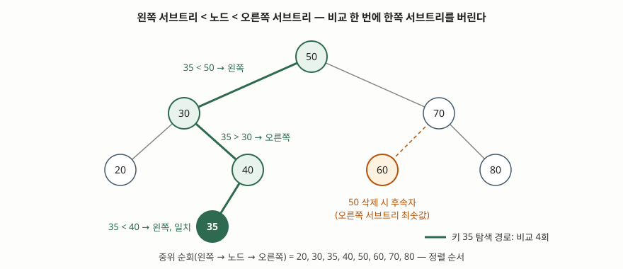

기출문제에서 이진 탐색 트리를 설명하라고 묻는다. 단답형이라 정의와 연산을 쓰면 반은 채우지만,
점수가 갈리는 곳은 그다음이다 — **같은 키 집합이라도 넣는 순서에 따라 성능이 로그에서 선형까지
떨어진다**는 약점과, 그 약점이 AVL·레드-블랙 같은 균형 트리가 생긴 이유라는 연결이다.
아래 예제의 탐색 경로·삭제 결과·높이는 전부 [`code/bst.py`](code/bst.py)로 돌려 확인했다.

---

## Ⅰ. 정의

**이진 탐색 트리(Binary Search Tree, BST)** 는 **각 노드가 키를 하나씩 갖고, 어느 노드에서든
왼쪽 서브트리의 모든 키는 그 노드의 키보다 작고 오른쪽 서브트리의 모든 키는 그 노드의 키보다
큰 이진 트리**다. NIST 알고리즘·자료구조 사전과 Sedgewick·Wayne 교재가 같은 순서 조건으로
정의한다. 두 자료 모두 부등호가 엄격하므로 **키가 중복되지 않는다는 것을 전제로 한다.**

이 순서 조건 하나에서 두 성질이 따라 나온다.

- **분할 탐색**: 노드 하나와 비교하면 찾는 키가 어느 쪽 서브트리에 있는지 정해진다. 나머지
  한쪽은 통째로 버린다
- **정렬 순회**: 왼쪽 → 노드 → 오른쪽 순서로 도는 **중위 순회**가 키를 오름차순으로 내놓는다.
  정렬된 배열의 이진 탐색과 같은 효과를 내면서 삽입·삭제 때 원소를 밀어 옮기지 않는다

## Ⅱ. 연산과 구조



> **출처**: [Sedgewick·Wayne, *Algorithms* 4th ed. §3.2 Binary Search Trees — Definition, Search, Insert, Deletion](https://algs4.cs.princeton.edu/32bst/) · [NIST DADS, binary search tree](https://xlinux.nist.gov/dads/HTML/binarySearchTree.html)

삽입 순서 `50, 30, 70, 20, 40, 60, 80, 35` 로 만든 8노드 트리다. 높이는 3이다.

### 가. 기본 연산 3가지

| 연산 | 동작 | 예제 결과 |
|---|---|---|
| **탐색** | 루트부터 비교해 작으면 왼쪽, 크면 오른쪽. 같으면 성공, 빈 링크면 실패 | 35: `50→30→40→35` **4회 비교 성공**. 65: `50→70→60` 3회 비교 후 실패 |
| **삽입** | 탐색이 실패한 빈 링크 자리에 새 노드를 단다. 기존 노드는 움직이지 않는다 | 35는 40의 왼쪽 빈 자리에 붙었다 |
| **삭제** | 자식 수에 따라 세 경우로 나눈다 (아래 나.) | |

### 나. 삭제 3경우 — Hibbard 삭제

| 경우 | 처리 | 예제 (차례로 삭제) |
|---|---|---|
| ① 자식 0개 | 노드를 떼어낸다 | 20 삭제 → 30의 왼쪽이 빈다 |
| ② 자식 1개 | 그 자식을 부모에 바로 잇는다 | 40 삭제 → 35가 30의 오른쪽으로 올라간다 |
| ③ 자식 2개 | **후속자**(오른쪽 서브트리의 최솟값)가 그 자리를 잇는다 | 50 삭제 → 60이 루트가 된다 |

③이 이 연산의 핵심이다. 후속자는 오른쪽 서브트리에서 가장 작으므로 **왼쪽 서브트리의 모든 키보다
크고, 오른쪽에 남는 모든 키보다 작다.** 그래서 그 자리에 놓아도 순서 조건이 깨지지 않는다.
세 번 삭제한 뒤의 중위 순회는 `30, 35, 60, 70, 80`으로 여전히 정렬 순서다. 이 방법은 T. Hibbard가
1962년에 제안했다고 교재가 밝힌다.

### 다. 순서 기반 연산

정렬 순서가 유지되므로 해시 테이블에 없는 연산이 따라온다. 최솟값·최댓값, floor(키 이하 최대)·
ceiling(키 이상 최소), rank(그보다 작은 키 개수)·select(k번째 키), 범위 탐색이다. **교재는 이
연산들이 최악의 경우 트리 높이에 비례하는 시간이 든다**고 정리한다.

## Ⅲ. 성능과 고려사항

### 가. 성능은 높이가 정한다

| 상황 | 비교 횟수 | 근거 |
|---|---|---|
| 무작위 순서 입력, 평균 | **~2 ln N (약 1.39 lg N)** | 교재 §3.2 분석 명제 |
| 최악 (정렬된 입력 등) | **N** (연결 리스트와 같다) | 높이 비례 명제 |

직접 돌려 보면 차이가 그대로 나온다.

```text
== 4. 입력 순서와 높이 (N=15) ==
정렬 순서 입력 높이: 14
균형 순서 입력 높이: 3

== 5. 무작위 입력의 평균 비교 횟수 ==
N=  1000: 측정 11.98회, 2 ln N = 13.82, lg N = 9.97, 높이 23
N= 10000: 측정 17.71회, 2 ln N = 18.42, lg N = 13.29, 높이 28
```

**같은 15개 키를 1부터 차례로 넣으면 높이가 14다.** 모든 노드가 오른쪽 자식 하나만 가진 사슬이
되고 탐색은 순차 탐색으로 떨어진다. 무작위 입력의 측정값은 lg N보다 크고 2 ln N 근처에 있다.
`~` 는 N이 커질 때의 주항만 적은 표기라 유한한 N에서 측정값과 정확히 같지는 않다.

### 나. 고려사항 4가지

- **입력 순서를 통제할 수 없으면 균형 트리를 쓴다.** 로그·타임스탬프·자동 증가 번호처럼 정렬된
  채로 들어오는 키가 실무에서는 흔하다. AVL 트리·레드-블랙 트리는 삽입·삭제 때 회전으로 높이를
  O(log N)에 묶는다. Java의 `TreeMap`은 API 문서에 레드-블랙 트리 기반이라고 밝힌다
- **삭제가 대칭이 아니다.** 후속자만 쓰면 삽입·삭제가 오래 섞일수록 트리가 한쪽으로 기운다.
  교재는 150노드 트리에 무작위 삭제·삽입을 반복하면 **왼쪽으로 치우친다**는 그림을 싣는다.
  선행자와 후속자를 번갈아 쓰거나 균형 트리로 간다
- **디스크에서는 이진이 아니라 다진(多進)으로 간다.** 노드 하나가 디스크 블록 하나면 비교 한 번마다
  I/O가 한 번 든다. 그래서 DBMS 인덱스는 노드 하나에 키를 여러 개 담아 높이를 낮춘 B-트리
  계열을 쓴다
- **중복 키 정책을 먼저 정한다.** 정의가 엄격 부등호이므로 같은 키는 거부하거나, 값을 덮어쓰거나,
  노드에 개수를 두는 방식 중 하나를 골라야 한다. 예제 코드는 무시하는 쪽을 택했다

> 함께 보기: [기출문제 — 이진 탐색 트리와 라우팅 테이블 탐색 알고리즘의 상관관계](../2026-10-20-bst-and-routing-table-lookup/index.md)

끝

## 답안 작성 메모

- **먼저 쓸 것**: 순서 조건 한 줄 정의와 8노드 내외 트리 그림. 그림에 탐색 경로를 굵게 그어 두면
  탐색·삽입 설명이 그림을 가리키는 것으로 끝난다.
- **점수가 갈리는 지점**: ① 삭제의 **자식 2개 경우**를 후속자로 정확히 쓰는가, ② **중위 순회 =
  정렬**을 적는가, ③ **최악 O(N)과 그 원인(정렬된 입력)** 을 적고 균형 트리로 잇는가. 셋째가
  빠지면 교과서 정의를 옮긴 답안이 된다.
- **개수를 붙인다**: 기본 연산 **3가지**, 삭제 **3경우**, 고려사항 **4가지**.
- **숫자는 출처 있는 것만**: 평균 비교 횟수는 교재 명제의 `~2 ln N (약 1.39 lg N)` 을 그대로 쓴다.
  "평균 O(log N)"까지만 써도 감점은 없지만, 상수 1.39를 적으면 근거를 아는 답안으로 읽힌다.
- **시간이 모자라면**: 순서 기반 연산(다.)과 고려사항 뒤쪽 두 항목을 버린다. 삭제 3경우 표와
  높이 비교(14 대 3)는 지킨다.
- **논술형으로 커지면**: "BST의 한계와 균형 트리 비교"로 나온다. AVL(높이 차 1 이하)·레드-블랙
  (색 규칙)·B-트리(다진 노드)를 회전 비용·높이 상한·쓰임새로 비교표를 세운다.

## 참고 자료

- [Robert Sedgewick, Kevin Wayne, *Algorithms* 4th ed. (Addison-Wesley, 2011) §3.2 Binary Search Trees](https://algs4.cs.princeton.edu/32bst/) — 정의, 탐색·삽입, 분석 명제(평균 ~2 ln N 비교, 최악 높이 비례), 순서 기반 연산, Hibbard 삭제와 비대칭 문제
- [NIST Dictionary of Algorithms and Data Structures, "binary search tree"](https://xlinux.nist.gov/dads/HTML/binarySearchTree.html) — 정의와 특수화(AVL·splay·randomized BST 등) 목록
- [Oracle, Java SE 21 API, `java.util.TreeMap`](https://docs.oracle.com/en/java/javase/21/docs/api/java.base/java/util/TreeMap.html) — 레드-블랙 트리 기반 구현이라는 클래스 설명
- T. N. Hibbard, "Some Combinatorial Properties of Certain Trees With Applications to Searching and Sorting", *Journal of the ACM* 9(1), 1962 — 후속자 삭제의 원 논문. 교재 서술로 확인, 원문 미열람
- 전체 소스: [`code/bst.py`](code/bst.py) · 실행 기록: [`code/output.txt`](code/output.txt)
