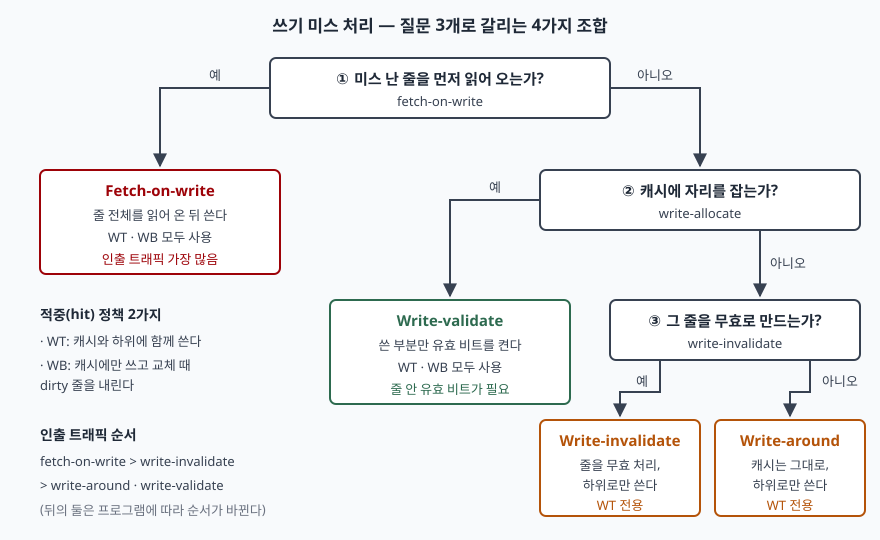
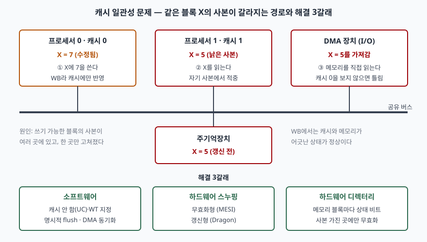

기출문제가 캐시 메모리에 대해 두 가지를 묻는다. 하나는 쓰기 정책이고, 다른 하나는 캐시
일관성 문제가 왜 생기고 어떻게 푸는가다. 두 물음은 따로 떨어진 것이 아니다. **쓰기 정책을
무엇으로 고르느냐가 캐시와 메모리가 어긋나는 시간을 정하고**, 그 어긋남이 다른 프로세서와
I/O 장치에게 보이는 순간 일관성 문제가 된다. 그래서 Ⅱ에서 쓰기 정책을 적중과 미스로 나눠
두고, Ⅲ에서 원인마다 어느 쓰기 정책에서 생기는지를 붙인 뒤, Ⅳ에서 두 주제가 만나는
지점을 따로 정리한다.

> 실행 검증 없음. 개념 문제이므로 원 논문·기술 보고서·제조사 매뉴얼·커널 공식 문서 근거만으로
> 정리했다. 쓰기 미스 조합 4가지와 측정값은 Jouppi의 DEC WRL 보고서(1991)에서, WT·WB 메모리
> 타입의 동작과 스누핑은 Intel SDM Vol. 3A에서, 일관성 문제의 원인과 기존 해법 분류는
> Papamarcos·Patel(1984)에서, 갱신형 프로토콜의 동작은 Baukus·van der Meyden의 MOESI 분석
> 논문에서, DMA 매핑은 Linux 커널 7.4.0-rc2 문서에서 확인했다. 원문에 없는 성능 배수는 적지
> 않았다.

---

## Ⅰ. 개요

### 가. 캐시 메모리와 쓰기의 문제

캐시는 **프로세서와 주기억장치 사이에 두는 작고 빠른 기억장치로, 최근에 쓴 블록의 사본을
보관해 메모리 접근 시간을 줄인다.** 읽기는 사본을 돌려주면 끝나지만 쓰기는 다르다. 캐시의
사본을 고치는 순간 **같은 블록이 두 군데 이상에 다른 값으로 존재할 수 있다.** 그 차이를
언제 없애느냐가 쓰기 정책이고, 다른 프로세서·장치가 그 차이를 보지 않게 하는 것이 일관성
유지다.

### 나. 두 주제의 관계

| 구분 | 쓰기 정책 | 캐시 일관성 |
|---|---|---|
| 다루는 관계 | 캐시 하나 ↔ 하위 메모리 | 캐시 여럿·I/O ↔ 같은 블록 |
| 결정하는 것 | 쓰기를 언제·어디로 내보내는가 | 사본들이 같은 값을 보이게 하는 규칙 |
| 단일 프로세서에서 | 항상 필요 | I/O(DMA)가 있으면 필요 |
| 대표 기법 | WT·WB, write-allocate 여부 | 소프트웨어 제어, 스누핑, 디렉터리 |

## Ⅱ. 캐시 쓰기 정책 (Write Policy)

Jouppi의 보고서는 쓰기 정책을 **적중(write hit)** 과 **미스(write miss)** 두 축으로 나눠
다룬다. 두 축은 독립이 아니다. 미스 정책 일부는 특정 적중 정책에서만 쓸 수 있다.

### 가. 쓰기 적중 정책 — 2가지

① **Write-through(WT, 즉시 쓰기).** 쓰기를 캐시 줄과 하위 메모리에 **함께** 반영한다. Intel
SDM의 WT 메모리 타입 정의(§12.3)는 모든 쓰기가 캐시 줄과 시스템 메모리로 함께 가며, 이 방식이
**프로세서 캐시와 시스템 메모리 사이의 일관성을 강제한다**고 적는다. 메모리가 늘 최신이므로
캐시 줄을 버려도 잃는 것이 없다.

② **Write-back(WB, 나중 쓰기).** 쓰기를 캐시에만 반영하고, 고친 줄(dirty)은 **교체될 때
한꺼번에** 내려 보낸다. 같은 정의 절은 WB가 불필요한 메모리 쓰기를 없애 **버스 트래픽을
줄인다**고 적고, 되쓰기(write-back)가 일어나는 때를 두 가지로 든다. 꽉 찬 캐시에 새 줄을
들이느라 줄을 내보낼 때와, **일관성 유지 장치가 요구할 때**다. 대신 시스템 버스의 모든
장치가 메모리 접근을 스누핑할 수 있어야 한다는 조건을 붙인다.

| 비교 항목 | Write-through | Write-back |
|---|---|---|
| 적중 시 쓰기 위치 | 캐시 + 하위 메모리 | 캐시만 |
| 메모리 사본 | 항상 최신 | 교체 전까지 낡을 수 있음 |
| 줄마다 필요한 비트 | 없음 | dirty 비트 |
| 쓰기 대기 장치 | 쓰기 버퍼 (Jouppi: 3~5칸) | dirty 줄 내보내기 레지스터 |
| 하위로 나가는 트래픽 | 쓰기마다 발생 | 교체되는 dirty 줄만 |
| 고장 대비 | 패리티로 충분 | 캐시에만 최신 값 → ECC 필요 |
| 일관성 측면 | 메모리와는 일치 | 다른 장치가 스누핑해야 함 |

Jouppi는 고성능 WT와 WB가 요구하는 하드웨어가 **놀랄 만큼 비슷하다**고 정리한다. WB는 dirty
줄 내보내기 레지스터를, WT는 쓰기 버퍼를 두고, WB는 줄마다 dirty 비트를 둔다. 남는 차이는
고장 대비와 남은 쓰기 트래픽이다. 측정에서 4KB 직접 사상 캐시에 **5칸짜리 쓰기 캐시**를 붙인
WT는 쓰기 트래픽을 40% 줄였고, 같은 크기 WB는 18%를 더 줄였다. 32KB에서는 WB가 쓰기 캐시를 붙인
WT보다 32%를 더 줄여, 남은 쓰기 트래픽이 절반이 됐다. 그래서 보고서는 **작고 중간 크기의 온칩
캐시에는 WT가, 캐시가 커질수록 WB가 유리하다**고 결론짓는다. 이 값은 1991년 벤치마크 6개에서
잰 것이므로, 답안에는 수치보다 **"캐시가 클수록 WB의 트래픽 이점이 커진다"는 방향**을 쓴다.

### 나. 쓰기 미스 정책 — 질문 3개, 조합 4가지

> **출처**: [Jouppi, Cache Write Policies and Performance, DEC WRL Research Report 91/12 (1991-12) — §3 Write Hits, §4 Write Misses, Figure 12 Write miss alternatives, Figure 17](https://ftp.mirrorservice.org/sites/www.bitsavers.org/pdf/dec/tech_reports/WRL-91-12.pdf), 적중 정책 정의는 [Intel SDM Vol. 3A 253668-082US — §12.3 Methods of Caching Available](https://cdrdv2-public.intel.com/812386/253668-sdm-vol-3a.pdf) 근거다.

쓰기 미스 정책은 흔히 write-allocate와 no-write-allocate 둘로만 쓰지만, Jouppi는 질문 세 개를
조합해 정리한다. **미스 난 줄을 먼저 읽어 오는가(fetch-on-write)**, **캐시에 자리를 잡는가
(write-allocate)**, **그 줄을 무효로 만드는가(write-invalidate)**. 여덟 조합 가운데 쓸모 있는
것은 네 가지다. 읽어 와 놓고 버리거나, 자리를 잡아 놓고 무효로 만드는 조합은 의미가 없기
때문이다.

| 조합 | 미스 시 동작 | 쓸 수 있는 적중 정책 |
|---|---|---|
| ① Fetch-on-write | 줄 전체를 읽어 와 채운 뒤 쓴다 | WT·WB |
| ② Write-validate | 읽지 않고 자리를 잡아 쓰고, **쓴 부분만** 유효 비트를 켠다 | WT·WB |
| ③ Write-around | 캐시는 그대로 두고 하위로만 쓴다 | WT |
| ④ Write-invalidate | 그 줄을 무효로 표시하고 하위로만 쓴다 | WT |

①은 문헌에서 사실상 write-allocate와 같은 뜻으로 쓰여 왔다. Intel SDM의 WB 정의도 P6 계열부터
**쓰기 미스가 줄 채우기를 일으킨다**고 적어 이 방식을 따른다. 반대로 WT 정의는 메모리로 쓸 때
**무효 상태의 줄은 채우지 않는다**고 적는다. no-write-allocate 쪽이다.

③·④는 쓰기가 캐시에 들어가지 않으므로 **WT에서만** 의미가 있다. ④는 직접 사상 WT 캐시에서
태그 비교와 동시에 데이터를 쓰고, 태그가 안 맞으면 줄을 무효로 돌리는 방식이라 구현이 가장
단순하다.

② **Write-validate**는 줄 안에 워드 단위 유효 비트(서브블록)를 둬야 하고, 하위 메모리가 줄
일부 쓰기를 받아 줘야 한다. 바이트 단위로 유효 비트를 두면 비용이 12.5%(바이트당 1비트)로
워드 단위 3.1%보다 크므로, 바이트 쓰기에는 ①을 쓰는 절충이 현실적이라고 보고서는 적는다.

**성능 순서.** 줄을 읽어 오는 트래픽은 ①이 가장 많고, ④가 그다음이며, ②와 ③은 항상 ④보다
적다. ②와 ③ 사이는 프로그램에 따라 갈리지만, 프로그램은 **방금 쓴 데이터를 다시 읽을 가능성이
옛 내용을 다시 읽을 가능성보다 높으므로** 대개 ②가 낫다. 8~128KB·16B 줄 구성에서 ①과 비교한
전체 미스 감소는 ② 30~35%, ③ 15~25%, ④ 10~20%였다. 줄이 길어질수록 줄 안의 옛 데이터가 쓰일
확률이 높아져 ②의 이점은 줄어든다. 대량 복사처럼 **목적지를 읽지 않고 덮어쓰기만 하는** 연산에서
①은 읽어 온 데이터 절반을 버리게 되어 대역 효율이 3분의 2로 떨어진다.

### 다. 정책 선택 기준 — 3가지

① **캐시 크기와 계층.** 작은 L1은 WT + 쓰기 버퍼로도 트래픽을 감당하고 패리티만으로 고장에
대비할 수 있다. 큰 캐시일수록 WB가 트래픽을 더 줄인다.

② **접근 패턴.** 복사·스트리밍처럼 쓰고 다시 읽지 않는 패턴은 no-fetch-on-write 계열이 유리하다.
읽고-고치고-쓰는 패턴(Jouppi가 든 linpack의 saxpy)은 쓰기 전에 이미 읽었으므로 미스 정책의
차이가 거의 없다.

③ **캐시를 공유하는 주체.** 버스에 스누핑하지 않는 장치가 있으면 WB는 그대로 쓸 수 없다. 이것이
Ⅲ의 일관성 문제로 이어진다.

## Ⅲ. 캐시 일관성(Cache Coherence) 문제의 원인과 해결 방법

### 가. 정의

캐시 일관성은 **같은 메모리 블록의 사본이 여러 캐시와 메모리에 있을 때, 어느 쪽을 통해 읽어도
가장 최근에 쓴 값이 보이도록 사본들을 맞추는 성질**이다. Baukus·van der Meyden은 일관성
프로토콜을 캐시들이 공유 버스 위에서 수행하는, **사본 사이의 일치를 보장하기 위한 규약**으로
정의한다.

> **출처**: 원인과 기존 해법 분류는 [Papamarcos & Patel, A Low-Overhead Coherence Solution for Multiprocessors with Private Cache Memories, ISCA 1984 — §I Introduction, §II Proposed Coherence Solution](https://www.csl.cornell.edu/courses/ece5750/papamarcos.isca84.pdf), WB와 스누핑 조건·비캐시 지정은 [Intel SDM Vol. 3A 253668-082US — §12.2 Caching Terminology, §12.3 Methods of Caching Available, §12.7 Implicit Caching](https://cdrdv2-public.intel.com/812386/253668-sdm-vol-3a.pdf), DMA 동기화는 [Linux kernel 7.4.0-rc2 문서 — Dynamic DMA mapping Guide](https://docs.kernel.org/core-api/dma-api-howto.html), 갱신형은 [Baukus & van der Meyden, A Knowledge Based Analysis of Cache Coherence — Dragon 프로토콜 설명](https://cgi.cse.unsw.edu.au/~meyden/research/moesi.pdf) 근거다. 그림의 값 5·7은 설명용 예시다.

### 나. 원인 — 3가지

**① 쓰기 가능한 공유 데이터가 여러 사설 캐시에 사본으로 존재한다.** Papamarcos·Patel은 프로세서마다
사설 캐시를 두는 구조가 일관성 문제를 안고 있다고 적는다. 같은 쓰기 가능 블록이 둘 이상의
캐시에 있으면 한 프로세서가 **자기 사본만 고칠 수 있기** 때문이다. 그림에서 프로세서 0이 X를 7로
고친 뒤에도 프로세서 1은 자기 캐시에서 5를 적중한다. 읽기만 하는 데이터는 사본이 여럿이어도
문제가 없다. **쓰기가 있어야** 문제가 된다.

**② WB 정책이 캐시와 메모리의 불일치를 정상 상태로 만든다.** 같은 논문은 WB에서는 캐시와 주기억
사이의 일치가 유지되지 않으며, WT에서는 유지할 수 있다고 대비한다. WB를 고르는 이유가 트래픽
감소인데, 그 대가로 **메모리에 있는 값을 믿을 수 없게 된다.** 메모리를 직접 읽는 주체가 하나라도
있으면 틀린 값을 가져간다.

**③ 캐시를 거치지 않는 주체가 메모리에 접근한다.** DMA 장치처럼 메모리를 직접 읽고 쓰는 I/O가
대표적이다. 장치가 메모리에 쓰면 캐시에 남은 옛 사본이 낡고, 캐시에만 있는 최신 값은 장치가
보지 못한다. Papamarcos·Patel은 WB를 쓰면 **I/O 프로세서도 캐시와 같은 프로토콜을 따라야 한다**고
적는다. Intel SDM의 암묵적 캐싱 절(§12.7)은 스누핑 장치가 감지하지 못하는 변경 — 이중 포트 메모리
보드에 대한 쓰기, 메모리에 있는 페이지 테이블 항목의 변경 — 에 대해서는 **운영체제가 캐시를
명시적으로 무효화해야 한다**고 적는다.

| 원인 | 생기는 조건 | 관련 쓰기 정책 |
|---|---|---|
| ① 공유 쓰기 데이터 | 다중 프로세서 + 사설 캐시 | WT·WB 모두 (캐시 사이 불일치) |
| ② 메모리 사본이 낡음 | 메모리를 읽는 다른 주체 존재 | WB에서 발생 |
| ③ 캐시를 거치지 않는 접근 | DMA·스누핑 못 하는 장치 | WB에서 심함, WT도 장치 쓰기는 문제 |

### 다. 해결 방법 — 3갈래

**(1) 소프트웨어로 막는다 — 3가지**

① **캐시하지 않거나 WT로 지정한다.** Intel SDM의 메모리 타입 정의(§12.3)는 강한 비캐시(UC)가
메모리 사상 I/O 장치에 적합하다고 적고, WT는 **스누핑하지 않는 장치가 버스에 있을 때** 적합하다고
적는다. 공유 영역을 캐시하지 않으면 문제가 생기지 않지만 그만큼 캐시 효과를 포기한다. 같은
절은 UC를 일반 RAM에 쓰면 성능이 크게 떨어진다고 적는다.

② **명시적으로 flush·무효화한다.** 하드웨어가 감지하지 못하는 변경이 있으면 운영체제가 캐시를
되쓰고 무효로 만든다(앞의 §12.7). 비용은 프로그래머와 운영체제가 언제 해야 하는지를 정확히 알아야
한다는 점이다.

③ **DMA 버퍼의 소유권을 넘길 때 동기화한다.** Linux DMA 매핑 지침은 두 종류를 구분한다.
**일관 매핑(coherent)** 은 장치와 CPU가 명시적 flush 없이 서로의 갱신을 보도록 하드웨어가 보장하는
영역이고, **스트리밍 매핑(streaming)** 은 전송마다 매핑하는 영역으로 일관성 범위 밖에 있다고 본다.
스트리밍 버퍼는 장치가 쓴 뒤 CPU가 읽기 전에 `dma_sync_single_for_cpu()`를, CPU가 고친 뒤 장치에
다시 넘기기 전에 `dma_sync_single_for_device()`를 부른다. 같은 지침은 일관성이 보장되지 않는
CPU에서 **CPU와 장치가 같은 캐시 줄의 서로 다른 워드에 쓰면 서로 덮어쓸 수 있으므로** DMA 버퍼를
캐시 줄 경계에 맞추라고 적는다.

**(2) 하드웨어 스누핑 — 버스를 엿들어 맞춘다**

모든 캐시가 공유 버스의 요청을 감시하다가 자기에게 있는 블록이 언급되면 상태를 바꾼다. Intel SDM의
캐싱 용어 절(§12.2)은 다중 프로세서에서 각 프로세서가 다른 프로세서의 메모리 접근을 스누핑해
캐시를 메모리 및 다른 캐시와 맞춘다고 적는다. 다른 쪽이 쓰려는 줄을 공유 상태로 갖고 있으면
무효로 만들고, 수정된 줄을 다른 쪽이 읽으려 하면 HITM# 신호로 알린 뒤 **요청한 프로세서에 바로
넘기는 암묵적 되쓰기**를 수행하며, 메모리 컨트롤러가 이것을 스누핑해 메모리를 갱신한다.
남의 사본을 어떻게 처리하느냐에 따라 두 갈래로 나뉜다.

① **무효화형(write-invalidate).** 공유 블록에 쓰면 다른 사본을 무효로 만든다. 가장 단순한
형태는 쓸 때마다 주소를 전체에 뿌리는 방식인데, Papamarcos·Patel은 쓰기가 참조의 25%면 **프로세서
넷이 되기 전에** 버스가 포화된다고 적는다. Goodman의 **write-once**는 블록에 처음 쓸 때만 무효화를
뿌리고 동시에 메모리로 써 보내며, 두 번째 쓰기부터는 WB로 동작하는 WT·WB 결합 방식이다.
**MESI**는 줄마다 2비트로 M·E·S·I 네 상태를 두고, 미스 시점에 다른 캐시에 사본이 있는지를 알아
**혼자 가진 블록(E)에 쓸 때는 무효화를 보내지 않는다.** 그 결과 버스에는 미스, 실제로 필요한
무효화, 메모리 쓰기만 남는다.

② **갱신형(write-update, write-broadcast).** 공유 블록에 쓰면 새 값을 버스로 보내 **다른 사본을
고친다.** Baukus·van der Meyden이 설명한 Dragon 프로토콜은 한 번 들어온 줄을 내보낼 때까지 최신으로
유지한다. 혼자 가진 줄은 읽기·쓰기가 모두 캐시 안에서 끝나고, **다른 캐시도 가지고 있을 수 있는
줄은 모든 쓰기가 버스로 나가 사본을 갱신한다.** 메모리는 처음 줄을 공급한 뒤로는 소유한 캐시가
줄을 내보낼 때만 관여하고, 두 dirty 상태가 소유권과 되쓰기 책임을 나타낸다.

**(3) 하드웨어 디렉터리 — 사본 위치를 표로 관리한다**

주기억의 블록마다 상태 비트를 두고, 미스나 첫 쓰기 때 이 표를 확인해 **다른 캐시가 사본을 가진
경우에만** 무효화를 보낸다. 미스에 따른 전송 요청도 표가 걸러 불필요한 캐시 간섭을 줄인다.
Papamarcos·Patel은 표 자체의 접근 간섭을 무시하면 성능이 매우 높지만, 간섭을 낮추려면 **분산
디렉터리와 크로스바**가 필요해 하드웨어가 많이 든다고 적는다. 같은 논문이 공유 버스 구조에는
브로드캐스트 기반 해법이 더 맞는다고 보는 것과 대비된다.

### 라. 해결 방법 비교

| 비교 항목 | 소프트웨어 제어 | 스누핑·무효화형 | 스누핑·갱신형 | 디렉터리 |
|---|---|---|---|---|
| 일관성 유지 주체 | OS·드라이버·컴파일러 | 캐시 제어기 | 캐시 제어기 | 메모리 측 디렉터리 |
| 공유 블록에 쓸 때 | 비캐시·flush로 사본을 없앰 | 다른 사본을 무효화 | 새 값을 버스로 보내 갱신 | 사본 가진 곳에만 무효화 |
| 상태 보관 위치 | 메모리 타입·페이지 속성 | 캐시 줄마다 (MESI 2비트) | 캐시 줄마다 (소유·공유 표시) | 메모리 블록마다 |
| 통신 방식 | 없음 (명령으로 처리) | 버스 브로드캐스트 | 버스 브로드캐스트 | 지정한 캐시에만 |
| 비용 | 캐시 효과 포기, 프로그래머 부담 | 무효화 후 재미스 | 공유 줄 쓰기마다 버스 사용 | 디렉터리 저장·접근 하드웨어 |
| 맞는 구조 | DMA·MMIO, 비일관 SoC | 공유 버스 다중 프로세서 | 공유 버스, 빠른 캐시 간 통신 | 크로스바 등 공유 버스가 아닌 연결 |

## Ⅳ. 쓰기 정책과 일관성이 만나는 지점

### 가. 쓰기 정책이 일관성 설계를 정한다 — 3가지

① **WB를 고르면 스누핑이 의무가 된다.** Intel SDM은 WB가 최고 성능을 주는 대신 **버스의 모든 장치가
메모리 접근을 스누핑할 수 있어야 한다**고 적는다. Papamarcos·Patel이 I/O 프로세서도 프로토콜을
따라야 한다고 한 것과 같은 결론이다. 스누핑을 못 하는 장치가 있는 영역은 WT나 UC로 지정한다.

② **일관성 프로토콜은 두 쓰기 정책 모두에 적용된다.** Papamarcos·Patel의 프로토콜은 WT·WB 모두에
쓸 수 있다. WT라면 수정 여부를 구분할 필요가 없어 Excl-Mod와 Excl-Unmod를 나눌 필요가 없다.
그런데도 논문이 WB를 택한 이유는 WB가 WT보다 버스 트래픽이 적기 때문이다. 즉 **트래픽을 줄이려고
WB를 고르고, WB가 만든 불일치를 프로토콜로 메운다.**

③ **미스 정책도 일관성의 제약을 받는다.** Jouppi는 일관 캐시를 쓰는 다중 프로세서에서 WB 캐시에
write-validate를 쓰면 **모든 쓰기 미스를 write-through로 보내야 한다**고 적는다. 그러지 않으면
나머지 시스템이 그 프로세서가 해당 줄의 dirty 데이터를 가진 사실을 모르기 때문이다. 미스를 줄이는
최적화가 일관성 규칙과 부딪히는 예다.

### 나. 실무 고려사항 — 3가지

① **일관성의 단위는 변수가 아니라 캐시 줄이다.** 서로 다른 변수라도 같은 줄에 있으면 한쪽 쓰기가
다른 코어의 사본을 무효로 만든다. DMA 버퍼를 캐시 줄 경계에 맞추라는 Linux 지침도 같은 이유다.

② **일관성(coherence)과 메모리 순서(consistency)를 구분한다.** 일관성은 **한 주소**의 사본이 어긋나지
않게 할 뿐이다. 여러 주소에 대한 쓰기가 어떤 순서로 보이는지는 메모리 모델과 배리어가 정한다.
Linux DMA 지침도 일관 매핑이 메모리 배리어를 대신하지 않는다고 적고 `wmb()` 예를 든다.

③ **확장 규모에 따라 방식이 바뀐다.** 버스 브로드캐스트는 참여자가 늘수록 버스 대역이 한계가 되고,
디렉터리는 브로드캐스트를 없애는 대신 저장 공간과 하드웨어를 쓴다. 코어 수와 상호 연결 구조를
보고 고른다.

## Ⅴ. 결론

캐시 쓰기 정책은 **적중 정책 2가지(WT·WB)** 와 **미스 정책 4가지 조합(fetch-on-write·
write-validate·write-around·write-invalidate)** 으로 정리된다. WT는 메모리를 항상 최신으로 두는 대신
쓰기마다 트래픽을 내고, WB는 트래픽을 줄이는 대신 캐시와 메모리의 불일치를 정상 상태로 만든다.
일관성 문제는 **쓰기 가능한 공유 데이터의 사본, WB가 만든 낡은 메모리, 캐시를 거치지 않는 I/O** 세
가지에서 생기고, **소프트웨어 제어·스누핑(무효화형·갱신형)·디렉터리** 세 갈래로 푼다. 두 주제는
한 선택의 앞뒤다. 트래픽을 줄이려고 WB를 고르면 그 대가로 스누핑이나 디렉터리가 필요해지고, 미스를
줄이는 최적화조차 일관성 규칙의 제약을 받는다. 따라서 캐시 설계는 **쓰기 트래픽과 일관성 유지 비용의
합을 시스템 구조에 맞춰 줄이는 선택**이다.

> 개념 정리: [메모리 계층과 캐시 일관성 프로토콜 — MESI 네 상태와 전이](../../system/2026-10-13-memory-hierarchy-cache-coherence-mesi/index.md)
>
> 관련 개념 정리: [캐시 사상 방식 — 직접·완전 연관·집합 연관의 주소 비트 분할과 충돌 미스](../../computer-architecture/2026-11-08-cache-mapping-direct-associative-set/index.md)

끝

## 답안 작성 메모

**무엇부터 쓰는가.** Ⅱ-나의 미스 정책 표를 먼저 세운다. 쓰기 정책을 WT·WB만으로 쓰는 답안이 많은데,
문항이 "쓰기 정책"을 물었으므로 **미스 정책까지** 써야 항목 수가 채워진다. 질문 3개로 4조합이 나오는
도식은 답안지에 3분이면 그릴 수 있다.

**점수가 갈리는 지점은 셋이다.**

- **적중과 미스를 나눠 쓰는가.** WT·WB 비교표 하나로 끝내면 절반만 쓴 것이다. no-write-allocate
  계열(write-around·write-invalidate)이 **WT에서만** 의미가 있다는 제약까지 쓰면 두 축이 이어진다.
- **원인을 3가지로 쓰는가.** "여러 캐시에 사본이 있어서" 하나로 쓰면 약하다. WB가 만든 낡은 메모리와
  **DMA·I/O** 를 따로 세우면 해결 방법의 소프트웨어 갈래(비캐시·flush·DMA 동기화)가 근거를 얻는다.
- **두 문항을 잇는가.** Ⅳ의 "WB를 고르면 스누핑이 의무가 된다"가 이 답안의 결론이다. 따로 쓴 두 개의
  단답이 아니라 한 편의 논술로 읽히게 하는 자리다.

**시간이 모자라면 무엇을 버리는가.** 버리는 순서는 ① Ⅱ-다 정책 선택 기준, ② Ⅳ-나 실무 고려사항,
③ 갱신형의 세부 동작이다. **절대 버리지 않을 것**은 Ⅱ-가의 WT·WB 비교표, Ⅱ-나의 4조합 표,
Ⅲ-라의 해결 방법 비교표다.

**빠지기 쉬운 함정.** "WT는 일관성 문제가 없다"고 쓰면 틀린다. WT는 메모리와의 일치만 지킬 뿐
**다른 캐시에 남은 사본**은 여전히 낡을 수 있고, 장치가 메모리에 쓰면 자기 캐시도 낡는다. 또
"MESI = 디렉터리 방식"처럼 섞어 쓰지 않는다. MESI는 스누핑 무효화형의 대표다.

**수치는 원문에 있는 것만.** 쓰기 캐시 40%·WB 추가 18%·32KB에서 32%, 미스 감소 30~35%·15~25%·
10~20%, 유효 비트 비용 12.5%·3.1%, 복사 대역 3분의 2, 25% 쓰기에서 프로세서 넷 미만 포화는 모두
원문에서 확인한 값이다. 1991년·1984년 측정이므로 답안에는 방향만 쓰고 숫자는 근거로 하나 정도만 든다.

## 참고 자료

- [Norman P. Jouppi, Cache Write Policies and Performance, DEC WRL Research Report 91/12, December 1991 — §3 Write Hits, §3.3 Summary, §4 Write Misses, §6 Conclusions](https://ftp.mirrorservice.org/sites/www.bitsavers.org/pdf/dec/tech_reports/WRL-91-12.pdf) (ISCA 1993 논문의 기술 보고서판)
- [Intel® 64 and IA-32 Architectures Software Developer's Manual Vol. 3A 253668-082US — Chapter 12 Memory Cache Control (§12.2 Caching Terminology, §12.3 Methods of Caching Available, §12.7 Implicit Caching)](https://cdrdv2-public.intel.com/812386/253668-sdm-vol-3a.pdf)
- [Mark S. Papamarcos, Janak H. Patel, A Low-Overhead Coherence Solution for Multiprocessors with Private Cache Memories, ISCA 1984, pp. 348–354](https://www.csl.cornell.edu/courses/ece5750/papamarcos.isca84.pdf)
- [Kai Baukus, Ron van der Meyden, A Knowledge Based Analysis of Cache Coherence — §3 The Cache Coherence Problem, Dragon 프로토콜 설명](https://cgi.cse.unsw.edu.au/~meyden/research/moesi.pdf)
- [Linux kernel 7.4.0-rc2 문서 — Dynamic DMA mapping Guide (Types of DMA mappings, Using Streaming DMA mappings)](https://docs.kernel.org/core-api/dma-api-howto.html)
