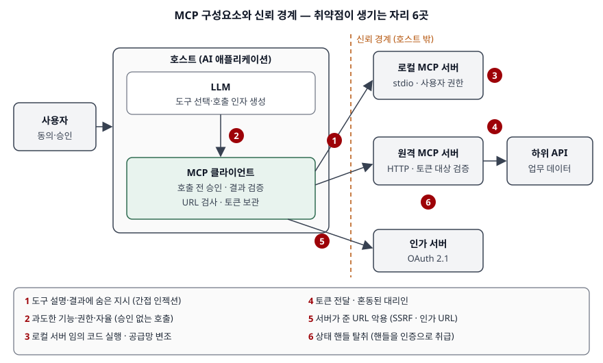

> 실행 검증 없음. MCP 공식 사양(개정판 2026-07-28)의 보안 모범 사례·인가·도구 절과 OWASP 위험
> 목록을 근거로 정리했다. 요구 수준(MUST·SHOULD)은 사양 원문의 표기를 그대로 옮겼다.
> OWASP MCP Top 10은 아직 **베타 단계**의 문서라 항목 이름이 바뀔 수 있다.

AI 서비스가 MCP로 사내 시스템·외부 도구를 붙일 때 어떤 보안 약점이 새로 생기는지를 설명하고,
그 대응을 제시하라는 문제다. 두 가지를 물었다 — 취약점 설명과 대응 방안. 문항 순서대로
Ⅱ에서 취약점을, Ⅲ에서 대응을 쓰고, 두 절이 같은 번호로 맞물리게 한다.

---

## Ⅰ. 개요

### 가. MCP의 정의

MCP(Model Context Protocol)는 **LLM 애플리케이션(호스트)이 외부 데이터 원천과 도구를 하나의
규격으로 붙이도록 정한 개방형 프로토콜**이다. JSON-RPC 2.0 메시지를 쓰며, 호스트 안의
**클라이언트**가 **서버**와 1:1로 연결되고, 서버는 자원(Resources)·프롬프트(Prompts)·도구(Tools)를
내놓는다. 서버는 같은 PC에서 표준 입출력(stdio)으로 띄우는 **로컬 서버**와 HTTP로 접속하는
**원격 서버**로 나뉜다.

### 나. 보안이 따로 문제가 되는 이유

기존 API 연동은 **개발자가 코드에 호출 순서를 적는다.** MCP 연동에서는 **LLM이 도구 설명을 읽고
무엇을 어떤 인자로 부를지 정한다.** 이 차이에서 세 가지가 달라진다.

| 구분 | 기존 API 연동 | MCP 기반 연동 |
|---|---|---|
| 호출 결정 주체 | 개발자가 작성한 코드 | LLM이 실행 중에 결정 |
| 상대 시스템의 설명 | 사람이 읽는 API 문서 | 모델 콘텍스트에 들어가는 도구 설명 |
| 공격 입력이 들어오는 자리 | 요청 매개변수 | 매개변수 + **도구 설명·도구 결과 전체** |
| 연동 대상의 수 | 계약한 소수 | 사용자가 설치하는 다수 서버 |
| 인가 단위 | 서비스 계정 | 사용자 위임 토큰(OAuth) |

MCP 사양도 개요의 보안 원칙에서 이 점을 짚는다. **도구는 임의 코드 실행에 해당하므로** 호스트는
도구를 부르기 전에 사용자의 명시적 동의를 받아야 하고, 도구 설명과 주석(annotation)은 **신뢰할 수
있는 서버에서 온 것이 아니면 신뢰하지 않는다**고 적는다. 동시에 사양은 이 원칙을 **프로토콜 수준에서
강제할 수 없으며 구현자의 책임**이라고 밝힌다. 보안 설계가 프로토콜 바깥, 즉 서비스를 구축하는 쪽의
일이라는 뜻이다.

---

## Ⅱ. MCP 기반 AI 서비스의 보안 취약점

### 가. 취약점이 생기는 자리 — 3구간 6유형

> **출처**: [MCP 사양 개정판 2026-07-28 — Overview(Security and Trust & Safety), Security Best Practices(Attacks and Mitigations), Tools(Security Considerations)](https://modelcontextprotocol.io/specification/latest/basic/security_best_practices), [OWASP Top 10 for LLM Applications 2025 — LLM01·LLM06](https://genai.owasp.org/llmrisk/llm062025-excessive-agency/)

취약점은 **어느 경계를 넘는가**로 묶으면 세 구간이 된다. ① 서버가 보낸 내용이 모델의 판단에
섞여 드는 **모델 콘텍스트 구간**, ② 토큰과 URL이 오가는 **인가 구간**, ③ 서버 프로그램이 돌아가는
**실행 환경 구간**이다.

### 나. 모델 콘텍스트 구간

**① 도구 설명·결과를 통한 간접 프롬프트 인젝션(도구 오염)**
도구 이름·설명·주석과 도구 실행 결과는 그대로 LLM의 입력이 된다. 서버가 악의적이거나 서버가
가져온 외부 문서(웹 페이지, 메일, 이슈)에 지시문이 숨어 있으면, 모델이 이를 사용자의 지시와
구분하지 못하고 따른다. OWASP는 외부 콘텐츠를 통해 들어오는 이 형태를 **간접 프롬프트
인젝션**(LLM01:2025)으로, 도구 정의 자체를 오염시키는 형태를 **Tool Poisoning**(MCP03:2025)으로
분류한다. OWASP는 이 위험에 대해 **확실한 예방책이 알려져 있지 않다**고 적는다. 막는 것보다
**당했을 때 피해를 줄이는 설계**가 필요한 이유다.

**② 과도한 기능·권한·자율(Excessive Agency)**
인젝션이 실제 피해가 되는 것은 모델이 쥔 권한이 클 때다. OWASP LLM06:2025는 원인을 셋으로
나눈다. 필요 없는 도구까지 붙어 있는 **과도한 기능**, 도구가 쓰는 하위 계정의 **과도한 권한**,
영향이 큰 작업을 사람 확인 없이 수행하는 **과도한 자율**이다. 읽기만 하면 되는 업무에 쓰기·삭제
도구가 함께 노출되는 것이 전형이다.

### 다. 인가 구간

**④ 토큰 전달(Token Passthrough)과 혼동된 대리인(Confused Deputy)**
원격 MCP 서버가 **자기에게 발급되지 않은 토큰**을 받아 하위 API로 그대로 넘기면, 하위 API의
호출량 제한과 감사 기록이 우회되고 누가 호출했는지 추적이 끊긴다. 또 MCP 서버가 고정된 클라이언트
ID로 제3자 인가 서버에 붙는 프록시 구조에서는, 사용자가 이전에 다른 클라이언트에 준 동의 쿠키가
재사용되어 **동의하지 않은 클라이언트가 인가 코드를 받는** 혼동된 대리인 문제가 생긴다.
사양은 둘 다 별도 항목으로 다룬다.

**⑤ 서버가 준 URL의 악용 — SSRF와 인가 URL**
인가 과정에서 클라이언트는 서버가 알려 준 메타데이터 URL·인가 서버 주소를 직접 가져온다. 이 URL이
내부망 주소나 클라우드 메타데이터 주소를 가리키면 **서버 측 요청 위조(SSRF)** 가 되고, 인가 URL이
`http`·`https`가 아닌 스킴이거나 셸 특수문자를 품으면 클라이언트 쪽 스크립트 실행·명령 실행으로
이어진다. 인가 응답이 엉뚱한 인가 서버로 섞여 들어가는 **혼합 공격(Mix-Up)** 도 사양이 별도
항목으로 든다.

**⑥ 상태 핸들 탈취**
도구 결과로 돌려준 장바구니 ID·작업 ID 같은 **핸들을 다른 사람이 얻거나 추측**해 그 사용자의
상태에 접근하는 경우다. 최신 개정판은 MCP를 프로토콜 수준의 세션이 없는 무상태 구조로 정리하면서,
이전 개정판(2025-11-25)의 세션 하이재킹 항목을 이 항목으로 바꿨다. 버전에 따라 항목 이름이 다르므로
답안에는 "세션·상태 식별자 탈취"로 묶어 쓰는 것이 안전하다.

### 라. 실행 환경 구간

**③ 로컬 서버를 통한 임의 코드 실행과 공급망 변조**
로컬 MCP 서버는 **사용자 권한으로 실행되는 프로그램**이다. 설치 설정에 들어 있는 기동 명령 자체가
악성이거나, 배포 패키지가 변조됐거나, 인증 없이 localhost 포트를 연 서버에 웹 페이지가 접근하는
경우 사용자 PC에서 임의 코드가 돈다. 사양은 그 결과로 **사용자 모르게 일어나는 코드 실행,
데이터 유출, 데이터 손실**을 든다. OWASP MCP Top 10은 여기에 조직이 파악하지 못한 채 쓰이는
**섀도 MCP 서버**(MCP09:2025)와 공급망 변조(MCP04:2025)를 따로 둔다.

---

## Ⅲ. 대응 방안

### 가. 구간별 대응 — 취약점과 1:1로 맞춘다

| 번호 | 취약점 | 대응 방안 | 근거와 요구 수준 |
|---|---|---|---|
| ① | 간접 인젝션·도구 오염 | 도구 설명·결과를 **신뢰하지 않는 입력**으로 분리 표시, 결과를 모델에 넘기기 전 검증, 승인 뒤 도구 정의가 바뀌면 재승인 | 사양 Tools: 주석은 신뢰된 서버가 아니면 불신(MUST), 결과 검증(SHOULD) / OWASP LLM01 외부 콘텐츠 분리 |
| ② | 과도한 기능·권한·자율 | 업무에 필요한 도구만 노출, 하위 계정 최소 권한, 영향 큰 작업은 사람 승인, 권한 판정은 하위 시스템에서 | 사양 Tools: 사람이 호출을 거부할 수 있어야 함(SHOULD) / OWASP LLM06 전체 중재(complete mediation) |
| ③ | 로컬 서버 코드 실행·공급망 | 설치 시 **기동 명령 전체를 잘림 없이 보여 주고** 명시적 승인, 최소 권한 샌드박스, 로컬 HTTP 서버는 인증 토큰 또는 stdio·유닉스 도메인 소켓 | 사양 Local MCP Server Compromise: 명령 표시·승인(MUST), 샌드박스(SHOULD) / OWASP LLM03 서명·SBOM |
| ④ | 토큰 전달·혼동된 대리인 | 서버는 **자기 앞으로 발급된 토큰만** 받는다(대상 검증), 하위 API에는 별도 토큰, 프록시 서버는 클라이언트별 동의와 redirect URI 완전 일치 | 사양 Authorization: 대상 검증(MUST), 다른 토큰 수락·전달 금지(MUST NOT) / 클라이언트별 동의(MUST) |
| ⑤ | SSRF·인가 URL 악용 | 운영 환경 OAuth URL은 HTTPS만, 사설·루프백·링크 로컬 대역 차단, 리다이렉트도 같은 검사, 셸로 URL을 열지 않음, 응답의 `iss` 확인 | 사양 SSRF(SHOULD), 인가 URL 스킴 제한(MUST), 셸 사용 금지(MUST NOT) / RFC 9207 `iss` 확인(MUST) |
| ⑥ | 상태 핸들 탈취 | 핸들 보유를 인증으로 보지 않고 **매 호출 인가 확인**, 난수 핸들·만료, 상태를 사용자에 묶음 | 사양 State Handle Hijacking: 모든 요청 검증(MUST), 핸들=인증 금지(MUST NOT) |

### 나. 인가 체계 — OAuth 2.1과 세 가지 메타데이터 표준

원격 MCP 서버의 인가는 사양의 인가 절이 정한 대로 짠다. 핵심은 **토큰이 누구에게, 어디에 쓰라고
발급됐는지를 양쪽이 모두 확인하는 구조**다.

1. **보호 자원 메타데이터(RFC 9728)** — MCP 서버가 자기 인가 서버를 공표하고(MUST), 클라이언트는
   이것으로 인가 서버를 찾는다(MUST).
2. **자원 지시자(RFC 8707)** — 클라이언트가 인가·토큰 요청에 `resource` 매개변수로 MCP 서버의
   정규 URI를 넣는다(MUST). 토큰이 그 서버 전용으로 발급된다.
3. **대상 검증** — 서버는 토큰의 대상이 자기인지 확인하고 아니면 거부한다(MUST).
4. **최소 범위와 단계적 상향** — 처음에는 좁은 scope로 시작하고, 권한이 모자라면 서버가 403과 함께
   필요한 scope만 알려 주어 그때 올린다. `files:*` 같은 포괄 scope는 토큰이 새었을 때의 피해 범위를
   키운다고 사양이 직접 지적한다.

토큰은 `Authorization: Bearer` 헤더로만 보내고 URL 질의 문자열에 넣지 않는다(MUST NOT).
stdio로 붙는 로컬 서버는 이 인가 절을 따르지 않고(SHOULD NOT) **환경에서 자격 증명을 읽으므로**,
로컬 서버에 넘기는 키는 그 서버 전용·최소 권한으로 따로 발급한다.

### 다. 운영·거버넌스 대응

| 영역 | 대응 | 겨냥하는 취약점 |
|---|---|---|
| 서버 등록 관리 | 승인된 MCP 서버 목록(허용 목록)과 출처·버전 고정, 미등록 서버 사용 탐지 | ③ 섀도 서버·공급망 |
| 감사 로그 | 도구 호출·입력·결과·승인 여부를 기록, 권한 상향 이벤트 기록 | ①②④ 사후 추적 |
| 호출 통제 | 서버 측 도구 입력 검증·호출량 제한·출력 정제(MUST), 클라이언트 측 시간 제한 | ②⑤ |
| 시험 | 도구 결과에 지시문을 넣은 적대적 시험을 배포 전 수행 | ① |
| 민감 정보 | 비밀번호·키·개인정보를 HTTP 헤더로 노출되는 매개변수에 두지 않음 | ④ 유출 |

---

## Ⅳ. 결론

MCP의 보안 약점은 프로토콜의 결함이라기보다 **LLM이 호출을 결정한다는 구조에서 나온다.** 도구 설명과
결과가 모델 입력이 되는 순간 서버 하나하나가 공격 입력의 통로가 되고, 인젝션 자체는 완전히 막을 수
없다. 따라서 대응의 축은 **인젝션이 성공해도 피해가 번지지 않게 하는 것** — 도구 최소화, 토큰의
대상·범위 제한, 영향 큰 작업의 사람 승인, 로컬 서버 격리 — 이다. 사양이 MUST로 정한 항목(토큰 대상
검증, 다른 토큰 전달 금지, 설치 명령 표시·승인, 인가 URL 스킴 제한)은 구축 단계의 점검표로 쓰고,
서버 허용 목록과 감사 로그로 운영 단계를 받친다.

> 개념 정리: [프롬프트 인젝션 방어 설계 — 신뢰 경계와 최소권한](../../security/2026-11-02-prompt-injection-defense-design/index.md)
>
> 관련 답안: [기출문제 — 프롬프트 인젝션](../2026-10-27-prompt-injection/index.md)
>
> MCP 구조: [에이전트 간 상호운용 프로토콜 — 능력 공표와 과업 수명주기](../../emerging-tech/2026-10-20-agent-interop-capability-and-task-lifecycle/index.md)

끝

---

## 답안 작성 메모

- **취약점과 대응을 같은 번호로 맞춘다.** 취약점 6개를 쓰고 대응을 따로 나열하면 채점자가 짝을
  찾아야 한다. Ⅲ-가 표 하나로 짝을 보이는 것이 이 문제의 뼈대다.
- **"LLM이 호출을 결정한다"는 차이를 개요에서 먼저 세운다.** 이것이 없으면 답안이 일반 웹 보안
  목록(SQL 인젝션·XSS)이 되어 MCP 답안으로 보이지 않는다. Ⅰ-나 비교표가 그 역할이다.
- **점수가 갈리는 곳은 인가 구간이다.** 프롬프트 인젝션은 누구나 쓴다. 토큰 대상 검증·자원
  지시자·토큰 전달 금지까지 쓰면 MCP 사양을 읽은 답안으로 보인다. RFC 번호를 못 외웠으면
  "토큰을 특정 서버 전용으로 발급하고 서버가 대상을 검증한다"까지만 써도 된다.
- 시간이 모자라면 Ⅲ-다 운영 표를 버리고 Ⅲ-가 대응 표와 Ⅲ-나 인가 4단계를 지킨다.
- 모식도는 상자 8개(사용자·호스트·LLM·클라이언트·로컬 서버·원격 서버·하위 API·인가 서버)에
  점선 하나와 번호 6개다. 번호를 Ⅱ의 소제목 번호와 같게 매기면 그림이 목차 역할을 한다.
- "인젝션을 완전히 막는다"고 쓰지 않는다. OWASP가 확실한 예방책이 없다고 적고 있으므로, 그렇게
  쓰면 오히려 감점 요인이다.

---

## 참고 자료

- [Model Context Protocol 사양 개정판 2026-07-28 — Overview](https://modelcontextprotocol.io/specification/latest) — Security and Trust & Safety(사용자 동의·데이터 프라이버시·도구 안전), 프로토콜 수준에서 강제할 수 없다는 한계
- [MCP 사양 — Security Best Practices](https://modelcontextprotocol.io/specification/latest/basic/security_best_practices) — Confused Deputy Problem, Token Passthrough, Server-Side Request Forgery, State Handle Hijacking, Local MCP Server Compromise, OAuth Authorization URL Validation, Mix-Up Attacks, Scope Minimization
- [MCP 사양 — Authorization](https://modelcontextprotocol.io/specification/latest/basic/authorization) — OAuth 2.1, 보호 자원 메타데이터, Resource Parameter Implementation, Access Token Usage, Authorization Response Validation, Scope Challenge Handling
- [MCP 사양 — Server Tools](https://modelcontextprotocol.io/specification/latest/server/tools) — User Interaction Model, Security Considerations, 도구 주석 불신 원칙
- [OWASP Top 10 for LLM Applications 2025 — LLM01:2025 Prompt Injection](https://genai.owasp.org/llmrisk/llm01-prompt-injection/)
- [OWASP Top 10 for LLM Applications 2025 — LLM03:2025 Supply Chain](https://genai.owasp.org/llmrisk/llm032025-supply-chain/)
- [OWASP Top 10 for LLM Applications 2025 — LLM06:2025 Excessive Agency](https://genai.owasp.org/llmrisk/llm062025-excessive-agency/)
- [OWASP MCP Top 10 (2025, 베타)](https://owasp.org/www-project-mcp-top-10/) — MCP03 Tool Poisoning, MCP04 Software Supply Chain Attacks & Dependency Tampering, MCP09 Shadow MCP Servers
- [RFC 8707, Resource Indicators for OAuth 2.0 (2020-02)](https://www.rfc-editor.org/rfc/rfc8707.html)
- [RFC 9728, OAuth 2.0 Protected Resource Metadata (2025-04)](https://www.rfc-editor.org/rfc/rfc9728.html)
- [RFC 9207, OAuth 2.0 Authorization Server Issuer Identification (2022-03)](https://www.rfc-editor.org/rfc/rfc9207.html)
