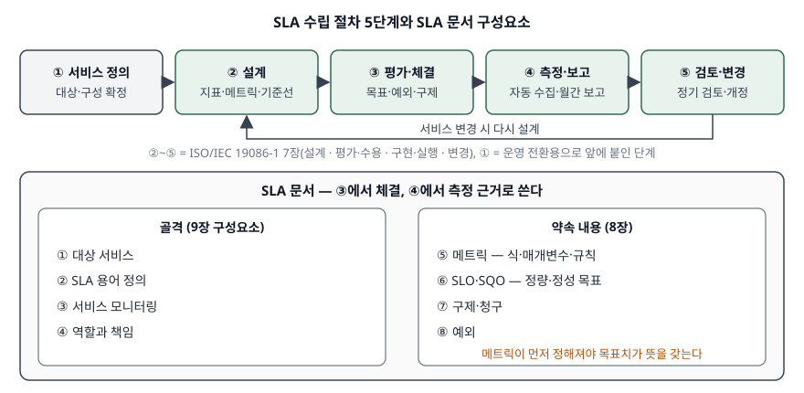

> 실행 검증 없음. 표준·RFC·NIST 간행물을 근거로 정리했다. ISO/IEC 19086-1:2016은 유료
> 표준이라 **발행처 공개 미리보기에 나온 목차·범위·정의까지만** 근거로 삼았고, 조항 본문은
> 옮기지 않았다. 사례에 나오는 목표치는 가상의 (A)기업에 대한 **예시 설정값**이며 업계
> 기준치가 아니다. 허용 중단 시간은 그 설정값으로 직접 계산했다.

개발을 마친 전자상거래 정보시스템을 운영 조직(또는 운영 위탁 업체)에 넘기기 직전에 무엇을
합의해야 하는지를 묻는 문제다. 두 갈래로 나눠 물었다. 가) SLA가 어떤 요소로 이루어지고
어떤 순서로 만들어지는가, 나) 이 기업의 특성에 맞춰 하드웨어·소프트웨어·네트워크 영역마다
무엇을 지표로 삼고 어떻게 재는가. 문항의 순서를 그대로 대항목 Ⅱ·Ⅲ으로 받는다.

---

## Ⅰ. 개요

### 가. SLA의 정의

ISO/IEC 19086-1:2016은 클라우드 SLA를 **서비스 협약의 일부로서, 대상 서비스에 대한
정량적 목표(SLO)와 정성적 목표(SQO)를 담은 것**으로 정의한다(3.4). SLO는 값이 등간·비율
척도를 따르는 정량적 특성에 대한 제공자의 약속이고(3.5), SQO는 명목·순서 척도를 따르는
정성적 특성에 대한 약속이다(3.6). 정의는 클라우드 서비스를 대상으로 쓰였지만 **제공자와
수요자가 서비스 수준을 문서로 약속한다**는 구조는 사내 운영 조직·운영 위탁 계약에도 그대로
적용된다.

### 나. 운영 전환 시점에 SLA가 필요한 이유

개발 단계의 품질 기준은 **요구사항 충족 여부**(인수 시험 통과)이고, 운영 단계의 기준은
**매달 재는 서비스 수준**이다. 이 둘 사이를 잇는 문서가 없으면 개통 다음 날부터 "느리다",
"자주 끊긴다"는 말이 숫자 없이 오간다. NIST SP 500-307은 지표가 쓰이는 자리를 서비스 선택,
서비스 협약, 서비스 측정의 셋으로 나누고, 협약에 정한 목표가 지켜지지 않으면 **미리 정해 둔
구제 조치가 시작돼야 한다**고 적는다(4.1.2·4.1.3). 운영 전환 시점은 이 세 번째 단계로
넘어가는 순간이다.

---

## Ⅱ. SLA 구성요소와 절차

### 가. 구성요소 — 골격 4가지 + 약속 내용 4가지

ISO/IEC 19086-1:2016은 SLA를 이루는 요소를 두 묶음으로 나눈다. 하나는 어느 SLA에나 들어가는
**골격**(SLA 구성요소 절, 9장)이고, 다른 하나는 **목표를 약속하는 방식**(목표·메트릭·구제·예외의
역할 절, 8장)이다.

| 묶음 | 구성요소 | 내용 | (A)기업 적용 |
|---|---|---|---|
| 골격 | ① 대상 서비스 (9.2) | SLA가 다루는 서비스의 범위 | 상품 조회·장바구니·주문·결제·회원, 관리자 백오피스는 별도 |
| | ② SLA 용어 정의 (9.3) | 장애·가용·응답시간 등 용어의 뜻 | "장애" = 주문 또는 결제가 불가능한 상태 |
| | ③ 서비스 모니터링 (9.4) | 무엇을 어떤 수단·주기로 재는가 | 합성 모니터링 1분 주기, 접근 로그 집계 |
| | ④ 역할과 책임 (9.5) | 제공자·수요자 각자의 의무 | 운영사: 감시·복구, (A)기업: 변경 사전 통보 |
| 약속 내용 | ⑤ 메트릭 (8.2) | 지표를 계산하는 식과 규칙 | 가용률 = (측정 시간 − 장애 시간) ÷ 측정 시간 |
| | ⑥ SLO·SQO (8.3) | 정량·정성 목표 | 월 가용률 99.95% / 장애 보고서 양식 준수 |
| | ⑦ 구제·청구 (8.4) | 미달 시 조치와 청구 절차 | 월 운영비 감액, 청구는 익월 10일까지 |
| | ⑧ 예외 (8.5) | 목표 산정에서 빼는 상황 | 사전 공지한 정기 점검, 외부 결제대행사 장애 |

NIST SP 500-307도 서비스 협약이 **서비스 설명, 양 당사자의 권리와 책임, 용어 정의, 그리고
측정에 관한 정보**를 담는다고 적어(4.1.2) 같은 골격을 가리킨다.

이 표에서 점수가 갈리는 칸은 ⑤다. 같은 표준이 메트릭(8.2)을 목표(8.3)보다 **앞에** 둔 것은
식이 먼저 정해져야 목표치가 뜻을 갖기 때문이다. NIST SP 500-307의 지표 모델도 지표를 **식
(expression), 매개변수(parameter), 규칙(rule)** 으로 쪼개고, 규칙의 예로 "업무 시간 중
가용률"처럼 측정 기간을 제한하는 제약을 든다(5.4.1·5.4.2). 목표치 한 줄만 적힌 SLA는 ⑤가
빠진 SLA다.

### 나. 절차 — 5단계

ISO/IEC 19086-1:2016은 SLA 관리 모범 사례(7장)를 **설계 → 평가·수용 → 구현·실행 → 변경**의
4개 절로 나눈다. 운영 전환 시점에는 그 앞에 "무엇을 넘기는지"를 확정하는 단계가 하나 더 필요하므로
답안은 5단계로 쓴다.

> **출처**: [ISO/IEC 19086-1:2016 공개 미리보기 — 목차(7 Cloud SLA management best practices, 8 SLOs·SQOs·metrics·remedies·exceptions, 9 Cloud SLA components)와 3.4~3.6 정의](https://cdn.standards.iteh.ai/samples/67545/919e2b609dff4dab8da9b3c39c6d0767/ISO-IEC-19086-1-2016.pdf), [NIST SP 500-307 §4.1 The Cloud Service Trifecta](https://doi.org/10.6028/NIST.SP.500-307)

| 단계 | 하는 일 | 산출물 | 19086-1 대응 |
|---|---|---|---|
| ① 서비스 정의 | 이관 대상 서비스·구성(CI) 목록 확정, 업무 영향 분석 | 서비스 카탈로그, 구성 목록 | 대상 서비스(9.2) |
| ② 설계 | 지표 선정, 메트릭 식·측정 수단 확정, 기준선 측정(안정화 기간) | 지표 정의서, 측정 체계 | 설계(7.2) |
| ③ 평가·체결 | 목표치·예외·구제 협상, 달성 가능성 검증 | SLA 문서, 운영 협약(OLA)·외부 계약 정렬 | 평가·수용(7.3) |
| ④ 측정·보고 | 자동 수집, 월간 보고, 미달 시 구제 처리 | 월간 SLA 보고서 | 구현·실행(7.4) |
| ⑤ 검토·변경 | 정기 검토, 서비스 변경 시 SLA 개정 | 개정 SLA | 변경(7.5) |

②의 **기준선 측정**이 운영 전환에서 특히 중요하다. 신규 시스템은 운영 실적이 없으므로
처음부터 목표치를 확정하면 근거 없는 숫자가 계약에 들어간다. 1~3개월 안정화 기간에 지표를
실제로 수집한 뒤 목표치를 확정하는 순서가 안전하다.

---

## Ⅲ. (A)기업 특성을 고려한 영역별 SLA 평가지표와 측정 방법

### 가. (A)기업 특성 — 지표 선정의 근거 4가지

| 특성 | 지표 설계에 주는 영향 |
|---|---|
| 24시간 무중단 판매 | 측정 창을 달력 월 전체로 두고 계획 정지 허용 시간을 따로 둔다 |
| 프로모션 시 트래픽 급증 | 평균이 아니라 **피크 구간** 응답시간과 자원 여유율을 본다 |
| 외부 결제대행사(PG) 연동 | 외부 구간을 분리 측정해 책임 경계를 나눈다(예외 ⑧) |
| 주문·결제의 금전 정합성 | 가용률만으로는 부족하다. **거래 성공률**을 따로 본다 |

### 나. 하드웨어 영역

| 지표 | 산식 | 측정 방법 | 예시 목표 |
|---|---|---|---|
| 서버 가용률 | (측정 시간 − 정지 시간) ÷ 측정 시간 | 감시 서버가 1분 주기로 상태 확인, 정지 구간 합산 | 월 99.95% |
| 평균 복구 시간(MTTR) | 장애 시간 합 ÷ 장애 건수 | 장애 관리 기록의 보고·복구 시각 | 2시간 이내 |
| 자원 사용률 | 피크 1시간 CPU·메모리 사용률의 상위 95번째 값 | 에이전트가 수집한 사용률 시계열 | 70% 이하 |
| 이중화 전환 성공률 | 성공한 전환 ÷ 전체 전환 시험 | 분기별 전환 시험 결과 기록 | 100% |

가용률 식에서 분모를 무엇으로 둘지가 첫 합의 대상이다. ITU-T E.800은 가용도를 **요구 기능을
수행할 수 있는 상태에 있는 정도**로(3.1.1.5.4), MTTR을 고장 보고부터 서비스 복구까지 걸린 시간의
기댓값으로(3.3.11) 정의한다. 따라서 MTTR의 시작점은 **장애가 보고된 시각**이며, 감시 경보
시각인지 고객 신고 시각인지를 SLA 용어 정의(②)에 적어 둬야 한다.

예시 목표 99.95%는 30일 측정 창(43,200분)에서 **21.6분**의 정지를 허용한다
(43,200 × 0.0005). 99.9%면 43.2분이다. 자원 사용률을 SLA에 넣는 것은 장애를 미리 막기
위해서다. 프로모션 직전 사용률이 이미 높으면 증설 의무가 발생하도록 적는다. 19086-1이
성능 내용 영역 아래에 **용량 구성요소(10.4.3)** 를 두고, 서비스 신뢰성 영역 아래에
**복원력·결함 허용(10.11.2)** 과 **백업·복구(10.11.3)** 를 따로 둔 것이 이 지표들의 자리다.

### 다. 소프트웨어(응용) 영역

| 지표 | 산식 | 측정 방법 | 예시 목표 |
|---|---|---|---|
| 서비스 가용률(요청 기준) | 정상 응답 수 ÷ 전체 요청 수 | 웹 서버 접근 로그 집계(수동 측정) | 월 99.9% |
| 주문·결제 성공률 | 승인 완료 주문 ÷ 결제 시도 (PG 거절 제외) | 주문 DB와 결제 로그 대사 | 99.5% |
| 화면 응답시간 | 상위 95·99번째 백분위 응답시간 | 서버 측 계측, 1분 집계 | p95 1초, p99 3초 |
| 정산 배치 적시 완료율 | 기한 내 완료 일수 ÷ 영업일 수 | 작업 스케줄러 이력 | 100% |

구글 SRE 서적은 응답시간 같은 지표를 **평균이 아니라 백분위로** 잡으라고 권한다. 평균은 긴
꼬리를 가리기 때문이다. 같은 장은 지표를 표준화할 때 **집계 간격, 집계 범위, 측정 빈도, 포함할
요청, 수집 방법, 응답시간의 끝점(마지막 바이트 기준 등)** 을 함께 정해 두라고 한다. 지표 이름만
같고 이 항목이 다르면 두 당사자가 다른 숫자를 들고 온다.

주문·결제 성공률을 가용률과 따로 두는 이유는 **서버는 살아 있는데 돈이 안 들어오는 상태**가
가용률에 잡히지 않기 때문이다. 분모에서 카드 한도 초과 같은 정상 거절은 빼야 하며, 이를
메트릭 규칙(⑤)으로 적는다.

### 라. 네트워크 영역

| 지표 | 정의 근거 | 측정 방법 | 예시 목표 |
|---|---|---|---|
| 회선 가용률 | 시간 기준 가용률 | 경계 라우터 상태 감시 | 월 99.95% |
| 왕복 지연 | RFC 2681 | 고객 접점 쪽 측정점에서 능동 측정 | 월 p95 50 ms |
| 패킷 손실률 | RFC 7680 | 시험 패킷 송수신, 대기 한도(Tmax) 명시 | 0.1% 이하 |
| 지연 변이(IPDV) | RFC 3393 | 연속 패킷의 단방향 지연 차 | 운영 참고 지표 |
| 대역폭 사용률 | 인터페이스 바이트 카운터 증분 ÷ (회선 속도 × 수집 주기) | SNMP로 `ifHCInOctets`·`ifHCOutOctets` 수집(RFC 2863) | 피크 5분 평균 70% 이하 |

네트워크 지표는 **정의를 IETF IPPM RFC에 맡기면** 측정 방법 분쟁이 줄어든다.

- RFC 2681의 왕복 지연은 송신 측 시계 하나로 재므로 **두 지점의 시계 동기화가 필요 없다**(2.7.1).
- RFC 7679의 단방향 지연은 송신·수신 시계를 **밀접하게 동기화**해야 하고(3.5·3.6), 동기화 오차가
  측정 불확도에 더해진다(3.7.1). 그래서 SLA 지표로는 왕복 지연이 다루기 쉽다.
- RFC 7680은 대기 한도 Tmax 안에 도착하지 않은 패킷을 손실로 판정하되 **Tmax 값을 정하지 않고
  매개변수로 둔다**(2.2·2.4). Tmax를 SLA에 적지 않으면 손실률이 정의되지 않는다.
- RFC 3393의 IPDV는 선택한 두 패킷의 단방향 지연 **차이**라서 시계 동기화 오차에 덜 민감하다(2.5).

측정 방식은 RFC 7799의 분류를 따라 적는다. **능동 측정**은 시험용 패킷 흐름을 만들어 보내는
방식이고(3.4), **수동 측정**은 기존 트래픽을 바꾸지 않고 관찰만 하는 방식이다(3.6). 네트워크
지연·손실은 능동으로, 응용 가용률·응답시간은 실제 접근 로그를 쓰는 수동으로 재면 각 지표가
가장 덜 왜곡된다.

### 마. 영역별 측정 방식 비교

| 구분 | 하드웨어 | 소프트웨어 | 네트워크 |
|---|---|---|---|
| 주 지표 | 가용률·MTTR·자원 사용률 | 요청 기준 가용률·거래 성공률·백분위 응답시간 | 회선 가용률·지연·손실 |
| 측정 수단 | 상태 감시·에이전트 | 접근 로그·애플리케이션 계측 | 시험 패킷·SNMP 카운터 |
| 측정 방식 | 능동(상태 확인) | 수동(실제 요청 관찰) | 능동(시험 패킷) + 수동(카운터) |
| 정의 근거 | ITU-T E.800 | SRE 지표 표준화 항목 | IETF IPPM RFC |
| 분쟁 지점 | 정지 시작 시각 | 정상 거절의 분모 제외 | Tmax·시계 동기화 |
| 사용자 체감과의 거리 | 멀다 | 가깝다 | 중간 |

세 영역을 다 걸되 **보상과 연결하는 지표는 사용자 체감에 가까운 소프트웨어 영역 몇 개로 좁히고**,
하드웨어·네트워크 지표는 원인 분석과 예방용 운영 지표(OLA)로 두는 구성이 실무에서 다루기 쉽다.
하부 지표가 전부 정상인데 주문이 안 되는 경우를 보상 대상에서 놓치지 않기 위해서다.

---

## Ⅳ. 결론

운영 전환 시점의 SLA는 개발 단계의 "요구사항을 만족했는가"를 운영 단계의 "매달 이 수준을
지켰는가"로 바꾸는 문서다. 구성요소 중 가장 먼저 확정할 것은 목표치가 아니라 **메트릭 식과
측정 수단**이며, 신규 시스템은 안정화 기간의 기준선 측정을 거쳐 목표치를 정해야 한다.
전자상거래처럼 외부 결제 연동과 트래픽 급증이 있는 시스템은 **구간을 나눠 재고 책임 경계를 예외
조항으로 적어 두는 것**이 SLA가 분쟁 대신 품질 개선에 쓰이게 하는 조건이다.

> 개념 정리: [SLA·SLO·SLI와 서비스수준관리(SLM) — 재는 것, 목표, 그리고 계약](../../it-management/2026-10-19-sla-slo-sli-service-level-management/index.md)
>
> 지표 산술: [SLA 지표 설계와 측정 — 99.9%가 실제로 허용하는 장애 시간](../../it-management/2026-10-20-sla-metrics-design-and-measurement/index.md)
>
> 네트워크 지표: [IPPM 네트워크 성능 지표 — 단방향·왕복 지연, 패킷 손실, 지연 변이와 능동·수동 측정](../../network/2026-11-11-ippm-delay-loss-variation-metrics/index.md)

끝

---

## 답안 작성 메모

- **가)는 구성요소와 절차 둘을 다 물었다.** 구성요소만 길게 쓰고 절차를 한 줄로 끝내면 반을
  잃는다. 구성요소 8개 표와 절차 5단계 표를 같은 분량으로 맞춘다.
- **나)의 핵심어는 "(A)기업의 특성"이다.** 일반 지표 목록을 나열하면 사례가 아니다. 24시간 판매,
  프로모션 피크, 외부 PG, 금전 정합성 네 특성을 먼저 적고, 각 지표가 어느 특성에서 나왔는지
  보이게 해야 점수가 붙는다.
- **측정 방법을 산식과 수단으로 나눠 쓴다.** "모니터링 도구로 측정"만 쓰면 측정 방법을 쓰지 않은
  것으로 본다. 분모·분자, 수집 주기, 백분위, Tmax처럼 **숫자가 바뀌는 자리**를 하나씩 짚는다.
- 시간이 모자라면 Ⅲ의 비교표(마)를 버리고 영역별 표 세 개를 지킨다. 네트워크 RFC 번호를
  못 외웠으면 "IETF IPPM 지표 정의를 따른다"까지만 써도 구조는 선다.
- 모식도는 위 절차 상자 5개와 아래 문서 상자 하나로 3분 안에 그릴 수 있다. 메트릭이 목표보다
  먼저라는 것을 화살표 하나로 보이면 충분하다.
- 예시 목표치는 **가정값임을 답안에도 밝힌다.** 근거 없는 업계 평균을 쓰면 감점 요인이 된다.

---

## 참고 자료

- [ISO/IEC 19086-1:2016, Cloud computing — Service level agreement (SLA) framework — Part 1: Overview and concepts](https://www.iso.org/standard/67545.html) — 발행처 페이지. 7 Cloud SLA management best practices(7.2 Design / 7.3 Evaluation and acceptance / 7.4 Implementation and execution / 7.5 Changes to the cloud SLA), 8.2 Metrics / 8.3 SLOs and SQOs / 8.4 Remedies and claims / 8.5 Exceptions, 9.2~9.5 SLA 구성요소, 10.4.3 Cloud service capacity / 10.11.2 Service resilience/fault tolerance / 10.11.3 Customer data backup and restore, 3.4~3.6 정의
- [ISO/IEC 19086-1:2016 공개 미리보기](https://cdn.standards.iteh.ai/samples/67545/919e2b609dff4dab8da9b3c39c6d0767/ISO-IEC-19086-1-2016.pdf) — iTeh 제공 미리보기(목차·범위·3.1~3.6 정의). 위 조항 번호와 정의는 이 미리보기에서 확인했다
- [NIST SP 500-307, Cloud Computing Service Metrics Description (2018-04)](https://doi.org/10.6028/NIST.SP.500-307) — 4.1.1~4.1.3 지표의 세 쓰임(선택·협약·측정), 5.4.1 Metric Class / 5.4.2 Rule Class
- [ITU-T Recommendation E.800 (09/2008), Definitions of terms related to quality of service](https://www.itu.int/rec/T-REC-E.800-200809-I) — 3.1.1.5.4 Availability, 3.3.11 MTTR
- [RFC 2681, A Round-trip Delay Metric for IPPM (1999-09)](https://www.rfc-editor.org/rfc/rfc2681.html) — 2.4 정의, 2.7.1 시계 오차
- [RFC 7679, A One-Way Delay Metric for IP Performance Metrics (IPPM) (2016-01, STD 81)](https://www.rfc-editor.org/rfc/rfc7679.html) — 3.5·3.6 동기화, 3.7.1 Errors related to Clocks
- [RFC 7680, A One-Way Loss Metric for IP Performance Metrics (IPPM) (2016-01, STD 82)](https://www.rfc-editor.org/rfc/rfc7680.html) — 2.2 매개변수 Tmax, 2.4 정의
- [RFC 3393, IP Packet Delay Variation Metric for IPPM (2002-11)](https://www.rfc-editor.org/rfc/rfc3393.html) — 1.2 IPDV 정의, 2.5 시계 동기화 민감도
- [RFC 7799, Active and Passive Metrics and Methods (with Hybrid Types In-Between) (2016-05)](https://www.rfc-editor.org/rfc/rfc7799.html) — 3.4 Active Methods, 3.6 Passive Methods
- [RFC 2863, The Interfaces Group MIB (2000-06)](https://www.rfc-editor.org/rfc/rfc2863.html) — `ifHCInOctets`·`ifHCOutOctets` 64비트 카운터
- [Google, "Service Level Objectives", Site Reliability Engineering, ch.4 (O'Reilly, 2016)](https://sre.google/sre-book/service-level-objectives/) — 백분위 지표, 지표 표준화 항목(집계 간격·범위·측정 빈도·포함 요청·수집 방법·지연 끝점)
