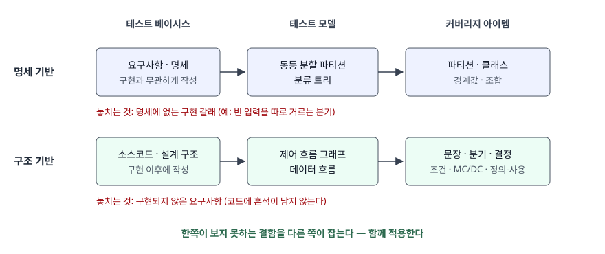
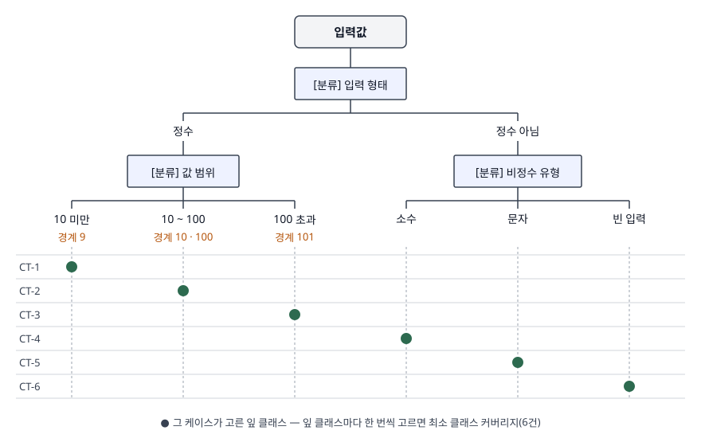

> (나)에서 도출한 테스트 케이스는 실제로 구현해 돌렸고, 같은 케이스가 구현의 분기를 얼마나 덮는지
> coverage.py로 쟀다. 전체 소스와 실행 기록은 [`code/`](code/)에 있다.
> 기법 분류와 용어 정의는 ISO/IEC/IEEE 29119-4:2021(본문은 유료라 발행처 공개 미리보기의 목차·용어 정의만 확인),
> 동등 분할과 화이트박스 기법은 ISTQB CTFL v4.0.1, 분류 트리 기법은 ISTQB CTAL-TA v3.1.2를 근거로 삼았다.

동적 테스트를 두 갈래로 묻는 문제다. 하나는 동적 테스트의 두 축인 명세 기반과 구조 기반을
견주는 것이고, 다른 하나는 짧은 프로그램 명세 하나를 주고 동등 분할과 분류 트리 기법으로
테스트 케이스를 실제로 뽑아 보라는 것이다. 명세는 이렇다 — 입력창은 정수를 받고, 10 미만이거나
100을 넘으면 `Fail`, 10 이상 100 이하이면 `Pass`, 정수가 아니면 `Invalid Input`을 출력한다.
문항이 가·나로 나눠 물었으므로 그 순서를 그대로 대항목으로 쓴다.

---

## Ⅰ. 개요 — 동적 테스트의 정의와 기법 분류

ISO/IEC/IEEE 29119-4:2021은 테스트를 **정해진 조건에서 시스템이나 컴포넌트를 실행하고, 결과를
관찰·기록해 어떤 측면을 평가하는 활동**으로 정의한다(용어 정의 3.48). 이 가운데 테스트 대상을
**실제로 실행하는** 것이 동적 테스트이고, 실행 없이 산출물을 검토·분석하는 정적 테스트(리뷰, 정적 분석)와
구분된다. 동적 테스트는 실행 결과로 고장을 드러내므로, 결국 **어떤 입력으로 실행할지**를 정하는
테스트 케이스 설계가 품질을 좌우한다.

같은 표준은 테스트 설계 기법을 세 갈래로 나눈다.

| 갈래 | 개수 | 표준이 드는 기법 |
|---|---|---|
| 명세 기반 | 12가지 | 동등 분할, 분류 트리, 경계값 분석, 구문, 조합, 결정 테이블, 원인-결과 그래프, 상태 전이, 시나리오, 랜덤, 메타모픽, 요구사항 기반 |
| 구조 기반 | 7가지 | 문장, 분기, 결정, 분기 조건, 분기 조건 조합, MC/DC, 데이터 흐름 |
| 경험 기반 | 1가지 | 오류 추정 |

이 문항이 묻는 동등 분할과 분류 트리는 명세 기반 12가지 중 **맨 앞 두 개**다. 표준이 둘을 나란히 두는
이유가 (나)에서 드러난다. 분류 트리는 동등 분할로 나눈 파티션을 **계층으로 세분하고 조합하는 틀**이다.

---

## Ⅱ. 가. 명세 기반 테스트와 구조 기반 테스트 비교

### 가) 개념

**명세 기반 테스트**(블랙박스)는 요구사항·명세에서 테스트 모델을 만들고 거기서 케이스를 뽑는다.
대상의 내부 구조를 보지 않으므로, 구현이 바뀌어도 요구된 동작이 같으면 케이스를 그대로 쓴다.
**구조 기반 테스트**(화이트박스)는 소스코드나 설계 구조에서 제어 흐름·데이터 흐름 모델을 만들고,
문장·분기·조건 같은 구조 요소를 커버리지 아이템으로 삼는다.

두 방식의 차이는 **테스트 모델을 어디서 가져오는가**로 요약된다. 29119-4는 테스트 모델의 예로
요구사항 문장, 동등 파티션, 분류 트리, 결정 테이블과 함께 소스코드, 제어 흐름 그래프를 나란히 든다
(용어 정의 3.54). 모델이 다르면 커버리지 아이템이 다르고, 아이템이 다르면 놓치는 결함도 다르다.



> **출처**: [ISO/IEC/IEEE 29119-4:2021 §3.54 test model, §5.2·§5.3 (iTeh 공개 미리보기)](https://cdn.standards.iteh.ai/samples/79430/6c93dfe4a05b46a8895e04dfd74ddd24/ISO-IEC-IEEE-29119-4-2021.pdf), [ISTQB CTFL Syllabus v4.0.1 §4.3.3 The Value of White-box Testing](https://astqb.org/assets/documents/ISTQB_CTFL_Syllabus_v4.0.1.pdf)

### 나) 비교

| 구분 | 명세 기반 (블랙박스) | 구조 기반 (화이트박스) |
|---|---|---|
| 테스트 베이시스 | 요구사항·명세·사용자 스토리 | 소스코드·설계 구조 |
| 테스트 모델 | 동등 파티션, 분류 트리, 결정 테이블, 상태 전이도 | 제어 흐름 그래프, 데이터 흐름(정의-사용) |
| 커버리지 아이템 | 파티션·클래스·경계값·결정 규칙·전이 | 문장·분기·결정·조건·정의-사용 쌍 |
| 표준 기법 수 | 12가지 | 7가지 |
| 작성 가능 시점 | 명세가 확정되면 바로 | 설계·구현이 나온 뒤 |
| 구현 변경 영향 | 동작이 같으면 케이스 유지 | 구조가 바뀌면 케이스 재설계 |
| 잡는 결함 | 요구된 동작과 다른 출력, 요구사항 누락 | 실행되지 않은 코드, 명세가 모호해도 구현 전체의 결함 |
| 놓치는 결함 | 명세에 없는 구현 갈래의 결함 | 구현되지 않은 요구사항(누락 결함) |
| 객관적 측정 | 실제 코드가 얼마나 실행됐는지는 알 수 없다 | 코드 커버리지로 객관적으로 잰다 |
| 주 적용 레벨 | 시스템·인수 테스트 | 컴포넌트·통합 테스트 |

ISTQB CTFL의 화이트박스 가치 항목(§4.3.3)이 이 대비를 그대로 적는다. 화이트박스는 구현 전체를
보므로 **명세가 모호하거나 낡았거나 불완전해도** 결함을 찾지만, 구현되지 않은 요구사항에서 생긴
**누락 결함**은 찾지 못할 수 있다. 반대로 블랙박스만 수행하면 실제 코드 커버리지를 잴 수 없다.
구조 기반 기법 사이에는 포함 관계가 있어 **분기 커버리지 100%는 문장 커버리지 100%를 보장하지만
그 역은 성립하지 않는다**(같은 실라버스 §4.3.2). 둘은 우열이 아니라 **서로의 빈칸을 메우는 관계**이며,
(나)의 실행 결과가 이것을 숫자로 보여 준다.

---

## Ⅲ. 나. 동등 분할과 분류 트리로 테스트 케이스 작성

### 가) 명세 분석 — 먼저 모호한 자리를 확정한다

입력창의 값은 문자열로 들어와 정수인지 판정된 뒤 범위가 검사된다. 출력은 `Pass`·`Fail`·`Invalid Input`
**3가지**다. 케이스를 뽑기 전에 명세가 정하지 않은 자리를 짚어 둔다. 앞뒤 공백(`" 50 "`), 부호 붙은
정수(`+50`), 소수점 아래가 0인 값(`10.0`), 빈 입력이 그렇다. 이 답안은 **앞뒤 공백은 무시하고, 부호 붙은
정수는 정수로 보며, `10.0`과 빈 입력은 정수가 아닌 것으로 본다**고 가정한다. 실무라면 이 가정을 명세
작성자에게 질의해 확정해야 하고, 확정 결과가 곧 기대 결과가 된다.

### 나) 동등 분할 — 파티션 4개, 테스트 케이스 4건

동등 분할은 같은 파티션의 값은 대상이 같은 방식으로 처리한다고 보고, 파티션마다 대표값 하나를 실행하는
기법이다. 커버리지 아이템은 파티션이며, **무효 파티션을 포함한 모든 파티션을 한 번 이상** 실행하면
100%다(ISTQB CTFL 동등 분할 항목, §4.2.1).

유효·무효를 가르는 기준은 짚고 가야 한다. 같은 실라버스는 유효값을 "대상이 처리해야 하는 값" 또는
"명세가 처리 방식을 정한 값"으로, 무효값을 "무시·거부해야 하는 값"으로 해석할 수 있다고 적고, 그 정의가
조직마다 다를 수 있다고 밝힌다. 이 명세에서 10 미만과 100 초과는 **거부되는 값이 아니라 정상 처리되어
`Fail`로 판정되는 값**이다. 따라서 입력 유효성 기준으로는 유효 파티션 3개와 무효 파티션 1개로 나눈다.
출력이 `Fail`이라는 이유로 범위 밖 정수를 무효로 분류하는 답안이 많은데, 그렇게 쓸 거라면 어느 정의를
따랐는지 한 줄을 붙여야 한다.

| TC | 파티션 | 구분 | 대표값 | 기대 출력 |
|---|---|---|---|---|
| EP-1 | 정수, 10 미만 | 유효 | `5` | Fail |
| EP-2 | 정수, 10 이상 100 이하 | 유효 | `50` | Pass |
| EP-3 | 정수, 100 초과 | 유효 | `150` | Fail |
| EP-4 | 정수 아님 | 무효 | `abc` | Invalid Input |

4건으로 동등 분할 커버리지 100%다. 여기서 한계가 보인다. **`정수 아님`이 하나의 파티션**으로 묶여
`abc` 하나만 실행된다. 소수, 빈 입력처럼 "정수가 아닌 방식"이 여럿인데 동등 분할의 평면 목록으로는
그 차이를 드러낼 자리가 없다.

### 다) 분류 트리 — 잎 클래스 6개, 테스트 케이스 6건

분류 트리 기법은 입력 데이터를 **분류**(classification, 시험 관점·파라미터)와 **클래스**(class, 그 파라미터가
가질 수 있는 값 = 동등 파티션)로 나눈 계층 트리로 모델링하고, 트리의 클래스를 조합해 케이스를 뽑는
명세 기반 기법이다(29119-4 용어 정의 3.10·3.11). 클래스 아래에 다시 하위 분류를 달아 세분할 수 있다는
점이 동등 분할과 다르다. 이 답안은 적용 절차를 다섯 단계로 정리한다.

1. **분류 식별** — 결과를 가르는 시험 관점을 찾는다. 여기서는 `입력 형태`다
2. **클래스 분할** — 분류마다 겹치지 않는 클래스로 나눈다. `정수`와 `정수 아님`
3. **계층 세분** — 클래스 아래 하위 분류를 단다. `정수` 아래 `값 범위`, `정수 아님` 아래 `비정수 유형`
4. **조합 선택** — 커버리지 기준에 따라 잎 클래스 조합을 조합표에 표시한다
5. **기대 결과 부여** — 조합마다 명세에서 기대 출력을 정해 케이스를 완성한다



> **출처**: [ISTQB CTAL-TA Syllabus v3.1.2 §3.2.5 Classification Tree Technique](https://www.istqb.org/wp-content/uploads/2024/11/ISTQB_CTAL-TA_Syllabus_v3.1.2.pdf)(p.31-32), [ISO/IEC/IEEE 29119-4:2021 §3.10 classification tree, §3.11 classification tree method (iTeh 공개 미리보기)](https://cdn.standards.iteh.ai/samples/79430/6c93dfe4a05b46a8895e04dfd74ddd24/ISO-IEC-IEEE-29119-4-2021.pdf)

CTAL-TA는 분류 트리의 커버리지 예로 **최소 클래스 커버리지**(분류의 모든 값을 최소 한 번 실행)를 들고,
필요하면 pairwise·three-wise 같은 조합 기준을 고를 수 있다고 적는다. 입력이 하나뿐인 이 명세에서는
분류끼리 교차할 일이 없으므로 최소 클래스 커버리지가 곧 잎 클래스 6개를 한 번씩 고르는 것이다.

| TC | 입력 형태 | 하위 클래스 | 입력 | 기대 출력 |
|---|---|---|---|---|
| CT-1 | 정수 | 10 미만 | `5` | Fail |
| CT-2 | 정수 | 10 이상 100 이하 | `50` | Pass |
| CT-3 | 정수 | 100 초과 | `150` | Fail |
| CT-4 | 정수 아님 | 소수 | `12.5` | Invalid Input |
| CT-5 | 정수 아님 | 문자 | `abc` | Invalid Input |
| CT-6 | 정수 아님 | 빈 입력 | `""` | Invalid Input |

CTAL-TA는 분류 트리를 분석하면 **경계값도 식별된다**고 적는다. `값 범위`의 세 클래스는 순서가 있으므로
그 경계에서 2-value 경계값 4건을 덧붙인다.

| TC | 겨냥한 경계 | 입력 | 기대 출력 |
|---|---|---|---|
| BV-1 | 10 미만의 상한 | `9` | Fail |
| BV-2 | 10 이상의 하한 | `10` | Pass |
| BV-3 | 100 이하의 상한 | `100` | Pass |
| BV-4 | 100 초과의 하한 | `101` | Fail |

같은 실라버스는 분류 트리가 **완전한 테스트 케이스가 아니라 데이터 조합만 만든다**는 한계를 적는다.
5단계(기대 결과 부여)를 따로 둔 이유다. 기대 출력은 구현이 아니라 명세에서 정해야 한다.

### 라) 도출한 케이스를 실제로 돌린 결과

명세대로 만든 구현(`checker.py`)에 두 케이스 집합을 돌리고, 같은 실행에서 coverage.py로 분기 커버리지를
쟀다. 이 구현은 빈 입력을 `int()`에 넘기기 전에 따로 거르는 갈래를 하나 더 갖고 있다 — 명세에는 없는,
구현자가 넣은 갈래다. 이어서 상한 비교를 `>` 대신 `>=`로 쓴 결함 구현에도 같은 케이스를 돌렸다.

```text
[커버리지] 동등 분할 4건 — 실패 0건
  Name         Stmts   Miss Branch BrPart  Cover   Missing
  --------------------------------------------------------
  checker.py      13      1      4      1    88%   13

[커버리지] 분류 트리 6건 — 실패 0건
  Name         Stmts   Miss Branch BrPart  Cover   Missing
  --------------------------------------------------------
  checker.py      13      0      4      0   100%

[결함 구현] 상한 비교를 >= 로 쓴 구현에 돌린 결과
  동등 분할 4건                   통과(놓침)
  분류 트리 6건                   통과(놓침)
  분류 트리 6건 + 경계값 4건          검출
    BV-3 입력 '100' 기대 Pass 실제 Fail
```

위 출력은 [`code/output.txt`](code/output.txt)에 남긴 수행 기록에서 가져왔다(합계 줄은 생략).
읽을 것은 세 가지다.

- **동등 분할 4건은 모두 통과했는데 분기 커버리지는 88%다.** 빠진 13번 줄이 빈 입력을 거르는 갈래다.
  명세 기반 커버리지 100%가 구조 기반 커버리지 100%를 뜻하지 않는다는 것이 (가)의 비교표 그대로 나왔다
- **분류 트리 6건은 100%다.** `정수 아님`을 하위 분류로 세분하자 빈 입력이 독립 클래스가 되었고,
  그 클래스가 명세에 없던 구현 갈래까지 실행했다. 다만 이것은 트리가 구현을 본 결과가 아니다.
  구조 쪽 측정이 있어야 **덮였다는 사실을 확인할 수 있다**
- **상한 결함은 범위 클래스의 대표값으로는 잡히지 않는다.** `50`과 `150`은 비교 연산자가 `>`이든 `>=`이든
  같은 답을 내므로, 트리가 드러낸 경계값 `100`을 넣었을 때 비로소 검출된다

---

## Ⅳ. 적용 시 고려사항

**① 모델을 그리는 동안 명세 결함을 먼저 찾는다.** 분류 트리를 그리려면 "정수가 아님"이 무엇인지를
나눠야 하고, 그 과정에서 `10.0`과 빈 입력처럼 명세가 답하지 않는 자리가 드러난다. 케이스 작성보다
이 질의가 먼저다. 기대 결과가 정해지지 않은 케이스는 실행해도 판정할 수 없다.

**② 커버리지 100%는 그 모델 안에서만 100%다.** 동등 분할 100%에서 분기 88%가 나온 것처럼, 한 모델의
커버리지는 다른 모델의 빈칸을 말해 주지 않는다. 종료 기준을 정할 때 명세 기반 커버리지와 구조 기반
커버리지를 **둘 다** 걸고, 구조 쪽 측정에서 빠진 줄이 나오면 그 줄이 명세의 어느 요구에 대응하는지
거꾸로 추적한다. 대응하는 요구가 없으면 명세 누락이거나 불필요한 코드다.

**③ 분류와 클래스가 늘면 조합 기준을 낮춘다.** CTAL-TA는 분류·클래스가 많아질수록 트리가 커져 다루기
어려워진다는 한계를 적는다. 입력 필드가 여럿인 화면이라면 전체 조합 대신 최소 클래스 커버리지나
pairwise를 기준으로 삼고, 서로 양립할 수 없는 조합은 트리 단계에서 제외한다.

**④ 동등 분할의 대표값 하나는 경계 결함을 보지 못한다.** 범위가 있는 클래스에는 경계값 분석을 함께 건다.
실행 결과의 상한 결함처럼, 대표값만으로는 비교 연산자 오류가 그대로 통과한다.

**⑤ 구조 기반 측정은 도구로 자동화한다.** 분기 커버리지는 손으로 세면 틀리기 쉽고, 코드가 바뀔 때마다
다시 세야 한다. CI에서 케이스 실행과 함께 커버리지 리포트를 남기면, 명세 기반 케이스가 덮지 못하는
갈래가 생길 때마다 바로 드러난다.

---

## Ⅴ. 결론

동적 테스트의 두 축은 테스트 모델의 출처가 다르다. 명세 기반은 요구사항에서, 구조 기반은 코드에서
모델을 가져오므로 **명세 기반은 명세에 없는 구현 갈래를, 구조 기반은 구현되지 않은 요구사항을** 놓친다.
주어진 명세에 동등 분할을 적용하면 파티션 4개·케이스 4건이 나오고, 분류 트리로 `정수 아님`을 세분하면
잎 클래스 6개·케이스 6건이 나온다. 실제 구현에 돌려 보니 동등 분할 4건은 명세 기준 100%이면서 분기 88%에
머물렀고, 분류 트리 6건은 분기 100%에 도달했으며, 경계 결함은 트리가 드러낸 경계값을 더했을 때만
검출됐다. 기법은 하나를 고르는 문제가 아니라 **각 모델이 보지 못하는 자리를 다른 모델로 메우는 조합의
문제**다.

> 개념 정리: [테스트 레벨과 테스트 기법 분류](../../software-engineering/2026-09-21-test-levels-and-techniques/index.md)
>
> 개념 정리: [MC/DC — 조건마다 독립 영향을 보이는 커버리지와 안전필수 소프트웨어](../../software-engineering/2026-10-23-mcdc-modified-condition-decision-coverage/index.md)
>
> 개념 정리: [분류 트리 기법 — 분류와 클래스로 입력 영역을 계층 분할하고 조합표로 케이스를 고르는 법](../../software-engineering/2026-11-12-classification-tree-method-test-design/index.md)
>
> 관련 답안: [기출문제 — 소프트웨어 테스트 7대 원리와 동등 분할·경계값 분석 테스트 케이스 설계](../2026-10-19-test-principles-equivalence-boundary/index.md)

끝

---

## 답안 작성 메모

- **(나)의 파티션 표를 머릿속에서 먼저 확정한다.** 유효·무효를 어떻게 나눌지가 정해져야 (나) 전체가
  흔들리지 않는다. 이 문제는 범위 밖 정수를 무효로 볼지가 갈림길이다. 어느 쪽으로 쓰든 **기준을 한 줄 밝히는
  답안**이 점수를 받는다.
- **점수가 갈리는 지점은 분류 트리를 동등 분할과 다르게 그렸는가다.** 동등 분할 표를 트리 모양으로 옮기기만
  하면 두 기법을 따로 물은 의미가 없다. `정수 아님`을 하위 분류로 세분해 케이스 수가 4건에서 6건으로 늘어나는
  것을 보이고, 조합표까지 그려야 분류 트리를 안다는 것이 드러난다.
- **명세 가정은 (나) 맨 앞에 쓴다.** 빈 입력·`10.0`·공백 처리 가정을 두세 줄로 밝히면, 채점자가 기대 출력이
  자기 답과 다를 때도 근거를 확인할 수 있다.
- **시간이 모자라면 버릴 것은 Ⅳ의 ⑤와 경계값 보강 표다.** (가)의 비교표와 (나)의 두 표·트리 그림은 버리지
  않는다. 비교표는 항목을 8줄 이상 채우되 "놓치는 결함" 줄은 반드시 넣는다 — 두 축을 함께 써야 하는 이유가
  이 한 줄에 있다.
- **모식도 전략.** 트리 그림이 (나)의 답 자체이므로 이쪽을 먼저 그린다. 상자는 분류 3개와 루트 1개뿐이고
  클래스는 글자로만 달면 되므로 3분이면 옮겨 그린다. (가)의 모델 대비 그림은 시간이 없으면 비교표로 대체한다.

---

## 참고 자료

- [ISO/IEC/IEEE 29119-4:2021 Software and systems engineering — Software testing — Part 4: Test techniques (iTeh 공개 미리보기)](https://cdn.standards.iteh.ai/samples/79430/6c93dfe4a05b46a8895e04dfd74ddd24/ISO-IEC-IEEE-29119-4-2021.pdf) — 목차(5.2 명세 기반 12가지, 5.3 구조 기반 7가지, 5.4 경험 기반, 6장 커버리지 측정), 용어 정의 3.10·3.11·3.48·3.54. 본문은 유료라 [ISO 카탈로그](https://www.iso.org/standard/79430.html)에서 구매한다
- [ISTQB Certified Tester Foundation Level Syllabus v4.0.1 (2024-09-15)](https://astqb.org/assets/documents/ISTQB_CTFL_Syllabus_v4.0.1.pdf) — §4.2.1 Equivalence Partitioning(유효·무효 파티션 정의와 커버리지), §4.3.2 Branch Testing(분기·문장 포함 관계), §4.3.3 The Value of White-box Testing
- [ISTQB Certified Tester Advanced Level Test Analyst Syllabus v3.1.2 (2021-05-15)](https://www.istqb.org/wp-content/uploads/2024/11/ISTQB_CTAL-TA_Syllabus_v3.1.2.pdf) — §3.2.5 Classification Tree Technique(분류·클래스, 적용성, 한계, 최소 클래스 커버리지), §3.2.6 Pairwise Testing
- [coverage.py 7.6.10 문서 — Branch coverage measurement](https://coverage.readthedocs.io/en/7.6.10/branch.html) — 실행 예제의 분기 커버리지 측정 도구
- [기출문제 — 소프트웨어 테스트 7대 원리와 동등 분할·경계값 분석 테스트 케이스 설계](../2026-10-19-test-principles-equivalence-boundary/index.md) — 같은 기법을 학점 처리 명세에 적용한 답안
