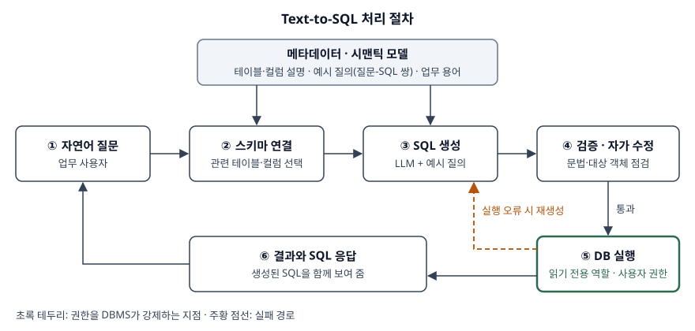

> 실행 검증 없음. Text-to-SQL 서베이 논문·벤치마크 원 논문과 각 제품의 공식 문서를 근거로 정리했다.
> 활용 사례는 공개된 제품 문서에 적힌 기능만 썼다. 벤치마크 수치는 원 논문 초록의 값이며
> 발표 시점(2018년, 2023년)의 결과다.

TEXT2SQL이 무엇인지와, 실제로 어디에 쓰이는지 두 가지 사례를 들라는 문제다. 문항이 두 가지를
물었으므로 Ⅱ에서 개념을, Ⅲ에서 활용 사례를 쓰고, 사례마다 **어떤 정보시스템 구성이 필요한지**를
붙인다. 도입 시 통제는 Ⅳ로 따로 뗀다.

---

## Ⅰ. 개요

### 가. 정의

TEXT2SQL(Text-to-SQL)은 **자연어 질문과 데이터베이스 스키마를 입력받아, 관계형 데이터베이스에서
실행할 수 있는 SQL 질의를 생성하는 기술**이다. Hong 등의 서베이는 이 과제를 자연어 질문을
"관계형 데이터베이스에서 실행할 수 있는 SQL 질의로 바꾸는 것"으로 정의한다.

### 나. 등장 배경

데이터는 데이터베이스에 쌓이지만 그것을 꺼내는 언어인 SQL은 업무 사용자가 직접 쓰기 어렵다.
그래서 질문 하나가 생길 때마다 **현업이 요청하고 → 분석가가 SQL을 짜고 → 결과를 돌려주는** 왕복이
생기고, 분석가가 병목이 된다. TEXT2SQL은 이 번역 단계를 시스템이 대신하게 하려는 시도이며,
대규모 언어 모델(LLM)이 등장하면서 처음 보는 스키마에도 적용할 수 있는 수준으로 실용화가 빨라졌다.

---

## Ⅱ. TEXT2SQL의 개념

### 가. 입력과 출력

| 구분 | 내용 |
|---|---|
| 입력 ① | 사용자의 자연어 질문 — "지난달 지역별 매출 상위 3개는?" |
| 입력 ② | 데이터베이스 스키마 — 테이블·컬럼·키 관계, 필요하면 컬럼 값 일부 |
| 입력 ③ | (선택) 업무 지식 — 용어 정의, 계산식, 질문-SQL 예시 |
| 출력 | 그 DB에서 실행되는 SQL과, 실행해 얻은 결과 |

입력 ②가 핵심이다. 같은 질문이라도 **스키마가 다르면 정답 SQL이 다르다.** 그래서 TEXT2SQL은
번역 문제이면서 동시에 "이 질문이 어느 테이블·컬럼을 가리키는가"를 찾는 문제다.

### 나. 처리 절차 — 6단계

> **출처**: [Hong et al., arXiv:2406.08426v8 §IV-A Decomposition](https://arxiv.org/abs/2406.08426), [Pourreza & Rafiei, DIN-SQL §4](https://arxiv.org/abs/2304.11015), [Amazon Bedrock 사용자 안내서 — 정형 데이터 저장소 연결](https://docs.aws.amazon.com/bedrock/latest/userguide/knowledge-base-build-structured.html), [Pedro et al., arXiv:2308.01990v4 §5.1](https://arxiv.org/abs/2308.01990)

| 단계 | 하는 일 | 근거 |
|---|---|---|
| ① 질문 입력 | 업무 사용자가 자연어로 묻는다 | — |
| ② 스키마 연결(schema linking) | 질문의 단어를 실제 테이블·컬럼에 대응시키고 쓸 객체만 고른다 | DIN-SQL 1단계 |
| ③ SQL 생성 | LLM이 고른 스키마와 예시 질의를 보고 SQL을 만든다. 복잡한 질의는 하위 질의로 나눠 만든다 | DIN-SQL 2·3단계 |
| ④ 검증·자가 수정(self-correction) | 문법 오류·잘못된 객체 참조를 점검하고 고친다 | DIN-SQL 4단계 |
| ⑤ 실행 | 읽기 전용 권한으로 DB에서 실행한다. 오류가 나면 ③으로 되돌린다 | 서베이 실행 기반 보정(C4) |
| ⑥ 응답 | 결과와 함께 생성된 SQL을 보여 주어 사용자가 확인하게 한다 | Snowflake 응답 형식 |

DIN-SQL은 ②~④를 **스키마 연결, 분류·분해, SQL 생성, 자가 수정의 4개 모듈**로 나누고, 분류 단계에서
질의를 **단순(조인·중첩 없음)·비중첩 복합(조인 있음)·중첩 복합(하위 질의·집합 연산)의 3종**으로
가른 뒤 종류마다 다른 방식으로 생성한다. 한 번에 SQL 전체를 만들게 하는 것보다 오류가 줄어드는
이유는, 어려운 부분(조인 경로, 하위 질의)을 따로 떼어 풀게 하기 때문이다.

### 다. 발전 단계 비교

| 구분 | 규칙·템플릿 기반 | 신경망 기반 | LLM 기반 |
|---|---|---|---|
| 방식 | 사람이 만든 문법 규칙으로 질문을 SQL 틀에 끼움 | 질문-SQL 쌍으로 학습한 인코더-디코더 | 프롬프트(문맥 내 학습) 또는 미세조정 |
| 대표 | 도메인 전용 자연어 인터페이스 | Seq2SQL(2017) | DIN-SQL(2023) |
| 새 스키마 적용 | 규칙을 다시 작성 | 재학습이 필요 | 스키마 설명만 넣으면 시도 가능 |
| 약점 | 표현이 조금만 달라도 실패 | 복잡한 조인·중첩에 약함 | 결과가 비결정적, 그럴듯한 오답 |

서베이는 LLM 기반 방법을 **문맥 내 학습 5범주**(기본 프롬프트, 분해, 프롬프트 최적화, 추론 강화,
실행 기반 보정)와 **미세조정 4범주**(구조 강화, 사전학습, 데이터 증강, 다중 과제 학습)로 나눈다.

### 라. 해결 과제 4가지와 평가 지표 4가지

서베이가 드는 과제는 넷이다. ① **언어의 복잡성·중의성**(같은 뜻의 다른 표현, 생략), ② **스키마
이해와 표현**(수백 개 테이블, 약어 컬럼명), ③ **드물고 복잡한 SQL 연산**(중첩, 윈도 함수),
④ **도메인 간 일반화**(학습에 없던 DB)다.

| 지표 | 무엇을 보는가 | 한계 |
|---|---|---|
| 구성요소 일치(CM) | SELECT·WHERE 등 절 단위로 정답과 같은가 | 절 순서·표현이 달라도 같은 질의를 놓친다 |
| 완전 일치(EM) | SQL 전체가 정답과 같은가 | 결과가 같아도 문장이 다르면 오답 처리 |
| 실행 정확도(EX) | 실행 결과가 정답 결과와 같은가 | 우연히 결과가 같은 오답을 통과시킨다 |
| 유효 효율 점수(VES) | 결과가 맞은 질의에 대해 실행 효율까지 반영 | 측정 환경에 따라 값이 흔들린다 |

벤치마크도 이 흐름을 따라 바뀌었다. **Spider**(2018)는 138개 도메인의 DB 200개에 질문 10,181개를
두고 **학습과 시험에 서로 다른 DB를 배치**해 도메인 간 일반화를 처음 정면으로 쟀으며, 발표 당시 최고
모델의 완전 일치 정확도는 12.4%였다. **BIRD**(2023)는 37개 전문 분야, 총 33.4GB의 DB 95개에
질문-SQL 쌍 12,751개를 두고 **더러운 실제 값과 외부 업무 지식**을 요구했는데, 발표 당시 ChatGPT의
실행 정확도는 40.08%로 사람의 92.96%와 차이가 컸다. 공개 벤치마크에서도 이만한 차이가 났다는 것이
Ⅳ의 고려사항이 필요한 이유다.

---

## Ⅲ. TEXT2SQL 활용 사례 2가지

### 가. 사례 1 — 셀프서비스 BI의 대화형 데이터 분석

**① 개요**: 현업 사용자가 대시보드에 없는 질문을 자연어로 묻고, 시스템이 데이터 웨어하우스에 SQL을
실행해 답한다. Snowflake Cortex Analyst는 업무 사용자가 "SQL을 쓰지 않고 자연어로 묻고 답을 받는"
기능으로 소개되며, Databricks Genie는 분석가가 구성한 대화 공간에서 사용자가 데이터에 질문한다.

**② 정보시스템 구성**

| 구성요소 | 역할 | 제품 문서의 예 |
|---|---|---|
| 시맨틱 계층 | 업무 용어를 테이블·컬럼·계산식에 미리 대응시킨다 | Snowflake 시맨틱 뷰(논리 테이블·차원·지표·관계) |
| 검증된 질의 | 자주 묻는 질문과 정답 SQL 쌍을 등록한다 | Snowflake verified queries, Genie 예시 SQL 질의 |
| 권한 체계 | 사용자 본인의 권한으로 실행한다 | Snowflake RBAC 통합, Genie는 사용자별 Unity Catalog 권한·행 필터·컬럼 마스크 적용 |
| 실행 이력 | 질의를 요청한 사용자 이름으로 남긴다 | Genie 질의 이력에 최종 사용자로 기록 |

**③ 효과와 핵심**: 분석가는 질문마다 SQL을 짜는 대신 **시맨틱 계층과 예시 질의를 관리하는 역할**로
옮겨 간다. 정확도를 올리는 수단이 모델 교체가 아니라 **메타데이터 정비**라는 점이 이 사례의 요점이다.
"매출"이 총매출인지 순매출인지를 모델이 추측하게 두지 않고 시맨틱 계층에 정의해 둔다.

### 나. 사례 2 — 생성형 AI 서비스의 정형 데이터 질의(RAG 확장)

**① 개요**: 문서 검색 기반 생성(RAG) 챗봇은 비정형 문서를 찾아 답하지만, "내 주문 중 미배송 건수"
같은 질문은 문서가 아니라 업무 DB에 답이 있다. 이때 챗봇이 TEXT2SQL로 정형 데이터를 조회해 답변
근거로 쓴다. Amazon Bedrock Knowledge Bases는 정형 데이터 저장소를 연결하면 사용자 질문을 SQL로
바꿔 조회하며, Amazon Redshift를 질의 엔진으로 쓴다.

**② 정보시스템 구성**

| 구성요소 | 역할 | 제품 문서의 예 |
|---|---|---|
| 질의 생성 API | 자연어를 SQL로만 바꿔 돌려준다(실행 전 검토 가능) | `GenerateQuery` |
| 검색·생성 API | SQL 실행 결과를 근거로 답변까지 만든다 | `RetrieveAndGenerate` |
| 질의 구성 | 테이블·컬럼 설명, 포함·제외 목록, 큐레이션 질의(질문-SQL 쌍), 최대 실행 시간 | 지식 기반 생성 시 선택 설정 |
| 접속 계정 | IAM 또는 Secrets Manager로 인증, SELECT 권한만 부여 | 사전 준비 안내 |

**③ 효과와 핵심**: 문서 RAG가 답하지 못하던 **집계·필터 질문**을 같은 대화 창구에서 처리한다.
반면 사용자가 입력한 문장이 곧 SQL이 되므로 **공격 입력이 DB까지 닿는 경로**가 새로 생긴다.
AWS 문서도 임의 SQL 실행이 모든 Text-to-SQL 응용의 보안 위험이라고 적고, 제한된 역할·읽기 전용
DB·샌드박스를 권고하며, 포함·제외 목록은 가드레일을 대신하지 못한다고 밝힌다.

### 다. 두 사례 비교

| 구분 | 사례 1 셀프서비스 BI | 사례 2 생성형 AI 서비스 |
|---|---|---|
| 사용자 | 사내 현업·경영진 | 고객 또는 일반 직원 |
| 대상 데이터 | 분석용 데이터 웨어하우스 | 업무 DB·데이터 레이크 |
| 정확도 확보 수단 | 시맨틱 계층·검증된 질의 | 테이블 설명·큐레이션 질의 |
| SQL 노출 | 생성된 SQL을 응답에 함께 반환 | API로 SQL만 따로 받아 검토 가능 |
| 주된 위험 | 지표 정의 오해로 인한 잘못된 의사결정 | 프롬프트를 통한 SQL 인젝션, 타인 데이터 노출 |

---

## Ⅳ. 도입 시 고려사항

### 가. 보안 — 프롬프트를 통한 SQL 인젝션 방어 4가지

Pedro 등은 LLM이 만든 SQL을 그대로 실행하는 웹 응용에서, 사용자 프롬프트나 **DB에 미리 심어 둔
레코드**를 통해 SQL 인젝션이 일어나는 것을 **P2SQL 인젝션**으로 정리하고 방어 4가지를 제시했다.

| 방어 | 내용 | 강제하는 곳 |
|---|---|---|
| ① DB 권한 강화 | 챗봇 계정을 읽기 전용 역할로 제한 | DBMS |
| ② SQL 질의 재작성 | 생성된 질의를 현재 사용자의 행만 보도록 고쳐 씀 | 응용 계층 |
| ③ 보조 LLM 검사 | DB 권한 없는 별도 LLM이 결과 속 주입 지시문을 검사 | 응용 계층 |
| ④ 프롬프트 내 데이터 선적재 | 사용자 본인 데이터를 미리 넣어 타인 레코드 조회 자체를 없앰 | 응용 계층 |

①은 LLM의 판단과 무관하게 DBMS가 막으므로 **가장 먼저 적용**한다. 권한 판정을 LLM에 맡기지 않는다는
원칙이 사례 1의 사용자별 권한 실행과 같은 축이다.

### 나. 정확도 — 메타데이터를 데이터 자산으로 관리

- **시맨틱 계층·데이터 사전 정비**: 컬럼 설명과 지표 정의가 없으면 모델은 이름만 보고 추측한다
- **검증된 질의 축적**: 자주 묻는 질문의 정답 SQL을 등록해 생성 시 예시로 쓴다
- **SQL 공개와 사람 확인**: 결과만 보여 주지 않고 SQL을 함께 보여 준다. AWS 문서도 생성 문맥이
  비결정적이므로 생성된 SQL을 확인하라고 적는다

### 다. 운영 — 비용과 감사

- **실행 시간·자원 제한**: 최대 실행 시간을 걸어 잘못 생성된 대형 조인이 웨어하우스를 점유하지 않게 한다
- **감사 이력**: 누가 어떤 질문으로 어떤 SQL을 실행했는지 남긴다
- **정확도 회귀 시험**: 검증된 질의 집합을 시험 세트로 삼아 모델·스키마가 바뀔 때마다 실행 정확도를 다시 잰다

---

## Ⅴ. 결론

TEXT2SQL은 자연어와 스키마를 받아 실행 가능한 SQL을 만드는 기술이며, LLM 이후 스키마 연결·분해·
자가 수정을 거치는 다단계 절차로 정확도를 끌어올리고 있다. 그러나 공개 벤치마크에서도 사람과의
차이가 남아 있어, 실무 도입의 성패는 모델보다 **시맨틱 계층과 검증된 질의라는 메타데이터 관리**,
그리고 **권한을 DBMS에서 강제하는 설계**에 달려 있다. 셀프서비스 BI에서는 지표 정의의 일관성이,
생성형 AI 서비스에서는 인젝션과 데이터 노출 통제가 도입 검토의 첫 항목이 된다.

> 개념 정리: [Text-to-SQL — 스키마 연결·분해·자가 수정과 실행 정확도](../../emerging-tech/2026-11-13-text-to-sql-pipeline-and-evaluation-metrics/index.md)
>
> 관련 개념: [RAG 구성요소와 검색 품질 지표](../../emerging-tech/2026-10-14-rag-components-retrieval-metrics/index.md)
>
> 관련 개념: [프롬프트 인젝션 방어 설계 — 신뢰 경계와 최소권한](../../security/2026-11-02-prompt-injection-defense-design/index.md)
>
> 관련 개념: [과도한 에이전시(Excessive Agency) — 기능·권한·자율의 최소화](../../security/2026-11-12-excessive-agency-least-functionality-permission-autonomy/index.md)

끝

---

## 답안 작성 메모

- **정의에 "스키마"를 반드시 넣는다.** "자연어를 SQL로 바꾸는 기술"에서 멈추면 개념 점수가 반만 나온다.
  입력이 질문과 스키마 두 가지라는 점이 스키마 연결 단계와 시맨틱 계층 이야기를 끌어내는 출발점이다.
- **처리 절차 모식도가 Ⅱ의 뼈대다.** 상자 7개에 실패 경로 점선 하나다. ⑤ DB 실행 상자에 "읽기 전용"을
  적어 두면 Ⅳ의 보안 이야기가 그림에서 이미 예고된다.
- **사례는 제품 이름보다 구성요소로 쓴다.** "Snowflake를 쓴다"가 아니라 "시맨틱 계층·검증된 질의·
  사용자 권한 실행"을 쓰는 것이 정보관리기술사 답안이다. 제품 이름은 예로 하나씩만 붙인다.
- **점수가 갈리는 곳은 두 사례의 위험이 다르다는 대비다.** Ⅲ-다 비교표에서 BI는 지표 정의 오해,
  생성형 AI 서비스는 P2SQL 인젝션으로 갈라 두면 Ⅳ가 자연스럽게 이어진다.
- 시간이 모자라면 Ⅱ-다 발전 단계 표와 Ⅳ-다 운영 항목을 버린다. 정의·절차 모식도·사례 2개·
  P2SQL 방어 표는 지킨다.
- 벤치마크 수치는 외웠을 때만 쓴다. 못 외웠으면 "공개 벤치마크에서도 사람과 정확도 차이가 크다"까지만
  쓰고, 숫자를 지어 쓰지 않는다.

---

## 참고 자료

- [Hong et al., Next-Generation Database Interfaces: A Survey of LLM-based Text-to-SQL, arXiv:2406.08426v8 (2025-11-24)](https://arxiv.org/abs/2406.08426) — 정의, 과제 4가지, 평가 지표(CM·EM·EX·VES), 방법 분류(문맥 내 학습 5범주·미세조정 4범주)
- [Yu et al., Spider, EMNLP 2018, arXiv:1809.08887v5](https://arxiv.org/abs/1809.08887) — 도메인 간 Text-to-SQL 과제와 데이터셋 규모
- [Li et al., Can LLM Already Serve as A Database Interface? (BIRD), NeurIPS 2023, arXiv:2305.03111v3](https://arxiv.org/abs/2305.03111) — 대규모 실데이터 벤치마크, 실행 정확도
- [Zhong et al., Seq2SQL, arXiv:1709.00103v7 (2017-11)](https://arxiv.org/abs/1709.00103) — 신경망 기반 생성과 WikiSQL
- [Pourreza & Rafiei, DIN-SQL, NeurIPS 2023, arXiv:2304.11015v3](https://arxiv.org/abs/2304.11015) — 4개 모듈, 질의 3분류
- [Pedro et al., From Prompt Injections to SQL Injection Attacks, ICSE 2025, arXiv:2308.01990v4](https://arxiv.org/abs/2308.01990) — P2SQL 인젝션과 방어 4가지
- [Snowflake 문서 — Cortex Analyst](https://docs.snowflake.com/en/user-guide/snowflake-cortex/cortex-analyst) — 시맨틱 뷰, 검증된 질의, RBAC 통합, REST API (2026-11-12 확인)
- [Amazon Bedrock 사용자 안내서 — 정형 데이터 저장소로 지식 기반 만들기](https://docs.aws.amazon.com/bedrock/latest/userguide/knowledge-base-build-structured.html) — GenerateQuery·RetrieveAndGenerate, 질의 구성, 보안 권고 (2026-11-12 확인)
- [Databricks 문서 — Genie](https://docs.databricks.com/aws/en/genie/) — 사용자별 Unity Catalog 권한 적용, 예시 SQL 질의와 지시문 (2026-11-11 갱신)
