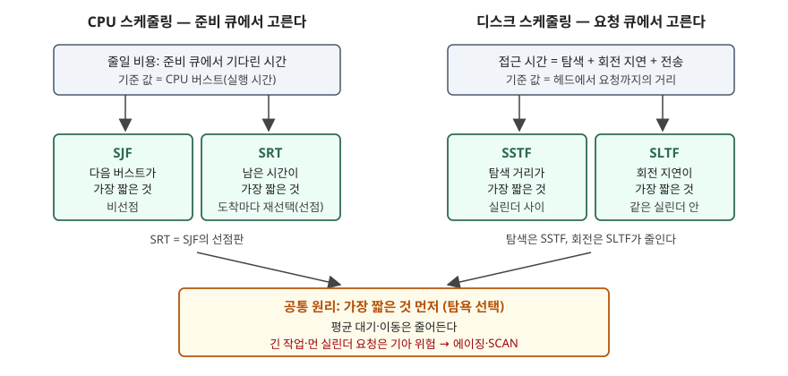

기출문제에서 운영체제 스케줄링을 세 갈래로 나눠 묻는다. 먼저 CPU 스케줄링과 디스크
스케줄링이 각각 무엇인지, 다음으로 CPU 쪽의 SJF와 SRT를, 마지막으로 디스크 쪽의
SSTF와 SLTF를 설명하게 한다. 네 기법은 이름이 모두 **Shortest**로 시작한다. 답안의
뼈대는 이 공통점에서 나온다 — **무엇을 '짧다'고 재는가**와 **언제 다시 고르는가**만
다르고, 그 대가로 치르는 기아 위험까지 같은 계보를 탄다.

> 계산 예제는 `code/scheduling_compare.py`로 직접 돌려 검산했다. 실행 기록: [`code/output.txt`](code/output.txt)

---

## Ⅰ. 개요

**스케줄링**은 하나의 자원을 여러 요청이 기다릴 때 **다음에 누구에게 줄지 고르는 결정**이다.
자원이 CPU면 준비 큐의 프로세스를, 자원이 디스크면 요청 큐의 I/O 요청을 고른다.
두 결정 모두 **평균 대기를 줄이는 효율**과 **아무도 무한정 밀리지 않는 공정성**을 맞바꾼다.



> **출처**: SJF·SRTF 정의는 [Silberschatz OSC 10th ed. Ch.5 슬라이드 5.22·5.27](https://www.cs.hunter.cuny.edu/~sweiss/course_materials/csci340/slides/chapter05.pdf), SSTF는 [같은 교재 Ch.11 슬라이드 11.19~11.20](https://www.cs.hunter.cuny.edu/~sweiss/course_materials/csci340/slides/chapter11.pdf), 접근 시간 분해와 회전 지연을 고려한 선택은 [Seltzer·Chen·Ousterhout, Disk Scheduling Revisited §4.1·§5.1](https://web.eecs.umich.edu/~pmchen/papers/seltzer90.pdf), SLTF의 적용 범위(고정 헤드 드럼·실린더 안)는 [Fuller, MTPT Drum and Disk Scheduling Disciplines 요약본 §1·§4](https://static.aminer.org/pdf/20170130/pdfs/sosp/h4lthzfrdb0eavkyqmjobmrnuqc7gcj2.pdf)

## Ⅱ. CPU 스케줄링과 디스크 스케줄링의 개념

### 가. CPU 스케줄링

준비 큐(ready queue, 실행을 기다리는 프로세스의 줄)에서 프로세스 하나를 골라 CPU 코어를
배정하는 단기 스케줄러의 결정이다. 결정 시점은 **4가지**다 — ① 실행→대기(I/O 요청),
② 실행→준비(인터럽트), ③ 대기→준비(I/O 완료), ④ 종료. ①·④에서만 고르면 **비선점**,
네 시점 모두에서 고르면 **선점**이다. 평가 기준은 **5가지**로, CPU 이용률·처리량은 키우고
반환 시간·대기 시간·응답 시간은 줄인다.

### 나. 디스크 스케줄링

디스크 요청 큐에 쌓인 I/O 요청 가운데 **다음에 처리할 요청을 고르는 결정**이다.
하드디스크 한 번의 접근 시간은 **3요소**로 나뉜다 — **탐색 시간**(헤드가 목표 실린더로
움직이는 시간), **회전 지연**(목표 섹터가 헤드 아래로 돌아오기까지의 시간),
**전송 시간**. 스케줄링이 줄일 수 있는 것은 앞의 둘이다. Seltzer 등은 1990년 Fujitsu
Eagle 드라이브에서 평균 탐색 18ms·평균 회전 지연 8.3ms·4KB 전송 2ms를 놓고,
FCFS(도착 순)면 데이터를 실제로 옮기는 시간이 전체의 약 7%에 그친다고 계산했다.

### 다. 두 스케줄링의 비교

| 구분 | CPU 스케줄링 | 디스크 스케줄링 |
|---|---|---|
| 자원 | CPU 코어 | 디스크 헤드(암)·회전 매체 |
| 대기열 | 준비 큐(프로세스) | 디스크 요청 큐(I/O 요청) |
| '짧다'의 기준 | 다음 CPU 버스트 길이 | 헤드에서 요청까지의 탐색 거리·회전 거리 |
| 기준 값을 아는가 | **모른다** — 과거 버스트로 예측 | **계산된다** — 위치에서 거리가 나온다 |
| 선점 | 가능 (실행 중 회수) | 시작한 I/O는 끝까지 간다. 매 요청 완료마다 다시 고른다 |
| 주요 지표 | 대기·반환·응답 시간 | 헤드 이동 거리, 처리량, 응답 시간 편차 |
| 결정 주체 | 운영체제 커널 | 과거에는 운영체제, 지금은 주로 **장치 컨트롤러 내부** |

**'기준 값을 아는가'가 두 영역을 가르는 핵심이다.** OSTEP은 디스크는 탐색·회전 시간을
추정할 수 있어 SJF에 가깝게 고를 수 있다고 설명한다. CPU의 SJF는 다음 버스트를 지수 평균
τ(n+1) = α·t(n) + (1−α)·τ(n) 으로 **예측**해야 하므로, 예측이 빗나가면 최적성이 무너진다.

## Ⅲ. SJF와 SRT

### 가. 정의

- **SJF(Shortest Job First)**: 준비 큐에서 **다음 CPU 버스트가 가장 짧은** 프로세스에
  CPU를 주는 **비선점** 기법. 한 번 받은 CPU는 버스트가 끝날 때까지 쓴다
- **SRT(Shortest Remaining Time)**: SJF의 **선점판**. 새 프로세스가 도착할 때마다
  **남은 실행 시간**을 비교해, 새 프로세스가 더 짧으면 실행 중인 프로세스를 내린다.
  Silberschatz는 SRTF(shortest-remaining-time-first), OSTEP은 STCF라 부른다

Silberschatz는 SJF가 **주어진 프로세스 집합에서 평균 대기 시간을 최소로 하는 최적 기법**이라고
적는다. 짧은 작업을 앞에 두면 그 작업이 줄이는 대기가 뒤의 긴 작업이 늘리는 대기보다 크기 때문이다.

### 나. 같은 4개 프로세스로 비교

도착 0·1·2·3, 실행 8·4·9·5인 P1~P4(교재 SRTF 예제). 동률이면 먼저 도착한 쪽을 고른다.

```text
[SJF]
  간트 : P1 0-8  P2 8-12  P4 12-17  P3 17-26
  평균 대기 31/4 = 7.75  평균 반환 14.25  평균 응답 7.75  CPU 넘김 3회
[SRT]
  간트 : P1 0-1  P2 1-5  P4 5-10  P1 10-17  P3 17-26
  평균 대기 13/2 = 6.50  평균 반환 13.00  평균 응답 4.25  CPU 넘김 4회
```

SJF에서는 시각 0에 P1만 와 있으므로 P1이 8까지 돈다. **뒤에 더 짧은 P2(4)가 도착해도
끼어들지 못한다.** SRT는 시각 1에 P2가 도착하는 순간 P1의 남은 7과 P2의 4를 비교해 P1을
내린다. 평균 대기는 7.75 → 6.5로 줄고, 대가로 CPU를 넘기는 횟수가 3 → 4회로 늘었다.
P3(실행 9)의 대기는 두 기법 모두 **15**로 가장 길다 — 짧은 작업을 앞세운 몫을 긴 작업이 진다.

### 다. SJF와 SRT 비교

| 구분 | SJF | SRT |
|---|---|---|
| 선점 | 비선점 | 선점 |
| 다시 고르는 시점 | 실행 중인 버스트가 끝날 때 | **새 프로세스가 도착할 때마다** |
| 비교 값 | 다음 버스트 전체 길이 | 남은 실행 시간 |
| 평균 대기 (위 예제) | 7.75 | **6.50** |
| 평균 응답 (위 예제) | 7.75 | **4.25** |
| 문맥 교환 | 적다 (3회) | 많다 (4회) |
| 기아 | 긴 작업이 밀릴 수 있다 | 더 심하다 — 실행 중에도 밀린다 |
| 공통 약점 | 버스트 길이를 미리 알 수 없어 **예측**에 기댄다 | 같음 |

## Ⅳ. SSTF와 SLTF

### 가. 정의

- **SSTF(Shortest Seek Time First)**: 현재 헤드 위치에서 **탐색 거리가 가장 짧은**
  요청을 먼저 처리하는 기법. Silberschatz와 OSTEP 모두 **SJF의 한 형태**로 설명하고,
  같은 이유로 **기아**가 생길 수 있다고 짚는다
- **SLTF(Shortest Latency Time First)**: **회전 지연이 가장 짧은**, 즉 헤드 아래에 가장
  먼저 돌아오는 섹터의 요청을 먼저 처리하는 기법. 트랙마다 헤드가 붙어 탐색이 없는
  **고정 헤드 드럼**에서 나왔고, 이동 헤드 디스크에서는 **헤드가 한 실린더에 자리 잡은 뒤
  그 실린더 안의 요청 순서**를 정하는 데 쓴다(Fuller 1973 요약본이 이 둘을 나눠 다룬다)

SSTF는 **실린더 사이**의 순서를, SLTF는 **실린더 안**의 순서를 정한다. 그래서 둘은
경쟁 관계가 아니라 **층이 다른 기법**이고, 한 디스크에서 함께 쓸 수 있다.

### 나. SSTF — 탐색 거리 최소

교재 큐(98, 183, 37, 122, 14, 124, 65, 67), 헤드 53, 실린더 0~199.

```text
  FCFS 이동 640
  SSTF 이동 236  순서 [65, 67, 37, 14, 98, 122, 124, 183]
```

교재 값 640·236과 같다. 헤드 이동이 약 37%로 줄었다.

### 다. SLTF — 회전 지연 최소

한 실린더 안, 트랙당 8섹터(섹터 하나가 지나가는 시간 = 1), 지금 섹터 0의 시작이 헤드 아래에
있다. 도착 순서로 섹터 6, 1, 4, 7, 2 요청이 와 있고 각각 1섹터를 읽는다.

```text
  FCFS: 6(대기 6) → 1(대기 2) → 4(대기 2) → 7(대기 2) → 2(대기 2)
        회전 지연 합 14  걸린 시간 19 (= 19/8 바퀴)
  SLTF: 1(대기 1) → 2(대기 0) → 4(대기 1) → 6(대기 1) → 7(대기 0)
        회전 지연 합 3  걸린 시간 8 (= 1 바퀴)
```

도착 순서대로면 디스크가 2.4바퀴를 돌아야 하지만 SLTF는 **회전 방향으로 만나는 순서**대로
집어 한 바퀴 안에 끝낸다. Stone·Fuller(1973)는 SLTF 순서의 총 접근 시간이 회전 지연을 최소로
하는 순서보다 **한 바퀴 넘게 길어지지 않는다**는 근사 최적성을 보였다(초록으로 확인).

### 라. 탐색만 보면 생기는 일

헤드가 실린더 10, 각도 0에 있고, 탐색 1칸 = 0.5(한 바퀴 = 8)라고 두었다.

```text
  A: 실린더 12 섹터 0  탐색 1.0 + 회전 7.0 = 위치 결정 8.0
  B: 실린더 16 섹터 4  탐색 3.0 + 회전 1.0 = 위치 결정 4.0
  SSTF 선택(탐색 최소): A   탐색+회전 최소 선택: B
```

SSTF는 가까운 A를 고르지만, 도착했을 때 섹터 0이 막 지나가 거의 한 바퀴를 기다린다.
OSTEP은 이 상황을 들어 **탐색이 회전보다 충분히 빠르면 SSTF가 나쁜 선택**이 된다고 설명하고,
요즘 드라이브는 탐색과 회전이 비슷한 크기라서 둘을 합쳐 보는 **SPTF**(shortest positioning
time first, SATF라고도 한다)가 쓸모 있다고 적는다. Seltzer 등도 탐색 시간이 회전 지연보다 더
빨리 줄어 왔으므로 **회전 지연의 비중이 커진다**고 보았다. SSTF와 SLTF를 합친 것이 SPTF다.

### 마. 기아 시험

요청 하나를 처리할 때마다 헤드 바로 옆에 새 요청이 들어오게 했다.

```text
  SSTF: 190번 요청이 처리된 순번 = None
  SLTF: 섹터 7 요청이 처리된 순번 = 8  (한 바퀴 8섹터)
```

SSTF는 헤드 옆(±3)에 요청이 계속 생기자 200번 처리하는 동안 190번에 한 번도 가지 않았다.
SLTF는 매번 헤드 바로 아래에 새 요청을 넣어도 8번째에 가장 먼 섹터 7을 처리했다.
**디스크는 한 방향으로만 돌기 때문에** 헤드 각도가 결국 그 섹터에 닿고, 그때 회전 지연이 0인
요청끼리는 먼저 온 쪽이 이긴다. 이 시험은 **한 실린더 안**의 결과다. 탐색과 회전을 함께
보는 SPTF는 Seltzer 등이 기아 가능성을 지적하고 가중치를 둔 변형을 제안했다.

### 바. SSTF와 SLTF 비교

| 구분 | SSTF | SLTF |
|---|---|---|
| 줄이는 비용 | 탐색 시간 | 회전 지연 |
| 적용 층 | 실린더 **사이** | 실린더 **안** (고정 헤드 드럼은 전체) |
| 필요한 정보 | 헤드 실린더 번호 | 헤드의 **회전 각도** |
| 위 예제 | 이동 640 → 236 | 회전 지연 14 → 3 |
| 기아 | 있다 — 먼 실린더 요청 | 한 실린더 안에서는 한 바퀴 안에 처리된다(위 시험) |
| 구현 위치 | 운영체제도 가능 | 회전 각도를 아는 **장치 컨트롤러** |
| 대응 CPU 기법 | SJF | SJF (기준만 회전 거리) |

## Ⅴ. 결론

네 기법은 **'가장 짧은 것 먼저'라는 탐욕 선택**을 서로 다른 자원과 비용에 적용한 것이다.
SJF·SRT는 CPU 버스트를, SSTF는 탐색 거리를, SLTF는 회전 거리를 잰다. 평균을 줄이는
대신 긴 작업·먼 요청이 밀리는 위험을 함께 지며, CPU는 **에이징**으로, 디스크는
**SCAN 계열**로 이 위험을 다룬다. 현대 시스템에서 디스크 스케줄링은 OSTEP의 설명대로
장치 안으로 들어가 탐색과 회전을 함께 보는 SPTF로 수행되고, 운영체제는 요청 몇 개를
골라 넘기고 병합하는 역할을 맡는다. 헤드가 없는 SSD에서는 탐색·회전 비용이 없으므로
이 계열의 순서 최적화가 의미를 잃는다.

> 개념 정리: [프로세스 스케줄링 알고리즘과 평균 대기시간 계산](../../system/2026-10-12-cpu-scheduling-waiting-time/index.md) · [디스크 스케줄링 — FCFS·SSTF·SCAN·C-SCAN·LOOK·C-LOOK](../../system/2026-11-06-disk-scheduling-six-algorithms/index.md) · [회전 위치 최적화 — SLTF·SPTF·MTPT](../../system/2026-11-13-rotational-position-scheduling-sltf-sptf-mtpt/index.md)

끝

## 답안 작성 메모

- **먼저 쓸 것**: 모식도. 네 기법을 2×2로 놓고 아래에 공통 원리 한 칸을 그리면 문항 세
  갈래가 한 그림에 들어간다. 박스 일곱 개라 2분이면 옮긴다.
- **순서를 바꾸지 않는다**: 문항이 (가) 개념 → (나) SJF·SRT → (다) SSTF·SLTF 순으로 물었으므로
  Ⅱ·Ⅲ·Ⅳ를 그 순서로 쓴다.
- **점수가 갈리는 지점**: ① (가)를 정의만 쓰지 않고 **'기준 값을 예측해야 하는가'**로 두 영역을
  대비하는가, ② SRT를 "선점 SJF"로 한 줄 쓰고 끝내지 않고 **도착마다 다시 고른다**는 결정 시점까지
  쓰는가, ③ SLTF를 **실린더 안의 회전 지연**으로 정확히 위치시키는가. SLTF를 SSTF와 같은 층의
  대안처럼 쓰면 틀린다.
- **숫자 예제는 작게**: CPU는 4개 프로세스, 디스크 회전은 8섹터·5요청이면 표 한 줄로 끝난다.
  교재 SSTF 236은 외워 둘 만하다.
- **시간이 모자라면**: Ⅳ-라(탐색만 보는 함정)와 기아 시험을 버린다. 비교표 세 개는 지킨다 —
  문항이 "~와 ~"로 짝을 지어 물었으므로 비교표가 곧 답이다.
- **쓰지 말 것**: "SLTF는 기아가 없다"를 무조건으로 쓰지 않는다. 확인한 것은 **한 실린더 안**에서다.
  그리고 SSD에 SSTF·SLTF를 권하는 문장.
- **용어 표기**: SRT는 교재에 따라 SRTF·STCF·선점 SJF로 불린다. 답안에 한 번 병기해 두면
  채점자가 어느 교재로 공부했든 걸리지 않는다.

## 참고 자료

- [Silberschatz, Galvin, Gagne, *Operating System Concepts* 10th ed. Ch.5 CPU Scheduling 슬라이드 (Hunter College S. Weiss 2020 개정판)](https://www.cs.hunter.cuny.edu/~sweiss/course_materials/csci340/slides/chapter05.pdf) — 5.9 결정 시점, 5.14 평가 기준, 5.22 SJF, 5.27 SRTF 예제
- [같은 교재 Ch.11 Mass-Storage Systems 슬라이드](https://www.cs.hunter.cuny.edu/~sweiss/course_materials/csci340/slides/chapter11.pdf) — 11.19 예제 큐, 11.20 FCFS 640, SSTF, 11.26 NVM Scheduling(탐색·회전 지연 없음)
- [Arpaci-Dusseau, *Operating Systems: Three Easy Pieces* v1.10, Ch.37 Hard Disk Drives](https://pages.cs.wisc.edu/~remzi/OSTEP/file-disks.pdf) — 37.5 Disk Scheduling: SSTF, SPTF(SATF), 탐색과 회전의 상대 크기, 장치 내부 스케줄링과 I/O 병합
- [Margo Seltzer, Peter Chen, John Ousterhout, "Disk Scheduling Revisited", USENIX Winter 1990](https://web.eecs.umich.edu/~pmchen/papers/seltzer90.pdf) — §4.1 FCFS의 접근 시간 구성, §4.2 SSF, §5.1 탐색과 회전을 함께 보는 STF와 기아
- [Samuel H. Fuller, "Minimal-Total-Processing-Time Drum and Disk Scheduling Disciplines" 요약본, ACM SOSP (1973) pp.54–57](https://static.aminer.org/pdf/20170130/pdfs/sosp/h4lthzfrdb0eavkyqmjobmrnuqc7gcj2.pdf) — §1 SLTF와 고정 헤드 드럼·이동 헤드 디스크, §4 실린더 안 스케줄링, §5 결론
- Harold S. Stone, Samuel H. Fuller, "On the Near-Optimality of the Shortest-Latency-Time-First Drum Scheduling Discipline", *Communications of the ACM* 16(6), 1973, pp.352–353 — SLTF가 최소 지연 순서보다 한 바퀴 넘게 길지 않다는 결과. 초록으로 확인, 원문 미열람
- 전체 소스: [`code/scheduling_compare.py`](code/scheduling_compare.py) · 실행 기록: [`code/output.txt`](code/output.txt)
